# Trabajo Práctico 3 - Arquitectura de Computadoras

## Procesador RISC-V (RV32I) segmentado con Debug Unit por UART

## Integrantes

- Krede, Julián
- Piñera, Nicolás

## UNC - Facultad de Ciencias Exactas, Físicas y Naturales

## Cátedra: Arquitectura de Computadoras

---

## Índice

- [Trabajo Práctico 3 - Arquitectura de Computadoras](#trabajo-práctico-3---arquitectura-de-computadoras)
  - [Procesador RISC-V (RV32I) segmentado con Debug Unit por UART](#procesador-risc-v-rv32i-segmentado-con-debug-unit-por-uart)
  - [Integrantes](#integrantes)
  - [UNC - Facultad de Ciencias Exactas, Físicas y Naturales](#unc---facultad-de-ciencias-exactas-físicas-y-naturales)
  - [Cátedra: Arquitectura de Computadoras](#cátedra-arquitectura-de-computadoras)
  - [Índice](#índice)
  - [1. Introducción](#1-introducción)
    - [1.1 Segmentación](#11-segmentación)
    - [1.2 Riesgos](#12-riesgos)
  - [2. Especificación](#2-especificación)
    - [2.1 Juego de instrucciones](#21-juego-de-instrucciones)
    - [2.2 Instrucción de parada (`HALT`)](#22-instrucción-de-parada-halt)
    - [2.3 Memorias](#23-memorias)
    - [2.4 Modos de operación y control del reloj](#24-modos-de-operación-y-control-del-reloj)
    - [2.5 Protocolo de comunicación con la PC](#25-protocolo-de-comunicación-con-la-pc)
    - [2.6 Errores e interpretaciones del enunciado](#26-errores-e-interpretaciones-del-enunciado)
  - [3. Diseño del núcleo](#3-diseño-del-núcleo)
    - [3.1 Arquitectura general](#31-arquitectura-general)
    - [3.2 Etapa IF](#32-etapa-if)
    - [3.3 Etapa ID](#33-etapa-id)
    - [3.4 Etapa EX](#34-etapa-ex)
    - [3.5 Etapa MEM](#35-etapa-mem)
    - [3.6 Etapa WB](#36-etapa-wb)
    - [3.7 Latches](#37-latches)
    - [3.8 Forwarding Unit](#38-forwarding-unit)
    - [3.9 Hazard Unit](#39-hazard-unit)
    - [3.10 Fin de ejecución y vaciado del pipeline](#310-fin-de-ejecución-y-vaciado-del-pipeline)
  - [4. Debug Unit](#4-debug-unit)
    - [4.1 Arquitectura interna](#41-arquitectura-interna)
    - [4.2 Máquina de estados](#42-máquina-de-estados)
    - [4.3 Carga y reprogramación (`du_loader`)](#43-carga-y-reprogramación-du_loader)
    - [4.4 Control de ejecución (`du_exec_ctrl`)](#44-control-de-ejecución-du_exec_ctrl)
    - [4.5 Volcado del estado (`du_dumper`)](#45-volcado-del-estado-du_dumper)
  - [5. Módulo `top` y reloj](#5-módulo-top-y-reloj)
    - [5.1 Integración](#51-integración)
    - [5.2 Asignación de pines](#52-asignación-de-pines)
  - [6. Software de PC](#6-software-de-pc)
  - [7. Verificación](#7-verificación)
  - [8. Síntesis e implementación](#8-síntesis-e-implementación)
    - [8.1 Utilización de recursos](#81-utilización-de-recursos)
    - [8.2 Análisis de tiempos a 100 MHz](#82-análisis-de-tiempos-a-100-mhz)
    - [8.3 Skew](#83-skew)
    - [8.4 Frecuencia óptima y Clock Wizard](#84-frecuencia-óptima-y-clock-wizard)
    - [8.5 Consumo de potencia](#85-consumo-de-potencia)
    - [8.6 Rendimiento (CPI)](#86-rendimiento-cpi)
  - [9. Respuestas a las preguntas del enunciado](#9-respuestas-a-las-preguntas-del-enunciado)
  - [10. Conclusiones](#10-conclusiones)
  - [Anexo A: Decisiones de diseño (ADR)](#anexo-a-decisiones-de-diseño-adr)
  - [Anexo B: Puertos del núcleo hacia la Debug Unit](#anexo-b-puertos-del-núcleo-hacia-la-debug-unit)
  - [Anexo C: Cómo reproducir los resultados](#anexo-c-cómo-reproducir-los-resultados)

---

## 1. Introducción

El presente trabajo práctico, último de la materia, tiene como objetivo implementar en la placa **Basys 3** (Artix-7 XC7A35T) un **procesador RISC-V de 32 bits segmentado en 5 etapas**, junto con una **Debug Unit** que permite programarlo, ejecutarlo y observarlo desde una PC a través de la **UART** desarrollada en el TP2, y un **software de PC** para interactuar con el sistema.

El sistema resultante cumple los requerimientos del enunciado:

- Se programa y reprograma por UART **sin resintetizar**: el programa se escribe en ensamblador, un ensamblador propio lo traduce a lenguaje máquina y la Debug Unit lo carga en la memoria de programa.
- Tiene dos **modos de operación**: continuo (ejecuta hasta el final del programa) y paso a paso (un ciclo de reloj por comando). En ambos el pipeline queda vacío al terminar.
- En cada paso, o al terminar, envía a la PC el contenido de los **32 registros**, de los **4 latches** intermedios y de la **memoria de datos usada**, más las señales de riesgo del ciclo.
- **El reloj no se interviene en ninguna parte**: el avance del procesador se controla con una señal de habilitación (_clock enable_), y la frecuencia final se genera con un Clock Wizard por la red dedicada de reloj.

Además del hardware, se desarrolló en Python un ensamblador, un desensamblador, un simulador de referencia (_golden model_), una CLI y una interfaz gráfica que muestra el pipeline ciclo a ciclo sobre el datapath.

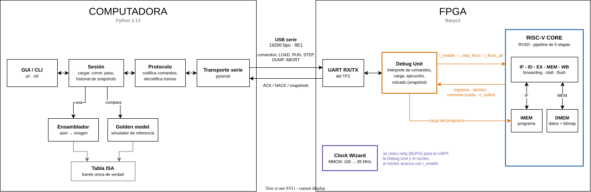

_Vista general del sistema (fuente: [`docs/diagramas/arquitectura_sistema.drawio`](../docs/diagramas/arquitectura_sistema.drawio)). En la PC, la GUI o la CLI usan la sesión, que habla con la placa por el protocolo propio sobre USB serie. En la FPGA, la Debug Unit recibe los comandos por la UART, controla el núcleo con `i_enable` y le devuelve a la PC registros, latches y memoria usada. Un Clock Wizard genera el único reloj del sistema._

Todas las decisiones de diseño que el enunciado deja abiertas quedaron registradas como **ADR** (_Architecture Decision Records_) en [`docs/adr/`](../docs/adr/README.md), con su contexto, las alternativas consideradas y las consecuencias. El Anexo A las resume.

### 1.1 Segmentación

En un procesador monociclo cada instrucción recorre todo el datapath en un único ciclo de reloj, cuyo período queda fijado por la instrucción más lenta. La **segmentación** (_pipelining_) divide ese recorrido en etapas separadas por registros (_latches_), de modo que en cada ciclo haya una instrucción distinta en cada etapa:

| Etapa                       | Qué hace                                                                 |
| --------------------------- | ------------------------------------------------------------------------ |
| **IF** (Instruction Fetch)  | Lee la instrucción de la memoria de programa en la dirección del PC      |
| **ID** (Instruction Decode) | Decodifica la instrucción, genera las señales de control y lee registros |
| **EX** (Execute)            | Opera en la ALU, calcula direcciones y resuelve los saltos condicionales |
| **MEM** (Memory Access)     | Lee o escribe la memoria de datos                                        |
| **WB** (Write Back)         | Escribe el resultado en el banco de registros                            |

| Ciclo →   |  1  |  2  |  3  |  4  |  5  |  6  |  7  |  8  |
| --------- | :-: | :-: | :-: | :-: | :-: | :-: | :-: | :-: |
| instr. 1  | IF  | ID  | EX  | MEM | WB  |     |     |     |
| instr. 2  |     | IF  | ID  | EX  | MEM | WB  |     |     |
| instr. 3  |     |     | IF  | ID  | EX  | MEM | WB  |     |
| instr. 4  |     |     |     | IF  | ID  | EX  | MEM | WB  |

_Carta de pipeline de 4 instrucciones sin riesgos: desde el ciclo 5 termina una instrucción por ciclo._

Cada instrucción sigue tardando 5 ciclos (latencia), pero en régimen termina una por ciclo, de modo que el **CPI ideal es 1**. Un programa de N instrucciones sin riesgos tarda N + 4 ciclos: los 4 extra son el llenado del pipeline.

### 1.2 Riesgos

El costo de la segmentación son los **riesgos** (_hazards_): situaciones en las que la instrucción siguiente no puede avanzar con el dato o con el PC correctos. El enunciado distingue tres tipos:

| Riesgo          | Ejemplo                                                                  | Solución en este diseño                                                                                    |
| --------------- | ------------------------------------------------------------------------ | ---------------------------------------------------------------------------------------------------------- |
| Estructural     | Dos etapas usan el mismo recurso en el mismo ciclo                       | No se producen: memorias de programa y de datos separadas (Harvard) y banco con bypass interno WB → ID      |
| De datos (RAW)  | `add x1, x2, x3` seguido de `sub x4, x1, x5`                             | **Forwarding** desde EX/MEM y MEM/WB hacia EX                                                              |
| De datos (load) | `lw x1, 0(x2)` seguido de una instrucción que lee `x1` (_load-use_)       | **Stall** de 1 ciclo y después forwarding                                                                  |
| De control      | Un `beq` tomado: cuando se sabe que salta, ya se buscaron instrucciones | **Predicción _not-taken_** y descarte (_flush_); `jal` se resuelve en ID y `beq`/`bne`/`jalr` en EX         |

Las secciones 3.8 y 3.9 describen cómo se implementó cada mecanismo.

---

## 2. Especificación

### 2.1 Juego de instrucciones

Se implementaron las 32 instrucciones RV32I que pide el enunciado, más una instrucción de parada propia:

| Formato | Instrucciones                                          | Operación                                               |
| ------- | ------------------------------------------------------ | ------------------------------------------------------- |
| R       | `add sub sll slt sltu xor srl sra or and`              | `rd ← rs1 op rs2`                                       |
| I       | `addi slti sltiu xori ori andi slli srli srai`         | `rd ← rs1 op imm`                                       |
| I       | `lb lh lw lbu lhu`                                     | `rd ← M[rs1 + imm]`, con extensión de signo o de ceros  |
| I       | `jalr`                                                 | `rd ← PC + 4`; `PC ← (rs1 + imm) & ~1`                  |
| S       | `sb sh sw`                                             | `M[rs1 + imm] ← rs2` (1, 2 o 4 bytes)                   |
| B       | `beq bne`                                              | si `rs1 == rs2` (o `!=`): `PC ← PC + imm`               |
| U       | `lui`                                                  | `rd ← imm << 12`                                        |
| J       | `jal`                                                  | `rd ← PC + 4`; `PC ← PC + imm`                          |
| —       | `halt`                                                 | Termina la ejecución (Sección 2.2)                      |

Los formatos de cada tipo y el reordenamiento de bits del inmediato están en [`docs/interfaces/formatos.md`](../docs/interfaces/formatos.md). La decodificación (qué señales de control genera cada instrucción y qué combinaciones de `opcode`/`funct3`/`funct7` son legales) está en [`docs/interfaces/tabla_control.md`](../docs/interfaces/tabla_control.md).

Otras definiciones que el enunciado no fija (ADR-018):

- **Endianness:** _little-endian_, como exige la especificación de RISC-V.
- **Accesos desalineados** (por ejemplo, `lw` en una dirección que no es múltiplo de 4): se ignoran los bits bajos de la dirección.
- **Instrucciones ilegales** (cualquier palabra que no sea una de las 33): se tratan como un `HALT` con motivo `ILLEGAL`. Solo detienen el procesador si llegan a WB; si quedaron en un camino descartado por un salto, no tienen efecto.

### 2.2 Instrucción de parada (`HALT`)

El enunciado exige una instrucción de parada, pero RV32I no tiene una. Se descartó reutilizar una instrucción existente (como `ecall` o `ebreak`) y se eligió el opcode **_custom-0_** (`0001011`), que la especificación de RISC-V reserva para extensiones propias y que, por lo tanto, nunca colisiona con una instrucción estándar (ADR-004). La palabra canónica es `0x0000000B`, y el procesador la detecta solo por el opcode.

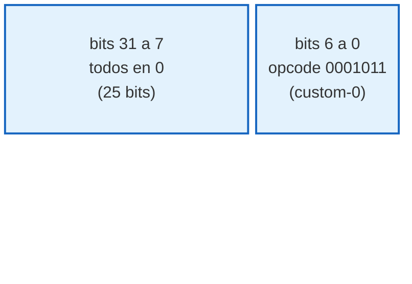

_Codificación de `halt` (`0x0000000B`)._

### 2.3 Memorias

Se usó una arquitectura **Harvard**: la memoria de programa (IMEM) y la de datos (DMEM) están separadas, así IF y MEM pueden acceder en el mismo ciclo sin un riesgo estructural.

| Parámetro             | IMEM                                     | DMEM                                                |
| --------------------- | ---------------------------------------- | --------------------------------------------------- |
| Tamaño                | 256 palabras de 32 bits (1 KiB)          | 256 palabras de 32 bits (1 KiB)                     |
| Implementación        | LUTRAM (memoria distribuida)             | LUTRAM, con escritura por byte                      |
| Lectura               | Combinacional (en el mismo ciclo)        | Combinacional, con un segundo puerto para la DU     |
| Escritura             | Solo la Debug Unit (carga del programa)  | El núcleo (stores) y la Debug Unit (limpieza)       |

Se eligió **memoria distribuida con lectura combinacional** en lugar de BRAM porque la BRAM de la Artix-7 tiene lectura sincrónica: obligaría a reorganizar IF y MEM para absorber un ciclo de latencia en la lectura. A cambio, las memorias ocupan LUTs y quedan en el camino crítico (ADR-005, Sección 8).

Como el enunciado pide enviar "la memoria de datos usada", se definió como **memoria usada** el conjunto de palabras que el programa escribió desde la última carga. La DMEM tiene asociado un **bitmap** de 256 bits (uno por palabra) y un contador de 9 bits, que se actualizan con cada store (ADR-008). El volcado envía solo esas palabras.

### 2.4 Modos de operación y control del reloj

El enunciado pide un modo **paso a paso** en el que cada comando ejecuta un ciclo de reloj, y a la vez prohíbe intervenir el reloj. La solución es que el reloj **corra siempre** y que lo que se habilite sea el avance del procesador: todos los registros del núcleo tienen una entrada de habilitación (_clock enable_) conectada a una única señal `i_enable` (ADR-001).

```verilog
// if_stage.v: sin enable, el PC mantiene su valor
wire w_pc_we = i_enable && !i_stall_f;

always @(posedge clock) begin
    if (i_reset) r_pc <= PC_RESET;
    else if (w_pc_we) r_pc <= r_pc_next;
end
```

- **Modo continuo (`RUN`):** la Debug Unit mantiene `i_enable = 1` hasta que el programa termina.
- **Modo paso a paso (`STEP`):** la Debug Unit pone `i_enable = 1` durante **exactamente un ciclo** y después devuelve el estado.

Como el reloj nunca pasa por una compuerta, todo el sistema (UART, Debug Unit y núcleo) comparte un único dominio de reloj, distribuido por la red global de la FPGA. La Sección 8.3 muestra el efecto que tiene esto sobre el skew.

### 2.5 Protocolo de comunicación con la PC

La UART es la del TP2, con **19200 bps, 8 bits de datos, paridad par y 1 bit de stop (8E1)**. A diferencia del TP2, el receptor ahora sí valida la paridad (ADR-002). Sobre ella se definió un protocolo propio, documentado byte a byte en [`docs/protocolo.md`](../docs/protocolo.md) (ADR-003).

**Comandos (PC → FPGA):** un byte ASCII, seguido de argumentos binarios si los tiene.

| Byte  | Comando    | Argumentos                                         | Respuesta                                  |
| ----- | ---------- | -------------------------------------------------- | ------------------------------------------ |
| `'L'` | `LOAD`     | N (2 B) + N palabras (4 B c/u) + checksum XOR (1 B) | `ACK` / `NACK`                             |
| `'R'` | `RUN`      | —                                                  | `ACK` inmediato y, al terminar, `SNAPSHOT` |
| `'S'` | `STEP`     | —                                                  | `SNAPSHOT`                                 |
| `'D'` | `DUMP`     | —                                                  | `SNAPSHOT`                                 |
| `'X'` | `RESET`    | —                                                  | `ACK`                                      |
| `'A'` | `ABORT`    | —                                                  | `SNAPSHOT` con motivo `ABORTED`            |
| `'?'` | `PING`     | —                                                  | `PING_INFO` (versión del protocolo)        |
| `'M'` | `DUMP_MEM` | dirección (2 B) + cantidad de palabras (2 B)       | `MEM_DATA` / `NACK`                        |

**Respuestas (FPGA → PC):** todas viajan en una trama con un byte de sincronismo, el tipo, la longitud y un checksum.

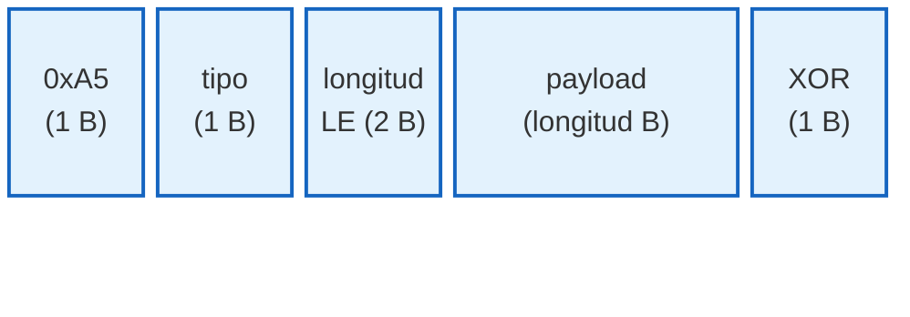

_Formato de las tramas de respuesta (FPGA → PC), de 5 + longitud bytes._

El checksum es el XOR de todos los bytes salvo el `0xA5`. Los tipos son `ACK`, `NACK` (con un código de error), `SNAPSHOT`, `PING_INFO` y `MEM_DATA`.

El **snapshot** es el volcado del estado completo, de `221 + 6·K` bytes:

| Offset | Bytes | Contenido                                                   |
| -----: | ----: | ----------------------------------------------------------- |
|      0 |     1 | Estado de la Debug Unit y motivo de terminación             |
|      1 |     4 | Contador de ciclos ejecutados                               |
|      5 |     4 | PC                                                          |
|      9 |     1 | Señales de riesgo del ciclo (stall, flushes, forwarding)    |
|     10 |   128 | Registros `x0` a `x31`                                      |
|    138 |    13 | Latch IF/ID                                                 |
|    151 |    31 | Latch ID/EX                                                 |
|    182 |    19 | Latch EX/MEM                                                |
|    201 |    18 | Latch MEM/WB                                                |
|    219 |     2 | K = cantidad de palabras usadas                             |
|    221 |   6·K | K pares (dirección de 2 B, dato de 4 B)                     |

Los latches se envían **campo a campo, alineados a byte** (ADR-017): la PC los decodifica sin conocer cómo están empaquetados los bits en el hardware. Se descartó enviar los latches como un vector de bits crudo porque cualquier cambio en el hardware rompería la decodificación.

### 2.6 Errores e interpretaciones del enunciado

Se contrastaron las diapositivas de la cátedra con la especificación oficial de RISC-V, que se tomó como referencia ante cualquier diferencia:

| Tema                           | Qué dice la presentación                                            | Qué se hizo                                                                                         |
| ------------------------------ | ------------------------------------------------------------------- | --------------------------------------------------------------------------------------------------- |
| `jal`                          | "La dirección a la que se salta es la almacenada en el registro rd" | Según la especificación: `rd ← PC + 4` y se salta a `PC + imm`. El salto a un registro es `jalr`     |
| Codificación de `beq`          | Rotula `rs1` en los bits [24:20] y en [19:15]                       | Los bits [24:20] son `rs2`                                                                          |
| `ld`                           | Aparece entre las instrucciones de tipo I                           | Es de RV64I: no se implementa                                                                       |
| Skew                           | "¿Este camino crítico genera skew?"                                 | Se responde aclarando que el skew lo genera la red del reloj, no un camino de datos (Sección 9.7)    |
| Paso a paso y reloj            | "Un comando ejecuta un ciclo de clock" y "no intervenir el clock"   | Se usa _clock enable_: el reloj corre siempre y lo que se habilita es el avance (Sección 2.4)        |
| Clock Wizard y reloj           | "Investiguen Clock Wizard" y "no intervenir el clock"               | Un MMCM genera el reloj por la red dedicada: no es intervenirlo, porque no hay lógica en su camino   |

---

## 3. Diseño del núcleo

### 3.1 Arquitectura general

El núcleo (`riscv_core`) se organizó en un módulo por etapa (`if_stage`, `id_stage`, `ex_stage`, `mem_stage`, `wb_stage`), un módulo por latch (`if_id_reg`, `id_ex_reg`, `ex_mem_reg`, `mem_wb_reg`) y las dos unidades de riesgo (`forwarding_unit` y `hazard_unit`). Cada bloque funcional se instancia **dentro de la etapa a la que pertenece** en el datapath: la IMEM en IF, el banco de registros en ID, la DMEM en MEM. Así, cada etapa se puede verificar por separado, y `riscv_core` queda reducido a cablear etapas, latches y unidades de riesgo.

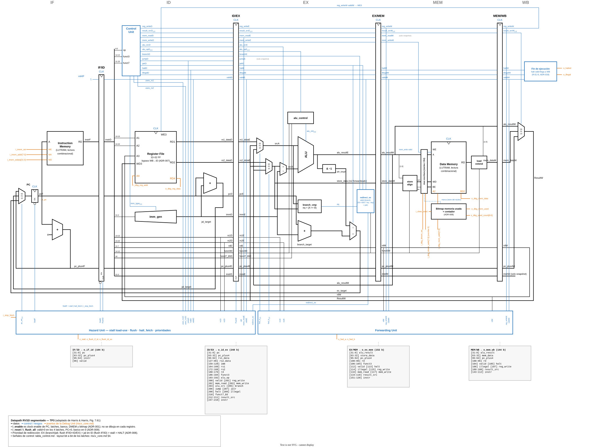

_Datapath completo del procesador (fuente: [`docs/diagramas/datapath_pipeline.drawio`](../docs/diagramas/datapath_pipeline.drawio)). Se diseñó antes de escribir el código y es la referencia de todos los módulos._

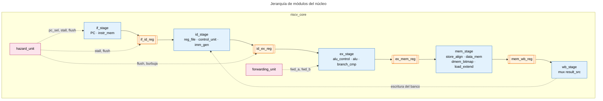

En el núcleo hay dos señales globales que no pertenecen a ninguna etapa:

- **Enable efectivo:** `w_en = i_enable && !o_halted`. Una vez que el programa terminó, el núcleo queda congelado aunque la Debug Unit siga habilitándolo.
- **Reset efectivo:** `i_reset || i_flush_all`. `i_flush_all` es el pedido de limpieza de la Debug Unit al cargar un programa, y actúa aunque `i_enable = 0`.

### 3.2 Etapa IF

`if_stage` contiene el registro **PC**, el mux del próximo PC y la **IMEM**. El próximo PC lo elige la Hazard Unit con `pc_sel`:

| `pc_sel` | Próximo PC                    | Cuándo                                          |
| -------- | ----------------------------- | ----------------------------------------------- |
| `00`     | `PC + 4`                      | Caso normal (predicción _not-taken_)            |
| `01`     | Destino del `jal` (desde ID)  | Hay un `jal` en ID                              |
| `10`     | Destino calculado en EX       | Branch tomado o `jalr` en EX                    |

Con `stall_f = 1` el PC no avanza y la etapa entrega una burbuja (`valid = 0`). La IMEM recibe la dirección de byte (`PC`) y usa los bits `[9:2]`, así que una dirección fuera de rango da la vuelta dentro de la memoria. Su puerto de escritura lo usa únicamente la Debug Unit para cargar el programa.

### 3.3 Etapa ID

`id_stage` separa los campos de la instrucción (`rs1`, `rs2`, `rd`, `funct3`, `funct7[5]`) e instancia tres bloques:

- **`reg_file`:** banco de 32 registros de 32 bits en flip-flops, con dos lecturas combinacionales, una escritura desde WB y un **tercer puerto de lectura para la Debug Unit**. `x0` vale siempre 0. Tiene **bypass interno**: si en el mismo ciclo WB escribe el registro que ID está leyendo, la lectura devuelve el valor nuevo. Esto resuelve la dependencia a distancia 3 sin forwarding (ADR-007).
- **`control_unit`:** decodifica `opcode`, `funct3` y `funct7` en las señales de control de la tabla de control. Tiene un bloque aparte que decide si la instrucción es legal; si no lo es, solo emite `halt = illegal = 1`, sin escrituras.
- **`imm_gen`:** arma el inmediato de 32 bits con extensión de signo según el formato (I, S, B, U o J).

Además, ID **resuelve el `jal`**: su destino (`PC + imm`) no depende de ningún registro, así que se calcula en ID y se redirige el PC con un solo ciclo de penalidad (ADR-006). ID también detecta el `HALT` (y las instrucciones ilegales) para frenar la búsqueda de instrucciones (Sección 3.10).

### 3.4 Etapa EX

`ex_stage` es combinacional e instancia la ALU, su control y el comparador de saltos:

- **Muxes de forwarding:** para cada operando, eligen entre el valor leído del banco (`00`), el resultado de MEM/WB (`01`) o el de EX/MEM (`10`), según indique la Forwarding Unit.
- **Mux `alu_src`:** el segundo operando de la ALU es el registro o el inmediato.
- **ALU:** de 32 bits, nueva respecto de la del TP1 (que era de 8 bits), con 11 operaciones seleccionadas por `alu_ctrl[3:0]` (ADR-019). El código de `alu_ctrl` se eligió como `{funct7[5], funct3}` de la instrucción R equivalente, para que en las formas de onda se lea igual que la ISA; `PASS_B` (para `lui`) usa el código `1111`, que ninguna instrucción R usa.
- **`branch_cmp`:** comparador de igualdad dedicado, en paralelo con la ALU, para no encadenar la resta de la ALU con la decisión del salto.
- **Redirección:** `branch_taken = branch && (beq ? igual : !igual)`. Si hay un branch tomado o un `jalr`, la etapa pide redirigir el PC a `PC + imm` o a `(rs1 + imm) & ~1`, respectivamente.

El dato que se guarda en un store es `rs2` **ya forwardeado**, así un store que depende de la instrucción anterior escribe el valor correcto.

### 3.5 Etapa MEM

`mem_stage` conecta cuatro bloques en cadena:

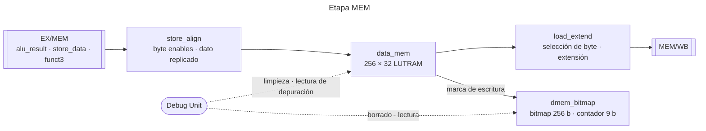

- **`store_align`:** a partir de `funct3` y de los dos bits bajos de la dirección genera los 4 _byte enables_ de la DMEM y **replica** el dato (`sb` escribe `{4{rs2[7:0]}}`, `sh` escribe `{2{rs2[15:0]}}`). Al replicar en lugar de desplazar, el byte correcto ya está en cada posición y los enables deciden cuál se escribe.
- **`data_mem`:** la escritura solo se hace si la instrucción es válida, es un store y el núcleo está habilitado. Tiene un puerto de lectura para el pipeline y otro para la Debug Unit.
- **`load_extend`:** selecciona el byte o la media palabra de la palabra leída y la extiende con signo (`lb`, `lh`) o con ceros (`lbu`, `lhu`).
- **`dmem_bitmap`:** marca la palabra escrita por cada store efectivo y cuenta cuántas palabras distintas se escribieron. Está separado de la DMEM para no mezclar el almacenamiento con la lógica de depuración.

### 3.6 Etapa WB

`wb_stage` es un mux de tres entradas (`result_src`) que elige qué se escribe en el banco: el resultado de la ALU, el dato leído de memoria o `PC + 4` (para `jal` y `jalr`). La escritura se habilita con `valid && reg_write`. Su salida es también la fuente del forwarding desde MEM/WB.

### 3.7 Latches

Cada latch guarda, además de los datos y las señales de control que necesitan las etapas siguientes, metadatos de depuración:

| Latch      | Datos                                                                          | Control                                                                                 | Depuración                         |
| ---------- | ------------------------------------------------------------------------------ | --------------------------------------------------------------------------------------- | ---------------------------------- |
| **IF/ID**  | `pc`, `pc_plus4`, `instr`                                                      | —                                                                                       | `valid`                            |
| **ID/EX**  | `pc`, `pc_plus4`, `rs1_data`, `rs2_data`, `imm`, `rs1`, `rs2`, `rd`, `funct3`, `funct7_b5` | `reg_write`, `mem_read`, `mem_write`, `result_src`, `alu_src`, `alu_op`, `branch`, `jump`, `jalr` | `valid`, `halt`, `illegal`, `instr` |
| **EX/MEM** | `alu_result`, `store_data`, `rd`, `pc_plus4`, `funct3`                         | `reg_write`, `mem_read`, `mem_write`, `result_src`                                      | `valid`, `halt`, `illegal`, `instr` |
| **MEM/WB** | `alu_result`, `mem_data`, `pc_plus4`, `rd`                                     | `reg_write`, `result_src`                                                               | `valid`, `halt`, `illegal`, `instr` |

- **`valid`** distingue una burbuja (producto de un stall, un flush o un reset) de una instrucción real que casualmente codifica como `addi x0, x0, 0`. Es lo que permite afirmar que el pipeline está vacío.
- **`instr`** no la necesita el datapath después de ID, pero sin ella la interfaz gráfica no podría mostrar qué instrucción está en cada etapa. Se controla con el parámetro `DEBUG_TRACE` y cuesta 96 flip-flops en el núcleo.
- **`halt`** e **`illegal`** viajan con la instrucción de parada hasta WB, donde se decide el motivo de terminación.

Prioridades de cada latch (todas con reset sincrónico):

| Latch           | Prioridad                                                       | Burbuja                                                         |
| --------------- | --------------------------------------------------------------- | --------------------------------------------------------------- |
| IF/ID           | reset > sin enable (mantiene) > flush > stall (mantiene) > carga | `valid = 0` e `instr = nop`                                     |
| ID/EX           | reset > sin enable > burbuja > carga (nunca mantiene por stall)  | `valid = 0`, `instr = nop` y **todas** las señales de control en 0 |
| EX/MEM y MEM/WB | reset > sin enable > carga (copia directa)                       | — (lo que llega a EX ya no se descarta)                         |

### 3.8 Forwarding Unit

Una instrucción en EX necesita sus operandos, pero la instrucción que los produce puede estar todavía en MEM o en WB, sin haber escrito el banco. La Forwarding Unit compara los registros fuente de la instrucción en EX con el `rd` de las dos instrucciones siguientes y elige de dónde tomar el valor:

```verilog
// forwarding_unit.v: una productora cuenta si es válida, escribe el banco y no escribe x0
wire w_escribe_mem = i_ex_mem_valid && i_ex_mem_reg_write && (i_ex_mem_rd != X0);
wire w_escribe_wb  = i_mem_wb_valid && i_mem_wb_reg_write && (i_mem_wb_rd != X0);

always @(*) begin
    o_fwd_a = FWD_ID_EX;                                                       // lo leído del banco
    if (w_escribe_mem && (i_ex_mem_rd == i_id_ex_rs1)) o_fwd_a = FWD_EX_MEM;   // la más nueva gana
    else if (w_escribe_wb && (i_mem_wb_rd == i_id_ex_rs1)) o_fwd_a = FWD_MEM_WB;
end
// o_fwd_b es igual, con i_id_ex_rs2
```

- **Prioridad EX/MEM > MEM/WB:** si las dos instrucciones anteriores escriben el mismo registro, la más nueva tiene el valor correcto.
- **Nunca se reenvía `x0`**, ni desde burbujas, ni desde instrucciones que no escriben el banco.
- **A distancia 3** no hace falta forwarding: la productora está en WB cuando la consumidora está en ID, y el bypass interno del banco resuelve la dependencia.

| Ciclo →           |  1  |  2  |    3     |         4         |  5  |  6  |
| ----------------- | :-: | :-: | :------: | :---------------: | :-: | :-: |
| `add x1, x2, x3`  | IF  | ID  | **EX** (calcula `x1`) | MEM      | WB  |     |
| `sub x4, x1, x5`  |     | IF  |    ID    | **EX** (`x1` desde EX/MEM) | MEM | WB  |

_Forwarding desde EX/MEM: en el ciclo 4 `add` está en MEM y su resultado todavía no está en el banco, pero se reenvía a la entrada de la ALU. No se pierde ningún ciclo._

La Forwarding Unit no mira si la instrucción usa realmente el operando. Por ejemplo, en `addi x1, x1, 1` el campo `rs2` contiene `imm[4:0]`, que puede coincidir con un `rd` anterior y hacer que `fwd_b ≠ 00`. Es inofensivo, porque la ALU toma el inmediato, y se dejó así a propósito: `fwd` indica coincidencia de registros, que es lo que pide la especificación del proyecto.

### 3.9 Hazard Unit

La Hazard Unit concentra **todo el control del pipeline**: elige el próximo PC y genera los stalls y flushes de cada latch.

**Load-use.** El forwarding no alcanza cuando la productora es un load: el dato recién está disponible al final de MEM, y la consumidora lo necesita al principio de EX. En ese caso se detiene un ciclo:

```verilog
// hazard_unit.v: un load válido en EX que escribe un registro que la instrucción de ID lee
wire w_load_en_ex = i_id_ex_valid && i_id_ex_mem_read && (i_id_ex_rd != X0);
wire w_usa_rd     = (i_uses_rs1 && (i_if_id_rs1 == i_id_ex_rd)) ||
                    (i_uses_rs2 && (i_if_id_rs2 == i_id_ex_rd));
wire w_load_use   = w_load_en_ex && w_usa_rd;
```

Con `load_use = 1`, el PC y el latch IF/ID mantienen su valor y en ID/EX entra una burbuja. En el ciclo siguiente el load está en MEM/WB y el dato llega por forwarding. A diferencia de la Forwarding Unit, acá **sí** se usan `uses_rs1`/`uses_rs2`, porque un stall de más cuesta un ciclo.

| Ciclo →           |  1  |  2  |  3  |        4         |             5              |  6  |  7  |
| ----------------- | :-: | :-: | :-: | :--------------: | :------------------------: | :-: | :-: |
| `lw x1, 0(x2)`    | IF  | ID  | EX  | **MEM** (lee `x1`) |             WB             |     |     |
| `add x3, x1, x4`  |     | IF  | ID  |  ID (_stall_)    | **EX** (`x1` desde MEM/WB) | MEM | WB  |
| (burbuja)         |     |     |     |        EX        |            MEM             | WB  |     |

_Load-use: en el ciclo 3 la Hazard Unit detecta que `add` necesita el `x1` del `lw` que está en EX. En el ciclo 4 `add` se queda en ID y entra una burbuja a EX; en el ciclo 5 el dato llega por forwarding desde MEM/WB. Se pierde 1 ciclo._

**Riesgos de control.** Se predice siempre que el salto **no** se toma (se siguen buscando las instrucciones de `PC + 4`). Si la predicción falla, se descartan las instrucciones buscadas de más:

| Caso                          | Se resuelve en | Instrucciones descartadas         | Penalidad |
| ----------------------------- | -------------- | --------------------------------- | --------- |
| `beq`/`bne` no tomado         | EX             | ninguna                           | 0 ciclos  |
| `beq`/`bne` tomado            | EX             | las que están en IF e ID          | 2 ciclos  |
| `jalr`                        | EX             | las que están en IF e ID          | 2 ciclos  |
| `jal`                         | ID             | la que está en IF                 | 1 ciclo   |

Resolver los branches en ID ahorraría un ciclo, pero obligaría a adelantar los operandos a ID, con más forwarding y más stalls, y el camino crítico pasaría a ser la comparación en ID. Se priorizó la simplicidad (ADR-006).

**Prioridades.** Cuando en un mismo ciclo coinciden varios eventos, la Hazard Unit aplica este orden:

1. **Redirección desde EX** (branch tomado o `jalr`): es la instrucción más antigua, así que todo lo que vino después está en un camino equivocado, incluidos un `jal` o un `HALT` en ID.
2. **`ABORT`** de la Debug Unit: deja de buscar instrucciones.
3. **`jal`** en ID.
4. **Load-use**.
5. **`HALT`** en ID.

### 3.10 Fin de ejecución y vaciado del pipeline

El enunciado pide que el pipeline quede vacío al terminar. Esto se resolvió así:

1. Cuando ID detecta un `HALT` (o una instrucción ilegal), la Hazard Unit activa un registro **`halt_fetch`** que congela el PC y hace que IF entregue solo burbujas.
2. El `HALT` sigue avanzando por EX y MEM, mientras detrás de él solo entran burbujas.
3. Cuando el `HALT` llega a WB, el núcleo activa `o_halted` (y `o_illegal` si correspondía). En ese mismo flanco, MEM/WB carga la burbuja que venía detrás, así que con `o_halted = 1` **los 4 latches ya tienen `valid = 0`**.

Si el `HALT` estaba en un camino especulativo (por ejemplo, justo después de un branch tomado), la redirección desde EX lo descarta y además borra `halt_fetch`: la búsqueda continúa en el destino del salto.

---

## 4. Debug Unit

### 4.1 Arquitectura interna

La Debug Unit es el intermediario entre la UART y el núcleo. Interpreta los comandos de la PC, carga los programas, controla el `i_enable` del núcleo y le envía el estado. Se dividió en seis módulos, con control y datapath separados:

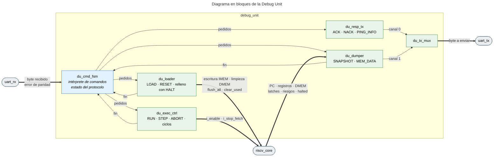

| Módulo         | Responsabilidad                                                                                                   |
| -------------- | ----------------------------------------------------------------------------------------------------------------- |
| `du_cmd_fsm`   | Decide si cada byte es un comando válido en el estado actual, le pide la acción al submódulo y elige la respuesta |
| `du_loader`    | Recibe el programa, verifica el checksum, escribe la IMEM, rellena con `HALT` y limpia DMEM, registros y pipeline |
| `du_exec_ctrl` | Genera `i_enable` (un ciclo en `STEP`, sostenido en `RUN`) y `i_stop_fetch` (`ABORT`); cuenta los ciclos           |
| `du_dumper`    | Serializa el snapshot y las tramas de `DUMP_MEM`, calculando el checksum al vuelo                                 |
| `du_resp_tx`   | Serializa las respuestas cortas                                                                                   |
| `du_tx_mux`    | Elige cuál de los dos serializadores maneja el transmisor de la UART                                              |

### 4.2 Máquina de estados

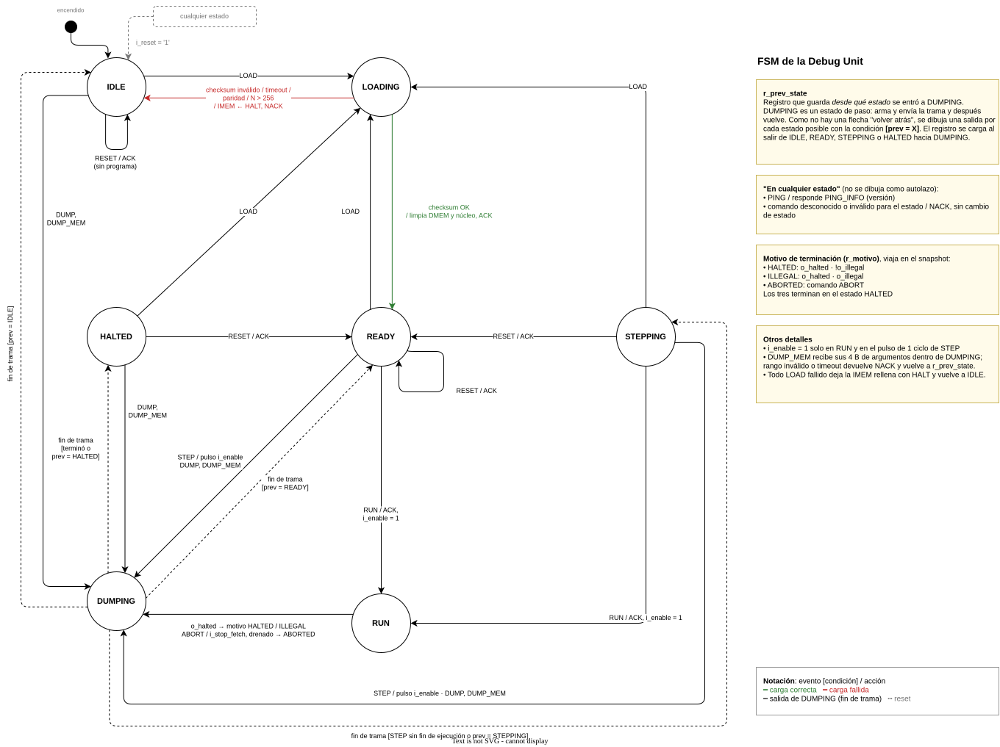

| Estado     | Significado                                                      | Comandos aceptados                 |
| ---------- | ---------------------------------------------------------------- | ---------------------------------- |
| `IDLE`     | No hay un programa válido (encendido o después de un `LOAD` fallido) | `LOAD`, `RESET`, `DUMP`, `DUMP_MEM`, `PING` |
| `LOADING`  | Recibiendo un programa: todo byte que llega es parte de la carga | —                                  |
| `READY`    | Programa cargado y núcleo limpio                                 | todos salvo `ABORT`                |
| `RUN`      | Ejecución continua                                               | `ABORT`, `PING`                    |
| `STEPPING` | Ejecución paso a paso empezada; el núcleo está congelado entre pasos | todos salvo `ABORT`            |
| `DUMPING`  | Enviando una trama; al terminar vuelve al estado anterior        | — (los bytes se descartan)         |
| `HALTED`   | La ejecución terminó, con el pipeline vacío                      | `LOAD`, `RESET`, `DUMP`, `DUMP_MEM`, `PING` |

Un comando que no vale en el estado actual responde `NACK(ERR_ESTADO)` sin cambiar nada. El **motivo** de terminación (`HALTED`, `ILLEGAL` o `ABORTED`) no es un estado: viaja en el snapshot, y los tres terminan en el estado `HALTED`.

Errores que maneja la Debug Unit, con su código de `NACK`: comando desconocido, comando en un estado inválido, checksum incorrecto, tamaño de programa fuera de rango (N > 256), rango de `DUMP_MEM` inválido, **error de paridad** y **timeout** de recepción (100 ms sin recibir el byte siguiente de un comando a medias).

### 4.3 Carga y reprogramación (`du_loader`)

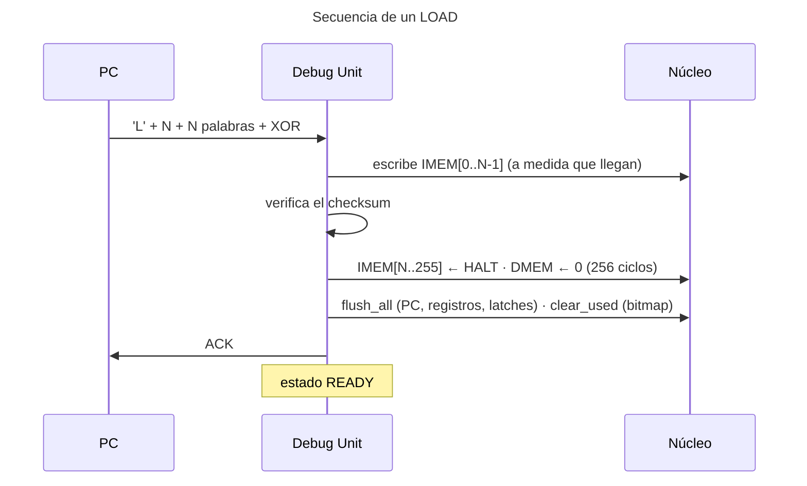

- Las palabras se escriben en la IMEM a medida que llegan. Si el checksum falla, si llega un byte con error de paridad o si vence el timeout, **toda la IMEM se rellena con `HALT`** y la Debug Unit vuelve a `IDLE`: después de una carga fallida no puede ejecutarse nada.
- La limpieza escribe una dirección por ciclo en la IMEM y en la DMEM en paralelo, así que dura 256 ciclos (unos 3 µs a 85 MHz).
- `RESET` hace la misma limpieza **sin tocar la IMEM**: sirve para volver a correr el mismo programa (ADR-009).

### 4.4 Control de ejecución (`du_exec_ctrl`)

- **`STEP`:** `i_enable = 1` durante exactamente un ciclo. Un ciclo después, cuando `o_halted` ya refleja cómo quedó el núcleo, avisa a `du_cmd_fsm`, que pide el snapshot.
- **`RUN`:** `i_enable = 1` sostenido hasta `o_halted`.
- **`ABORT`:** durante un `RUN`, activa `i_stop_fetch` sin bajar `i_enable`. El núcleo deja de buscar instrucciones y descarta la que estaba en ID, mientras las que ya pasaron a EX terminan. Cuando los 4 latches tienen `valid = 0`, termina igual que un `RUN`, con motivo `ABORTED`. Así se puede frenar un programa con un lazo infinito sin dejar instrucciones a medio ejecutar (ADR-010).

### 4.5 Volcado del estado (`du_dumper`)

Al recibir el pedido, `du_dumper` copia los 4 latches en registros propios. Después recorre el snapshot byte a byte: lee cada registro, campo o palabra de memoria por los puertos de depuración del núcleo y calcula el checksum al vuelo. El núcleo está congelado durante todo el volcado, así que las lecturas son estables de principio a fin.

La longitud de la trama depende de K (las palabras usadas), y en la primera versión se recalculaba en cada ciclo. La síntesis fuera de contexto mostró que ese cálculo era el camino crítico de la Debug Unit, así que ahora se calcula una sola vez al recibir el pedido (`r_len`, `r_pos_checksum`).

---

## 5. Módulo `top` y reloj

### 5.1 Integración

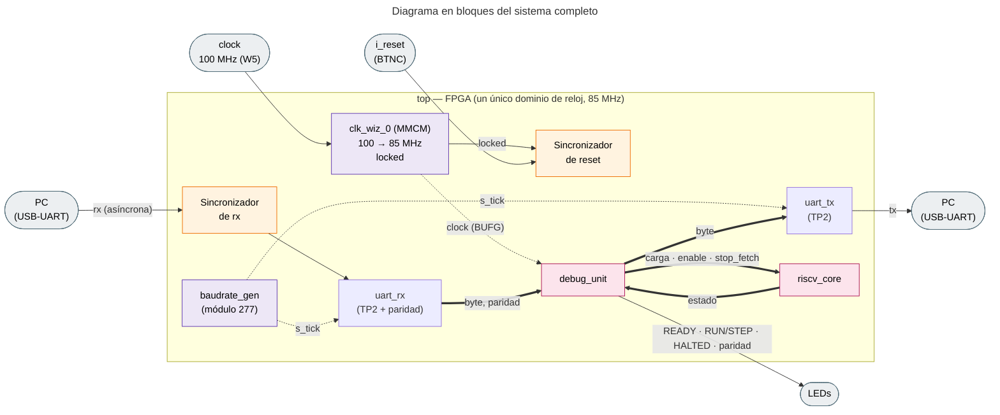

Respecto del TP2, el `top` incorpora:

- **Clock Wizard (`clk_wiz_0`):** genera los 85 MHz del sistema a partir de los 100 MHz de la placa (Sección 8.4). Solo se instancia al sintetizar, así que en simulación el reloj del testbench entra directo y el `top` se sigue simulando con Icarus.
- **Reset sincronizado y retenido hasta `locked`:** el botón es asíncrono, así que pasa por dos flip-flops antes de llegar a los ~3000 registros que resetea. Mientras el MMCM no enganchó (`locked = 0`), el sistema queda en reset.
- **`COUNT_MAX` recalculado:** el generador de baud rate se parametriza desde `CLK_FREQ_HZ`, con redondeo. A 85 MHz, $85\,000\,000 / (16 \times 19200) = 276{,}7 \rightarrow 277$, lo que da 19 179 bps (error de 0,11 %, muy por debajo del 2 % que tolera la UART).
- **Sincronizador de `rx`** (el mismo del TP2), ahora con el atributo `ASYNC_REG` y `set_false_path` en el `.xdc`, como había quedado pendiente en el informe del TP2.

### 5.2 Asignación de pines

| Puerto       | Recurso            | Función                                           |
| ------------ | ------------------ | ------------------------------------------------- |
| `clock`      | Oscilador 100 MHz  | Entrada del Clock Wizard                          |
| `i_reset`    | Botón (BTNC)       | Reset de todo el sistema                          |
| `rx`         | Pin USB-UART (RXD) | Entrada serie desde la PC                         |
| `tx`         | Pin USB-UART (TXD) | Salida serie hacia la PC                          |
| `o_led[0]`   | LED0               | Debug Unit en `READY`                             |
| `o_led[1]`   | LED1               | Ejecutando (`RUN` o `STEPPING`)                   |
| `o_led[2]`   | LED2               | Ejecución terminada (`HALTED`)                    |
| `o_led[3]`   | LED3               | Hubo al menos un error de paridad desde el reset  |

---

## 6. Software de PC

El software es un paquete Python 3.13 (`riscv_toolkit`, en [`TP3/tools/`](tools/)), administrado con `uv` (ADR-011). Se organizó en capas, de modo que la interfaz gráfica y la CLI usan exactamente el mismo código:

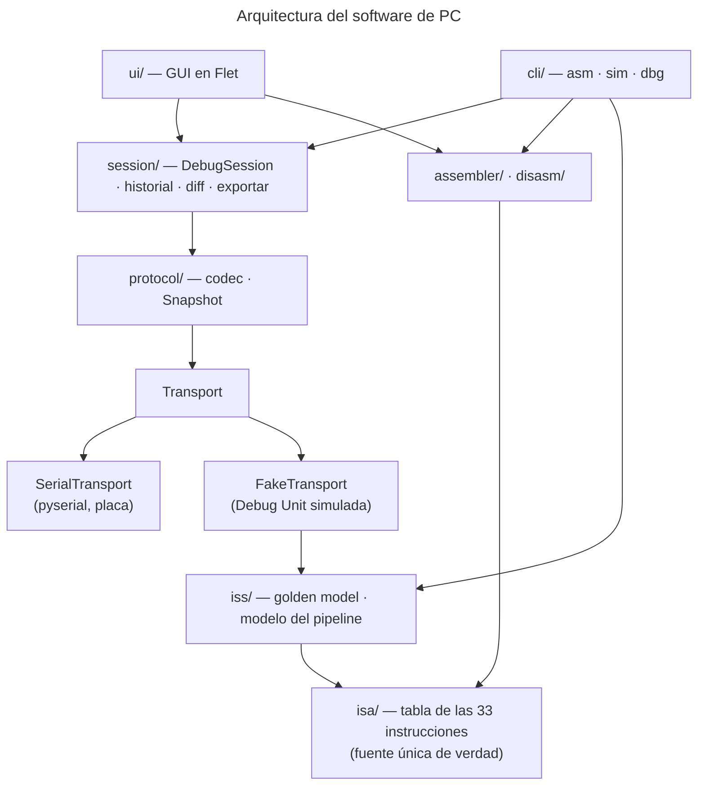

| Componente                   | Qué hace                                                                                                                                                                       |
| ---------------------------- | ------------------------------------------------------------------------------------------------------------------------------------------------------------------------------ |
| **Ensamblador**              | De dos pasadas (la primera resuelve las etiquetas): sintaxis de RISC-V, pseudoinstrucciones `nop`, `mv`, `j` y `ret`, `.word`, errores con número de línea y `HALT` agregado al final si falta (ADR-013). Se verificó contra GNU `as` |
| **Desensamblador**           | Traduce una palabra a texto; lo usan la GUI y los listados                                                                                                                      |
| **Golden model**             | Simulador de referencia que ejecuta una instrucción por paso, sin pipeline. Genera el estado final esperado (`.expected`) de cada programa (ADR-014)                             |
| **Modelo del pipeline**      | Reproduce el pipeline ciclo a ciclo, con forwarding, stalls y flushes. Lo usan la vista Datapath, el modo sin placa y la comparación paso a paso con la placa                    |
| **Protocolo y transporte**   | Arma y decodifica las tramas. `SerialTransport` habla con la placa y `FakeTransport` simula la Debug Unit, así el software se desarrolló y probó antes de tener el hardware     |
| **Sesión**                   | Conexión, carga, ejecución, historial de snapshots navegable, diferencias entre ciclos y exportación de sesiones en JSON                                                        |
| **CLI**                      | `asm` (ensambla a `.hex`, `.bin` o `.lst`), `sim` (golden model) y `dbg` (maneja la placa desde la terminal)                                                                     |
| **GUI**                      | Editor con errores por línea, controles de ejecución, registros, memoria, latches campo a campo, carta de pipeline, **datapath animado** con el valor de cada cable, historial y verificación contra el golden model |

La tabla de las 33 instrucciones (`isa/instrucciones.py`) es la **única fuente de verdad**: de ella salen el ensamblador, el desensamblador, el golden model y el archivo `du_defs.vh` del hardware, que se genera con un script y tiene un test que verifica que esté actualizado.

La vista **Datapath** de la GUI dibuja el diagrama de la Sección 3.1 con el valor de cada cable en el ciclo que se está viendo, los latches en stall o flush y el camino que eligió cada mux. Su objetivo es "interpretar el estado actual del sistema mientras se usa", como sugiere el enunciado. El manual de uso está en [`docs/manual/usuario.md`](../docs/manual/usuario.md).

---

## 7. Verificación

Se verificó en capas, desde cada módulo aislado hasta el sistema completo. Cada testbench es **autoverificable**: compara contra un valor esperado e imprime `PASS` o `FAIL`, sin necesidad de mirar formas de onda (ADR-015).

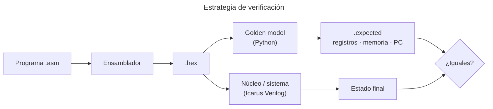

| Nivel                  | Comando             | Qué compara                                                                                   | Resultado            |
| ---------------------- | ------------------- | --------------------------------------------------------------------------------------------- | -------------------- |
| Lint                   | `make lint`         | Verilator sobre todo el RTL                                                                   | 39 archivos sin avisos |
| Testbenches de módulos | `make sim-all`      | Cada módulo contra vectores o modelos de referencia                                           | 30 de 30             |
| Programas en el núcleo | `make sim-programs` | Estado final contra el `.expected`, con `i_enable` fijo y **aleatorio**                       | 74 de 74 corridas    |
| Verificación cruzada   | `make verify`       | Todo `asm/` en el núcleo contra el golden model, más instrucciones retiradas, ciclos y CPI   | 59 de 59 programas   |
| Sistema completo       | `make sim-system`   | Cada programa por la UART simulada al `top` (`PING`, `LOAD`, `RUN`, `SNAPSHOT`)               | 59 de 59             |
| Software               | `make check-py`     | pytest, ruff, mypy estricto y pip-audit                                                       | 1162 tests, cobertura 99,4 % |

Puntos a destacar:

- **Programas con firma.** Los programas de prueba (`asm/tests/`) se verifican solos: escriben en la dirección `0x3FC` un 1 si todos sus casos pasaron, o el número del caso que falló. Los valores esperados se cargan con `lui`/`addi` y no con la instrucción que se prueba, para que un error no se cancele en el chequeo. Hay un programa por familia de instrucciones y uno por cada caso de riesgo.
- **Enable aleatorio.** Correr los programas con `i_enable` que se prende y apaga al azar verifica que el núcleo dé el mismo resultado ejecutado de corrido o ciclo a ciclo.
- **Pruebas de mutación.** Para comprobar que las pruebas detectan errores reales, se introdujeron errores a propósito. Con 35 mutaciones del golden model y 16 de la Hazard Unit, todas fueron detectadas por algún test. Con el forwarding EX/MEM anulado, fallan 10 de los 16 programas de riesgos.
- **Integración continua.** GitHub Actions corre lint, testbenches, programas, verificación cruzada y tests de Python en cada push y en cada PR.

---

## 8. Síntesis e implementación

El diseño se sintetizó e implementó con Vivado 2025.2 para la Artix-7 (XC7A35T-1CPG236C) de la Basys 3, en modo batch con `make impl`. Los reportes están versionados en [`hw/reports/`](hw/reports/), y `make reportes` los resume en las tablas de [`docs/informe/datos/`](../docs/informe/datos/).

### 8.1 Utilización de recursos

| Recurso                   |     TP3 |   TP2 | Disponible | Utilización TP3 |
| ------------------------- | ------: | ----: | ---------: | --------------: |
| Slice LUTs                |    3945 |   123 |      20800 |         18,97 % |
| ↳ como lógica             |    3257 |   123 |      20800 |         15,66 % |
| ↳ como memoria (LUTRAM)   |     688 |     — |       9600 |          7,17 % |
| Flip-flops                |    2975 |    95 |      41600 |          7,15 % |
| F7 / F8 Muxes             | 608/147 |  11/— | 16300/8150 |   3,73 / 1,80 % |
| Block RAM                 |       0 |     — |         50 |             0 % |
| DSP                       |       0 |     — |         90 |             0 % |
| Bonded IOB                |       8 |    14 |        106 |          7,55 % |
| BUFG                      |       2 |     1 |         32 |          6,25 % |
| MMCM                      |       1 |     — |          5 |            20 % |

Desglose por módulo:

| Módulo                                   |        LUTs | LUTRAM |          FF | Qué ocupa                                                                                    |
| ---------------------------------------- | ----------: | -----: | ----------: | -------------------------------------------------------------------------------------------- |
| **Núcleo** (`riscv_core`)                |    **3082** |    688 |    **1916** |                                                                                              |
| ↳ banco de registros                     |         890 |      0 |         992 | 31 × 32 bits en flip-flops (`x0` no se almacena) y los muxes 32 a 1 de los tres puertos de lectura |
| ↳ IF (con IMEM)                          |         226 |    176 |          32 | IMEM y PC                                                                                    |
| ↳ MEM (con DMEM y bitmap)                |         732 |    512 |         265 | DMEM con escritura por byte y dos puertos de lectura; bitmap de 256 bits y contador          |
| ↳ latches IF/ID · ID/EX · EX/MEM · MEM/WB | 123 · 401 · 336 · 350 | 0 | 105 · 223 · 157 · 139 | Campos de cada latch y lógica de enable, flush y burbuja                         |
| **Debug Unit**                           |     **783** |      0 |    **1001** |                                                                                              |
| ↳ `du_dumper`                            |         532 |      0 |         721 | Copia de los 4 latches (648 FF) y selección del byte a enviar                                |
| ↳ `du_loader`                            |         108 |      0 |         130 | Contadores de carga, relleno con `HALT` y limpieza                                           |
| ↳ `du_cmd_fsm`                           |         110 |      0 |         100 | Intérprete de comandos                                                                       |
| **UART RX**                              |          58 |      0 |          21 | Igual que en el TP2                                                                          |

Del reporte se desprenden las siguientes observaciones:

- **El diseño ocupa menos del 20 % de la FPGA.** El tamaño no fue una restricción.
- **El núcleo es el 78 % de los LUTs**, y dentro de él el bloque más grande es el **banco de registros**: casi 1000 flip-flops y 890 LUTs de multiplexores.
- **No se infirieron BRAM ni DSP.** Las memorias están en LUTRAM, como se decidió (Sección 2.3), y la ALU no multiplica, porque RV32I base no tiene multiplicación.
- **La DMEM ocupa 4 veces el mínimo teórico.** Cada LUT de memoria guarda 64 bits, así que 256 × 32 bits necesitan como mínimo 128 LUTs. La DMEM usa 512 porque tiene dos puertos de lectura combinacional (el del pipeline y el de la Debug Unit) además del de escritura, y Vivado replica la memoria por cada dirección distinta. La IMEM, con un solo puerto de lectura, usa 176.
- **La Debug Unit es un 20 % del diseño**, y casi todo es la copia de los latches en `du_dumper`. El campo `instr` de los latches (`DEBUG_TRACE`) agrega 96 flip-flops en el pipeline y otros 96 en esa copia.
- **No se infirieron latches** en ningún módulo (lo verifica `make synth-ooc`).

### 8.2 Análisis de tiempos a 100 MHz

Con el reloj de la placa conectado directo, **el diseño no cierra timing**:

| WNS       | TNS        | WHS      | Endpoints | Endpoints con falla |
| --------- | ---------- | -------- | --------: | ------------------: |
| −1,316 ns | −18,849 ns | 0,039 ns |     14528 |                  76 |

**Camino crítico.** El peor camino **no está en el pipeline sino en la Debug Unit**, armando el snapshot. En un solo ciclo, `du_dumper` calcula la dirección de la palabra de memoria que corresponde al byte que se está enviando, lee la DMEM del núcleo por el puerto de depuración, elige el byte, actualiza el checksum y lo entrega al transmisor de la UART. El camino de la tabla es el del diseño final a 85 MHz, que tiene la misma estructura:

| # | Tramo                               | Celdas                        | Retardo (ns) | Qué hace en el RTL                                                     |
| - | ----------------------------------- | ----------------------------- | -----------: | ---------------------------------------------------------------------- |
| 1 | Lanzamiento                         | FDRE + red (fanout 7)         |        0,980 | `r_pos`: qué byte del snapshot se está enviando                        |
| 2 | Offset dentro de la zona de memoria | 2 × CARRY4 + red (fanout 26)  |        1,426 | `r_pos − inicio de la zona de memoria`                                 |
| 3 | Dirección de la DMEM                | LUT2, LUT6, CARRY4 + redes    |        1,916 | `base + offset / 4`                                                    |
| 4 | Llegada a la LUTRAM                 | LUT3 + red (fanout 16)        |        1,060 | La dirección se reparte a todas las LUTRAM de la DMEM                  |
| 5 | Lectura de la DMEM                  | RAMD64E + MUXF7 + red         |        1,079 | Lectura combinacional, del núcleo de vuelta a la Debug Unit            |
| 6 | Selección del byte y checksum       | LUT5, LUT6, MUXF7, LUT6, LUT6 |        3,257 | Elegir el byte de la palabra y calcular `r_xor ^ byte`                 |
| 7 | Mux de respuesta hacia la UART      | LUT5, LUT6 + redes            |        1,506 | `du_tx_mux` elige el byte que entra al transmisor                      |
|   | **Total**                           | 15 niveles                    |   **11,226** | lógica 4,253 ns (38 %) · ruteo 6,973 ns (62 %)                         |

El ruteo pesa tanto porque el camino cruza el chip: sale de la Debug Unit, entra a la DMEM, que está ubicada junto al núcleo, y vuelve. Este camino no aparecía en la síntesis fuera de contexto de la Debug Unit sola, porque la DMEM quedaba del otro lado del límite del módulo.

**El camino crítico del núcleo** es el que se esperaba al diseñar: `EX/MEM.rd` → Forwarding Unit → mux de forwarding → `branch_cmp` → Hazard Unit → enable del PC o flush de IF/ID. Es el precio de resolver el branch en EX con operandos reenviados: forwarding, comparación y selección del PC en un mismo ciclo. A 100 MHz da −0,443 ns, así que también fallaría por sí solo.

**Hold.** Los peores caminos de hold son copias directas registro a registro, sin lógica (por ejemplo, los latches del pipeline hacia la copia de `du_dumper`). Son los más rápidos del diseño y por eso los más sensibles al skew, pero todos cumplen.

### 8.3 Skew

El skew es la diferencia entre los instantes en que el flanco de reloj llega a dos flip-flops. Lo genera la red de distribución del reloj, no la lógica entre ellos.

| Caminos                            | Skew a 100 MHz (sin MMCM) | Skew a 85 MHz (con MMCM) | Efecto                                                    |
| ---------------------------------- | ------------------------: | -----------------------: | --------------------------------------------------------- |
| Peor setup (Debug Unit → UART)     |                 −0,034 ns |                −0,111 ns | Resta ese tiempo al camino: menos del 1 % del período     |
| Setup del núcleo (forwarding → PC) |                 −0,047 ns |       −0,227 a −0,294 ns | Igual de chico frente a 11,8 ns                           |
| Peor hold (latches → dumper)       |                 +0,266 ns |                +0,264 ns | Juega en contra del hold; aun así WHS = +0,054 ns         |

El skew es chico porque todo el sistema usa **un único reloj distribuido por una única red global** (un BUFG que alimenta los 3663 elementos sincrónicos), **sin lógica en el camino del reloj**. Es una consecuencia directa de haber implementado el paso a paso con _clock enable_ (Sección 2.4).

### 8.4 Frecuencia óptima y Clock Wizard

Como el diseño no cierra a 100 MHz, se buscó la frecuencia óptima con un **barrido**: un script (`make freq-sweep`) sintetiza e implementa el sistema completo a cada frecuencia y registra el WNS y el WHS. El criterio, fijado de antemano en ADR-016, fue: **la mayor frecuencia con WNS ≥ 0,3 ns y WHS ≥ 0**. El margen de 0,3 ns cubre la variación entre corridas de implementación.

| Frecuencia | Período (ns) | WNS (ns) | WHS (ns) | TNS (ns) | ¿Cumple el criterio?               |
| ---------: | -----------: | -------: | -------: | -------: | ---------------------------------- |
|     50 MHz |       20,000 |   +4,760 |   +0,057 |        0 | Sí                                 |
|     75 MHz |       13,333 |   +0,635 |   +0,049 |        0 | Sí                                 |
|     80 MHz |       12,500 |   +0,688 |   +0,069 |        0 | Sí                                 |
| **85 MHz** |   **11,765** | **+0,324** | +0,049 |        0 | **Sí (la mayor)**                  |
|     90 MHz |       11,111 |   +0,028 |   +0,047 |        0 | No: cumple, pero sin el margen     |
|     95 MHz |       10,526 |   −0,306 |   +0,049 |   −0,494 | No                                 |
|    100 MHz |       10,000 |   −1,145 |   +0,039 |   −8,953 | No                                 |

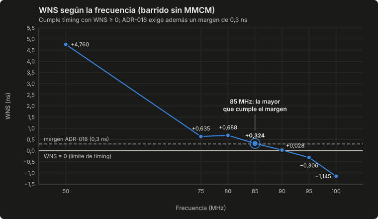

_WNS del sistema implementado a cada frecuencia del barrido. `make freq-sweep` deja los resultados en `hw/reports/freq_sweep.csv` y, al terminar, `make grafico-wns` (`tools/scripts/grafico_wns.py`) dibuja este gráfico a partir del CSV. El diseño cumple timing mientras el WNS es positivo; el criterio exige además 0,3 ns de margen, y la mayor frecuencia que lo cumple es 85 MHz._

El WNS no baja de forma pareja con la frecuencia (80 MHz tiene más margen que 75 MHz), porque cada corrida ubica y rutea el diseño de forma distinta. Por eso se midió con un barrido en lugar de calcularlo a partir de una sola corrida, y por eso el criterio exige un margen.

**¿Por qué no 90 MHz, si también cumple timing?** A 90 MHz el WNS es de +0,028 ns: cumple, pero con apenas 28 ps de margen. El criterio de 0,3 ns se fijó en ADR-016 antes de ver los resultados, porque la implementación de Vivado es heurística: el _placer_ y el _router_ son determinísticos, pero no buscan la solución óptima, y cualquier cambio en la entrada (el período del reloj, el RTL, las restricciones o la versión de la herramienta) puede cambiar bastante el resultado, como muestra el propio barrido (80 MHz tiene más margen que 75 MHz). Además, el barrido se hizo sin el MMCM, cuyo _jitter_ le resta unos 0,08 ns a cada camino; con él, los +0,028 ns de 90 MHz quedarían en torno a −0,05 ns. El margen también evita tener que bajar la frecuencia ante cualquier corrección posterior del RTL. No cubre la temperatura ni la tensión: el análisis de Vivado ya considera los extremos del dispositivo (esquinas `Slow` y `Fast`). Por último, 90 MHz sería solo un 6 % más rápido, y en la placa el tiempo lo domina la UART (Sección 8.6).

**Aplicación de la frecuencia.** Se generó el reloj de 85 MHz con un **Clock Wizard**, que configura un MMCM de la FPGA:

$$
f_{out} = 100\ \text{MHz} \times \frac{40{,}375}{4 \times 11{,}875} = 85{,}000\ \text{MHz} \qquad (f_{VCO} = 1009{,}375\ \text{MHz})
$$

La salida del MMCM pasa por un BUFG y es la única red de reloj del sistema. Esto **no es intervenir el reloj**: el MMCM es el recurso dedicado de la FPGA para generar relojes, y no agrega lógica en su camino.

Resultado del diseño final:

| Medida                        | Antes: 100 MHz directo | Después: 85 MHz con MMCM       |
| ----------------------------- | ---------------------: | -----------------------------: |
| WNS                           |              −1,316 ns |                  **+0,345 ns** |
| TNS                           |             −18,849 ns |                           0 ns |
| WHS                           |              +0,039 ns |                      +0,054 ns |
| Endpoints con falla           |                     76 |                          **0** |
| Skew del peor camino de setup |              −0,034 ns |                      −0,111 ns |
| Incertidumbre del reloj       |               0,035 ns |       0,113 ns (jitter del MMCM) |

El MMCM no es gratis: su jitter le quita unos 0,08 ns de margen a cada camino y consume más potencia que toda la lógica (Sección 8.5). A cambio, el sistema cumple timing con margen.

Al integrar el MMCM apareció un problema en las restricciones: el `.xdc` que genera el Clock Wizard crea su propio reloj en el pin de entrada, y el `create_clock -add` del `.xdc` de la placa creaba un segundo reloj primario idéntico, por lo que Vivado analizaba caminos entre los dos. Se resolvió definiendo el reloj de la placa sin `-add`.

**Mejoras posibles** (no implementadas):

- Registrar la lectura de la DMEM en `du_dumper` (un ciclo entre la dirección y la selección del byte). Eliminaría el camino crítico de la Debug Unit, a costa de un ciclo por byte enviado, irrelevante a 19200 bps.
- Con eso, el límite pasaría al camino del núcleo (forwarding → `branch_cmp` → PC), que también falla a 100 MHz. Se llegaría a unos 90–95 MHz; para alcanzar 100 MHz habría que registrar la decisión del salto o resolverlo en otra etapa.

### 8.5 Consumo de potencia

| Concepto                 | Valor     |
| ------------------------ | --------- |
| **Total**                | 0,210 W   |
| Estática del dispositivo | 0,072 W   |
| Dinámica                 | 0,138 W   |
| ↳ MMCM                   | 0,122 W   |
| ↳ Red de reloj y BUFG    | 0,007 W   |
| ↳ Señales                | 0,004 W   |
| ↳ Lógica                 | 0,002 W   |
| ↳ E/S                    | 0,002 W   |
| Temperatura de juntura   | 26,1 °C   |

La estimación es _vectorless_ (Vivado supone una tasa de conmutación típica), así que sirve para comparar y no como medición. **Lo que más consume es el MMCM** (88 % de la potencia dinámica): es un bloque analógico con un oscilador de 1 GHz funcionando todo el tiempo. Sin él, a 100 MHz directo, el total era de 0,094 W. La potencia estática es la misma que en el TP2, porque depende del chip y no del diseño.

### 8.6 Rendimiento (CPI)

`make verify` cuenta los ciclos, las instrucciones, los stalls y los flushes de cada programa de la suite:

| Medida                                | Valor          |
| ------------------------------------- | -------------- |
| Ciclos totales (59 programas)         | 3068           |
| Instrucciones ejecutadas              | 2281           |
| **CPI agregado**                      | **1,345**      |
| Ciclos perdidos por load-use          | 90 (2,9 %)     |
| Ciclos perdidos por saltos (flushes)  | 461 (15,0 %)   |
| Llenado del pipeline                  | 236 (7,7 %)    |

CPI de los programas de demostración, donde el llenado del pipeline pesa poco:

| Programa       | Ciclos | Instrucciones | CPI   | Stalls | Ciclos de flush | Tiempo a 85 MHz |
| -------------- | -----: | ------------: | ----: | -----: | --------------: | --------------: |
| `burbuja`      |    383 |           270 | 1,419 |     28 |              81 |         4,51 µs |
| `copia_cadena` |    122 |            92 | 1,326 |     12 |              14 |         1,44 µs |
| `factorial`    |    232 |           164 | 1,415 |      0 |              64 |         2,73 µs |
| `fibonacci`    |    188 |           145 | 1,297 |      0 |              39 |         2,21 µs |
| `hola`         |    130 |            96 | 1,354 |     14 |              16 |         1,53 µs |
| `subrutina`    |    381 |           309 | 1,233 |      0 |              68 |         4,48 µs |
| `suma_arreglo` |     88 |            61 | 1,443 |      8 |              15 |         1,04 µs |

Las pérdidas vienen sobre todo de los **saltos** y no de los datos: el forwarding resuelve todas las dependencias salvo load-use, mientras que cada salto tomado cuesta 2 ciclos con la predicción _not-taken_. Los programas con lazos (`burbuja`, `factorial`, `subrutina`) son los que más pierden. En la placa, el tiempo lo domina la UART: un snapshot de unos 230 bytes tarda ~130 ms a 19200 bps, decenas de miles de veces más que ejecutar cualquiera de estos programas.

---

## 9. Respuestas a las preguntas del enunciado

Al reprogramar (`LOAD`), la Debug Unit carga la IMEM nueva y hace un reset completo del resto del sistema (Sección 4.3). Las primeras cuatro preguntas son qué parte de ese reset hace falta y por qué.

### 9.1 ¿Es necesario vaciar la memoria de datos?

**Para que el programa nuevo sea correcto, no**: un programa bien escrito no lee una posición de memoria que no escribió antes. **Para observarlo, sí**: el volcado envía la "memoria usada", y con restos del programa anterior el resultado dependería de lo que se haya corrido antes en la placa. Por eso `LOAD` escribe ceros en toda la DMEM (256 ciclos, unos 3 µs) y borra el bitmap de palabras escritas.

### 9.2 ¿Y los registros?

**Tampoco para la corrección**, por el mismo motivo. Se vuelven a 0 para que cada corrida sea **reproducible** y comparable con el golden model, que arranca con todos los registros en cero.

### 9.3 ¿Se necesita vaciar el pipeline?

**Sí, es obligatorio.** Si quedaran instrucciones del programa anterior en los latches, se completarían durante los primeros ciclos del programa nuevo: escribirían registros o memoria, y un salto podría redirigir el PC. El reset pone `valid = 0` en los 4 latches y el PC en 0.

### 9.4 ¿Y la memoria de programa?

**Sí, en la parte que el programa nuevo no ocupa.** Si el programa nuevo es más corto que el anterior, las instrucciones viejas siguen en la IMEM después de su final, y sin una instrucción de parada se ejecutarían (Sección 9.5). Por eso la Debug Unit **rellena con `HALT`** todas las posiciones libres: un programa que se queda sin instrucciones termina en la primera posición vacía.

### 9.5 ¿Qué sucede si en la memoria no se encuentra una instrucción de parada?

**El PC sigue avanzando** y el procesador ejecuta lo que haya en la memoria. Para observarlo se armó un testbench del sistema completo (`tb_top_sin_halt`) que desactiva el relleno con `HALT` de la Debug Unit (parámetro `RELLENO_HALT = 0`):

| Caso                                     | Qué pasa                                                                                                     | Resultado                                         |
| ---------------------------------------- | ------------------------------------------------------------------------------------------------------------ | ------------------------------------------------- |
| A. IMEM en cero después del programa     | Se busca `0x00000000`, que no es una instrucción válida de RV32I                                              | Termina con motivo `ILLEGAL`                      |
| B. Programa corto después de uno largo   | **Se ejecuta el final del programa anterior**: escribe `x3`, `x4` y `x5`, que el programa nuevo nunca usa     | Termina en el `HALT` del programa viejo           |
| C. Lazo infinito                         | El programa nunca termina                                                                                    | Solo lo detiene `ABORT`, con el pipeline vaciado  |

El log del experimento está en [`docs/informe/datos/experimento_sin_halt.txt`](../docs/informe/datos/experimento_sin_halt.txt). En el sistema final ninguno de estos casos deja la placa fuera de control, porque hay tres defensas (ADR-010):

1. el ensamblador agrega un `HALT` al final si el programa no lo tiene, y lo advierte;
2. la Debug Unit rellena con `HALT` la memoria que el programa no ocupa;
3. el comando `ABORT` detiene un lazo infinito y vacía el pipeline.

### 9.6 ¿Cuál es el camino crítico del sistema?

Es el armado del snapshot en la **Debug Unit**: `du_dumper` calcula la dirección, lee la DMEM del núcleo por el puerto de depuración, elige el byte y actualiza el checksum en un solo ciclo, con 15 niveles de lógica y un 62 % de ruteo (Sección 8.2). Hace que el sistema no cierre timing a 100 MHz (WNS = −1,316 ns). El camino crítico propio del pipeline es forwarding → `branch_cmp` → selección del próximo PC, que a 100 MHz también falla, con −0,443 ns.

### 9.7 ¿Este camino crítico genera skew en el sistema?

**No.** El camino crítico es un retardo de **datos** entre dos flip-flops, mientras que el skew es la diferencia de llegada del **reloj** a esos flip-flops, y lo produce la red que distribuye el reloj. Lo que sí hace el skew es sumarle o restarle margen al camino.

En este diseño el skew es pequeño, −0,111 ns en el peor camino frente a un período de 11,765 ns, porque todo el sistema usa un único reloj por una única red global, sin compuertas ni divisores (Sección 8.3).

### 9.8 ¿Qué consecuencias tiene?

- **En setup:** el skew negativo le resta su valor al tiempo disponible del camino. Con −0,11 ns es menos del 1 % del período, y ya está incluido en el slack que informa Vivado.
- **En hold:** el skew positivo es el que preocupa, porque el dato nuevo puede llegar al destino antes de que este capture el anterior. Los caminos de hold más cortos (copias registro a registro) tienen unos 0,27 ns de skew y aun así cumplen, con WHS = +0,054 ns.
- **Si se hubiera intervenido el reloj** (por ejemplo, con una compuerta `clock & step` para el paso a paso), la compuerta retrasaría nanosegundos el reloj del núcleo respecto del de la Debug Unit. Los caminos de hold que cruzan entre los dos fallarían por varios nanosegundos, y la compuerta podría generar _glitches_. Por eso el diseño usa _clock enable_.

Como el sistema no cerraba timing a la frecuencia de la placa, se aplicó lo que pide el enunciado en ese caso: se buscó la **frecuencia óptima (85 MHz)** con un barrido, se generaron las **métricas** con Vivado (timing, utilización y potencia) y se **aplicó la frecuencia** con un Clock Wizard (Sección 8.4).

---

## 10. Conclusiones

- Se implementó un procesador RV32I segmentado de 5 etapas con las 32 instrucciones pedidas más `HALT`, con forwarding completo, stall por load-use y predicción _not-taken_, que alcanza un **CPI de 1,23 a 1,44** en programas reales. La mayor parte de la pérdida respecto del CPI ideal se debe a los saltos.
- La Debug Unit permite **programar y reprogramar el procesador por UART sin resintetizar**, ejecutarlo de corrido o ciclo a ciclo y volcar registros, latches y memoria usada, dejando siempre el pipeline vacío al terminar.
- Implementar el paso a paso con **_clock enable_** en lugar de intervenir el reloj mantuvo todo el sistema en un único dominio de reloj y el skew por debajo del 1 % del período.
- El análisis de timing mostró que el camino crítico **no estaba en el pipeline sino en la lógica de depuración**, algo que no se veía al sintetizar los módulos por separado. Integrar temprano y medir en contexto resultó tan importante como diseñar bien cada bloque.
- La frecuencia se eligió **con datos** (un barrido y un criterio fijado de antemano), y la final de **85 MHz** se aplicó con un Clock Wizard, que cuesta jitter y potencia pero no interviene el reloj.
- Verificar contra un **golden model** independiente, con programas que se verifican solos y enable aleatorio, permitió integrar el núcleo y la Debug Unit, desarrollados en paralelo, sin sorpresas al juntarlos.
- Documentar cada decisión en un ADR, con sus alternativas, hizo posible trabajar en dos pistas paralelas con contratos de interfaz fijados desde el principio.

---

## Anexo A: Decisiones de diseño (ADR)

Cada decisión tiene su documento en [`docs/adr/`](../docs/adr/README.md), con contexto, alternativas y consecuencias.

| ADR | Decisión                                                                     | Por qué                                                                                                  |
| --- | ---------------------------------------------------------------------------- | -------------------------------------------------------------------------------------------------------- |
| 001 | `i_enable` como _clock enable_ de todo el núcleo                             | Paso a paso sin tocar el reloj; un solo dominio de reloj y skew mínimo                                   |
| 002 | UART 19200 bps 8E1, `COUNT_MAX` calculado desde `CLK_FREQ_HZ`                | Reutiliza el TP2 y se adapta sola al cambiar la frecuencia                                               |
| 003 | Comando de 1 byte + tramas con checksum XOR                                  | Simple de decodificar en hardware y robusto ante bytes perdidos                                          |
| 004 | `HALT` = opcode _custom-0_ (`0x0000000B`)                                    | Espacio reservado por RISC-V para extensiones: no choca con ninguna instrucción estándar                  |
| 005 | Memorias distribuidas (LUTRAM) con lectura combinacional                     | Lectura en el mismo ciclo, sin reorganizar el pipeline; a cambio ocupan LUTs y están en el camino crítico |
| 006 | `jal` en ID; branches y `jalr` en EX; predicción _not-taken_                 | `jal` no necesita registros; resolver branches en ID exigiría más forwarding y stalls                     |
| 007 | Forwarding completo + stall por load-use; bypass interno del banco           | CPI cercano a 1 sin pedirle `nop` al programador                                                         |
| 008 | IMEM y DMEM de 256 palabras; bitmap de palabras escritas                     | Alcanza para los programas de prueba; "memoria usada" = lo que el programa escribió                       |
| 009 | `LOAD` resetea todo y rellena la IMEM con `HALT`                             | Reproducibilidad (Secciones 9.1 a 9.4)                                                                   |
| 010 | Relleno con `HALT` + `HALT` automático del ensamblador + `ABORT`             | Ningún programa deja la placa fuera de control (Sección 9.5)                                             |
| 011 | Software en Python 3.13                                                      | El equipo lo conoce; buen soporte para el puerto serie y para testing                                    |
| 012 | GUI en Flet + CLI                                                            | Interfaz de escritorio en Python, sin otro lenguaje                                                      |
| 013 | Ensamblador propio de dos pasadas                                            | Errores claros y control total del formato; GNU `as` solo para validarlo                                 |
| 014 | Golden model propio + firma en memoria                                       | Referencia independiente del hardware para cada programa                                                 |
| 015 | Icarus Verilog para simular, Verilator para lint, en local y en CI           | Libres y rápidos; Vivado solo para síntesis                                                              |
| 016 | 85 MHz con Clock Wizard                                                      | Mayor frecuencia del barrido con WNS ≥ 0,3 ns; no cierra a 100 MHz                                        |
| 017 | Volcado de latches campo a campo, alineado a byte                            | La PC lo decodifica sin conocer el empaquetado de bits del hardware                                      |
| 018 | Little-endian; desalineados ignoran los bits bajos; ilegal detiene con `ILLEGAL` | Lo define la especificación, o es el comportamiento más simple que sigue siendo observable           |
| 019 | ALU nueva de 32 bits; comparador de branches aparte                          | La del TP1 era de 8 bits; el comparador en paralelo acorta el camino del branch                          |
| 020 | Vivado 2025.2; solo se versiona el `.xci` del Clock Wizard                   | Una única versión para que los IP y los reportes sean reproducibles                                      |

---

## Anexo B: Puertos del núcleo hacia la Debug Unit

Contrato completo en [`docs/interfaces/riscv_core.md`](../docs/interfaces/riscv_core.md).

| Grupo            | Señal                                   | Dir. | Ancho   | Qué significa                                                         |
| ---------------- | --------------------------------------- | ---- | ------- | --------------------------------------------------------------------- |
| **Control**      | `clock`, `i_reset`                      | in   | 1       | Reloj y reset sincrónico                                              |
|                  | `i_enable`                              | in   | 1       | _Clock enable_: el núcleo avanza un ciclo por cada ciclo con 1        |
|                  | `i_flush_all`                           | in   | 1       | Limpia PC, registros y latches (actúa aunque `i_enable = 0`)          |
|                  | `i_stop_fetch`                          | in   | 1       | `ABORT`: deja de buscar instrucciones y vacía el pipeline             |
|                  | `o_halted`, `o_illegal`                 | out  | 1       | El `HALT` (o una ilegal) llegó a WB; el pipeline está vacío            |
| **Carga**        | `i_imem_we`, `i_imem_addr`, `i_imem_wdata` | in | 1, 8, 32 | Escritura de la IMEM (dirección de palabra)                          |
|                  | `i_dbg_dmem_we`, `i_dbg_dmem_addr`      | in   | 1, 8    | Limpieza de la DMEM (escribe 0)                                       |
|                  | `i_clear_used`                          | in   | 1       | Borra el bitmap de memoria usada                                      |
| **Observación**  | `o_pc`                                  | out  | 32      | PC actual                                                             |
|                  | `i_dbg_reg_addr` → `o_dbg_reg_data`     | in/out | 5 → 32 | Lectura de un registro (sin bypass)                                  |
|                  | `i_dbg_mem_addr` → `o_dbg_mem_data`, `o_dbg_mem_used` | in/out | 8 → 32, 1 | Lectura de una palabra de la DMEM y si fue escrita           |
|                  | `o_dbg_used_count`                      | out  | 9       | Cantidad de palabras escritas (0 a 256)                               |
|                  | `o_stall`, `o_flush_if_id`, `o_flush_id_ex` | out | 1    | Riesgos del ciclo                                                     |
|                  | `o_fwd_a`, `o_fwd_b`                    | out  | 2       | Selección de forwarding de cada operando                              |
|                  | `o_if_id`, `o_id_ex`, `o_ex_mem`, `o_mem_wb` | out | 104, 248, 152, 144 | Latches, con el mismo layout de bytes que el snapshot    |

---

## Anexo C: Cómo reproducir los resultados

Desde `TP3/`, en Linux o WSL:

```bash
make setup          # Icarus, Verilator y el entorno de Python (uv)
make check          # lo mismo que el CI: lint, testbenches, programas, verificación cruzada y Python
make sim-system     # toda la suite por la UART simulada al top
make impl           # síntesis, implementación y bitstream con Vivado 2025.2 (reportes en hw/reports/)
make freq-sweep     # barrido de frecuencias (hw/reports/freq_sweep.csv) y su gráfico
make grafico-wns    # solo el gráfico, desde el CSV ya generado (TEMA=claro para fondo claro)
make reportes       # resume los reportes de Vivado en docs/informe/datos/
```

Uso con la placa, desde `TP3/tools/`:

```bash
uv run python -m riscv_toolkit ui                              # interfaz gráfica
uv run python -m riscv_toolkit asm ../asm/demos/fibonacci.asm  # ensamblar
uv run python -m riscv_toolkit dbg ping                        # probar la conexión con la placa
```

Documentación complementaria:

| Documento                                                                   | Contenido                                                       |
| --------------------------------------------------------------------------- | --------------------------------------------------------------- |
| [`docs/PRD-pipeline-riscv.md`](../docs/PRD-pipeline-riscv.md)               | Plan completo: requerimientos, historias de usuario e hitos     |
| [`docs/protocolo.md`](../docs/protocolo.md)                                 | Protocolo PC ↔ Debug Unit byte a byte, con ejemplos en hex      |
| [`docs/informe/timing.md`](../docs/informe/timing.md)                       | Análisis de timing completo: 10 peores caminos de setup y hold  |
| [`docs/informe/metricas.md`](../docs/informe/metricas.md)                   | Recursos, potencia y rendimiento en detalle                     |
| [`docs/manual/usuario.md`](../docs/manual/usuario.md)                       | Manual de usuario de la GUI y la CLI                            |
| [`docs/manual/hoja_referencia.pdf`](../docs/manual/hoja_referencia.pdf)     | Hoja de referencia del juego de instrucciones y del ensamblador |
| [`docs/guias/`](../docs/guias/)                                             | Guías de estudio de cada parte del proyecto                     |
| [`CHANGELOG.md`](CHANGELOG.md)                                              | Historial de versiones                                          |
