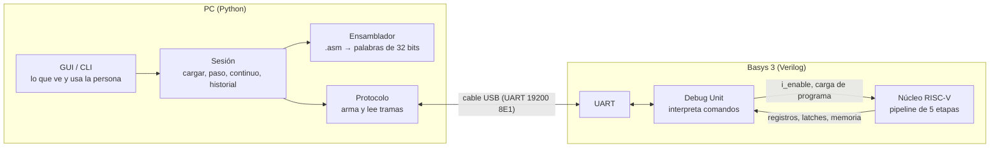
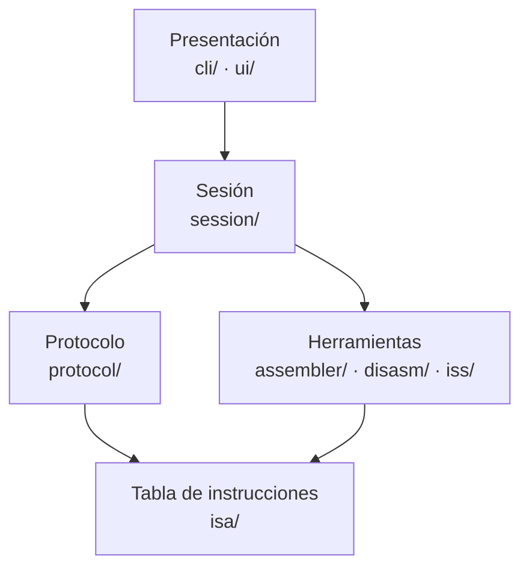

# Arquitectura del software: qué corre en la placa y qué corre en la PC

Este documento explica cómo se reparte el trabajo entre la FPGA y la PC, por qué el software de PC tiene tantos archivos de Python y qué hace cada uno. Es un resumen de las secciones 4 y 5 del [PRD](PRD-pipeline-riscv.md) y de los ADR que se citan.

---

## 1. Dos mitades que solo se hablan por UART

|                        | Debug Unit                                                                                                                                                | GUI y programas de Python                                                                          |
| ---------------------- | --------------------------------------------------------------------------------------------------------------------------------------------------------- | -------------------------------------------------------------------------------------------------- |
| **Dónde corre**        | En la FPGA, es hardware (Verilog)                                                                                                                         | En la PC                                                                                           |
| **Qué es**             | Un circuito al lado del procesador                                                                                                                        | Programas                                                                                          |
| **Qué hace**           | Recibe comandos de 1 byte, escribe el programa en la memoria, habilita el reloj lógico del núcleo de a un ciclo o de corrido, y manda de vuelta el estado | Ensambla el programa, manda los comandos, interpreta los bytes que vuelven y los muestra           |
| **Qué sabe**           | Nada de instrucciones ni de nombres: solo mueve bytes                                                                                                     | Todo lo que tiene significado: mnemónicos, nombres de registros, qué instrucción hay en cada etapa |
| **Qué no puede hacer** | Mostrar nada ni decidir nada por su cuenta                                                                                                                | Tocar el procesador: todo pasa por un comando                                                      |

La Debug Unit y la GUI **no son lo mismo**. La Debug Unit es el "control remoto" que vive dentro de la placa; la GUI es la pantalla que usa ese control remoto. Se podría manejar la Debug Unit sin GUI (con la CLI, o mandando bytes a mano desde una terminal serie), y se puede usar la GUI sin placa (con el transporte simulado).

El único contrato entre las dos mitades es el **protocolo** (ADR-003): qué byte es cada comando y qué forma tienen las respuestas. Mientras ese contrato no cambie, cada mitad se puede desarrollar y probar por separado.

### Un paso (`STEP`), de punta a punta

1. La persona aprieta **Paso** en la GUI.
2. La sesión le pide al protocolo que mande el comando `STEP` (un byte).
3. El transporte escribe ese byte en el puerto serie.
4. En la placa, la UART lo recibe y la Debug Unit lo reconoce.
5. La Debug Unit habilita el núcleo durante **exactamente un ciclo de reloj** y lo vuelve a detener.
6. La Debug Unit lee el PC, los 32 registros, los 4 latches y la memoria usada, y los manda por la UART en una trama.
7. En la PC, el protocolo verifica la trama y la convierte en un objeto `Snapshot`.
8. La sesión lo guarda en el historial y lo compara con el anterior.
9. La GUI dibuja el nuevo estado y resalta lo que cambió.

---

## 2. Por qué tantos archivos de Python

Porque son **cuatro programas distintos que comparten piezas**, y cada pieza está en un solo lugar:

| Programa                        | Para qué sirve                                                                 | ¿Lo pide el enunciado?                      |
| ------------------------------- | ------------------------------------------------------------------------------ | ------------------------------------------- |
| Ensamblador (`rvasm`)           | Convierte un `.asm` en las palabras que se cargan en la memoria                | Sí                                          |
| Depurador por consola (`rvdbg`) | Carga, corre y hace pasos desde la terminal                                    | Sí (es la interfaz mínima)                  |
| GUI                             | Lo mismo, con el pipeline dibujado                                             | Sí (interfaz de usuario)                    |
| Golden model (`rvsim`)          | Ejecuta el programa en la PC para saber qué resultado **debería** dar la placa | No; es nuestra forma de verificar (ADR-014) |

Si cada programa fuera un script suelto, la tabla de instrucciones estaría copiada tres veces (ensamblador, desensamblador y golden model) y un error en una copia pasaría desapercibido. Con las piezas compartidas, las 33 instrucciones se definen **una vez** y todos leen de ahí.

Además, separar en capas permite:

- **Probar sin placa.** Todo lo que no sea "escribir en el puerto serie" se prueba con tests automáticos.
- **Trabajar en paralelo.** Uno hace la GUI contra una placa simulada mientras el otro termina el hardware.
- **Cambiar una parte sin romper las otras.** Si hubiera que cambiar el framework de la GUI, solo se reescribe la carpeta `ui/`.

### Las capas

Cada capa solo conoce a las de abajo. La tabla de instrucciones no sabe que existe una GUI; la GUI no sabe cómo es una trama.

---

## 3. Qué hace cada archivo

Todo vive en `TP3/tools/riscv_toolkit/`.

### `isa/` — la definición de RV32I

| Archivo            | Qué hace                                                                                       |
| ------------------ | ---------------------------------------------------------------------------------------------- |
| `instrucciones.py` | La tabla de las 33 instrucciones: mnemónico, formato, opcode, `funct3`, `funct7`. Fuente única |
| `formatos.py`      | Cómo se empaquetan y desempaquetan los campos de cada formato (R, I, S, B, U, J) en 32 bits    |
| `registros.py`     | Los nombres de los registros: `x0`…`x31` y sus alias (`zero`, `ra`, `sp`, …)                   |

### `assembler/` — de texto a código de máquina

| Archivo        | Qué hace                                                                                                     |
| -------------- | ------------------------------------------------------------------------------------------------------------ |
| `lexer.py`     | Corta cada línea en piezas: mnemónico, registros, números, etiquetas, comentarios                            |
| `parser.py`    | Verifica que las piezas formen una instrucción válida (cantidad y tipo de operandos)                         |
| `assembler.py` | Las dos pasadas: la primera anota en qué dirección queda cada etiqueta; la segunda codifica cada instrucción |
| `imagen.py`    | El resultado: la lista de palabras, la tabla de símbolos y qué línea del `.asm` generó cada palabra          |
| `errores.py`   | Los errores con número de línea y mensaje claro                                                              |

### `disasm/` — de código de máquina a texto

| Archivo           | Qué hace                                                                                                                                     |
| ----------------- | -------------------------------------------------------------------------------------------------------------------------------------------- |
| `disassembler.py` | Convierte una palabra de 32 bits en su texto (`0x00500093` → `addi x1, x0, 5`). La GUI lo usa para mostrar qué instrucción hay en cada etapa |

### `iss/` — el procesador de referencia

| Archivo           | Qué hace                                                                                                                           |
| ----------------- | ---------------------------------------------------------------------------------------------------------------------------------- |
| `golden_model.py` | Ejecuta el programa instrucción por instrucción en la PC, sin pipeline. Su resultado final es contra lo que se compara el hardware |

### `protocol/` — hablar con la placa

| Archivo               | Qué hace                                                                                                    |
| --------------------- | ----------------------------------------------------------------------------------------------------------- |
| `comandos.py`         | Las constantes del protocolo: el byte de cada comando, los tipos de respuesta, los códigos de error         |
| `codec.py`            | Arma los bytes de cada comando y desarma las tramas de respuesta, verificando cabecera, longitud y checksum |
| `snapshot.py`         | La "foto" del procesador ya interpretada: PC, registros, cada latch con sus campos, memoria usada           |
| `transport.py`        | La interfaz común: "mandar bytes" y "recibir bytes", sin decir cómo                                         |
| `serial_transport.py` | La implementación real: el puerto serie de la Basys 3. Es el **único** archivo que usa `pyserial`           |
| `fake_transport.py`   | Una placa simulada: responde los comandos usando el golden model. Permite usar la GUI sin FPGA              |

### `session/` — la lógica de una sesión de depuración

| Archivo            | Qué hace                                                                                   |
| ------------------ | ------------------------------------------------------------------------------------------ |
| `debug_session.py` | Las operaciones de alto nivel: `cargar()`, `paso()`, `continuo()`, `reset()`, `dump_mem()` |
| `history.py`       | Guarda todos los snapshots de la sesión, para volver atrás o armar la carta de pipeline    |
| `diff.py`          | Compara dos snapshots y dice qué registros, latches y posiciones de memoria cambiaron      |
| `export.py`        | Guarda una sesión completa en un archivo y la reabre sin placa                             |

### `cli/` — los comandos de terminal

| Archivo    | Comando | Qué hace                                                |
| ---------- | ------- | ------------------------------------------------------- |
| `rvasm.py` | `rvasm` | Ensambla un `.asm` y genera `.hex`, `.bin` y `.lst`     |
| `rvsim.py` | `rvsim` | Corre un programa en el golden model                    |
| `main.py`  | `rvdbg` | Controla la placa: cargar, correr, paso, volcar memoria |

### `ui/` — la interfaz gráfica (Flet, ADR-012)

| Archivo                        | Qué hace                                                             |
| ------------------------------ | -------------------------------------------------------------------- |
| `app.py`                       | Arranca la ventana y decide si se conecta a la placa o a la simulada |
| `state.py`                     | El estado de la interfaz, independiente de Flet (se puede testear)   |
| `views/connection_bar.py`      | Elegir el puerto y conectar                                          |
| `views/editor_view.py`         | Editar y ensamblar el programa                                       |
| `views/controls_view.py`       | Botones: cargar, paso, continuo, reset, abortar                      |
| `views/pipeline_view.py`       | Las 5 etapas con la instrucción que hay en cada una                  |
| `views/latch_detail_view.py`   | Los campos de cada latch                                             |
| `views/pipeline_chart_view.py` | La carta de pipeline (instrucciones × ciclos)                        |
| `views/registers_view.py`      | Los 32 registros, resaltando los que cambiaron                       |
| `views/memory_view.py`         | La memoria de datos usada                                            |
| `views/timeline_view.py`       | El historial de pasos                                                |

### `scripts/` — tareas puntuales

| Archivo             | Qué hace                                                                                                                   |
| ------------------- | -------------------------------------------------------------------------------------------------------------------------- |
| `gen_du_defs.py`    | Genera el archivo de constantes de Verilog a partir de `comandos.py`, para que hardware y software usen los mismos valores |
| `verify_rtl.py`     | Corre toda la suite de programas en la simulación del RTL y la compara con el golden model                                 |
| `verify_board.py`   | Lo mismo, pero en la placa real                                                                                            |
| `uart_echo_test.py` | Prueba mínima del enlace serie                                                                                             |

No todos los archivos existen desde el primer día: se crean en la historia de usuario que los necesita (US-105 a US-108 para el ensamblador y el golden model, US-409 y US-410 para el protocolo y la CLI, US-501 a US-505 para la GUI).

---

## 4. Cómo se organiza y se ejecuta

- **Un solo proyecto de uv**, en `TP3/tools/`, con un `pyproject.toml` y un `uv.lock`. No se publica ni se instala a mano: `uv sync` deja el entorno listo y los comandos se corren con `uv run` (`uv run rvasm programa.asm`, `uv run rvdbg --port COM4`).
- **La GUI es una aplicación de escritorio.** Necesita abrir el puerto serie de la placa, que es un dispositivo USB de la máquina. Flet permite, con el mismo código, abrirla en el navegador (`flet run --web`) si alguna vez hiciera falta.
- **Verificaciones**, en local y en el CI: `pytest` con cobertura, `ruff`, `mypy` y `pip-audit` (ADR-011, ADR-015).
