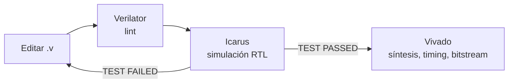

# Guía de herramientas: lint con Verilator y simulación con Icarus Verilog

Cómo revisar y simular el RTL del TP3 desde la terminal, sin abrir Vivado. Vivado sigue siendo necesario para sintetizar, implementar, analizar timing y programar la placa. Todos los comandos se corren desde la carpeta `TP3/`.

| Herramienta        | Para qué se usa                                            |
| ------------------ | ---------------------------------------------------------- |
| `iverilog` + `vvp` | Compilar y ejecutar simulaciones RTL                       |
| `verilator`        | Lint: detecta errores y construcciones dudosas sin simular |

> **Alcance.** Icarus hace simulación RTL (funcional): verifica que el diseño responde lo esperado, pero no modela los retardos de la FPGA. El timing real y las simulaciones post-síntesis o post-implementación solo se obtienen con Vivado.

---

## 1. Instalación

En Ubuntu, Linux Mint o WSL (Ubuntu 24.04):

```bash
sudo apt update
sudo apt install -y make iverilog verilator
```

Comprobar:

```bash
iverilog -V | head -1      # Icarus Verilog version 12.0
verilator --version        # Verilator 5.020
```

En WSL, el repositorio se usa directamente desde `/mnt/c/...`.

Para Python se usa **uv** (ADR-011):

```bash
curl -LsSf https://astral.sh/uv/install.sh | sh
```

---

## 2. Icarus Verilog: simular

Simular son dos pasos: `iverilog` compila los fuentes a un archivo `.vvp`, y `vvp` lo ejecuta.

```bash
mkdir -p build
iverilog -g2001 -Wall -o build/tb_baudrate_gen.vvp \
    hw/rtl/uart/baudrate_gen.v hw/tb/uart/tb_baudrate_gen.v
vvp build/tb_baudrate_gen.vvp
```

| Opción              | Qué hace                                                                                      |
| ------------------- | --------------------------------------------------------------------------------------------- |
| `-g2001`            | Acepta solo Verilog-2001. Es el estándar del proyecto (ADR-015)                               |
| `-Wall`             | Activa todas las advertencias                                                                 |
| `-o archivo`        | Archivo de salida. Se guarda en `build/`, que no se versiona                                  |
| `-s modulo`         | Elige el módulo raíz. Hace falta si hay más de un candidato (por ejemplo, varios testbenches) |
| `-I carpeta`        | Carpeta donde buscar los archivos de `` `include `` (por ejemplo `-I hw/tb/common`)           |
| `-D NOMBRE`         | Define una macro, como un `` `define NOMBRE `` al principio de todos los archivos             |
| `-P tb.PARAM=valor` | Cambia un parámetro del módulo raíz sin editar el archivo                                     |

El orden de los archivos no importa. Si falta un módulo, el error es `Unknown module type`.

### Argumentos en tiempo de ejecución (plusargs)

Lo que se escribe después del `.vvp` con un `+` adelante lo puede leer el testbench sin recompilar:

```bash
vvp build/tb_baudrate_gen.vvp +WAVES
```

```verilog
if ($test$plusargs("WAVES")) ...             // ¿se pasó +WAVES?
if ($value$plusargs("HEX=%s", ruta)) ...     // lee +HEX=asm/prog.hex en 'ruta'
```

### Cargar una memoria desde un archivo

```verilog
reg [31:0] mem [0:255];
initial $readmemh("asm/prog.hex", mem);   // una palabra hexadecimal por línea
```

La ruta es relativa a la carpeta desde donde se corre `vvp`.

### Advertencias habituales

| Mensaje                          | Qué significa                                                                                             |
| -------------------------------- | --------------------------------------------------------------------------------------------------------- |
| `Some modules have no timescale` | El testbench declara `` `timescale `` y el RTL no. No afecta al resultado mientras el RTL no use retardos |
| `implicit definition of wire`    | Se usó una señal sin declararla: casi siempre es un error de tipeo en un nombre                           |
| `Port ... expects N bits, got M` | Los anchos no coinciden en una conexión                                                                   |

---

## 3. Un testbench de ejemplo

El siguiente testbench comprueba que `baudrate_gen` emite un tick cada `COUNT_MAX` ciclos. Sirve como plantilla: genera el reloj, aplica el reset, verifica el resultado y lo informa con `TEST PASSED` o `TEST FAILED`.

```verilog
`timescale 1ns / 1ps

module tb_baudrate_gen;
  reg  clock = 1'b0;
  reg  i_reset = 1'b1;
  wire o_baudrate;
  integer ciclos;

  // COUNT_MAX chico para que la simulacion sea corta
  baudrate_gen #(.COUNT_MAX(4), .BITS(3)) dut (
    .clock(clock), .i_reset(i_reset), .o_baudrate(o_baudrate)
  );

  always #5 clock = ~clock;  // 100 MHz

  initial
  begin
    if ($test$plusargs("WAVES"))
    begin
      $dumpfile("build/tb_baudrate_gen.vcd");
      $dumpvars(0, tb_baudrate_gen);
    end

    repeat (2) @(posedge clock);
    i_reset = 1'b0;

    // Mide cuantos ciclos de clock hay entre dos ticks consecutivos
    @(posedge o_baudrate);
    ciclos = 0;
    @(negedge o_baudrate);
    while (!o_baudrate)
    begin
      @(negedge clock);
      ciclos = ciclos + 1;
    end

    if (ciclos == 4) $display("TEST PASSED");
    else             $display("TEST FAILED (periodo = %0d ciclos, esperado 4)", ciclos);
    $finish;
  end
endmodule
```

Puntos a notar:

- **Parámetros chicos.** Con `COUNT_MAX = 4` la simulación dura nanosegundos. Con el valor real (326) funcionaría igual pero tardaría más.
- **Ondas opcionales.** `$dumpfile` y `$dumpvars` solo se ejecutan si se pasa `+WAVES`, así una corrida normal no genera archivos grandes. `$dumpvars(0, modulo)` vuelca todas las señales de ese módulo y de los que tiene adentro.
- **`$finish` siempre.** Sin él, el bloque `always` del reloj hace que la simulación no termine nunca. Si una simulación se cuelga, se corta con `Ctrl+C` y después `finish`.
- **Veredicto explícito.** El testbench compara y decide; no hace falta mirar las ondas para saber si pasó.

Salida esperada con `+WAVES`:

```text
VCD info: dumpfile build/tb_baudrate_gen.vcd opened for output.
TEST PASSED
```

---

## 4. Ondas, cuando un test falla

Los testbenches dicen si pasaron o no, así que las ondas no forman parte del flujo normal. Si hace falta mirar señales para entender una falla, se genera el archivo `.vcd` bajo demanda:

```bash
vvp build/tb_baudrate_gen.vvp +WAVES     # genera build/tb_baudrate_gen.vcd
```

El `.vcd` es un formato estándar: se abre con cualquier visor de ondas (por ejemplo la extensión WaveTrace o Surfer de VS Code, o GTKWave). Si resulta muy grande, se limita lo que se vuelca: `$dumpvars(1, tb)` guarda solo las señales del testbench, sin los módulos internos.

---

## 5. Verilator: lint

Verilator revisa el código sin simularlo y encuentra errores que Icarus acepta en silencio: anchos que no coinciden, señales sin usar, latches inferidos, mezcla de asignaciones bloqueantes y no bloqueantes.

```bash
verilator --lint-only -Wall --top-module uart_rx hw/rtl/uart/uart_rx*.v
```

| Opción                | Qué hace                                                                        |
| --------------------- | ------------------------------------------------------------------------------- |
| `--lint-only`         | Solo analiza; no genera el simulador en C++                                     |
| `-Wall`               | Activa todas las advertencias, incluidas las de estilo                          |
| `--top-module nombre` | Módulo raíz. Hace falta cuando se pasan varios archivos                         |
| `-Icarpeta`           | Carpeta de `` `include `` (va pegado, sin espacio)                              |
| `-Wno-NOMBRE`         | Desactiva una advertencia puntual, por ejemplo `-Wno-UNUSEDSIGNAL`              |
| `--timing`            | Acepta retardos (`#5`) y esperas de eventos; necesario para revisar testbenches |

Advertencias más frecuentes:

| Advertencia      | Qué significa                                            | Qué hacer                                            |
| ---------------- | -------------------------------------------------------- | ---------------------------------------------------- |
| `WIDTH`          | Los anchos de una asignación o comparación no coinciden  | Corregir: suele ser un error real                    |
| `LATCH`          | Un `always @(*)` no asigna la señal en todos los caminos | Corregir: agregar el valor por defecto               |
| `CASEINCOMPLETE` | A un `case` le faltan casos y no tiene `default`         | Agregar el `default`                                 |
| `BLKSEQ`         | Asignación bloqueante (`=`) en un bloque con reloj       | Usar `<=`                                            |
| `UNUSEDSIGNAL`   | Una señal se declara y no se usa                         | Borrarla, o justificar por qué queda                 |
| `PINMISSING`     | Una instancia deja un puerto sin conectar                | Conectarlo, o dejarlo vacío a propósito: `.puerto()` |
| `DECLFILENAME`   | El nombre del módulo no coincide con el del archivo      | Solo estilo; pasa con `legacy/alu_tp1.v`             |

Para silenciar una advertencia justificada en un lugar puntual, sin desactivarla en todo el proyecto:

```verilog
// verilator lint_off UNUSEDSIGNAL
wire [31:0] w_debug;
// verilator lint_on UNUSEDSIGNAL
```

> **Diferencia con Icarus.** Verilator se usa acá solo como revisor. También puede simular, pero compila el diseño a C++ y requiere otro tipo de testbench; en este proyecto la simulación se hace con Icarus (ADR-015).

---

## 6. Flujo de trabajo y dónde entra Vivado



| Tarea                                          | Terminal | Vivado |
| ---------------------------------------------- | :------: | :----: |
| Lint                                           |    ✅    |   ✅   |
| Simulación RTL                                 |    ✅    |   ✅   |
| Simulación con IP de Xilinx (Clock Wizard)     |    ❌    |   ✅   |
| Simulación post-síntesis / post-implementación |    ❌    |   ✅   |
| Síntesis, implementación y timing              |    ❌    |   ✅   |
| Bitstream y programación de la placa           |    ❌    |   ✅   |

### Proyecto de Vivado

El proyecto de Vivado no se versiona (NFR-8, ADR-020): cada integrante lo crea localmente.

1. Verificar que la versión sea **2025.2** (`Help → About`).
2. Crear un proyecto RTL para la parte `xc7a35tcpg236-1`, fuera del repositorio.
3. **Add Sources:** las carpetas de `TP3/hw/rtl/` que correspondan, con **"Copy sources into project" desmarcado** para que el proyecto use los archivos del repositorio.
4. **Add Constraints:** `TP3/hw/constraints/basys3.xdc`, también sin copiar.

| Etapa                           | Fuentes                             | `top`                         |
| ------------------------------- | ----------------------------------- | ----------------------------- |
| Prueba de humo de la migración  | `hw/rtl/uart/` + `hw/rtl/legacy/`   | `top` (en `legacy/top_tp2.v`) |
| Desde que exista `hw/rtl/top.v` | `hw/rtl/` completo, salvo `legacy/` | `top`                         |

---

## 7. Uso en el CI

Icarus y Verilator se instalan en segundos en un runner de GitHub Actions, así que las mismas verificaciones corren en cada PR (ADR-015):

```yaml
- name: Instalar herramientas HDL
  run: sudo apt-get update && sudo apt-get install -y iverilog verilator

- name: Lint
  run: make lint
  working-directory: TP3

- name: Simulación
  run: make sim-all
  working-directory: TP3
```

El workflow definitivo (`.github/workflows/ci.yml`) y los objetivos del `Makefile` se definen en la US-102.

---

## 8. Referencia rápida

```bash
# Lint de un módulo
verilator --lint-only -Wall --top-module uart_rx hw/rtl/uart/uart_rx*.v

# Compilar y simular
mkdir -p build
iverilog -g2001 -Wall -o build/tb.vvp hw/rtl/uart/*.v hw/tb/uart/tb_algo.v
vvp build/tb.vvp

# Simular generando ondas (build/tb_algo.vcd)
vvp build/tb.vvp +WAVES
```
