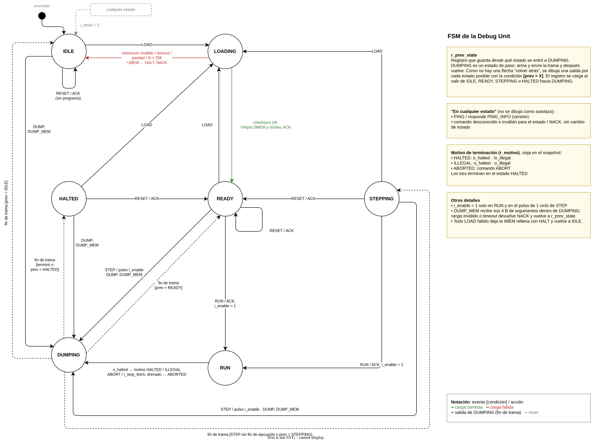
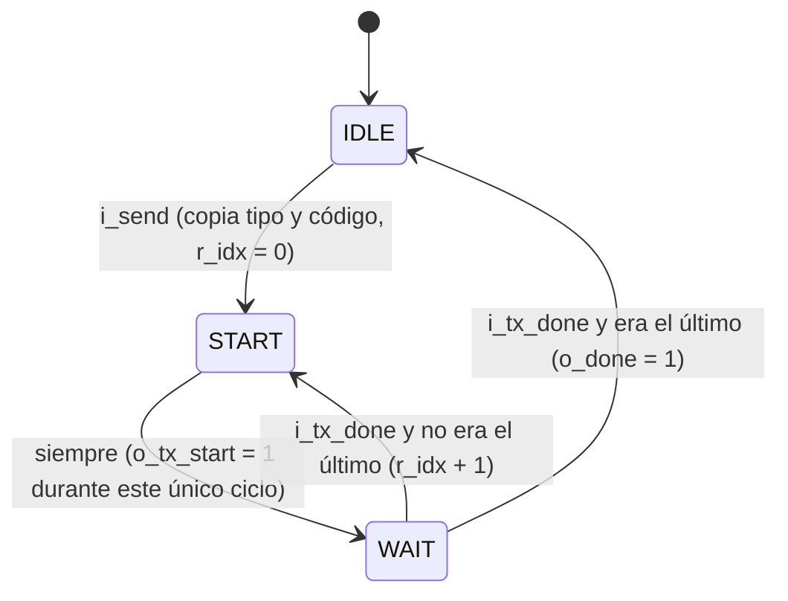
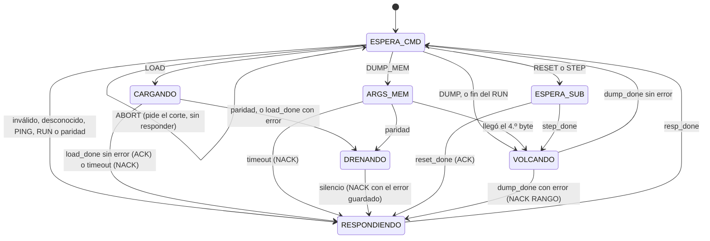
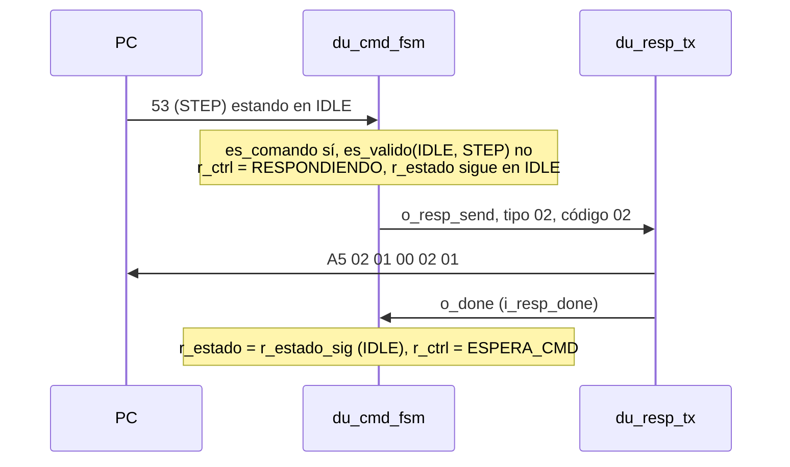
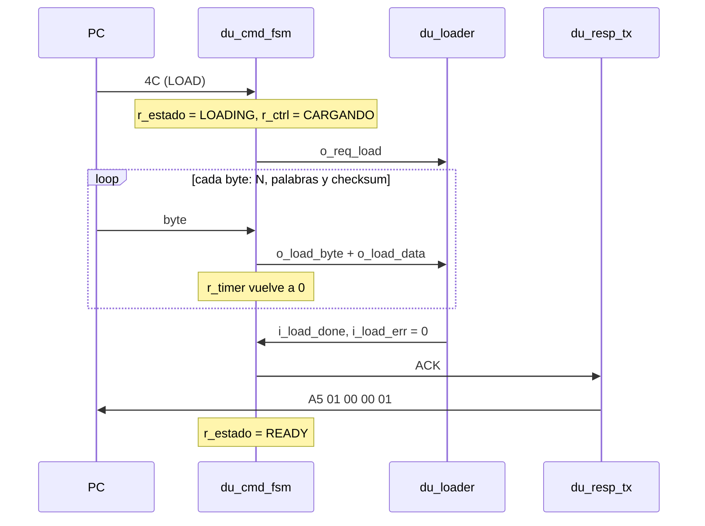
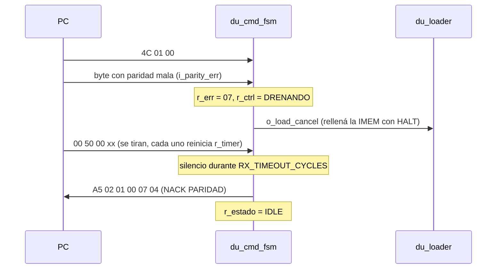
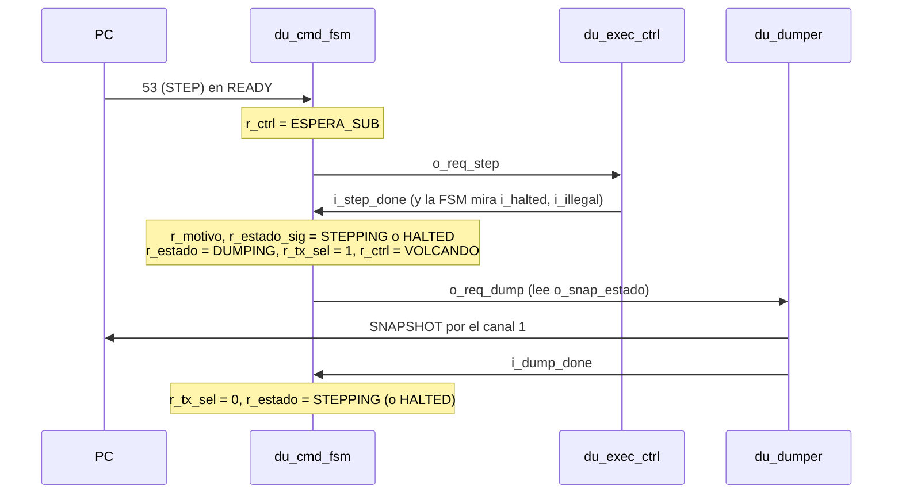
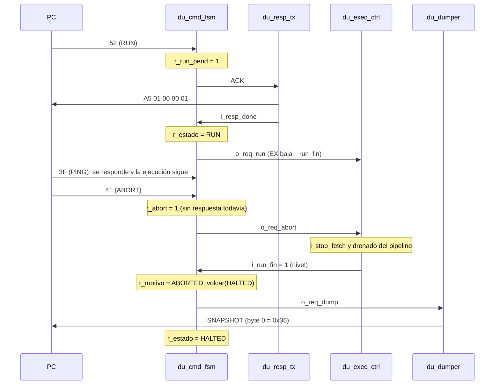

# Guía de estudio: la FSM de la Debug Unit

Guía para entender **en qué estado está la Debug Unit (DU), qué hace en cada uno y por qué pasa al siguiente**. La referencia formal (bytes, códigos, tablas) está en [`protocolo.md`](../protocolo.md). Esta guía cuenta la historia.

- La **Parte 1** (secciones 1 a 6) explica la FSM **del protocolo**: lo que ve la PC.
- La **Parte 2** (secciones 7 a 17) explica **cómo está implementada en Verilog** (US-403): los módulos, cada señal y cada registro, y los pasos internos que da la FSM ante cada comando.
- La **Parte 3** (secciones 18 a 28) explica `du_loader` (US-404): cómo se carga el programa y cómo se limpia todo antes de ejecutar.



## 1. Qué es una FSM

Una **máquina de estados finitos** (_Finite State Machine_) es un circuito que en cada momento está en **uno** de un conjunto chico de estados. Un **evento** (llega un byte, el núcleo avisa que terminó) la hace **transicionar** a otro estado y, en el camino, ejecutar una **acción** (mandar un `ACK`, poner `i_enable = 1`).

En el diagrama, cada flecha se lee **`evento [condición] / acción`**. Por ejemplo, `RUN / ACK, i_enable = 1` quiere decir "llegó el comando RUN; respondo ACK y habilito el reloj del núcleo".

## 2. Los 7 estados en una línea

| Estado     | En una frase                                                         |
| ---------- | -------------------------------------------------------------------- |
| `IDLE`     | Estoy prendida, pero no tengo un programa válido                     |
| `LOADING`  | Estoy recibiendo un programa                                         |
| `READY`    | Tengo un programa limpio, listo para arrancar en el ciclo 0          |
| `RUN`      | El núcleo corre libre                                                |
| `STEPPING` | Estoy en medio de una ejecución paso a paso, con el núcleo congelado |
| `DUMPING`  | Estoy enviando un snapshot o un bloque de memoria                    |
| `HALTED`   | La ejecución terminó y el pipeline está vacío                        |

`LOADING` y `DUMPING` son **estados de paso**: la DU está ocupada recibiendo o enviando, no atiende comandos y sale sola cuando termina.

## 3. El cuento completo

### 3.1 Encendido → `IDLE`

Al prender la placa, o al apretar el botón de reset (`i_reset`), la DU arranca en `IDLE`. La IMEM no tiene nada confiable todavía, así que no se puede ejecutar: `RUN` y `STEP` responden `NACK(ERR_ESTADO)`. Lo que sí se puede hacer es `LOAD`, `RESET`, `DUMP`, `DUMP_MEM` y `PING`.

### 3.2 `LOAD`: `IDLE` → `LOADING`

La GUI manda el byte `'L'` (`0x4C`) y la DU pasa a `LOADING`.

**Qué viaja:** no el texto en assembly, sino el **código máquina ya ensamblado**. La PC corre el ensamblador y manda palabras de 32 bits (`addi x1, x0, 5` viaja como `93 00 50 00`). El orden es:

1. `N`: cuántas palabras vienen (2 bytes).
2. Las `N` palabras, 4 bytes cada una.
3. Un byte de checksum, que es el XOR de todo lo anterior salvo la `'L'`.

**¿Se verifica palabra por palabra o todo al final?** **Todo al final.** La DU escribe cada palabra en la IMEM **apenas termina de llegar** y va acumulando el XOR. Recién cuando llega el último byte compara su XOR con el checksum que mandó la PC. No hay verificación por instrucción: una sola suma de control para todo el programa.

> ¿Por qué no se guarda todo en un buffer y se escribe al final? Porque el buffer sería otra IMEM entera de flip-flops. Es más barato escribir directo y, si algo sale mal, "borrar" la IMEM rellenándola con HALT.

Mientras está en `LOADING`, **todo byte es parte de la carga**. Si dentro de una palabra aparece `0x52` (`'R'`), no es un `RUN`: es un dato.

### 3.3 Fin de la carga: `LOADING` → `READY` o `IDLE`

**Si el checksum coincide** → `READY`. Antes de responder, la DU:

- rellena con HALT la parte de la IMEM que el programa no usa,
- escribe ceros en toda la DMEM y limpia el bitmap de memoria usada,
- resetea el núcleo: PC = 0, registros en 0, latches con `valid = 0`, contador de ciclos en 0,
- responde `ACK`.

**Si algo falló** → `IDLE`, con **toda** la IMEM rellena de HALT, y responde `NACK`. Pueden fallar cuatro cosas:

| Falla          | Qué significa                                                                                            |
| -------------- | -------------------------------------------------------------------------------------------------------- |
| `ERR_CHECKSUM` | Llegaron todos los bytes, pero alguno se corrompió en el cable                                           |
| `ERR_TIMEOUT`  | Pasaron **100 ms sin que llegue ningún byte** en medio de la carga (por ejemplo, se desenchufó el cable) |
| `ERR_PARIDAD`  | Un byte llegó con el bit de paridad incorrecto                                                           |
| `ERR_TAMANO`   | `N` es 0 o mayor que 256                                                                                 |

**Sobre el timeout:** no es un tiempo total para el `LOAD`, sino el tiempo **entre un byte y el siguiente**. Cada byte que llega reinicia el contador. Un programa largo puede tardar varios segundos en cargarse sin problema, siempre que no haya un hueco de 100 ms.

**¿Por qué rellenar con HALT y no dejar lo que había?** Porque las primeras palabras ya se escribieron. La IMEM quedó con la mitad del programa nuevo y la mitad del viejo: una mezcla que no es ningún programa. Rellenarla con HALT garantiza que, si alguien la ejecuta igual, se detiene en la primera instrucción. Y como no hay programa válido, la DU vuelve a `IDLE`.

**¿Y los errores a mitad de la carga?** Paridad y tamaño se detectan **antes** de que termine de llegar la carga. Si la DU respondiera en ese momento, los bytes que siguen llegando se leerían como comandos. Por eso primero espera a que la línea quede en silencio (100 ms) y recién después responde el `NACK` ([protocolo §7.2](../protocolo.md)).

### 3.4 `STEP`: `READY` → `DUMPING` → `STEPPING`

Llega `'S'`. La DU:

1. pone `i_enable = 1` durante **exactamente un ciclo de reloj**: el núcleo avanza un ciclo y todas las instrucciones del pipeline se corren una etapa;
2. vuelve a poner `i_enable = 0`, y el núcleo queda congelado;
3. pasa a `DUMPING` y envía el snapshot (la "foto" de registros, latches y memoria usada);
4. cuando sale el último byte del snapshot, pasa a `STEPPING`.

¿Por qué `STEPPING` y no `READY`? Porque `READY` significa "limpio, en el ciclo 0". Después de un paso ya no lo está: se ejecutó al menos un ciclo.

Cada `STEP` siguiente hace lo mismo: `STEPPING` → `DUMPING` → `STEPPING`.

**Excepción:** si en ese ciclo el HALT llegó a WB, la ejecución terminó, así que al salir de `DUMPING` va a `HALTED` en lugar de a `STEPPING` (ver 3.6).

### 3.5 Comandos desde `STEPPING`

| Llega   | Pasa a                 | Para qué sirve                                                                                     |
| ------- | ---------------------- | -------------------------------------------------------------------------------------------------- |
| `STEP`  | `DUMPING` → `STEPPING` | Otro paso                                                                                          |
| `RUN`   | `RUN`                  | "Ya vi lo que quería, corré hasta el final"                                                        |
| `RESET` | `READY`                | Volver a empezar el **mismo** programa desde el ciclo 0 sin reenviarlo (limpia todo menos la IMEM) |
| `LOAD`  | `LOADING`              | Abandonar esta depuración y cargar otro programa                                                   |
| `DUMP`  | `DUMPING` → `STEPPING` | Pedir la foto de nuevo sin avanzar (por ejemplo, si se perdió la anterior)                         |

> **Ojo:** `ACK` no es un comando, es una **respuesta** de la FPGA. La PC nunca manda un `ACK`. Los que llevan de `STEPPING` a `READY` son `RESET` y, pasando por `LOADING`, `LOAD`.

`RESET` y `LOAD` se aceptan en `STEPPING` porque, en modo paso a paso, el programa puede no terminar nunca (por ejemplo, un loop infinito). Sin esos dos comandos, no habría forma de salir sin apretar el botón de la placa (ADR-010).

### 3.6 `RUN`: `READY`/`STEPPING` → `RUN` → `DUMPING` → `HALTED`

Llega `'R'`. La DU responde `ACK` **enseguida** (para que la PC sepa que el comando llegó) y deja `i_enable = 1` en todos los ciclos. El núcleo corre a toda velocidad.

En `RUN` la DU **sigue escuchando la UART**, pero solo acepta `ABORT` (y `PING`). Cualquier otro comando responde `NACK(ERR_ESTADO)` y la ejecución sigue.

**¿Cuándo termina?** Hay tres motivos:

| Motivo    | Quién lo detecta y cómo                                                                                                                                                                      |
| --------- | -------------------------------------------------------------------------------------------------------------------------------------------------------------------------------------------- |
| `HALTED`  | El **núcleo**. Detecta el HALT en **ID** y deja de buscar instrucciones, pero el HALT sigue avanzando. Cuando llega a **WB**, todo lo anterior ya terminó: el núcleo pone `o_halted = 1`     |
| `ILLEGAL` | El **núcleo**, igual que el HALT: la instrucción ilegal se detecta en ID y avanza marcada. Al llegar a WB pone `o_halted = 1` **y** `o_illegal = 1`                                          |
| `ABORTED` | La **DU**. Llega `'A'`, pone `i_stop_fetch = 1` (no se buscan más instrucciones) y espera a que las que ya estaban adentro terminen, o sea, a que los 4 bits `valid` de los latches valgan 0 |

La DU no decodifica instrucciones: solo **mira las salidas `o_halted` y `o_illegal`** del núcleo (y los `valid` en el caso de `ABORT`).

¿Por qué esperar a WB y no detenerse en ID? Porque en ese momento todavía hay instrucciones **más viejas** en EX, MEM y WB que no terminaron. Si se cortara en ID, quedarían a medio ejecutar. Esperar a WB garantiza que el pipeline quede vacío (R-EJ-5).

**Al terminar**, por cualquiera de los tres motivos:

1. `i_enable = 0` (el núcleo queda congelado);
2. pasa a `DUMPING` y envía el snapshot final, con el motivo dentro del byte `estado`;
3. al terminar de enviar, pasa a `HALTED`.

Entonces, respondiendo a la pregunta: **`RUN` pasa a `DUMPING` solo cuando la ejecución terminó**, y eso puede ser por HALT, por instrucción ilegal **o por `ABORT`**. Mientras no termine, se queda en `RUN`.

### 3.7 `DUMPING`: cuándo sale y adónde va

Sale **cuando se envió el último byte de la trama**, es decir, el checksum. ¿Adónde? Depende de por qué entró:

| Entró por                 | Sale a                                           |
| ------------------------- | ------------------------------------------------ |
| `DUMP`/`DUMP_MEM` desde X | X, el mismo estado de antes (lo guarda `r_prev`) |
| `STEP` sin terminar       | `STEPPING`                                       |
| `STEP` que terminó        | `HALTED`                                         |
| Fin de `RUN` o `ABORT`    | `HALTED`                                         |

`r_prev` es un registro que se carga **al entrar** a `DUMPING`, con el estado del que viene. `DUMPING` no tiene una flecha de "volver atrás" genérica, porque una FSM en hardware necesita saber a qué estado concreto ir. Por eso el diagrama dibuja una salida por cada estado posible, con la condición `[prev = X]`.

Mientras `DUMPING` envía, cualquier byte que llega se **descarta sin respuesta**: la PC tiene que esperar a recibir la trama completa.

### 3.8 `HALTED`: el final

El programa terminó y el pipeline está vacío. Desde acá se puede:

- `DUMP` / `DUMP_MEM`: volver a mirar el estado final (vuelve a `HALTED`; el motivo se conserva);
- `RESET` → `READY`: correr de nuevo el mismo programa;
- `LOAD` → `LOADING`: cargar otro programa.

`RUN` y `STEP` responden `NACK(ERR_ESTADO)`: no hay nada más que ejecutar sin reiniciar.

## 4. ¿Por qué se llega a `LOADING` desde `HALTED`, `STEPPING`, `READY` e `IDLE`?

Porque **cargar un programa nuevo tiene sentido cada vez que el núcleo no está corriendo**:

- `IDLE`: es la primera carga.
- `HALTED`: terminó un programa y querés probar otro. Es el caso más común: la métrica del proyecto pide 5 cargas seguidas sin resintetizar.
- `READY`: cargaste el programa equivocado y lo querés cambiar antes de correrlo.
- `STEPPING`: estás depurando paso a paso, encontraste el bug, lo corregiste en la PC y querés cargar la versión nueva sin terminar la ejecución anterior.

**¿Por qué no desde `RUN`?** Porque el núcleo está leyendo la IMEM en ese mismo momento: escribirla en medio de la ejecución ejecutaría una mezcla de programas. Primero hay que mandar `ABORT` (→ `HALTED`) y después `LOAD`.

Como `LOAD` siempre limpia todo (ADR-009), no importa desde qué estado se haga: el resultado es el mismo que después de encender la placa, pero con el programa nuevo.

## 5. Lo que no está dibujado como flecha

Para no llenar el diagrama de autolazos, hay dos reglas que valen en todos los estados que aceptan comandos:

- `PING` responde la versión del protocolo y **no cambia el estado**.
- Un comando desconocido, o uno inválido para ese estado, responde `NACK` y **no cambia nada**.

El botón de reset de la placa (`i_reset`) lleva a `IDLE` desde **cualquier** estado.

## 6. Errores comunes al razonar la FSM

- **Confundir el motivo con el estado.** `HALTED`, `ILLEGAL` y `ABORTED` son motivos de terminación que viajan en el snapshot. El estado es siempre `HALTED`.
- **Creer que `STEP` = una instrucción.** Es **un ciclo de reloj**. Una instrucción tarda 5 ciclos en atravesar el pipeline, y en cada ciclo hay hasta 5 instrucciones avanzando a la vez.
- **Creer que la DU detecta el HALT.** Lo detecta el núcleo. La DU solo mira `o_halted`.
- **Pensar que el timeout es para todo el `LOAD`.** Es entre bytes.
- **Interpretar bytes de datos como comandos.** En `LOADING` todo byte es dato, aunque valga `'R'`.

---

## Parte 2: cómo está implementada (US-403)

La Parte 1 describe **qué** hace la Debug Unit. Esta parte explica **cómo** lo hace el hardware de [`TP3/hw/rtl/debug/`](../../TP3/hw/rtl/debug/).

**Convención:** cada vez que aparece una señal o un registro, entre paréntesis se dice qué significa. Los prefijos siguen la convención del repo:

| Prefijo | Qué es                                                                   | Ejemplo                                          |
| ------- | ------------------------------------------------------------------------ | ------------------------------------------------ |
| `i_`    | entrada del módulo                                                       | `i_rx_done` (pulso: "llegó un byte bueno")       |
| `o_`    | salida del módulo                                                        | `o_estado` (estado del protocolo hacia los LEDs) |
| `r_`    | registro: guarda un valor entre ciclos (flip-flops)                      | `r_timer` (ciclos desde el último byte)          |
| `w_`    | cable: valor calculado en el momento, sin memoria (lógica combinacional) | `w_timeout` (1 cuando `r_timer` llegó al límite) |

## 7. La idea en una frase

La US-403 construye el **recepcionista** de la placa. Recibe los bytes que manda la PC, entiende qué comando es, decide si se puede hacer en este momento, le pasa el trabajo a quien corresponde y **siempre contesta algo** (R-DU-2).

Como en una mesa de entradas: llega alguien con un trámite (el comando).

- Si el trámite no existe, "no existe ese trámite" (`NACK(ERR_DESCONOCIDO)`).
- Si existe pero hoy no se atiende, "hoy no" (`NACK(ERR_ESTADO)`).
- Si se atiende, lo manda a la oficina correcta (el submódulo), espera que termine y le da el comprobante (`ACK` o los datos).

## 8. Mapa de bloques

```text
 PC ──(cable rx)──► uart_rx ──► ┌────────────────────── debug_unit ───────────────────────┐
                                │                                                         │
                                │  du_cmd_fsm ─pedidos o_req_*─► du_loader [exec] [dumper]│  ← exec y dumper
                                │  (el cerebro) ◄──"listo" i_*_done──                      │    (US-405, US-406):
                                │      │                                   │               │    los emula el testbench
                                │      ▼                                   │               │
                                │  du_resp_tx                              │               │
                                │  (ACK, NACK, PING_INFO)                  │               │
                                │      │ canal 0                   canal 1 │               │
                                │      └──────────►  du_tx_mux  ◄──────────┘               │
                                │                   (el turno)                            │
                                └─────────────────────────│───────────────────────────────┘
 PC ◄──(cable tx)── uart_tx ◄─────────────────────────────┘
```

| Archivo                                               | Qué es                             | Analogía                          |
| ----------------------------------------------------- | ---------------------------------- | --------------------------------- |
| [`du_tx_mux.v`](../../TP3/hw/rtl/debug/du_tx_mux.v)   | decide quién usa la UART de salida | el turno en un único teléfono     |
| [`du_resp_tx.v`](../../TP3/hw/rtl/debug/du_resp_tx.v) | arma y manda las respuestas cortas | el sello "recibido" / "rechazado" |
| [`du_cmd_fsm.v`](../../TP3/hw/rtl/debug/du_cmd_fsm.v) | interpreta, decide y coordina      | el recepcionista                  |
| [`debug_unit.v`](../../TP3/hw/rtl/debug/debug_unit.v) | contiene y conecta a los tres      | el edificio                       |

## 9. Conceptos que hay que tener claros

**Byte, comando, trama.**

- Un **byte** son 8 bits: lo mínimo que viaja por la UART.
- Un **comando** es un pedido de la PC: un byte (por ejemplo `0x3F` = `'?'` = `PING`), a veces seguido de **argumentos** (más bytes con datos, como las palabras del programa en un `LOAD`).
- Una **trama** es una respuesta de la placa con formato fijo: `A5 tipo long_baja long_alta [datos] checksum`.
  - `A5` marca el comienzo.
  - El **checksum** es el XOR de todos los bytes salvo el `A5`, y sirve para que la PC detecte bytes dañados.

**Pulso y nivel.**

```text
            ciclo:  1   2   3   4   5   6
pulso   (timbre)  ___|‾‾‾|___________________   vale 1 un solo ciclo: "pasó algo AHORA"
nivel   (luz)     ___|‾‾‾‾‾‾‾‾‾‾‾‾‾‾‾‾‾‾‾‾‾‾‾   queda en 1 MIENTRAS algo sea cierto
```

Si alguien avisa con un pulso y el otro no estaba mirando en ese ciclo, el aviso se pierde. Con un nivel no se pierde.

**Handshake (pedido y listo).** Coordina a dos módulos sin que ninguno sepa cuánto tarda el otro, como pedir un café y esperar que te llamen:

```text
du_cmd_fsm:  o_req_step   ___|‾|_______________________
exec:        i_step_done  ____________________|‾|______   (pueden pasar 3 o 30 000 ciclos)
du_cmd_fsm:  r_ctrl       ESPERA_CMD | ESPERA_SUB ...  | VOLCANDO
```

**Moore y Mealy.**

- Una salida **Moore** depende **solo de registros**.
- Una salida **Mealy** depende de registros **y de las entradas del momento**.
- **Regla del proyecto:** si un módulo A le da a B una salida Mealy, la salida de B que vuelve a A tiene que ser Moore. Si no, se arma un **lazo combinacional**: los dos `always @(*)` se reevalúan infinitamente y el simulador se cuelga **sin avanzar el tiempo**. Pasó con un mutante de `du_resp_tx`: `o_tx_done` de `uart_tx` es Mealy, así que `o_tx_start` tiene que ser Moore.

**Timeout.** Contador de ciclos **sin recibir bytes**. Si la PC empezó un comando largo y se calla demasiado (por ejemplo, se desenchufó el cable), la placa responde `NACK(ERR_TIMEOUT)` en vez de esperar para siempre.

**Drenado.** Ante un error en medio de los argumentos, la placa primero **tira** los bytes que siguen llegando hasta que la línea queda en silencio, y recién después responde. Si respondiera enseguida, los bytes que faltan se interpretarían como comandos: un `0x53` dentro de una instrucción sería un `STEP`.

**Paridad.** Un bit extra por byte para detectar un bit dado vuelta en el cable (US-401). Si está mal, `uart_rx` levanta `o_parity_err` (pulso: "llegó un byte con paridad incorrecta") en lugar de `o_rx_done` (pulso: "llegó un byte bueno").

## 10. `du_tx_mux`: el turno para hablar

**Problema:** hay una sola `uart_tx` (el transmisor serie) y dos módulos que quieren mandar:

- `du_resp_tx` (respuestas cortas);
- `du_dumper` (snapshots, US-405).

Si hablan a la vez, los bytes se mezclan.

```text
                  i_sel
                    │
du_resp_tx ─start0─►┌───┐
           ─data0──►│MUX│──o_tx_start──► uart_tx
           ◄done0───│   │──o_tx_data───►
du_dumper  ─start1─►│   │◄─i_tx_done────
           ─data1──►└───┘
           ◄done1───
```

| Señal                     | Qué es                                                                 |
| ------------------------- | ---------------------------------------------------------------------- |
| `i_sel`                   | selector: 0 = habla el canal 0 (`du_resp_tx`), 1 = el canal 1 (dumper) |
| `i_start_0` / `i_start_1` | pedido "mandá este byte" del canal 0 / 1                               |
| `i_data_0` / `i_data_1`   | el byte que quiere mandar el canal 0 / 1                               |
| `o_done_0` / `o_done_1`   | aviso al canal 0 / 1 de que **su** byte terminó de salir               |
| `o_tx_start`, `o_tx_data` | el pedido y el byte que finalmente llegan a `uart_tx`                  |
| `i_tx_done`               | aviso de `uart_tx`: "terminé de mandar el byte" (pulso, Mealy)         |

Son cuatro `assign`, sin reloj:

- **Ida:** pasan solo el `start` y el `data` del canal elegido.
- **Vuelta:** el `done` le llega **solo** al canal elegido; al otro le llega 0. Si le llegara a los dos, el que no habló creería que su byte salió y se saltearía uno.

**Regla de uso:** `i_sel` cambia solo **entre tramas**, nunca con un byte en vuelo. La cumple `du_cmd_fsm` (sección 12.8).

## 11. `du_resp_tx`: el sello de "recibido" o "rechazado"

Cuando se le pide, manda **una trama corta completa**, byte por byte. Hay solo tres:

```text
             byte:  0    1     2     3     4       5
ACK                 A5   01    00    00    01               ← 5 bytes, sin datos
NACK(código)        A5   02    01    00    código  XOR      ← 6 bytes
PING_INFO(versión)  A5   04    01    00    01      04       ← 6 bytes
                         └────────── XOR de estos ───┘       (el A5 no entra)
```

**¿Por qué solo estas tres?** Son las únicas respuestas que se arman **sin leer el núcleo**: un tipo y como mucho un byte. Las que llevan datos (`SNAPSHOT`, de 221 bytes o más, y `MEM_DATA`) las arma el dumper, que lee registros y memoria. Es como HTTP: respuestas de estado ("200 OK", "404") por un lado, respuestas con cuerpo (la página) por el otro.

| Comando                    | Respuesta                        | La manda              |
| -------------------------- | -------------------------------- | --------------------- |
| `LOAD`, `RESET`            | `ACK` o `NACK(err)`              | `du_resp_tx`          |
| `PING`                     | `PING_INFO`                      | `du_resp_tx`          |
| cualquier comando inválido | `NACK(código)`                   | `du_resp_tx`          |
| `RUN`                      | `ACK` ahora, `SNAPSHOT` al final | `du_resp_tx` + dumper |
| `STEP`, `DUMP`, `ABORT`    | `SNAPSHOT`                       | dumper                |
| `DUMP_MEM`                 | `MEM_DATA` o `NACK(RANGO)`       | dumper / `du_resp_tx` |

| Señal o registro          | Qué es                                                                                                       |
| ------------------------- | ------------------------------------------------------------------------------------------------------------ |
| `i_send`                  | pulso: "empezá a mandar una respuesta" (lo da `du_cmd_fsm`)                                                  |
| `i_tipo`                  | qué respuesta: `01` ACK, `02` NACK, `04` PING_INFO                                                           |
| `i_codigo`                | el byte de datos: código de error (NACK) o versión (PING_INFO); ACK lo ignora                                |
| `o_done`                  | pulso: "terminé de mandar la trama entera"                                                                   |
| `o_tx_start`, `o_tx_data` | pedido y byte hacia el canal 0 del mux                                                                       |
| `i_tx_done`               | aviso del mux: "salió el byte que pediste"                                                                   |
| `r_tipo`, `r_codigo`      | copias de `i_tipo`/`i_codigo` guardadas al recibir `i_send` (la FSM puede cambiarlas mientras la trama sale) |
| `r_idx`                   | qué byte de la trama se está mandando (0 a 5)                                                                |
| `w_con_payload`           | 1 si la trama lleva byte de datos (todas menos ACK)                                                          |
| `w_xor`                   | el checksum, calculado al instante: `tipo ^ longitud ^ dato`                                                 |
| `w_ultimo`                | índice del último byte: 4 para ACK, 5 para las otras                                                         |



**¿Por qué existe `START`?** ¿Por qué no se pide el byte siguiente en el mismo ciclo del `i_tx_done`?

1. En ese ciclo `uart_tx` todavía está en STOP, así que ignora el pedido y el byte se pierde.
2. `o_tx_start` tiene que ser Moore (sección 9): con `START`, depende solo del estado.

## 12. `du_cmd_fsm`: el cerebro

### 12.1 Las dos funciones de decisión

- **`es_comando(cmd)`** (¿este byte es uno de los 8 comandos?): 1 para `L R S D X A ? M`, 0 para los otros 248 bytes.
- **`es_valido(estado, cmd)`** (¿este comando se puede hacer en este estado?): la tabla de [protocolo §4.1](../protocolo.md) en código.

| Estado              | Comandos válidos (además de `PING`, que vale siempre) |
| ------------------- | ----------------------------------------------------- |
| `IDLE`, `HALTED`    | `LOAD`, `RESET`, `DUMP`, `DUMP_MEM`                   |
| `READY`, `STEPPING` | todos menos `ABORT`                                   |
| `RUN`               | solo `ABORT`                                          |

**El orden importa:** primero "¿es comando?" y después "¿es válido?". Al revés, un byte basura respondería `ERR_ESTADO` en lugar de `ERR_DESCONOCIDO`.

### 12.2 Dos "estados" distintos: `r_estado` y `r_ctrl`

Es la idea central de la implementación. Hay **dos** registros de estado:

| Registro   | Qué guarda                                | Valores                                                                                    | Quién lo ve                              |
| ---------- | ----------------------------------------- | ------------------------------------------------------------------------------------------ | ---------------------------------------- |
| `r_estado` | el estado **del protocolo** (Parte 1)     | `IDLE`, `LOADING`, `READY`, `RUN`, `STEPPING`, `DUMPING`, `HALTED`                         | la PC (snapshot) y los LEDs (`o_estado`) |
| `r_ctrl`   | el **paso interno** que está dando la FSM | `ESPERA_CMD`, `RESPONDIENDO`, `ESPERA_SUB`, `VOLCANDO`, `CARGANDO`, `ARGS_MEM`, `DRENANDO` | nadie más                                |

**¿Por qué dos?** Mientras sale un `NACK(ERR_ESTADO)` desde `STEPPING`, la placa **sigue estando en `STEPPING`**: el protocolo dice "sin cambiar nada". Si "estoy respondiendo" fuera otro valor de `r_estado`, se perdería en qué estado estaba la placa.

- `r_estado` es **lo que la PC ve**.
- `r_ctrl` es **lo que la FSM está haciendo por dentro**.

Los siete pasos internos:

| `r_ctrl`       | Qué está haciendo                                                            | Qué bytes acepta                    | Corre el timer |
| -------------- | ---------------------------------------------------------------------------- | ----------------------------------- | :------------: |
| `ESPERA_CMD`   | espera un byte de comando (y, en `RUN`, el fin de la ejecución)              | comandos                            |       no       |
| `RESPONDIENDO` | `du_resp_tx` está mandando `ACK`/`NACK`/`PING_INFO`                          | ninguno: se ignoran                 |       no       |
| `ESPERA_SUB`   | espera que el submódulo termine un `RESET` o un `STEP`                       | ninguno: se ignoran                 |       no       |
| `VOLCANDO`     | el dumper manda `SNAPSHOT` o `MEM_DATA` por el canal 1                       | ninguno: se descartan (§3.7)        |       no       |
| `CARGANDO`     | los bytes que llegan son el programa del `LOAD`                              | todos, como **datos** (se reenvían) |       sí       |
| `ARGS_MEM`     | junta los 4 bytes de argumentos de `DUMP_MEM`                                | 4 bytes, como **datos**             |       sí       |
| `DRENANDO`     | hubo un error en medio de los argumentos: tira bytes hasta que haya silencio | todos, y los **tira**               |       sí       |

Qué valor tiene `r_estado` mientras la FSM da cada paso:

| Comando en curso        | `r_ctrl` (en orden)                                    | `r_estado` en ese tiempo        | `r_estado` al final                    |
| ----------------------- | ------------------------------------------------------ | ------------------------------- | -------------------------------------- |
| inválido / `PING`       | `RESPONDIENDO`                                         | sin cambio                      | sin cambio                             |
| `LOAD` bien             | `CARGANDO` → `RESPONDIENDO`                            | `LOADING`                       | `READY`                                |
| `LOAD` con error        | `CARGANDO` → (`DRENANDO`) → `RESPONDIENDO`             | `LOADING`                       | `IDLE`                                 |
| `RESET`                 | `ESPERA_SUB` → `RESPONDIENDO`                          | sin cambio                      | `READY` (o `IDLE` si estaba en `IDLE`) |
| `RUN`                   | `RESPONDIENDO` → `ESPERA_CMD` …                        | sin cambio mientras sale el ACK | `RUN`                                  |
| fin del `RUN` / `ABORT` | `VOLCANDO`                                             | `DUMPING`                       | `HALTED`                               |
| `STEP`                  | `ESPERA_SUB` → `VOLCANDO`                              | sin cambio, después `DUMPING`   | `STEPPING` o `HALTED`                  |
| `DUMP`                  | `VOLCANDO`                                             | `DUMPING`                       | el estado previo (`r_prev`)            |
| `DUMP_MEM`              | `ARGS_MEM` → `VOLCANDO` (o → `RESPONDIENDO` con error) | `DUMPING`                       | el estado previo (`r_prev`)            |

### 12.3 Todos los registros

| Registro                                                                                              | Qué es                                                                            |
| ----------------------------------------------------------------------------------------------------- | --------------------------------------------------------------------------------- |
| `r_estado`                                                                                            | estado del protocolo; sale por `o_estado`                                         |
| `r_ctrl`                                                                                              | paso interno (sección 12.2)                                                       |
| `r_estado_sig`                                                                                        | estado al que ir **cuando termine** la respuesta o el volcado en curso            |
| `r_prev`                                                                                              | estado al que vuelven `DUMP` y `DUMP_MEM` ("de dónde vine")                       |
| `r_motivo`                                                                                            | por qué terminó la ejecución: 0 ninguno, 1 HALT, 2 ilegal, 3 ABORT                |
| `r_cmd`                                                                                               | comando que se está atendiendo (para saber qué "listo" esperar)                   |
| `r_err`                                                                                               | código de error guardado mientras se drena, para responderlo al final             |
| `r_run_pend`                                                                                          | "hay un RUN pendiente": pedir la ejecución cuando termine de salir el ACK         |
| `r_abort`                                                                                             | "llegó un ABORT": el fin de la ejecución va a tener motivo ABORTED                |
| `r_arg_idx`                                                                                           | cuál de los 4 bytes de argumentos de `DUMP_MEM` está llegando (0 a 3)             |
| `r_dm_args`                                                                                           | los 4 bytes de `DUMP_MEM`: dirección (2 B, en bytes) y cantidad de palabras (2 B) |
| `r_tx_sel`                                                                                            | quién usa la UART: va a `i_sel` del mux (0 respuestas, 1 dumper)                  |
| `r_timer`                                                                                             | ciclos desde el último byte recibido (timeout)                                    |
| `r_resp_send`, `r_resp_tipo`, `r_resp_codigo`                                                         | el pedido a `du_resp_tx`: "mandá esta respuesta"                                  |
| `r_req_load`, `r_req_reset`, `r_req_run`, `r_req_step`, `r_req_abort`, `r_req_dump`, `r_req_dump_mem` | pulsos de pedido a cada submódulo                                                 |
| `r_load_cancel`                                                                                       | pulso: "cancelá la carga y rellená la IMEM con HALT"                              |

Y los cables:

| Cable             | Qué es                                                                   |
| ----------------- | ------------------------------------------------------------------------ |
| `w_byte`          | `i_rx_done \|\| i_parity_err`: llegó un byte, bueno o malo               |
| `w_timeout`       | 1 cuando `r_timer` llegó a `RX_TIMEOUT_CYCLES`                           |
| `w_con_timer`     | 1 en los pasos donde corre el timer (`CARGANDO`, `ARGS_MEM`, `DRENANDO`) |
| `w_motivo_nucleo` | motivo según el núcleo: ILLEGAL si `i_illegal`, si no HALTED             |

Dos **tareas** de Verilog evitan repetir código. Una `task` dentro de un `always` es un "atajo" que asigna varios registros juntos:

- `responder(tipo, código, estado_sig)`: carga el pedido a `du_resp_tx`, anota `r_estado_sig` y pasa a `RESPONDIENDO`.
- `volcar(estado_sig)`: pulsa `o_req_dump`, pone `r_tx_sel = 1` y `r_estado = DUMPING`, anota `r_estado_sig` y pasa a `VOLCANDO`.

### 12.4 Diagrama de los pasos internos



### 12.5 Tabla completa de transiciones

Cada fila se lee así: "estando en este paso, si pasa este evento, en el flanco de reloj se hacen estas acciones y se pasa a este paso". Las filas de un mismo paso están **en orden de prioridad**: gana la primera que se cumple.

**`ESPERA_CMD`**

| #   | Evento                                          | Acciones                                                                                    | Siguiente      |
| --- | ----------------------------------------------- | ------------------------------------------------------------------------------------------- | -------------- |
| 1   | `r_estado = RUN` y `i_run_fin` y no `r_req_run` | `r_motivo` = ABORTED si `r_abort`, si no `w_motivo_nucleo`; `r_abort = 0`; `volcar(HALTED)` | `VOLCANDO`     |
| 2   | `i_parity_err`                                  | `responder(NACK, ERR_PARIDAD, r_estado)` (en `RUN` la ejecución sigue)                      | `RESPONDIENDO` |
| 3   | `i_rx_done` y no `es_comando`                   | `responder(NACK, ERR_DESCONOCIDO, r_estado)`                                                | `RESPONDIENDO` |
| 4   | `i_rx_done` y no `es_valido`                    | `responder(NACK, ERR_ESTADO, r_estado)`                                                     | `RESPONDIENDO` |
| 5   | `i_rx_done` = `PING`                            | `responder(PING_INFO, versión, r_estado)`                                                   | `RESPONDIENDO` |
| 6   | `i_rx_done` = `LOAD`                            | `r_estado = LOADING`; `r_motivo = 0`; pulso `o_req_load`                                    | `CARGANDO`     |
| 7   | `i_rx_done` = `RESET`                           | pulso `o_req_reset`                                                                         | `ESPERA_SUB`   |
| 8   | `i_rx_done` = `RUN`                             | `r_run_pend = 1`; `responder(ACK, –, RUN)`                                                  | `RESPONDIENDO` |
| 9   | `i_rx_done` = `STEP`                            | pulso `o_req_step`                                                                          | `ESPERA_SUB`   |
| 10  | `i_rx_done` = `DUMP`                            | `r_prev = r_estado`; `volcar(r_estado)`                                                     | `VOLCANDO`     |
| 11  | `i_rx_done` = `DUMP_MEM`                        | `r_prev = r_estado`; `r_estado = DUMPING`; `r_arg_idx = 0`                                  | `ARGS_MEM`     |
| 12  | `i_rx_done` = `ABORT`                           | `r_abort = 1`; pulso `o_req_abort`                                                          | `ESPERA_CMD`   |

En las filas 5 a 12 también se guarda `r_cmd = i_rx_data`.

**`RESPONDIENDO`**

| Evento        | Acciones                                                                         | Siguiente    |
| ------------- | -------------------------------------------------------------------------------- | ------------ |
| `i_resp_done` | `r_estado = r_estado_sig`; si `r_run_pend`: pulso `o_req_run` y `r_run_pend = 0` | `ESPERA_CMD` |
| byte          | se ignora                                                                        | —            |

**`ESPERA_SUB`**

| Evento                           | Acciones                                                                                            | Siguiente      |
| -------------------------------- | --------------------------------------------------------------------------------------------------- | -------------- |
| `r_cmd = RESET` e `i_reset_done` | `r_motivo = 0`; `responder(ACK, –, IDLE si r_estado = IDLE, si no READY)`                           | `RESPONDIENDO` |
| `r_cmd = STEP` e `i_step_done`   | `r_motivo` = `w_motivo_nucleo` si `i_halted`, si no 0; `volcar(HALTED si i_halted, si no STEPPING)` | `VOLCANDO`     |

**`VOLCANDO`**

| Evento                         | Acciones                                                    | Siguiente      |
| ------------------------------ | ----------------------------------------------------------- | -------------- |
| `i_dump_done` sin `i_dump_err` | `r_tx_sel = 0`; `r_estado = r_estado_sig`                   | `ESPERA_CMD`   |
| `i_dump_done` con `i_dump_err` | `r_tx_sel = 0`; `responder(NACK, i_dump_err, r_estado_sig)` | `RESPONDIENDO` |

**`CARGANDO`** (cada `i_rx_done` sale además como `o_load_byte`, sin cambiar de paso)

| Evento                          | Acciones                                                    | Siguiente      |
| ------------------------------- | ----------------------------------------------------------- | -------------- |
| `i_parity_err`                  | `r_err = ERR_PARIDAD`; pulso `o_load_cancel`                | `DRENANDO`     |
| `i_load_done`, `i_load_err = 0` | `responder(ACK, –, READY)`                                  | `RESPONDIENDO` |
| `i_load_done`, `i_load_err ≠ 0` | `r_err = i_load_err` (el loader ya rellenó la IMEM)         | `DRENANDO`     |
| `w_timeout`                     | pulso `o_load_cancel`; `responder(NACK, ERR_TIMEOUT, IDLE)` | `RESPONDIENDO` |

**`ARGS_MEM`**

| Evento                       | Acciones                                                                        | Siguiente      |
| ---------------------------- | ------------------------------------------------------------------------------- | -------------- |
| `i_parity_err`               | `r_err = ERR_PARIDAD`                                                           | `DRENANDO`     |
| `i_rx_done`, `r_arg_idx` < 3 | guarda el byte en `r_dm_args`; `r_arg_idx + 1`                                  | `ARGS_MEM`     |
| `i_rx_done`, `r_arg_idx` = 3 | guarda el byte; pulso `o_req_dump_mem`; `r_tx_sel = 1`; `r_estado_sig = r_prev` | `VOLCANDO`     |
| `w_timeout`                  | `responder(NACK, ERR_TIMEOUT, r_prev)`                                          | `RESPONDIENDO` |

**`DRENANDO`**

| Evento                    | Acciones                                                     | Siguiente      |
| ------------------------- | ------------------------------------------------------------ | -------------- |
| byte (bueno o malo)       | se tira; `r_timer` vuelve a 0                                | `DRENANDO`     |
| `w_timeout` y ningún byte | `responder(NACK, r_err, IDLE si r_cmd = LOAD, si no r_prev)` | `RESPONDIENDO` |

**En cualquier paso:** `i_reset` (el botón de la placa) vuelve todo a `IDLE` / `ESPERA_CMD`.

### 12.6 Cada comando, paso a paso

**`PING`, o un comando inválido** (AC1, AC2, AC3). Siempre la misma forma; solo cambian el tipo y el código:



**`LOAD` correcto.** La FSM no cuenta los bytes: sabe cuántos son el loader, que leyó `N`.



**`LOAD` con error.** Hay tres caminos distintos según **quién** detecta el error y **cuándo**:

| Error          | Lo detecta           | Cuándo                             |                   ¿Drena?                   |  ¿Pulsa `o_load_cancel`?  |
| -------------- | -------------------- | ---------------------------------- | :-----------------------------------------: | :-----------------------: |
| `ERR_TIMEOUT`  | FSM (`w_timeout`)    | la línea ya está en silencio       |                     no                      |            sí             |
| `ERR_PARIDAD`  | FSM (`i_parity_err`) | en medio de la carga               |                     sí                      |            sí             |
| `ERR_TAMANO`   | loader               | después de `N`, con bytes viniendo |                     sí                      | no (el loader ya terminó) |
| `ERR_CHECKSUM` | loader               | con el último byte                 | sí (no cambia nada: ya no vienen más bytes) |            no             |

Ejemplo, paridad mala en medio de la carga (AC6):



Cómo se ve el timer en ese caso:

```text
bytes       :  4C   01   00   ✗p   00   50   00   xx  ·····silencio·····
r_ctrl      : ESP  CAR  CAR  DRE  DRE  DRE  DRE  DRE  DRE  DRE  DRE | RESP
r_timer     :   0    0    0    0    0    0    0    0  ↗↗↗↗↗↗↗↗↗↗↗↗↗ (LÍMITE) → NACK(07)
```

**`RESET`.** Pide la limpieza, espera y responde. Desde `IDLE` queda en `IDLE`, porque no hay programa; desde cualquier otro estado va a `READY`. Borra el motivo.

**`STEP`.**



**`DUMP`** es lo mismo sin el `ESPERA_SUB`: guarda `r_prev`, llama a `volcar(r_estado)` y al terminar vuelve al estado previo.

**`DUMP_MEM`.** La FSM junta los 4 bytes de argumentos (`r_dm_args`) y se los pasa al dumper por `o_dm_addr` (dirección inicial en bytes) y `o_dm_n` (cantidad de palabras). El dumper valida el rango:

- si está bien, manda `MEM_DATA`;
- si no, responde `i_dump_err = ERR_RANGO` sin mandar nada, y la FSM responde el `NACK` por el canal 0.

En los dos casos se vuelve a `r_prev`.

**`RUN`, su fin y `ABORT`.**



Tres detalles del `RUN`:

1. **Primero el ACK, después la ejecución.** Si el programa terminara en 3 ciclos, el snapshot final necesitaría la UART mientras el ACK todavía está saliendo. Con `r_run_pend` el `o_req_run` sale recién con `i_resp_done`.
2. **`i_run_fin` es un nivel.** El fin puede llegar mientras la FSM está en `RESPONDIENDO` contestando un `PING`. Un pulso en ese momento se perdería; el nivel espera a que la FSM vuelva a `ESPERA_CMD`:
   ```text
   r_ctrl     : ESPERA_CMD | RESPONDIENDO (sale PING_INFO)       | ESPERA_CMD | VOLCANDO
   i_run_fin  : ____________________|‾‾‾‾‾‾‾‾‾‾‾‾‾‾‾‾‾‾‾‾‾‾‾‾‾‾‾‾‾‾‾‾‾‾‾‾‾‾‾‾‾‾‾‾‾‾‾‾‾
                                    ↑ terminó acá…                ↑ …y se atiende acá
   ```
3. **La guarda `!r_req_run`.** Si un `ABORT` anterior dejó `i_run_fin` en 1, en el ciclo en que sale `o_req_run` ese 1 todavía es el viejo. Contrato: el submódulo baja `i_run_fin` al recibir `o_req_run`, y la FSM lo ignora en ese ciclo.

**Byte con paridad mala** sin argumentos en curso (en `ESPERA_CMD`): `NACK(ERR_PARIDAD)` enseguida y sin cambio de estado. En `RUN` la ejecución sigue.

### 12.7 El timeout por dentro

```verilog
always @(posedge clock)
  if (i_reset || !w_con_timer || w_byte)   // fuera de los pasos con timer, o llegó un byte
    r_timer <= 0;
  else if (!w_timeout)                     // cuenta hasta el límite y se queda ahí
    r_timer <= r_timer + 1;
```

- `RX_TIMEOUT_CYCLES` (parámetro: ciclos de silencio permitidos) vale `CLK_FREQ_HZ / 1000 * DU_RX_TIMEOUT_MS`. A 100 MHz son 10 000 000 ciclos (100 ms).
- El testbench lo baja a 3000 para no simular millones de ciclos.
- El ancho del contador sale de `$clog2`, con el mismo truco de `baudrate_gen` para comparar con el mismo ancho.

### 12.8 Las salidas

| Salida                       | Qué es                                                                                                                    |
| ---------------------------- | ------------------------------------------------------------------------------------------------------------------------- |
| `o_estado`                   | estado del protocolo (`r_estado`), para los LEDs                                                                          |
| `o_snap_estado`              | byte 0 del snapshot: `{r_motivo, r_estado_sig}`. Por ejemplo `0x16` = motivo HALT (1) y estado HALTED (6)                 |
| `o_tx_sel`                   | quién usa la UART (`r_tx_sel`): pasa a 1 solo al entrar a `VOLCANDO` y vuelve a 0 con `i_dump_done`, siempre entre tramas |
| `o_resp_send/tipo/codigo`    | el pedido a `du_resp_tx`                                                                                                  |
| `o_req_*`, `o_load_cancel`   | pulsos de pedido a los submódulos                                                                                         |
| `o_load_byte`, `o_load_data` | "este byte es parte de la carga" y el byte (`i_rx_data` tal cual)                                                         |
| `o_dm_addr`, `o_dm_n`        | argumentos de `DUMP_MEM`                                                                                                  |

- **¿Por qué `o_snap_estado` usa `r_estado_sig` y no `r_estado`?** Durante el volcado `r_estado` vale `DUMPING`, pero el protocolo pide que el snapshot de un `STEP` diga `STEPPING` ([protocolo §8.5](../protocolo.md)): el estado **de destino**.
- **Todas las salidas hacia otros módulos salen de registros (Moore)**, por la regla de la sección 9. La excepción es `o_load_byte` (`i_rx_done` filtrado por el paso). Es seguro porque nada vuelve por ese camino hacia `uart_rx`.

## 13. `debug_unit`: la caja

Conecta `du_cmd_fsm` → `du_resp_tx` → canal 0 de `du_tx_mux` → `uart_tx`. La UART **no** está adentro: la Debug Unit recibe `rx_done`/`rx_data`/`parity_err` y entrega `tx_start`/`tx_data`, y el top las conecta.

Los puertos de los submódulos que todavía no existen (`o_req_*`, `i_*_done`, el canal 1 del mux) salen **afuera**, marcados con `TODO(US-405/406)`, para que el testbench los conteste. Cuando cada submódulo exista, entra a la caja y esos puertos desaparecen.

`du_loader` ya entró (US-404): sus pedidos y respuestas quedaron como cables internos (`w_req_load`, `w_load_byte`, `w_load_cancel`, `w_load_done`, `w_load_err`, `w_req_reset`, `w_reset_done`), y en su lugar salen los puertos hacia el núcleo: `o_imem_we`/`o_imem_addr`/`o_imem_wdata`, `o_dmem_we`/`o_dmem_addr`, `o_clear_used`, `o_flush_all` y `o_load_done` (este último irá a `du_exec_ctrl` en US-406).

| Submódulo        | Puertos que hoy están afuera                                                                                                                               |
| ---------------- | ---------------------------------------------------------------------------------------------------------------------------------------------------------- |
| `du_exec_ctrl`   | `o_req_run`, `o_req_step`, `o_req_abort`, `i_step_done`, `i_run_fin`, `i_halted`, `i_illegal`                                                              |
| `du_dumper`      | `o_req_dump`, `o_req_dump_mem`, `o_dm_addr`, `o_dm_n`, `o_snap_estado`, `i_dump_done`, `i_dump_err`, `i_dump_tx_start`, `i_dump_tx_data`, `o_dump_tx_done` |

## 14. Cómo se probó

| Testbench                                                  | Chequeos | Qué prueba                                                                               |
| ---------------------------------------------------------- | -------: | ---------------------------------------------------------------------------------------- |
| [`tb_du_tx_mux.v`](../../TP3/hw/tb/debug/tb_du_tx_mux.v)   |       16 | sale solo el canal elegido; el `done` llega solo a ese canal                             |
| [`tb_du_resp_tx.v`](../../TP3/hw/tb/debug/tb_du_resp_tx.v) |       50 | las 9 tramas fijas de [protocolo §8.1](../protocolo.md) byte a byte (AC5); un solo `o_done` |
| [`tb_du_cmd_fsm.v`](../../TP3/hw/tb/debug/tb_du_cmd_fsm.v) |      284 | toda la Debug Unit **por la UART real**, como en la placa (AC1 a AC6)                    |

En `tb_du_cmd_fsm` los submódulos que faltan **se emulan**:

- **loader:** desde US-404 es el `du_loader` real, adentro de `debug_unit`, escribiendo en un `core_stub`. El testbench mira sus señales internas (`u_du.w_load_cancel`, `u_du.u_loader.r_state`) para contar cancelaciones y bytes reenviados de más, y la IMEM del `core_stub` para ver la palabra cargada y el HALT;
- **exec falso:** el `STEP` termina a los 3 ciclos y el drenado del `ABORT` a los 4. El fin del `RUN` lo dispara el test con `r_fin_tb`;
- **dumper falso:** otra copia de `du_resp_tx` conectada al canal 1. Manda una trama corta de tipo `SNAPSHOT` con `o_snap_estado` como dato, así se verifica el momento del cambio de canal y el motivo.

Recorre `IDLE` → errores de `LOAD` → `READY` → `STEPPING` → `HALTED` → `READY` → `RUN` (fin por ilegal, fin durante un `PING`, `ABORT`, `RUN` después de `ABORT`) → `LOAD` desde `HALTED`. También prueba los 248 bytes que no son comandos.

**Mutantes:** se rompió la FSM a propósito de 5 maneras y el testbench detectó todas:

| Bug inyectado                         | Lo detectó                                   |
| ------------------------------------- | -------------------------------------------- |
| sin la guarda `!r_req_run`            | "RUN tras ABORT" termina en el primer ciclo  |
| `DRENANDO` reenvía bytes al loader    | "bytes drenados no van al loader"            |
| `ERR_TAMANO` sin drenar               | el `3F` de relleno se interpretó como `PING` |
| `RESET` no borra el motivo            | `DUMP` informa `0x12` en vez de `0x02`       |
| el timer no se reinicia con cada byte | un `LOAD` normal da timeout                  |

## 15. Decisiones de diseño

| Decisión                                   | Elegido                                         | Por qué                                              |
| ------------------------------------------ | ----------------------------------------------- | ---------------------------------------------------- |
| ¿Dónde se arman las respuestas cortas?     | módulo aparte (`du_resp_tx`)                    | se prueba solo y la FSM no se llena de estados       |
| ¿Quién responde ACK/NACK?                  | la FSM                                          | todas las respuestas cortas salen de un solo lugar   |
| ¿Quién junta los argumentos de `DUMP_MEM`? | la FSM                                          | ya tiene que contarlos para el timeout               |
| ¿Quién coordina "ejecutar → volcar"?       | la FSM                                          | toda la lógica de estados está en un archivo         |
| ¿Pulso o nivel?                            | pulsos para los "listo", nivel para `i_run_fin` | el fin del `RUN` llega en cualquier momento          |
| ¿Cómo se piden las acciones?               | un pulso por comando (`o_req_*`)                | lo pide el PRD y el cableado se lee solo             |
| ¿Dónde vive el motivo?                     | en la FSM (`r_motivo`)                          | es estado del protocolo, igual que `r_estado`        |
| `RUN`                                      | primero el ACK, después ejecutar                | el snapshot nunca compite con el ACK                 |
| `top.v`                                    | sigue con el eco de US-401                      | todavía no hay quién atienda los pedidos en la placa |

## 16. Pendientes y riesgos

1. **`o_load_cancel` no espera confirmación.** Se asume que rellenar la IMEM con HALT (256 ciclos, unos 2,5 µs) termina antes de que salga el NACK (unos 3 ms). Está marcado con `shortcut:` en el código. Con el loader de US-404 se cumple: `LIMPIAR` + `FIN` tardan 257 ciclos (§24). Si algún día tarda más, hay que agregar un "cancelación terminada".
2. **Los errores del loader también drenan.** Con checksum incorrecto, el `NACK` sale 100 ms después. Es inofensivo, pero el protocolo solo lo exige para errores en medio de los argumentos.
3. **Los bytes que llegan en `RESPONDIENDO`, `ESPERA_SUB` o `VOLCANDO` se ignoran**, también los de paridad mala: la PC no debe mandar nada en ese momento ([protocolo §7.4](../protocolo.md)).
4. **Si un byte y el fin del `RUN` llegan en el mismo ciclo**, gana el fin y el byte se pierde. La ventana es de 10 ns y la PC reintenta por timeout.
5. **Solo simulación y lint:** no se probó en la placa ni se sintetizó en Vivado.

## 17. Preguntas para repasar

1. ¿Qué pasaría si `i_run_fin` fuera un pulso y el programa terminara mientras la placa responde un `PING` en `RUN`? ¿En qué paso de `r_ctrl` estaría la FSM?
2. En un `LOAD` de 100 palabras, el byte 10 llega con paridad mala. ¿Qué pasos de `r_ctrl` recorre la FSM, qué hace `r_timer` y qué responde? ¿Por qué no puede contestar enseguida?
3. ¿Por qué `o_snap_estado` usa `r_estado_sig` y no `r_estado`? ¿Qué valor tendría el byte 0 del snapshot de un `STEP` si usara `r_estado`?
4. ¿Por qué `r_estado` y `r_ctrl` son registros distintos? ¿Qué se rompería si `RESPONDIENDO` fuera un valor más de `r_estado`?
5. ¿Por qué `du_resp_tx` necesita el estado `START` en lugar de pedir el siguiente byte en el mismo ciclo del `i_tx_done`?

---

## Parte 3: `du_loader`, el que carga el programa (US-404)

Archivo: [`du_loader.v`](../../TP3/hw/rtl/debug/du_loader.v). Testbench: [`tb_du_loader.v`](../../TP3/hw/tb/debug/tb_du_loader.v).

## 18. Qué es y qué problema resuelve

`du_cmd_fsm` sabe **que** llegó un `LOAD`, pero no sabe cuántos bytes trae ni qué hacer con ellos. `du_loader` es el **cargador**: recibe los bytes del programa uno por uno, los junta en instrucciones de 32 bits, los escribe en la IMEM del núcleo y, al final, deja todo el sistema limpio para arrancar (ADR-009).

Analogía: la FSM es el recepcionista que recibe una caja con papeles. El loader es el empleado que la abre, revisa que estén todas las hojas, las archiva en orden y tira lo que quedó del trámite anterior.

Hace tres trabajos:

| Pedido de la FSM | Qué hace el loader                                                                              | Cómo avisa que terminó        |
| ---------------- | ----------------------------------------------------------------------------------------------- | ----------------------------- |
| `LOAD`           | recibe N, N palabras y el checksum; escribe la IMEM; rellena con HALT lo que sobra; limpia todo | `o_done` + `o_err` (0 = bien) |
| `RESET`          | la misma limpieza, pero **sin tocar la IMEM**                                                   | `o_reset_done`                |
| cancelación      | la carga se cortó (timeout o paridad): rellena **toda** la IMEM con HALT y limpia               | no avisa: la FSM ya respondió |

**¿Por qué rellenar con HALT?** Si el programa nuevo es más corto que el anterior, las instrucciones viejas siguen en la IMEM después del final. Si el programa nuevo no termina con HALT (o la carga falla), el núcleo las ejecutaría. Con HALT (`0x0000000B`) en todo lo que sobra, lo peor que puede pasar es que el núcleo se detenga.

## 19. Conceptos que usa

- **Little-endian (LE):** el byte **menos** significativo viaja **primero**. La palabra `0x00500013` llega como `13 00 50 00`. N (2 bytes) también: `N = 300 = 0x012C` llega como `2C 01`.
- **Checksum XOR:** la PC hace el XOR de todos los bytes que siguen al `4C` (N y las palabras) y lo manda al final. El loader hace lo mismo con lo que recibe: si coincide, ningún bit cambió en el camino.
- **Puerto de depuración:** las memorias del núcleo tienen una entrada de escritura extra (`i_imem_we`, `i_dbg_dmem_we`) que usa solo la Debug Unit, sin importar lo que esté haciendo el pipeline.
- **`flush_all`:** pulso que deja el núcleo como recién encendido: pipeline vacío (`valid = 0`), PC = 0 y registros en 0.
- **`clear_used`:** pulso que borra el bitmap de memoria usada y su contador (ADR-008).

## 20. Puertos

| Puerto                                     | Dir.    | Hacia / desde  | Qué significa                                                               |
| ------------------------------------------ | ------- | -------------- | --------------------------------------------------------------------------- |
| `i_req_load`                               | entrada | FSM            | pulso: "empieza un `LOAD`"                                                  |
| `i_load_byte`, `i_load_data`               | entrada | FSM            | pulso "llegó un byte de la carga" y el byte                                 |
| `i_load_cancel`                            | entrada | FSM            | pulso: "la carga se cortó" (timeout o paridad)                              |
| `o_done`, `o_err`                          | salida  | FSM            | pulso "terminó el `LOAD`" y el resultado (0, `ERR_TAMANO` o `ERR_CHECKSUM`) |
| `i_req_reset`, `o_reset_done`              | ambos   | FSM            | pedido y fin del `RESET`                                                    |
| `o_imem_we`, `o_imem_addr`, `o_imem_wdata` | salida  | núcleo         | escribir una palabra en la IMEM                                             |
| `o_dmem_we`, `o_dmem_addr`                 | salida  | núcleo         | escribir **0** en una dirección de la DMEM                                  |
| `o_clear_used`, `o_flush_all`              | salida  | núcleo         | pulsos de limpieza (ver §19)                                                |
| `o_load_done`                              | salida  | `du_exec_ctrl` | pulso: "se limpió todo"; con él se pone en 0 el contador de ciclos (US-406) |

Todas las salidas son **registros** (Moore). Los pulsos valen 0 por defecto en cada ciclo, y la rama del estado los pone en 1 durante un solo ciclo.

## 21. Registros

| Registro     | Bits | Qué guarda                                                                                               |
| ------------ | ---: | -------------------------------------------------------------------------------------------------------- |
| `r_state`    |    3 | el estado (§22)                                                                                          |
| `r_origen`   |    2 | **quién pidió la limpieza**: `LOAD`, `RESET` o cancelación (§23)                                         |
| `r_n`        |    9 | N ya validado (1..256): 256 no entra en 8 bits                                                           |
| `r_word`     |   24 | los 3 bytes ya llegados de la palabra en curso                                                           |
| `r_byte_idx` |    2 | qué byte de la palabra está llegando (0..3); después de 3 vuelve solo a 0                                |
| `r_word_idx` |    9 | cuántas palabras se escribieron (0..256), que es la dirección de la próxima                              |
| `r_xor`      |    8 | XOR acumulado de N y las palabras                                                                        |
| `r_addr`     |    9 | dirección que se está limpiando en `LIMPIAR` (0..255)                                                    |
| `r_inicio`   |    9 | primera dirección de la IMEM que se rellena con HALT (0 = toda, N = después del programa, 256 = ninguna) |

Y dos cables (`w_`), que existen por el mismo motivo:

- `w_n = {i_load_data, r_n[7:0]}`: N completo **en el ciclo en que llega el byte alto**. `r_n` recién tendría ese byte un ciclo después, y la validación se hace en ese mismo ciclo.
- `w_word = {i_load_data, r_word}`: la palabra completa **en el ciclo en que llega el 4.º byte**. Cada byte entra por arriba y empuja a los anteriores hacia abajo. Después de 4 bytes, el primero que llegó queda en `[7:0]`, y así sale el little-endian sin multiplexores.

## 22. Los estados

```mermaid
stateDiagram-v2
    [*] --> IDLE
    IDLE --> LEN_LO : i_req_load
    IDLE --> LIMPIAR : i_req_reset (origen RESET)
    LEN_LO --> LEN_HI : byte (N bajo)
    LEN_HI --> PALABRAS : byte (N alto), 1 ≤ N ≤ 256
    LEN_HI --> LIMPIAR : N = 0 o N > 256 (ERR_TAMANO, todo HALT)
    PALABRAS --> PALABRAS : byte (cada 4, escribe la IMEM)
    PALABRAS --> CHECKSUM : se escribió la palabra N
    CHECKSUM --> LIMPIAR : byte (bien, HALT desde N; mal, ERR_CHECKSUM y todo HALT)
    LIMPIAR --> LIMPIAR : r_addr < 255
    LIMPIAR --> FIN : r_addr = 255
    FIN --> IDLE : pulsos de fin
    note right of LIMPIAR : i_load_cancel en cualquier estado lleva a LIMPIAR (origen CANCEL, todo HALT)
```



| Estado     | Qué hace                                                          | Qué lo hace salir                              | A dónde va                     |
| ---------- | ----------------------------------------------------------------- | ---------------------------------------------- | ------------------------------ |
| `IDLE`     | nada: espera un pedido                                            | `i_req_load` / `i_req_reset`                   | `LEN_LO` / `LIMPIAR`           |
| `LEN_LO`   | guarda el byte bajo de N                                          | `i_load_byte`                                  | `LEN_HI`                       |
| `LEN_HI`   | arma N con `w_n` y lo valida                                      | `i_load_byte`                                  | `PALABRAS` o `LIMPIAR` (error) |
| `PALABRAS` | junta bytes; cada 4 escribe una palabra en la IMEM                | `i_load_byte` que completa la palabra N        | `CHECKSUM`                     |
| `CHECKSUM` | compara `r_xor` con el byte recibido y decide desde dónde va HALT | `i_load_byte`                                  | `LIMPIAR`                      |
| `LIMPIAR`  | una dirección por ciclo: 0 en la DMEM y, si toca, HALT en la IMEM | **nada externo**: termina solo al llegar a 255 | `FIN`                          |
| `FIN`      | `flush_all`, `clear_used`, `load_done` y el aviso según el origen | nada: dura un ciclo                            | `IDLE`                         |

Además, `i_load_cancel` le gana a **todo**: en cualquier estado lleva a `LIMPIAR` con origen `CANCEL` y `r_inicio = 0`.

**Detalle de `CHECKSUM`:** `r_xor` tiene el XOR de N y las palabras, **sin** el checksum. Si los datos llegaron bien, ese valor es exactamente el byte que mandó la PC, así que se compara `r_xor == i_load_data`.

## 23. `r_origen`: una sola limpieza para tres casos

`LIMPIAR` y `FIN` son los mismos para `LOAD`, `RESET` y cancelación. Lo único que cambia está en dos registros que se cargan **antes** de entrar:

| Origen        | Lo carga                    | `r_inicio` | IMEM en `LIMPIAR`  | Aviso en `FIN`        |
| ------------- | --------------------------- | ---------- | ------------------ | --------------------- |
| `ORIG_LOAD`   | `CHECKSUM` (bien)           | N          | HALT en `[N, 255]` | `o_done`, `o_err = 0` |
| `ORIG_LOAD`   | `CHECKSUM` (mal) o `LEN_HI` | 0          | HALT en toda       | `o_done`, `o_err ≠ 0` |
| `ORIG_RESET`  | `IDLE` con `i_req_reset`    | no importa | **no se toca**     | `o_reset_done`        |
| `ORIG_CANCEL` | `i_load_cancel`             | 0          | HALT en toda       | ninguno               |

La DMEM se pone en 0 y salen `flush_all`, `clear_used` y `load_done` **en los cuatro casos**. Aunque la carga falle, el núcleo queda limpio y no se puede ejecutar nada a medio cargar (R-DU-4).

**¿Por qué con error se rellena toda la IMEM y no solo desde N?** Porque no se sabe **qué** byte llegó mal: pudo ser una instrucción del medio. Lo único seguro es que no quede nada ejecutable.

## 24. Ejemplo: `LOAD` de una instrucción

La PC manda `4C 01 00 13 00 50 00 42`: `LOAD`, N = 1, la palabra `0x00500013` (`addi x0, x0, 5`) y el checksum `01^00^13^00^50^00 = 0x42`. El `4C` lo consume la FSM; al loader le llega el resto.

```text
byte que llega   :  (req)   01      00      13      00      50      00      42
r_state después  :  LEN_LO  LEN_HI  PALAB   PALAB   PALAB   PALAB   CHECK   LIMPIAR
r_byte_idx desp. :  0       0       0       1       2       3       0       0
r_xor después    :  00      01      01      12      12      42      42      42
escritura IMEM   :                                                  addr 0 = 00500013

LIMPIAR (256 ciclos): addr 0    -> DMEM = 0 (la IMEM no: 0 < r_inicio = 1)
                      addr 1..255 -> DMEM = 0 y IMEM = HALT
FIN (1 ciclo):        flush_all, clear_used, load_done, o_done con o_err = 0
```

Entre byte y byte pasan unos 1000 ciclos (la UART es lenta) y el loader se queda en el mismo estado hasta el próximo `i_load_byte`. `LIMPIAR` + `FIN` tardan 257 ciclos (≈ 2,6 µs a 100 MHz). Después la FSM responde el `ACK`.

## 25. Detalles técnicos

- **La cancelación va antes del `case`.** Puede llegar en cualquier estado de la carga, incluso en `LIMPIAR`. Si llega un byte extra con la paridad mal mientras se limpia, la FSM cancela y la limpieza **vuelve a empezar** como `CANCEL`: toda la IMEM queda en HALT y no sale `o_done`. La FSM ya está en `DRENANDO` y va a responder `NACK(ERR_PARIDAD)`, así que lo que ve la PC es coherente con lo que quedó en la placa.
- **`ERR_TAMANO` con bytes que siguen llegando.** La FSM los sigue reenviando hasta recibir `o_done`. `LIMPIAR` y `FIN` no miran `i_load_byte`, e `IDLE` solo mira `i_req_load`, así que se ignoran solos. Después la FSM drena el resto ([protocolo §7.2](../protocolo.md)).
- **Contadores de 9 bits.** N, `r_word_idx` y `r_inicio` llegan a 256, que no entra en 8 bits. Con 8 bits, N = 256 se leería como 0.
- **`r_word_idx + 1 == r_n`** se compara en el ciclo en que se escribe la última palabra, porque `r_word_idx` todavía vale el índice de esa palabra.
- **Una dirección por ciclo, sin handshake.** El puerto de depuración de las memorias escribe en un ciclo, así que no hay que esperar a nadie. IMEM y DMEM se recorren juntas con el mismo `r_addr`.
- **`RESET` también pulsa `o_load_done`**, porque ADR-009 pide el contador de ciclos en 0 también después de un `RESET`.
- **La FSM no espera al loader en la cancelación.** Responde el `NACK` unos 3 ms después y el loader termina en 2,6 µs (ver §16, punto 1).

## 26. Errores comunes

- **Validar con `r_n` en `LEN_HI`.** En ese ciclo `r_n` todavía tiene solo el byte bajo: N = 300 (`2C 01`) se validaría como 44 y pasaría. Por eso existe `w_n`.
- **Armar la palabra al revés.** Si cada byte entrara por abajo (`{r_word, i_load_data}`), `13 00 50 00` daría `0x13005000`. Se detecta enseguida usando bytes distintos entre sí, que es lo que hace el testbench.
- **Olvidar el borde N = 256.** `r_inicio = 256` significa "no rellenar nada": `r_addr >= 256` nunca se cumple en `LIMPIAR`.
- **Avisar con `o_done` en una cancelación.** La FSM ya respondió el `NACK`; un `o_done` de más le llegaría cuando está en otro paso.
- **Aceptar N = 0.** El protocolo pide `1 ≤ N ≤ IMEM_DEPTH` ([§4](../protocolo.md)). Un `LOAD` vacío dejaría la IMEM toda en HALT respondiendo `ACK`.

## 27. Cómo se probó

[`tb_du_loader.v`](../../TP3/hw/tb/debug/tb_du_loader.v) conecta `du_loader` con `core_stub` (US-402). El testbench hace de FSM (manda los pulsos) y después lee directamente la IMEM y la DMEM del núcleo falso. Antes de cada carga hace correr el núcleo unos ciclos para **ensuciar** la DMEM, el bitmap y el PC, así se comprueba que la limpieza los borra de verdad.

| Caso                                        | Qué verifica                                                                                    | AC          |
| ------------------------------------------- | ----------------------------------------------------------------------------------------------- | ----------- |
| carga válida (N = 5)                        | programa en `[0, 4]`, HALT en el resto, DMEM y contador en 0, PC = 0, un solo pulso de cada uno | —           |
| N = 256                                     | no queda ningún HALT                                                                            | —           |
| checksum incorrecto                         | `ERR_CHECKSUM` y toda la IMEM en HALT                                                           | AC3, AC7    |
| cancelación a mitad de la carga             | sin `o_done`, toda la IMEM en HALT, un `flush_all`                                              | AC7         |
| cancelación durante `LIMPIAR`               | igual que la anterior                                                                           | AC7         |
| N = 300 con bytes que siguen llegando       | `ERR_TAMANO`, un solo `o_done`, toda la IMEM en HALT                                            | —           |
| N = 0                                       | `ERR_TAMANO`, toda la IMEM en HALT                                                              | —           |
| `RESET`                                     | IMEM intacta, DMEM en 0, `o_reset_done` y no `o_done`                                           | AC4 (parte) |
| cinco cargas seguidas (N = 20, 3, 1, 64, 2) | cada una deja solo su programa                                                                  | AC5         |

AC1, AC2 y AC4 completos necesitan **ejecutar** el programa, así que se verifican con el núcleo real en US-411.

## 28. Preguntas para repasar

1. Llega `LOAD` con N = 256 (`00 01`). ¿Qué vale `w_n` en el ciclo del segundo byte? ¿Y `r_n` en ese mismo ciclo? ¿Qué pasaría si se validara con `r_n`?
2. ¿Por qué con checksum incorrecto se rellena toda la IMEM y con checksum correcto solo desde N?
3. Un byte con paridad mala llega mientras el loader está en `LIMPIAR` después de un checksum correcto. ¿Qué responde la placa, qué queda en la IMEM y por qué es coherente?
4. ¿Qué cambiaría si `r_word_idx` fuera de 8 bits?
