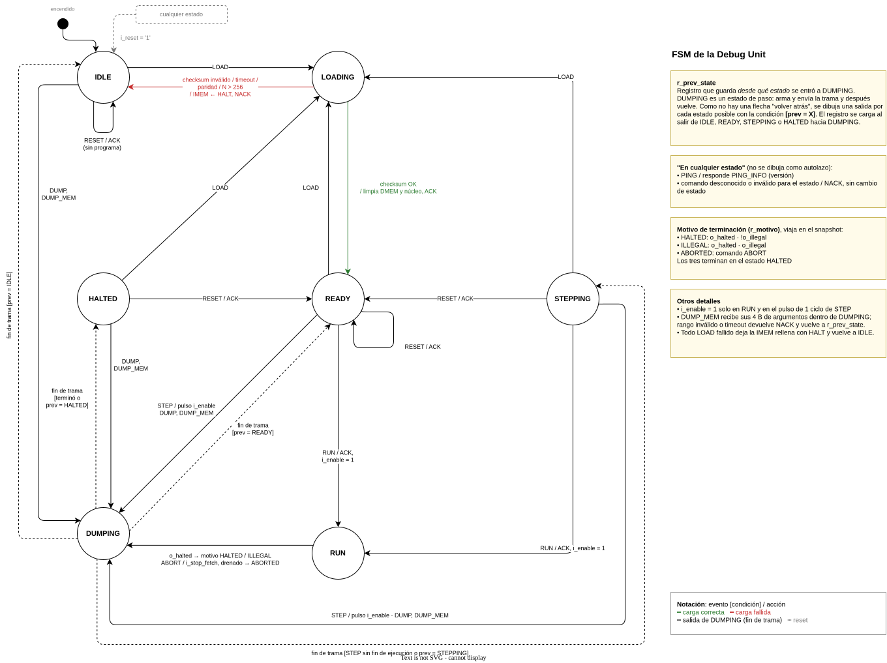
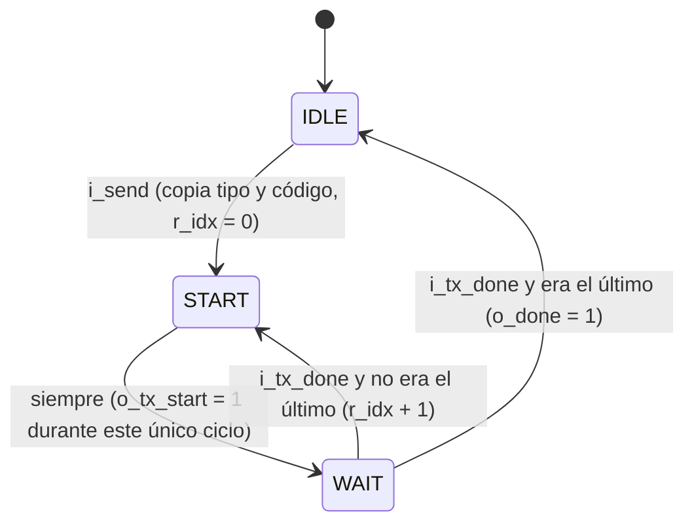
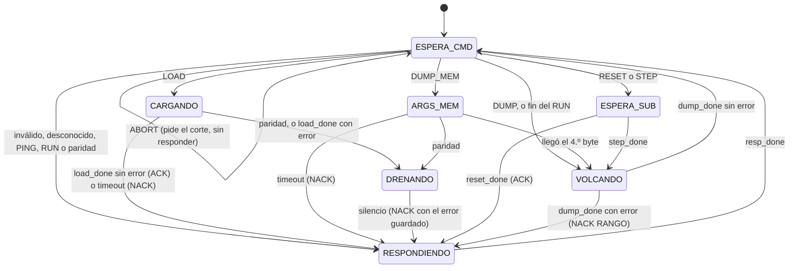
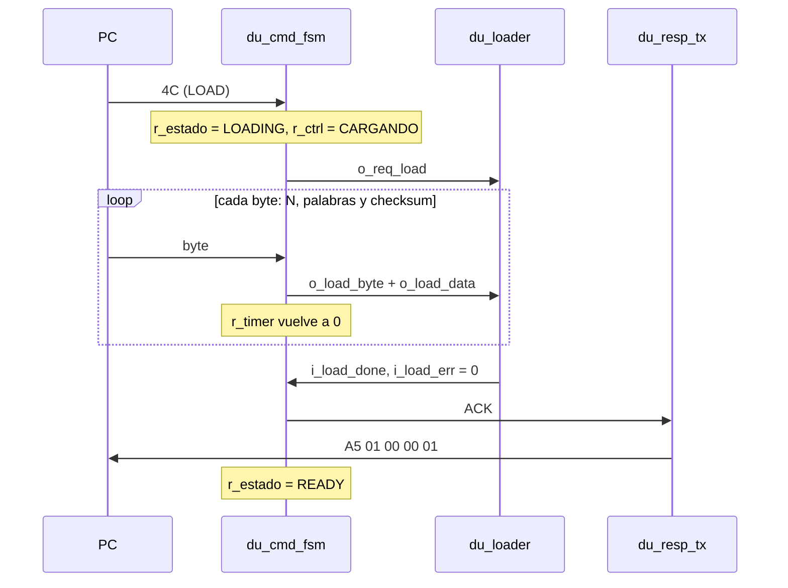
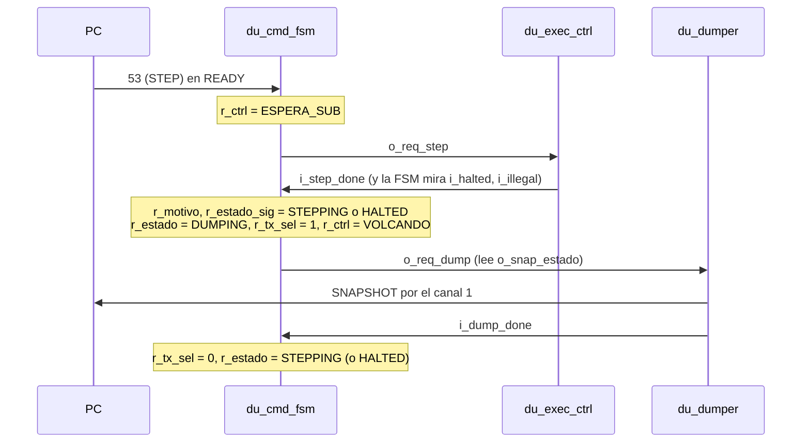
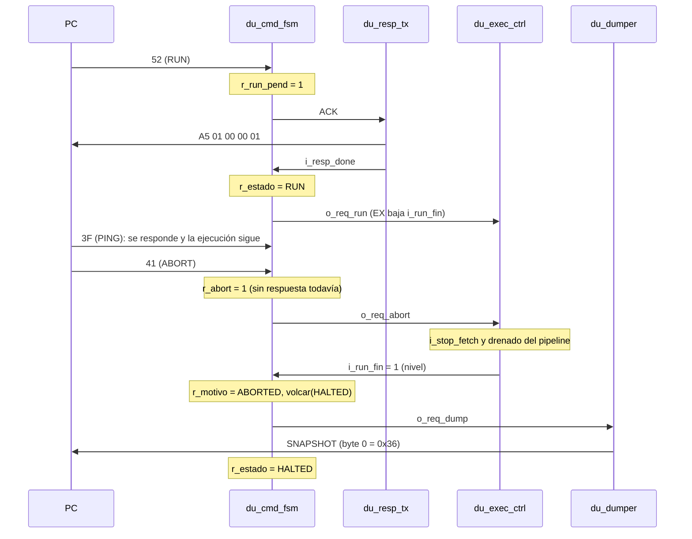
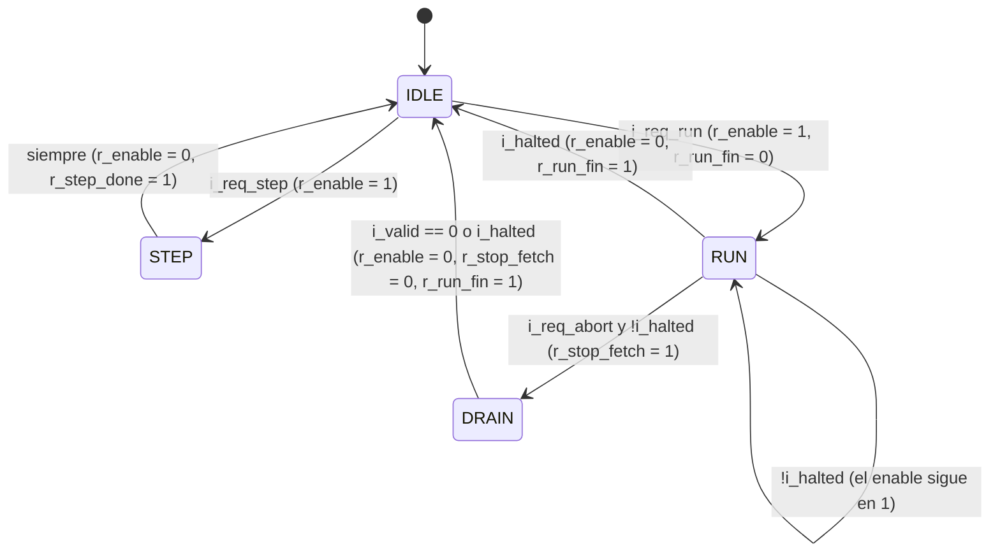

# Guía de estudio: la FSM de la Debug Unit

Guía para entender **en qué estado está la Debug Unit (DU), qué hace en cada uno y por qué pasa al siguiente**. La referencia formal (bytes, códigos, tablas) está en [`protocolo.md`](../protocolo.md). Esta guía cuenta la historia.

- La **Parte 1** explica la FSM **del protocolo**: lo que ve la PC.
- La **Parte 2** explica **cómo está implementada en Verilog**: los módulos, cada señal y cada registro, y los pasos internos que da la FSM ante cada comando.
- La **Parte 3** explica `du_loader`: cómo se carga el programa y cómo se limpia todo antes de ejecutar.
- La **Parte 4** explica `du_dumper`: cómo se arma y se manda el snapshot.



## 1. Qué es una FSM

Una **máquina de estados finitos** (_Finite State Machine_) es un circuito que en cada momento está en **uno** de un conjunto chico de estados. Un **evento** (llega un byte, el núcleo avisa que terminó) la hace **transicionar** a otro estado y, en el camino, ejecutar una **acción**. En el diagrama, cada flecha se lee **`evento [condición] / acción`**. Por ejemplo, `RUN / ACK, i_enable = 1` quiere decir "llegó el comando RUN; respondo ACK y habilito el reloj del núcleo".

## 2. Los 7 estados en una línea

| Estado     | En una frase                                                         |
| ---------- | -------------------------------------------------------------------- |
| `IDLE`     | Estoy prendida, pero no tengo un programa válido                     |
| `LOADING`  | Estoy recibiendo un programa                                         |
| `READY`    | Tengo un programa limpio, listo para arrancar en el ciclo 0          |
| `RUN`      | El núcleo corre libre                                                |
| `STEPPING` | Estoy en medio de una ejecución paso a paso, con el núcleo congelado |
| `DUMPING`  | Estoy enviando un snapshot o un bloque de memoria                    |
| `HALTED`   | La ejecución terminó y el pipeline está vacío                        |

`LOADING` y `DUMPING` son **estados de paso**: la DU está ocupada recibiendo o enviando, no atiende comandos y sale sola cuando termina.

## 3. El cuento completo

### 3.1 Encendido → `IDLE`

Al prender la placa, o al apretar el botón de reset (`i_reset`), la DU arranca en `IDLE`. La IMEM no tiene nada confiable todavía, así que no se puede ejecutar: `RUN` y `STEP` responden `NACK(ERR_ESTADO)`. Lo que sí se puede hacer es `LOAD`, `RESET`, `DUMP`, `DUMP_MEM` y `PING`.

### 3.2 `LOAD`: `IDLE` → `LOADING`

La GUI manda el byte `'L'` (`0x4C`) y la DU pasa a `LOADING`.

**Qué viaja:** el **código máquina ya ensamblado**. La PC corre el ensamblador y manda palabras de 32 bits. El orden es:

1. `N`: cuántas palabras vienen (2 bytes).
2. Las `N` palabras, 4 bytes cada una.
3. Un byte de checksum, que es el XOR de todo lo anterior salvo la `'L'`.

**¿Se verifica palabra por palabra o todo al final?** **Todo al final.** La DU escribe cada palabra en la IMEM **apenas termina de llegar** y va acumulando el XOR. Recién cuando llega el último byte compara su XOR con el checksum que mandó la PC. No hay verificación por instrucción: una sola suma de control para todo el programa.

> ¿Por qué no se guarda todo en un buffer y se escribe al final? Porque el buffer sería otra IMEM entera de flip-flops. Es más barato escribir directo y, si algo sale mal, "borrar" la IMEM rellenándola con HALT.

Mientras está en `LOADING`, **todo byte es parte de la carga**. Si dentro de una palabra aparece `0x52` (`'R'`), no es un `RUN`: es un dato.

### 3.3 Fin de la carga: `LOADING` → `READY` o `IDLE`

**Si el checksum coincide** → `READY`. Antes de responder, la DU:

- rellena con HALT la parte de la IMEM que el programa no usa,
- escribe ceros en toda la DMEM y limpia el bitmap de memoria usada,
- resetea el núcleo: PC = 0, registros en 0, latches con `valid = 0`, contador de ciclos en 0,
- responde `ACK`.

**Si algo falló** → `IDLE`, con **toda** la IMEM rellena de HALT, y responde `NACK`. Pueden fallar cuatro cosas:

| Falla          | Qué significa                                                      |
| -------------- | ------------------------------------------------------------------ |
| `ERR_CHECKSUM` | Llegaron todos los bytes, pero alguno se corrompió en el cable     |
| `ERR_TIMEOUT`  | Pasaron **100 ms sin que llegue ningún byte** en medio de la carga |
| `ERR_PARIDAD`  | Un byte llegó con el bit de paridad incorrecto                     |
| `ERR_TAMANO`   | `N` es 0 o mayor que 256                                           |

**Sobre el timeout:** no es un tiempo total para el `LOAD`, sino el tiempo **entre un byte y el siguiente**. Cada byte que llega reinicia el contador. Un programa largo puede tardar varios segundos en cargarse sin problema, siempre que no haya un hueco de 100 ms.

**¿Por qué rellenar con HALT y no dejar lo que había?** Porque las primeras palabras ya se escribieron. La IMEM quedó con la mitad del programa nuevo y la mitad del viejo: una mezcla que no es ningún programa. Rellenarla con HALT garantiza que, si alguien la ejecuta igual, se detiene en la primera instrucción. Y como no hay programa válido, la DU vuelve a `IDLE`.

**¿Y los errores a mitad de la carga?** Paridad y tamaño se detectan **antes** de que termine de llegar la carga. Si la DU respondiera en ese momento, los bytes que siguen llegando se leerían como comandos. Por eso primero espera a que la línea quede en silencio (100 ms) y recién después responde el `NACK`.

### 3.4 `STEP`: `READY` → `DUMPING` → `STEPPING`

Llega `'S'`. La DU:

1. pone `i_enable = 1` durante **exactamente un ciclo de reloj**: el núcleo avanza un ciclo y todas las instrucciones del pipeline se corren una etapa;
2. vuelve a poner `i_enable = 0`, y el núcleo queda congelado;
3. pasa a `DUMPING` y envía el snapshot (la "foto" de registros, latches y memoria usada);
4. cuando sale el último byte del snapshot, pasa a `STEPPING`.

¿Por qué `STEPPING` y no `READY`? Porque `READY` significa "limpio, en el ciclo 0". Después de un paso ya no lo está: se ejecutó al menos un ciclo.

Cada `STEP` siguiente hace lo mismo: `STEPPING` → `DUMPING` → `STEPPING`.

**Excepción:** si en ese ciclo el HALT llegó a WB, la ejecución terminó, así que al salir de `DUMPING` va a `HALTED` en lugar de a `STEPPING` (ver 3.6).

### 3.5 Comandos desde `STEPPING`

| Llega   | Pasa a                 | Para qué sirve                                                                                     |
| ------- | ---------------------- | -------------------------------------------------------------------------------------------------- |
| `STEP`  | `DUMPING` → `STEPPING` | Otro paso                                                                                          |
| `RUN`   | `RUN`                  | "Ya vi lo que quería, corré hasta el final"                                                        |
| `RESET` | `READY`                | Volver a empezar el **mismo** programa desde el ciclo 0 sin reenviarlo (limpia todo menos la IMEM) |
| `LOAD`  | `LOADING`              | Abandonar esta depuración y cargar otro programa                                                   |
| `DUMP`  | `DUMPING` → `STEPPING` | Pedir la foto de nuevo sin avanzar (por ejemplo, si se perdió la anterior)                         |

`RESET` y `LOAD` se aceptan en `STEPPING` porque, en modo paso a paso, el programa puede no terminar nunca (por ejemplo, un loop infinito). Sin esos dos comandos, no habría forma de salir sin apretar el botón de la placa (ADR-010).

### 3.6 `RUN`: `READY`/`STEPPING` → `RUN` → `DUMPING` → `HALTED`

Llega `'R'`. La DU responde `ACK` **enseguida** (para que la PC sepa que el comando llegó) y deja `i_enable = 1` en todos los ciclos. El núcleo corre a toda velocidad.

En `RUN` la DU **sigue escuchando la UART**, pero solo acepta `ABORT` (y `PING`). Cualquier otro comando responde `NACK(ERR_ESTADO)` y la ejecución sigue.

**¿Cuándo termina?** Hay tres motivos:

| Motivo    | Quién lo detecta y cómo                                                                                                                                                                      |
| --------- | -------------------------------------------------------------------------------------------------------------------------------------------------------------------------------------------- |
| `HALTED`  | El **núcleo**. Detecta el HALT en **ID** y deja de buscar instrucciones, pero el HALT sigue avanzando. Cuando llega a **WB**, todo lo anterior ya terminó: el núcleo pone `o_halted = 1`     |
| `ILLEGAL` | El **núcleo**, igual que el HALT: la instrucción ilegal se detecta en ID y avanza marcada. Al llegar a WB pone `o_halted = 1` **y** `o_illegal = 1`                                          |
| `ABORTED` | La **DU**. Llega `'A'`, pone `i_stop_fetch = 1` (no se buscan más instrucciones) y espera a que las que ya estaban adentro terminen, o sea, a que los 4 bits `valid` de los latches valgan 0 |

La DU no decodifica instrucciones: solo **mira las salidas `o_halted` y `o_illegal`** del núcleo (y los `valid` en el caso de `ABORT`).

¿Por qué esperar a WB y no detenerse en ID? Porque en ese momento todavía hay instrucciones **más viejas** en EX, MEM y WB que no terminaron. Si se cortara en ID, quedarían a medio ejecutar. Esperar a WB garantiza que el pipeline quede vacío (R-EJ-5).

**Al terminar**, por cualquiera de los tres motivos:

1. `i_enable = 0` (el núcleo queda congelado);
2. pasa a `DUMPING` y envía el snapshot final, con el motivo dentro del byte `estado`;
3. al terminar de enviar, pasa a `HALTED`.

Entonces, respondiendo a la pregunta: **`RUN` pasa a `DUMPING` solo cuando la ejecución terminó**, y eso puede ser por HALT, por instrucción ilegal **o por `ABORT`**. Mientras no termine, se queda en `RUN`.

### 3.7 `DUMPING`: cuándo sale y adónde va

Sale **cuando se envió el último byte de la trama**, es decir, el checksum. ¿Adónde? Depende de por qué entró:

| Entró por                 | Sale a                                           |
| ------------------------- | ------------------------------------------------ |
| `DUMP`/`DUMP_MEM` desde X | X, el mismo estado de antes (lo guarda `r_prev`) |
| `STEP` sin terminar       | `STEPPING`                                       |
| `STEP` que terminó        | `HALTED`                                         |
| Fin de `RUN` o `ABORT`    | `HALTED`                                         |

`r_prev` es un registro que se carga **al entrar** a `DUMPING`, con el estado del que viene. `DUMPING` no tiene una flecha de "volver atrás" genérica, porque una FSM en hardware necesita saber a qué estado concreto ir. Por eso el diagrama dibuja una salida por cada estado posible, con la condición `[prev = X]`.

Mientras `DUMPING` envía, cualquier byte que llega se **descarta sin respuesta**: la PC tiene que esperar a recibir la trama completa.

### 3.8 `HALTED`: el final

El programa terminó y el pipeline está vacío. Desde acá se puede:

- `DUMP` / `DUMP_MEM`: volver a mirar el estado final (vuelve a `HALTED`; el motivo se conserva);
- `RESET` → `READY`: correr de nuevo el mismo programa;
- `LOAD` → `LOADING`: cargar otro programa.

`RUN` y `STEP` responden `NACK(ERR_ESTADO)`: no hay nada más que ejecutar sin reiniciar.

## 4. ¿Por qué se llega a `LOADING` desde `HALTED`, `STEPPING`, `READY` e `IDLE`?

Porque **cargar un programa nuevo tiene sentido cada vez que el núcleo no está corriendo**:

- `IDLE`: es la primera carga.
- `HALTED`: terminó un programa y querés probar otro. Es el caso más común: la métrica del proyecto pide 5 cargas seguidas sin resintetizar.
- `READY`: cargaste el programa equivocado y lo querés cambiar antes de correrlo.
- `STEPPING`: estás depurando paso a paso, encontraste el bug, lo corregiste en la PC y querés cargar la versión nueva sin terminar la ejecución anterior.

**¿Por qué no desde `RUN`?** Porque el núcleo está leyendo la IMEM en ese mismo momento: escribirla en medio de la ejecución ejecutaría una mezcla de programas. Primero hay que mandar `ABORT` (→ `HALTED`) y después `LOAD`.

Como `LOAD` siempre limpia todo (ADR-009), no importa desde qué estado se haga: el resultado es el mismo que después de encender la placa, pero con el programa nuevo.

## 5. Lo que no está dibujado como flecha

Para no llenar el diagrama de autolazos, hay dos reglas que valen en todos los estados que aceptan comandos:

- `PING` responde la versión del protocolo y **no cambia el estado**.
- Un comando desconocido, o uno inválido para ese estado, responde `NACK` y **no cambia nada**.

El botón de reset de la placa (`i_reset`) lleva a `IDLE` desde **cualquier** estado.

---

## Parte 2: cómo está implementada

## 8. Mapa de bloques

```text
 PC ──(cable rx)──► uart_rx ──► ┌────────────────────── debug_unit ───────────────────────┐
                                │                                                         │
                                │  du_cmd_fsm ─pedidos o_req_*─► du_loader / exec / dumper│
                                │  (el cerebro) ◄──"listo" i_*_done──                     │
                                │      │                                   │              │
                                │      ▼                                   │              │
                                │  du_resp_tx                              │              │
                                │  (ACK, NACK, PING_INFO)                  │              │
                                │      │ canal 0                   canal 1 │              │
                                │      └──────────►  du_tx_mux  ◄──────────┘              │
                                │                   (el turno)                            │
                                └─────────────────────────│───────────────────────────────┘
 PC ◄──(cable tx)── uart_tx ◄─────────────────────────────┘
```

## 9. Conceptos que hay que tener claros

**Byte, comando, trama.**

- Un **byte** son 8 bits: lo mínimo que viaja por la UART.
- Un **comando** es un pedido de la PC: un byte (por ejemplo `0x3F` = `'?'` = `PING`), a veces seguido de **argumentos** (más bytes con datos, como las palabras del programa en un `LOAD`).
- Una **trama** es una respuesta de la placa con formato fijo: `A5 tipo long_baja long_alta [datos] checksum`.
  - `A5` marca el comienzo.
  - El **checksum** es el XOR de todos los bytes salvo el `A5`, y sirve para que la PC detecte bytes dañados.

**Handshake (pedido y listo).** Coordina a dos módulos sin que ninguno sepa cuánto tarda el otro, como pedir un café y esperar que te llamen:

```text
du_cmd_fsm:  o_req_step   ___|‾|_______________________
exec:        i_step_done  ____________________|‾|______   (pueden pasar 3 o 30 000 ciclos)
du_cmd_fsm:  r_ctrl       ESPERA_CMD | ESPERA_SUB ...  | VOLCANDO
```

**Drenado.** Ante un error en medio de los argumentos, la placa primero **tira** los bytes que siguen llegando hasta que la línea queda en silencio, y recién después responde. Si respondiera enseguida, los bytes que faltan se interpretarían como comandos: un `0x53` dentro de una instrucción sería un `STEP`.

**Paridad.** Un bit extra por byte para detectar un bit dado vuelta en el cable (US-401). Si está mal, `uart_rx` levanta `o_parity_err` (pulso: "llegó un byte con paridad incorrecta") en lugar de `o_rx_done` (pulso: "llegó un byte bueno").

## 10. `du_tx_mux`: el turno para hablar

**Problema:** hay una sola `uart_tx` (el transmisor serie) y dos módulos que quieren mandar:

- `du_resp_tx` (respuestas cortas);
- `du_dumper` (snapshots).

Si hablan a la vez, los bytes se mezclan.

```text
                  i_sel
                    │
du_resp_tx ─start0─►┌───┐
           ─data0──►│MUX│──o_tx_start──► uart_tx
           ◄done0───│   │──o_tx_data───►
du_dumper  ─start1─►│   │◄─i_tx_done────
           ─data1──►└───┘
           ◄done1───
```

| Señal                     | Qué es                                                                 |
| ------------------------- | ---------------------------------------------------------------------- |
| `i_sel`                   | selector: 0 = habla el canal 0 (`du_resp_tx`), 1 = el canal 1 (dumper) |
| `i_start_0` / `i_start_1` | pedido "mandá este byte" del canal 0 / 1                               |
| `i_data_0` / `i_data_1`   | el byte que quiere mandar el canal 0 / 1                               |
| `o_done_0` / `o_done_1`   | aviso al canal 0 / 1 de que **su** byte terminó de salir               |
| `o_tx_start`, `o_tx_data` | el pedido y el byte que finalmente llegan a `uart_tx`                  |
| `i_tx_done`               | aviso de `uart_tx`: "terminé de mandar el byte" (pulso, Mealy)         |

Son cuatro `assign`, sin reloj:

- **Ida:** pasan solo el `start` y el `data` del canal elegido.
- **Vuelta:** el `done` le llega **solo** al canal elegido; al otro le llega 0. Si le llegara a los dos, el que no habló creería que su byte salió y se saltearía uno.

**Regla de uso:** `i_sel` cambia solo **entre tramas**, nunca con un byte en vuelo. La cumple `du_cmd_fsm`.

## 11. `du_resp_tx`: el sello de "recibido" o "rechazado"

Cuando se le pide, manda **una trama corta completa**, byte por byte. Hay solo tres:

```text
             byte:  0    1     2     3     4       5
ACK                 A5   01    00    00    01               ← 5 bytes, sin datos
NACK(código)        A5   02    01    00    código  XOR      ← 6 bytes
PING_INFO(versión)  A5   04    01    00    01      04       ← 6 bytes
                         └────────── XOR de estos ───┘       (el A5 no entra)
```

**¿Por qué solo estas tres?** Son las únicas respuestas que se arman **sin leer el núcleo**. Las que llevan datos (`SNAPSHOT`, de 221 bytes o más, y `MEM_DATA`) las arma el dumper, que lee registros y memoria.

| Comando                    | Respuesta                        | La manda              |
| -------------------------- | -------------------------------- | --------------------- |
| `LOAD`, `RESET`            | `ACK` o `NACK(err)`              | `du_resp_tx`          |
| `PING`                     | `PING_INFO`                      | `du_resp_tx`          |
| cualquier comando inválido | `NACK(código)`                   | `du_resp_tx`          |
| `RUN`                      | `ACK` ahora, `SNAPSHOT` al final | `du_resp_tx` + dumper |
| `STEP`, `DUMP`, `ABORT`    | `SNAPSHOT`                       | dumper                |
| `DUMP_MEM`                 | `MEM_DATA` o `NACK(RANGO)`       | dumper / `du_resp_tx` |

| Señal o registro          | Qué es                                                                                                       |
| ------------------------- | ------------------------------------------------------------------------------------------------------------ |
| `i_send`                  | pulso: "empezá a mandar una respuesta" (lo da `du_cmd_fsm`)                                                  |
| `i_tipo`                  | qué respuesta: `01` ACK, `02` NACK, `04` PING_INFO                                                           |
| `i_codigo`                | el byte de datos: código de error (NACK) o versión (PING_INFO); ACK lo ignora                                |
| `o_done`                  | pulso: "terminé de mandar la trama entera"                                                                   |
| `o_tx_start`, `o_tx_data` | pedido y byte hacia el canal 0 del mux                                                                       |
| `i_tx_done`               | aviso del mux: "salió el byte que pediste"                                                                   |
| `r_tipo`, `r_codigo`      | copias de `i_tipo`/`i_codigo` guardadas al recibir `i_send` (la FSM puede cambiarlas mientras la trama sale) |
| `r_idx`                   | qué byte de la trama se está mandando (0 a 5)                                                                |
| `w_con_payload`           | 1 si la trama lleva byte de datos (todas menos ACK)                                                          |
| `w_xor`                   | el checksum, calculado al instante: `tipo ^ longitud ^ dato`                                                 |
| `w_ultimo`                | índice del último byte: 4 para ACK, 5 para las otras                                                         |



## 12. `du_cmd_fsm`: el cerebro

### 12.1 Las dos funciones de decisión

- **`es_comando(cmd)`** (¿este byte es uno de los 8 comandos?): 1 para `L R S D X A ? M`, 0 para los otros 248 bytes.
- **`es_valido(estado, cmd)`** (¿este comando se puede hacer en este estado?).

| Estado              | Comandos válidos (además de `PING`, que vale siempre) |
| ------------------- | ----------------------------------------------------- |
| `IDLE`, `HALTED`    | `LOAD`, `RESET`, `DUMP`, `DUMP_MEM`                   |
| `READY`, `STEPPING` | todos menos `ABORT`                                   |
| `RUN`               | solo `ABORT`                                          |

### 12.2 Dos "estados" distintos: `r_estado` y `r_ctrl`

Es la idea central de la implementación. Hay **dos** registros de estado:

| Registro   | Qué guarda                                | Valores                                                                                    | Quién lo ve                              |
| ---------- | ----------------------------------------- | ------------------------------------------------------------------------------------------ | ---------------------------------------- |
| `r_estado` | el estado **del protocolo**               | `IDLE`, `LOADING`, `READY`, `RUN`, `STEPPING`, `DUMPING`, `HALTED`                         | la PC (snapshot) y los LEDs (`o_estado`) |
| `r_ctrl`   | el **paso interno** que está dando la FSM | `ESPERA_CMD`, `RESPONDIENDO`, `ESPERA_SUB`, `VOLCANDO`, `CARGANDO`, `ARGS_MEM`, `DRENANDO` | nadie más                                |

**¿Por qué dos?** Mientras sale un `NACK(ERR_ESTADO)` desde `STEPPING`, la placa **sigue estando en `STEPPING`**: el protocolo dice "sin cambiar nada". Si "estoy respondiendo" fuera otro valor de `r_estado`, se perdería en qué estado estaba la placa.

- `r_estado` es **lo que la PC ve**.
- `r_ctrl` es **lo que la FSM está haciendo por dentro**.

Los siete pasos internos:

| `r_ctrl`       | Qué está haciendo                                                            | Qué bytes acepta                    | Corre el timer |
| -------------- | ---------------------------------------------------------------------------- | ----------------------------------- | :------------: |
| `ESPERA_CMD`   | espera un byte de comando (y, en `RUN`, el fin de la ejecución)              | comandos                            |       no       |
| `RESPONDIENDO` | `du_resp_tx` está mandando `ACK`/`NACK`/`PING_INFO`                          | ninguno: se ignoran                 |       no       |
| `ESPERA_SUB`   | espera que el submódulo termine un `RESET` o un `STEP`                       | ninguno: se ignoran                 |       no       |
| `VOLCANDO`     | el dumper manda `SNAPSHOT` o `MEM_DATA` por el canal 1                       | ninguno: se descartan (§3.7)        |       no       |
| `CARGANDO`     | los bytes que llegan son el programa del `LOAD`                              | todos, como **datos** (se reenvían) |       sí       |
| `ARGS_MEM`     | junta los 4 bytes de argumentos de `DUMP_MEM`                                | 4 bytes, como **datos**             |       sí       |
| `DRENANDO`     | hubo un error en medio de los argumentos: tira bytes hasta que haya silencio | todos, y los **tira**               |       sí       |

Qué valor tiene `r_estado` mientras la FSM da cada paso:

| Comando en curso        | `r_ctrl` (en orden)                                    | `r_estado` en ese tiempo        | `r_estado` al final                    |
| ----------------------- | ------------------------------------------------------ | ------------------------------- | -------------------------------------- |
| inválido / `PING`       | `RESPONDIENDO`                                         | sin cambio                      | sin cambio                             |
| `LOAD` bien             | `CARGANDO` → `RESPONDIENDO`                            | `LOADING`                       | `READY`                                |
| `LOAD` con error        | `CARGANDO` → (`DRENANDO`) → `RESPONDIENDO`             | `LOADING`                       | `IDLE`                                 |
| `RESET`                 | `ESPERA_SUB` → `RESPONDIENDO`                          | sin cambio                      | `READY` (o `IDLE` si estaba en `IDLE`) |
| `RUN`                   | `RESPONDIENDO` → `ESPERA_CMD` …                        | sin cambio mientras sale el ACK | `RUN`                                  |
| fin del `RUN` / `ABORT` | `VOLCANDO`                                             | `DUMPING`                       | `HALTED`                               |
| `STEP`                  | `ESPERA_SUB` → `VOLCANDO`                              | sin cambio, después `DUMPING`   | `STEPPING` o `HALTED`                  |
| `DUMP`                  | `VOLCANDO`                                             | `DUMPING`                       | el estado previo (`r_prev`)            |
| `DUMP_MEM`              | `ARGS_MEM` → `VOLCANDO` (o → `RESPONDIENDO` con error) | `DUMPING`                       | el estado previo (`r_prev`)            |

### 12.3 Todos los registros

| Registro                                                                                              | Qué es                                                                            |
| ----------------------------------------------------------------------------------------------------- | --------------------------------------------------------------------------------- |
| `r_estado`                                                                                            | estado del protocolo; sale por `o_estado`                                         |
| `r_ctrl`                                                                                              | paso interno (sección 12.2)                                                       |
| `r_estado_sig`                                                                                        | estado al que ir **cuando termine** la respuesta o el volcado en curso            |
| `r_prev`                                                                                              | estado al que vuelven `DUMP` y `DUMP_MEM` ("de dónde vine")                       |
| `r_motivo`                                                                                            | por qué terminó la ejecución: 0 ninguno, 1 HALT, 2 ilegal, 3 ABORT                |
| `r_cmd`                                                                                               | comando que se está atendiendo (para saber qué "listo" esperar)                   |
| `r_err`                                                                                               | código de error guardado mientras se drena, para responderlo al final             |
| `r_run_pend`                                                                                          | "hay un RUN pendiente": pedir la ejecución cuando termine de salir el ACK         |
| `r_abort`                                                                                             | "llegó un ABORT": el fin de la ejecución va a tener motivo ABORTED                |
| `r_arg_idx`                                                                                           | cuál de los 4 bytes de argumentos de `DUMP_MEM` está llegando (0 a 3)             |
| `r_dm_args`                                                                                           | los 4 bytes de `DUMP_MEM`: dirección (2 B, en bytes) y cantidad de palabras (2 B) |
| `r_tx_sel`                                                                                            | quién usa la UART: va a `i_sel` del mux (0 respuestas, 1 dumper)                  |
| `r_timer`                                                                                             | ciclos desde el último byte recibido (timeout)                                    |
| `r_resp_send`, `r_resp_tipo`, `r_resp_codigo`                                                         | el pedido a `du_resp_tx`: "mandá esta respuesta"                                  |
| `r_req_load`, `r_req_reset`, `r_req_run`, `r_req_step`, `r_req_abort`, `r_req_dump`, `r_req_dump_mem` | pulsos de pedido a cada submódulo                                                 |
| `r_load_cancel`                                                                                       | pulso: "cancelá la carga y rellená la IMEM con HALT"                              |

Y los cables:

| Cable             | Qué es                                                                   |
| ----------------- | ------------------------------------------------------------------------ |
| `w_byte`          | `i_rx_done \|\| i_parity_err`: llegó un byte, bueno o malo               |
| `w_timeout`       | 1 cuando `r_timer` llegó a `RX_TIMEOUT_CYCLES`                           |
| `w_con_timer`     | 1 en los pasos donde corre el timer (`CARGANDO`, `ARGS_MEM`, `DRENANDO`) |
| `w_motivo_nucleo` | motivo según el núcleo: ILLEGAL si `i_illegal`, si no HALTED             |

Dos **tareas** de Verilog evitan repetir código. Una `task` dentro de un `always` es un "atajo" que asigna varios registros juntos:

- `responder(tipo, código, estado_sig)`: carga el pedido a `du_resp_tx`, anota `r_estado_sig` y pasa a `RESPONDIENDO`.
- `volcar(estado_sig)`: pulsa `o_req_dump`, pone `r_tx_sel = 1` y `r_estado = DUMPING`, anota `r_estado_sig` y pasa a `VOLCANDO`.

### 12.4 Diagrama de los pasos internos



### 12.5 Tabla completa de transiciones

Cada fila se lee así: "estando en este paso, si pasa este evento, en el flanco de reloj se hacen estas acciones y se pasa a este paso". Las filas de un mismo paso están **en orden de prioridad**: gana la primera que se cumple.

**`ESPERA_CMD`**

| #   | Evento                                          | Acciones                                                                                    | Siguiente      |
| --- | ----------------------------------------------- | ------------------------------------------------------------------------------------------- | -------------- |
| 1   | `r_estado = RUN` y `i_run_fin` y no `r_req_run` | `r_motivo` = ABORTED si `r_abort`, si no `w_motivo_nucleo`; `r_abort = 0`; `volcar(HALTED)` | `VOLCANDO`     |
| 2   | `i_parity_err`                                  | `responder(NACK, ERR_PARIDAD, r_estado)` (en `RUN` la ejecución sigue)                      | `RESPONDIENDO` |
| 3   | `i_rx_done` y no `es_comando`                   | `responder(NACK, ERR_DESCONOCIDO, r_estado)`                                                | `RESPONDIENDO` |
| 4   | `i_rx_done` y no `es_valido`                    | `responder(NACK, ERR_ESTADO, r_estado)`                                                     | `RESPONDIENDO` |
| 5   | `i_rx_done` = `PING`                            | `responder(PING_INFO, versión, r_estado)`                                                   | `RESPONDIENDO` |
| 6   | `i_rx_done` = `LOAD`                            | `r_estado = LOADING`; `r_motivo = 0`; pulso `o_req_load`                                    | `CARGANDO`     |
| 7   | `i_rx_done` = `RESET`                           | pulso `o_req_reset`                                                                         | `ESPERA_SUB`   |
| 8   | `i_rx_done` = `RUN`                             | `r_run_pend = 1`; `responder(ACK, –, RUN)`                                                  | `RESPONDIENDO` |
| 9   | `i_rx_done` = `STEP`                            | pulso `o_req_step`                                                                          | `ESPERA_SUB`   |
| 10  | `i_rx_done` = `DUMP`                            | `r_prev = r_estado`; `volcar(r_estado)`                                                     | `VOLCANDO`     |
| 11  | `i_rx_done` = `DUMP_MEM`                        | `r_prev = r_estado`; `r_estado = DUMPING`; `r_arg_idx = 0`                                  | `ARGS_MEM`     |
| 12  | `i_rx_done` = `ABORT`                           | `r_abort = 1`; pulso `o_req_abort`                                                          | `ESPERA_CMD`   |

En las filas 5 a 12 también se guarda `r_cmd = i_rx_data`.

**`RESPONDIENDO`**

| Evento        | Acciones                                                                         | Siguiente    |
| ------------- | -------------------------------------------------------------------------------- | ------------ |
| `i_resp_done` | `r_estado = r_estado_sig`; si `r_run_pend`: pulso `o_req_run` y `r_run_pend = 0` | `ESPERA_CMD` |
| byte          | se ignora                                                                        | —            |

**`ESPERA_SUB`**

| Evento                           | Acciones                                                                                            | Siguiente      |
| -------------------------------- | --------------------------------------------------------------------------------------------------- | -------------- |
| `r_cmd = RESET` e `i_reset_done` | `r_motivo = 0`; `responder(ACK, –, IDLE si r_estado = IDLE, si no READY)`                           | `RESPONDIENDO` |
| `r_cmd = STEP` e `i_step_done`   | `r_motivo` = `w_motivo_nucleo` si `i_halted`, si no 0; `volcar(HALTED si i_halted, si no STEPPING)` | `VOLCANDO`     |

**`VOLCANDO`**

| Evento                         | Acciones                                                    | Siguiente      |
| ------------------------------ | ----------------------------------------------------------- | -------------- |
| `i_dump_done` sin `i_dump_err` | `r_tx_sel = 0`; `r_estado = r_estado_sig`                   | `ESPERA_CMD`   |
| `i_dump_done` con `i_dump_err` | `r_tx_sel = 0`; `responder(NACK, i_dump_err, r_estado_sig)` | `RESPONDIENDO` |

**`CARGANDO`** (cada `i_rx_done` sale además como `o_load_byte`, sin cambiar de paso)

| Evento                          | Acciones                                                    | Siguiente      |
| ------------------------------- | ----------------------------------------------------------- | -------------- |
| `i_parity_err`                  | `r_err = ERR_PARIDAD`; pulso `o_load_cancel`                | `DRENANDO`     |
| `i_load_done`, `i_load_err = 0` | `responder(ACK, –, READY)`                                  | `RESPONDIENDO` |
| `i_load_done`, `i_load_err ≠ 0` | `r_err = i_load_err` (el loader ya rellenó la IMEM)         | `DRENANDO`     |
| `w_timeout`                     | pulso `o_load_cancel`; `responder(NACK, ERR_TIMEOUT, IDLE)` | `RESPONDIENDO` |

**`ARGS_MEM`**

| Evento                       | Acciones                                                                        | Siguiente      |
| ---------------------------- | ------------------------------------------------------------------------------- | -------------- |
| `i_parity_err`               | `r_err = ERR_PARIDAD`                                                           | `DRENANDO`     |
| `i_rx_done`, `r_arg_idx` < 3 | guarda el byte en `r_dm_args`; `r_arg_idx + 1`                                  | `ARGS_MEM`     |
| `i_rx_done`, `r_arg_idx` = 3 | guarda el byte; pulso `o_req_dump_mem`; `r_tx_sel = 1`; `r_estado_sig = r_prev` | `VOLCANDO`     |
| `w_timeout`                  | `responder(NACK, ERR_TIMEOUT, r_prev)`                                          | `RESPONDIENDO` |

**`DRENANDO`**

| Evento                    | Acciones                                                     | Siguiente      |
| ------------------------- | ------------------------------------------------------------ | -------------- |
| byte (bueno o malo)       | se tira; `r_timer` vuelve a 0                                | `DRENANDO`     |
| `w_timeout` y ningún byte | `responder(NACK, r_err, IDLE si r_cmd = LOAD, si no r_prev)` | `RESPONDIENDO` |

**En cualquier paso:** `i_reset` (el botón de la placa) vuelve todo a `IDLE` / `ESPERA_CMD`.

### 12.6 Cada comando, paso a paso

**`PING`, o un comando inválido**. Siempre la misma forma; solo cambian el tipo y el código:

**`LOAD` correcto.** La FSM no cuenta los bytes: sabe cuántos son el loader, que leyó `N`.



**`LOAD` con error.** Hay tres caminos distintos según **quién** detecta el error y **cuándo**:

| Error          | Lo detecta           | Cuándo                             |                   ¿Drena?                   |  ¿Pulsa `o_load_cancel`?  |
| -------------- | -------------------- | ---------------------------------- | :-----------------------------------------: | :-----------------------: |
| `ERR_TIMEOUT`  | FSM (`w_timeout`)    | la línea ya está en silencio       |                     no                      |            sí             |
| `ERR_PARIDAD`  | FSM (`i_parity_err`) | en medio de la carga               |                     sí                      |            sí             |
| `ERR_TAMANO`   | loader               | después de `N`, con bytes viniendo |                     sí                      | no (el loader ya terminó) |
| `ERR_CHECKSUM` | loader               | con el último byte                 | sí (no cambia nada: ya no vienen más bytes) |            no             |

**`RESET`.** Pide la limpieza, espera y responde. Desde `IDLE` queda en `IDLE`, porque no hay programa; desde cualquier otro estado va a `READY`. Borra el motivo.

**`STEP`.**



**`DUMP`** es lo mismo sin el `ESPERA_SUB`: guarda `r_prev`, llama a `volcar(r_estado)` y al terminar vuelve al estado previo.

**`DUMP_MEM`.** La FSM junta los 4 bytes de argumentos (`r_dm_args`) y se los pasa al dumper por `o_dm_addr` (dirección inicial en bytes) y `o_dm_n` (cantidad de palabras). El dumper valida el rango:

- si está bien, manda `MEM_DATA`;
- si no, responde `i_dump_err = ERR_RANGO` sin mandar nada, y la FSM responde el `NACK` por el canal 0.

En los dos casos se vuelve a `r_prev`.

**`RUN`, su fin y `ABORT`.**



Tres detalles del `RUN`:

1. **Primero el ACK, después la ejecución.** Si el programa terminara en 3 ciclos, el snapshot final necesitaría la UART mientras el ACK todavía está saliendo. Con `r_run_pend` el `o_req_run` sale recién con `i_resp_done`.
2. **`i_run_fin` es un nivel.** El fin puede llegar mientras la FSM está en `RESPONDIENDO` contestando un `PING`. Un pulso en ese momento se perdería; el nivel espera a que la FSM vuelva a `ESPERA_CMD`
3. **La guarda `!r_req_run`.** Si un `ABORT` anterior dejó `i_run_fin` en 1, en el ciclo en que sale `o_req_run` ese 1 todavía es el viejo. Contrato: el submódulo baja `i_run_fin` al recibir `o_req_run`, y la FSM lo ignora en ese ciclo.

**Byte con paridad mala** sin argumentos en curso (en `ESPERA_CMD`): `NACK(ERR_PARIDAD)` enseguida y sin cambio de estado. En `RUN` la ejecución sigue.

### 12.8 Las salidas

| Salida                       | Qué es                                                                                                                    |
| ---------------------------- | ------------------------------------------------------------------------------------------------------------------------- |
| `o_estado`                   | estado del protocolo (`r_estado`), para los LEDs                                                                          |
| `o_snap_estado`              | byte 0 del snapshot: `{r_motivo, r_estado_sig}`. Por ejemplo `0x16` = motivo HALT (1) y estado HALTED (6)                 |
| `o_tx_sel`                   | quién usa la UART (`r_tx_sel`): pasa a 1 solo al entrar a `VOLCANDO` y vuelve a 0 con `i_dump_done`, siempre entre tramas |
| `o_resp_send/tipo/codigo`    | el pedido a `du_resp_tx`                                                                                                  |
| `o_req_*`, `o_load_cancel`   | pulsos de pedido a los submódulos                                                                                         |
| `o_load_byte`, `o_load_data` | "este byte es parte de la carga" y el byte (`i_rx_data` tal cual)                                                         |
| `o_dm_addr`, `o_dm_n`        | argumentos de `DUMP_MEM`                                                                                                  |

- **¿Por qué `o_snap_estado` usa `r_estado_sig` y no `r_estado`?** Durante el volcado `r_estado` vale `DUMPING`, pero el protocolo pide que el snapshot de un `STEP` diga `STEPPING` ([protocolo §8.5](../protocolo.md)): el estado **de destino**.
- **Todas las salidas hacia otros módulos salen de registros (Moore)**, por la regla de la sección 9. La excepción es `o_load_byte` (`i_rx_done` filtrado por el paso). Es seguro porque nada vuelve por ese camino hacia `uart_rx`.

---

## Parte 3: `du_loader`, el que carga el programa (US-404)

## 18. Qué es y qué problema resuelve

`du_cmd_fsm` sabe **que** llegó un `LOAD`, pero no sabe cuántos bytes trae ni qué hacer con ellos. `du_loader` es el **cargador**: recibe los bytes del programa uno por uno, los junta en instrucciones de 32 bits, los escribe en la IMEM del núcleo y, al final, deja todo el sistema limpio para arrancar.

Hace tres trabajos:

| Pedido de la FSM | Qué hace el loader                                                                              | Cómo avisa que terminó        |
| ---------------- | ----------------------------------------------------------------------------------------------- | ----------------------------- |
| `LOAD`           | recibe N, N palabras y el checksum; escribe la IMEM; rellena con HALT lo que sobra; limpia todo | `o_done` + `o_err` (0 = bien) |
| `RESET`          | la misma limpieza, pero **sin tocar la IMEM**                                                   | `o_reset_done`                |
| cancelación      | la carga se cortó (timeout o paridad): rellena **toda** la IMEM con HALT y limpia               | no avisa: la FSM ya respondió |

**¿Por qué rellenar con HALT?** Si el programa nuevo es más corto que el anterior, las instrucciones viejas siguen en la IMEM después del final. Si el programa nuevo no termina con HALT (o la carga falla), el núcleo las ejecutaría. Con HALT (`0x0000000B`) en todo lo que sobra, lo peor que puede pasar es que el núcleo se detenga.

## 19. Conceptos que usa

- **Little-endian (LE):** el byte **menos** significativo viaja **primero**. La palabra `0x00500013` llega como `13 00 50 00`. N (2 bytes) también: `N = 300 = 0x012C` llega como `2C 01`.
- **Checksum XOR:** la PC hace el XOR de todos los bytes que siguen al `4C` (N y las palabras) y lo manda al final. El loader hace lo mismo con lo que recibe: si coincide, ningún bit cambió en el camino.
- **Puerto de depuración:** las memorias del núcleo tienen una entrada de escritura extra (`i_imem_we`, `i_dbg_dmem_we`) que usa solo la Debug Unit, sin importar lo que esté haciendo el pipeline.
- **`flush_all`:** pulso que deja el núcleo como recién encendido: pipeline vacío (`valid = 0`), PC = 0 y registros en 0.
- **`clear_used`:** pulso que borra el bitmap de memoria usada y su contador (ADR-008).

## 20. Puertos

| Puerto                                     | Dir.    | Hacia / desde  | Qué significa                                                               |
| ------------------------------------------ | ------- | -------------- | --------------------------------------------------------------------------- |
| `i_req_load`                               | entrada | FSM            | pulso: "empieza un `LOAD`"                                                  |
| `i_load_byte`, `i_load_data`               | entrada | FSM            | pulso "llegó un byte de la carga" y el byte                                 |
| `i_load_cancel`                            | entrada | FSM            | pulso: "la carga se cortó" (timeout o paridad)                              |
| `o_done`, `o_err`                          | salida  | FSM            | pulso "terminó el `LOAD`" y el resultado (0, `ERR_TAMANO` o `ERR_CHECKSUM`) |
| `i_req_reset`, `o_reset_done`              | ambos   | FSM            | pedido y fin del `RESET`                                                    |
| `o_imem_we`, `o_imem_addr`, `o_imem_wdata` | salida  | núcleo         | escribir una palabra en la IMEM                                             |
| `o_dmem_we`, `o_dmem_addr`                 | salida  | núcleo         | escribir **0** en una dirección de la DMEM                                  |
| `o_clear_used`, `o_flush_all`              | salida  | núcleo         | pulsos de limpieza (ver §19)                                                |
| `o_load_done`                              | salida  | `du_exec_ctrl` | pulso: "se limpió todo"; con él se pone en 0 el contador de ciclos (US-406) |

Todas las salidas son **registros** (Moore). Los pulsos valen 0 por defecto en cada ciclo, y la rama del estado los pone en 1 durante un solo ciclo.

## 21. Registros

| Registro     | Bits | Qué guarda                                                                                               |
| ------------ | ---: | -------------------------------------------------------------------------------------------------------- |
| `r_state`    |    3 | el estado (§22)                                                                                          |
| `r_origen`   |    2 | **quién pidió la limpieza**: `LOAD`, `RESET` o cancelación (§23)                                         |
| `r_n`        |    9 | N ya validado (1..256): 256 no entra en 8 bits                                                           |
| `r_word`     |   24 | los 3 bytes ya llegados de la palabra en curso                                                           |
| `r_byte_idx` |    2 | qué byte de la palabra está llegando (0..3); después de 3 vuelve solo a 0                                |
| `r_word_idx` |    9 | cuántas palabras se escribieron (0..256), que es la dirección de la próxima                              |
| `r_xor`      |    8 | XOR acumulado de N y las palabras                                                                        |
| `r_addr`     |    9 | dirección que se está limpiando en `LIMPIAR` (0..255)                                                    |
| `r_inicio`   |    9 | primera dirección de la IMEM que se rellena con HALT (0 = toda, N = después del programa, 256 = ninguna) |

Y dos cables (`w_`), que existen por el mismo motivo:

- `w_n = {i_load_data, r_n[7:0]}`: N completo **en el ciclo en que llega el byte alto**. `r_n` recién tendría ese byte un ciclo después, y la validación se hace en ese mismo ciclo.
- `w_word = {i_load_data, r_word}`: la palabra completa **en el ciclo en que llega el 4.º byte**. Cada byte entra por arriba y empuja a los anteriores hacia abajo. Después de 4 bytes, el primero que llegó queda en `[7:0]`, y así sale el little-endian sin multiplexores.

## 22. Los estados

```mermaid
stateDiagram-v2
    [*] --> IDLE
    IDLE --> LEN_LO : i_req_load
    IDLE --> LIMPIAR : i_req_reset (origen RESET)
    LEN_LO --> LEN_HI : byte (N bajo)
    LEN_HI --> PALABRAS : byte (N alto), 1 ≤ N ≤ 256
    LEN_HI --> LIMPIAR : N = 0 o N > 256 (ERR_TAMANO, todo HALT)
    PALABRAS --> PALABRAS : byte (cada 4, escribe la IMEM)
    PALABRAS --> CHECKSUM : se escribió la palabra N
    CHECKSUM --> LIMPIAR : byte (bien, HALT desde N; mal, ERR_CHECKSUM y todo HALT)
    LIMPIAR --> LIMPIAR : r_addr < 255
    LIMPIAR --> FIN : r_addr = 255
    FIN --> IDLE : pulsos de fin
    note right of LIMPIAR : i_load_cancel en cualquier estado lleva a LIMPIAR (origen CANCEL, todo HALT)
```



| Estado     | Qué hace                                                          | Qué lo hace salir                              | A dónde va                     |
| ---------- | ----------------------------------------------------------------- | ---------------------------------------------- | ------------------------------ |
| `IDLE`     | nada: espera un pedido                                            | `i_req_load` / `i_req_reset`                   | `LEN_LO` / `LIMPIAR`           |
| `LEN_LO`   | guarda el byte bajo de N                                          | `i_load_byte`                                  | `LEN_HI`                       |
| `LEN_HI`   | arma N con `w_n` y lo valida                                      | `i_load_byte`                                  | `PALABRAS` o `LIMPIAR` (error) |
| `PALABRAS` | junta bytes; cada 4 escribe una palabra en la IMEM                | `i_load_byte` que completa la palabra N        | `CHECKSUM`                     |
| `CHECKSUM` | compara `r_xor` con el byte recibido y decide desde dónde va HALT | `i_load_byte`                                  | `LIMPIAR`                      |
| `LIMPIAR`  | una dirección por ciclo: 0 en la DMEM y, si toca, HALT en la IMEM | **nada externo**: termina solo al llegar a 255 | `FIN`                          |
| `FIN`      | `flush_all`, `clear_used`, `load_done` y el aviso según el origen | nada: dura un ciclo                            | `IDLE`                         |

Además, `i_load_cancel` le gana a **todo**: en cualquier estado lleva a `LIMPIAR` con origen `CANCEL` y `r_inicio = 0`.

**Detalle de `CHECKSUM`:** `r_xor` tiene el XOR de N y las palabras, **sin** el checksum. Si los datos llegaron bien, ese valor es exactamente el byte que mandó la PC, así que se compara `r_xor == i_load_data`.

## 23. `r_origen`: una sola limpieza para tres casos

`LIMPIAR` y `FIN` son los mismos para `LOAD`, `RESET` y cancelación. Lo único que cambia está en dos registros que se cargan **antes** de entrar:

| Origen        | Lo carga                    | `r_inicio` | IMEM en `LIMPIAR`  | Aviso en `FIN`        |
| ------------- | --------------------------- | ---------- | ------------------ | --------------------- |
| `ORIG_LOAD`   | `CHECKSUM` (bien)           | N          | HALT en `[N, 255]` | `o_done`, `o_err = 0` |
| `ORIG_LOAD`   | `CHECKSUM` (mal) o `LEN_HI` | 0          | HALT en toda       | `o_done`, `o_err ≠ 0` |
| `ORIG_RESET`  | `IDLE` con `i_req_reset`    | no importa | **no se toca**     | `o_reset_done`        |
| `ORIG_CANCEL` | `i_load_cancel`             | 0          | HALT en toda       | ninguno               |

La DMEM se pone en 0 y salen `flush_all`, `clear_used` y `load_done` **en los cuatro casos**. Aunque la carga falle, el núcleo queda limpio y no se puede ejecutar nada a medio cargar (R-DU-4).

**¿Por qué con error se rellena toda la IMEM y no solo desde N?** Porque no se sabe **qué** byte llegó mal: pudo ser una instrucción del medio. Lo único seguro es que no quede nada ejecutable.

## 25. Detalles técnicos

- **La cancelación va antes del `case`.** Puede llegar en cualquier estado de la carga, incluso en `LIMPIAR`. Si llega un byte extra con la paridad mal mientras se limpia, la FSM cancela y la limpieza **vuelve a empezar** como `CANCEL`: toda la IMEM queda en HALT y no sale `o_done`. La FSM ya está en `DRENANDO` y va a responder `NACK(ERR_PARIDAD)`, así que lo que ve la PC es coherente con lo que quedó en la placa.
- **`ERR_TAMANO` con bytes que siguen llegando.** La FSM los sigue reenviando hasta recibir `o_done`. `LIMPIAR` y `FIN` no miran `i_load_byte`, e `IDLE` solo mira `i_req_load`, así que se ignoran solos. Después la FSM drena el resto ([protocolo §7.2](../protocolo.md)).
- **Contadores de 9 bits.** N, `r_word_idx` y `r_inicio` llegan a 256, que no entra en 8 bits. Con 8 bits, N = 256 se leería como 0.
- **`r_word_idx + 1 == r_n`** se compara en el ciclo en que se escribe la última palabra, porque `r_word_idx` todavía vale el índice de esa palabra.
- **Una dirección por ciclo, sin handshake.** El puerto de depuración de las memorias escribe en un ciclo, así que no hay que esperar a nadie. IMEM y DMEM se recorren juntas con el mismo `r_addr`.
- **`RESET` también pulsa `o_load_done`**, porque ADR-009 pide el contador de ciclos en 0 también después de un `RESET`.
- **La FSM no espera al loader en la cancelación.** Responde el `NACK` unos 3 ms después y el loader termina en 2,6 µs.

---

## Parte 4: `du_dumper`, el que manda la foto

## 29. Qué es y qué problema resuelve

El enunciado pide mandar a la PC "el contenido de los 32 registros, de los latches intermedios y de la memoria de datos usada". `du_dumper` es el **serializador** que hace eso: saca una **foto** del procesador (el _snapshot_) y la manda byte por byte por la UART, dentro de una trama `SNAPSHOT`.

Analogía: la FSM es el recepcionista que decide **cuándo** hay que mandar un informe (después de `STEP`, al terminar `RUN`, o con `DUMP`). El dumper es el empleado que arma el informe: lo escribe hoja por hoja, en un orden fijo, y le pone un número de control al final.

| Pedido de la FSM | Qué hace el dumper                                                                      | Cómo avisa que terminó               |
| ---------------- | --------------------------------------------------------------------------------------- | ------------------------------------ |
| `i_req_dump`     | manda la trama `SNAPSHOT` completa por el canal 1 de `du_tx_mux`                        | `o_done` (`o_err = 0`)               |
| `i_req_dump_mem` | valida el rango y manda la trama `MEM_DATA` (§37), o no manda nada si el rango está mal | `o_done` (`o_err = 0` o `ERR_RANGO`) |

Las dos tramas comparten todo el mecanismo (FSM, checksum, UART); cambia solo la tabla de qué byte va en cada posición.

**¿Qué NO se manda?** La IMEM: el programa ya lo tiene la PC, porque fue ella quien lo cargó. De la DMEM solo van las palabras que el programa **escribió**.

## 30. Conceptos que usa

- **Trama y payload.** La trama es el sobre: `[A5][tipo][longitud: 2 B][payload][checksum]`. El `A5` marca el comienzo y no entra en el checksum.
- **Longitud = 221 + 6·K.** Es la cantidad de bytes del payload. 221 es la parte fija (siempre igual); **K** es la cantidad de palabras de DMEM que escribió el programa (`i_dbg_used_count`), y cada una ocupa 6 bytes (dirección 2 + dato 4). La longitud va **antes** del payload, así que hay que saber K **al arrancar**.
- **`K` mayúscula y `k` minúscula no son lo mismo.** `K` = palabras usadas de la DMEM. `k` = número de byte dentro de un bus (`bus[8k+7 : 8k]`).
- **Little-endian (LE).** El byte menos significativo va primero: PC = `0x00000014` sale `14 00 00 00`.
- **Checksum al vuelo.** No se guarda la trama: un registro de 8 bits hace `r_xor ^= byte` con cada byte que sale. Al final, `r_xor` **es** el checksum.
- **Handshake con la UART.** El dumper pulsa `o_tx_start` con el byte en `o_tx_data` y espera `i_tx_done`. Un byte tarda 11 bits / 19200 bps ≈ **573 µs ≈ 57 000 ciclos** a 100 MHz: para el dumper, la UART es lentísima.
- **Lectura de depuración combinacional.** El núcleo tiene puertos extra para que la DU lea registros y DMEM: se pone la dirección (`o_dbg_reg_addr`) y **en el mismo ciclo** sale el dato (`i_dbg_reg_data`), sin esperar un flanco.
- **Bitmap de memoria usada.** Un bit por palabra de DMEM que se pone en 1 cuando el programa la escribe (`i_dbg_mem_used`), más un contador (`i_dbg_used_count` = K).
- **Foto del mismo ciclo (R-DU-3).** Todo lo que sale tiene que ser del mismo ciclo del núcleo. El núcleo está congelado (`i_enable = 0`) durante todo el volcado, y además el dumper **copia** al arrancar lo que podría cambiar.

## 31. Puertos

| Puerto                                                            | Dir.    | Hacia / desde  | Qué significa                                                                     |
| ----------------------------------------------------------------- | ------- | -------------- | --------------------------------------------------------------------------------- |
| `i_req_dump`                                                      | entrada | FSM            | pulso: "mandá un snapshot"                                                        |
| `i_snap_estado`                                                   | entrada | FSM            | byte 0 del payload: `{motivo, estado de la DU}`; vale bien en el ciclo del pedido |
| `i_req_dump_mem`, `i_dm_addr`, `i_dm_n`                           | entrada | FSM            | pulso: "mandá un `MEM_DATA`", dirección inicial en bytes y cantidad de palabras   |
| `o_done`, `o_err`                                                 | salida  | FSM            | pulso "terminé" y error: 0, o `ERR_RANGO` si se rechazó un `DUMP_MEM`             |
| `i_ciclos`                                                        | entrada | `du_exec_ctrl` | ciclos ejecutados desde el último `LOAD`/`RESET` (`o_ciclos` de `du_exec_ctrl`)   |
| `i_pc`                                                            | entrada | núcleo         | PC actual                                                                         |
| `o_dbg_reg_addr` → `i_dbg_reg_data`                               | ambos   | núcleo         | "¿qué registro?" → su valor (combinacional)                                       |
| `o_dbg_mem_addr` → `i_dbg_mem_data`, `i_dbg_mem_used`             | ambos   | núcleo         | "¿qué palabra de DMEM?" → su dato y si el programa la escribió                    |
| `i_dbg_used_count`                                                | entrada | núcleo         | K: cuántas palabras escribió el programa (0..256)                                 |
| `i_stall`, `i_flush_if_id`, `i_flush_id_ex`, `i_fwd_a`, `i_fwd_b` | entrada | núcleo         | señales de riesgo del ciclo (van al byte 9)                                       |
| `i_if_id`, `i_id_ex`, `i_ex_mem`, `i_mem_wb`                      | entrada | núcleo         | los 4 latches como buses planos (13, 31, 19 y 18 bytes)                           |
| `o_tx_start`, `o_tx_data`, `i_tx_done`                            | ambos   | `du_tx_mux` 1  | "mandá este byte", el byte, "la UART terminó"                                     |

Los buses de latches ya vienen ordenados por el núcleo ([`riscv_core.md` §4](../interfaces/riscv_core.md)): el byte `k` del bloque es `bus[8k+7 : 8k]`. Así el dumper no necesita saber qué campo hay en cada byte.

## 32. La idea: una FSM chica y un contador de posición

El módulo separa dos preguntas:

- **¿Cuándo?** (mandar, esperar, terminar) → la **FSM**, con 5 estados.
- **¿Qué byte?** → un contador **`r_pos`** (qué byte de la trama va saliendo: 0 = `A5`) y una **tabla** que, para cada posición, dice qué byte corresponde. La tabla es una copia de [`protocolo.md` §6.2](../protocolo.md).

La FSM **no sabe nada de secciones**: no hay un estado "REGISTROS" ni "LATCHES". Para agregar una sección se agrega una fila a la tabla y la FSM no cambia.

## 33. Registros

| Registro     | Bits | Qué guarda                                                                                                                        |
| ------------ | ---: | --------------------------------------------------------------------------------------------------------------------------------- |
| `state_reg`  |    3 | el estado                                                                                                                         |
| `r_pos`      |   16 | qué byte de la trama va saliendo: 0 = `A5`, 1 = tipo, 2-3 = longitud, 4… = payload, último = checksum. Con K = 256 son 1762 bytes |
| `r_xor`      |    8 | checksum al vuelo (todo lo mandado menos el `A5`)                                                                                 |
| `r_estado`   |    8 | copia de `i_snap_estado` al pedido                                                                                                |
| `r_k`        |    9 | copia de K al pedido: de él salen la longitud y los 2 bytes de K                                                                  |
| `r_latches`  |  648 | copia de los 4 latches al pedido: `{MEM/WB, EX/MEM, ID/EX, IF/ID}`                                                                |
| `r_mem_addr` |    9 | palabra de DMEM que se está mandando o buscando; el bit 8 en 1 (= 256) significa "se pasó del final"                              |
| `r_sub`      |    3 | byte dentro de la entrada de memoria: 0-1 = dirección, 2-5 = dato                                                                 |
| `r_modo`     |    1 | qué trama se está mandando: 0 = `SNAPSHOT`, 1 = `MEM_DATA` (§37)                                                                  |
| `r_dm_addr`  |   16 | `MEM_DATA`: dirección pedida (en bytes), copiada al pedido                                                                        |
| `r_dm_n`     |   16 | `MEM_DATA`: cantidad de palabras, copiada al pedido                                                                               |
| `r_err`      |    8 | resultado del último pedido (`o_err`): 0 o `ERR_RANGO`                                                                            |

**¿Por qué se copian estado, K y latches, y no el PC ni los registros?**

- `i_snap_estado` lo arma la FSM y solo garantiza que vale bien **en el ciclo del pedido**.
- K define la longitud, que sale al principio. Si se leyera de nuevo al final y fuera distinto, la trama mentiría.
- Los latches: el núcleo está congelado, pero la copia hace explícito que los 81 bytes son del mismo ciclo (lo pide la US). Son 648 flip-flops.
- PC, ciclos, registros y DMEM vienen de cosas congeladas durante todo el volcado: valen lo mismo de principio a fin.

## 34. Los estados

```mermaid
stateDiagram-v2
    [*] --> IDLE
    IDLE --> BUSCAR : i_req_dump (copia estado, K y latches; r_pos = 0; r_modo = 0)
    IDLE --> BUSCAR : i_req_dump_mem con rango OK (copia dir y n; r_pos = 0; r_modo = 1)
    IDLE --> FIN : i_req_dump_mem con rango mal (r_err = ERR_RANGO, no manda nada)
    BUSCAR --> BUSCAR : empieza una entrada de memoria y la palabra no está usada (r_mem_addr + 1)
    BUSCAR --> ENVIAR : en cualquier otro caso
    ENVIAR --> ESPERAR : siempre (1 ciclo con o_tx_start)
    ESPERAR --> BUSCAR : i_tx_done y no era el checksum (r_pos + 1)
    ESPERAR --> FIN : i_tx_done y era el checksum
    FIN --> IDLE : siempre (1 ciclo con o_done)
```



| Estado    | Qué hace                                                                      | Qué lo hace salir                           | A dónde va                              |
| --------- | ----------------------------------------------------------------------------- | ------------------------------------------- | --------------------------------------- |
| `IDLE`    | nada: espera un pedido                                                        | `i_req_dump` / `i_req_dump_mem`             | `BUSCAR` (o `FIN` si el rango está mal) |
| `BUSCAR`  | antes de cada byte; si empieza una palabra de memoria, busca la próxima usada | encontró una usada, o no hacía falta buscar | `ENVIAR`                                |
| `ENVIAR`  | **un ciclo**: `o_tx_start = 1`, la UART toma `o_tx_data`; suma el byte al XOR | nada: dura un ciclo                         | `ESPERAR`                               |
| `ESPERAR` | nada: el byte viaja por la línea                                              | `i_tx_done`                                 | `BUSCAR` o `FIN`                        |
| `FIN`     | **un ciclo**: `o_done = 1`                                                    | nada: dura un ciclo                         | `IDLE`                                  |

Las salidas son **Moore** (dependen solo del estado): `o_tx_start = (estado == ENVIAR)` y `o_done = (estado == FIN)`. Como esos estados duran un ciclo, los pulsos duran un ciclo sin hacer nada más.

**El ciclo de separación con la UART.** `uart_tx` avisa `i_tx_done` cuando todavía está en STOP; si en ese mismo ciclo le llegara otro start, lo ignoraría y el byte se perdería. Acá no puede pasar: el `done` lleva a `BUSCAR` y recién después a `ENVIAR`, así que hay al menos un ciclo en el medio.

## 35. La tabla: qué byte sale en cada posición

Primero se calculan dos posiciones:

- `w_off = r_pos − 4`: posición **dentro del payload** (le saca el sobre).
- `w_rel_X = w_off − OFF_X`: posición **dentro de la sección X** (le saca el comienzo de la sección).

Después, una cadena de `if / else if` donde **cada condición pregunta "¿estoy antes de que empiece la sección siguiente?"**. Que ya se pasó el comienzo de la propia lo garantizan las condiciones de arriba, que no se cumplieron.

| `r_pos` / `w_off`   | Sección   | Byte que sale                                           |
| ------------------- | --------- | ------------------------------------------------------- |
| `r_pos` = `len + 4` | checksum  | `r_xor` (se pregunta primero: su posición depende de K) |
| `r_pos` 0..3        | sobre     | `A5`, `03`, `len[7:0]`, `len[15:8]`                     |
| `w_off` 0           | estado    | `r_estado`                                              |
| `w_off` 1..4        | ciclos    | byte `w_rel` de `i_ciclos`                              |
| `w_off` 5..8        | PC        | byte `w_rel` de `i_pc`                                  |
| `w_off` 9           | riesgos   | `{0, fwd_b, fwd_a, flush_id_ex, flush_if_id, stall}`    |
| `w_off` 10..137     | registros | registro `w_rel[6:2]`, byte `w_rel[1:0]`                |
| `w_off` 138..218    | latches   | `r_latches[8k+7 : 8k]` con `k = w_rel`                  |
| `w_off` 219..220    | K         | byte `w_rel` de K                                       |
| `w_off` 221…        | memoria   | según `r_sub`: dirección en bytes (2) o dato (4), LE    |

**Registros: un número, dos datos.** Hay 32 registros de 4 bytes, así que `w_rel` va de 0 a 127. Dividido por 4 (`w_rel[6:2]`, los bits de arriba) da el **registro**; el resto (`w_rel[1:0]`, los 2 bits de abajo) da el **byte**. Ejemplo: `w_off = 23` → `w_rel = 13 = 0b0001101` → registro `00011` = x3, byte `01` = 1. `o_dbg_reg_addr` sale de ahí **combinacionalmente**: cuando cambia `r_pos`, el núcleo ya contesta el registro nuevo en el mismo ciclo.

**`byte_de(palabra, n)`** es una `function` que devuelve `palabra[8n+7 : 8n]` (n = 0..3). En Verilog una `function` no es una llamada como en software: el sintetizador copia el hardware (un mux 4 a 1) en cada lugar donde se usa.

**Latches con índice.** El byte `k` de la copia es `r_latches[8k +: 8]`. El índice de bit se arma con `{w_rel[6:0], 3'b000}` (multiplicar por 8 es correr 3 bits). Sale un multiplexor de 81 a 1 de 8 bits. La alternativa era un shift register (correr 8 bits por byte enviado y mandar siempre `[7:0]`); con la tabla por posición, el índice queda más simple de leer y cuesta parecido en LUTs.

## 36. La memoria: `BUSCAR` y `r_sub`

Es la única sección donde **la posición no alcanza**: las palabras no usadas se saltean, así que `w_off` no dice qué dirección de DMEM toca. Por eso hay dos registros propios:

- `r_mem_addr`: la palabra de DMEM actual (va a `o_dbg_mem_addr`).
- `r_sub`: qué byte de la entrada `[dir 2 B | dato 4 B]` toca (0..5).

El recorrido:

1. Al llegar a la primera posición de memoria, `r_sub = 0` y `r_mem_addr = 0`.
2. **`BUSCAR`**: si `i_dbg_mem_used = 0` (el programa no escribió esa palabra), `r_mem_addr + 1` y se queda. Una dirección por ciclo. Cuando encuentra una usada, pasa a `ENVIAR`.
3. Se mandan los 6 bytes: `r_sub` 0-1 = dirección **en bytes** (`r_mem_addr × 4`, LE), 2-5 = dato (LE). En cada `i_tx_done`, `r_sub + 1`.
4. Después del 6.º byte: `r_sub = 0` y `r_mem_addr + 1`. Si todavía quedan entradas, vuelve a `BUSCAR` desde la dirección siguiente.

Buscar cuesta como mucho 256 ciclos **en todo el volcado** (el recorrido nunca vuelve atrás): nada al lado de los ~57 000 ciclos de cada byte.

**¿Y si el bitmap no coincide con K?** (no debería pasar: sería un bug del núcleo). Si `r_mem_addr` llega a 256 sin encontrar, `BUSCAR` sigue a `ENVIAR` igual. La trama sale con la longitud declarada y datos basura, pero el dumper **no se cuelga**. El testbench, que compara entrada por entrada, lo detectaría.

## 37. `MEM_DATA`: la trama de `DUMP_MEM` (US-408)

**El problema.** El snapshot trae solo las palabras que el programa **escribió**. Un programa que **lee** una tabla que nunca escribe (por ejemplo, datos cargados antes) no la muestra en el snapshot. `DUMP_MEM` pide un rango cualquiera: "dame `n` palabras desde la dirección `dir`", estén usadas o no.

**El pedido** (PC → FPGA, 5 bytes): `4D | dir (2 B, LE, en bytes) | n (2 B, LE)`. Lo junta `du_cmd_fsm` (`ARGS_MEM`) y se lo pasa al dumper con `i_req_dump_mem`, `i_dm_addr` e `i_dm_n`.

**La respuesta** (FPGA → PC) usa el mismo sobre que el snapshot, con tipo `05`:

```text
A5 | 05 | len LE | dir (2 B LE) | n (2 B LE) | palabra 0 (4 B LE) | … | palabra n-1 | XOR
               └────────── payload: len = 4 + 4n bytes ──────────┘
```

- `dir` y `n` se devuelven **tal como llegaron**: la PC sabe a qué pedido corresponde la respuesta sin acordarse de nada.
- Después van las palabras `dir/4`, `dir/4 + 1`, …, `dir/4 + n − 1` de la DMEM, cada una en little-endian. **No** llevan la dirección al lado (a diferencia de la memoria del snapshot): son consecutivas, la dirección de la palabra `i` es `dir + 4i`.
- El XOR es el de siempre: todo menos el `A5`.

**Ejemplo byte a byte** (`protocolo.md` §8.9, verificado en `tb_du_dump_mem`). DMEM con `[0x000] = 5` y `[0x004] = 0`; la PC pide 2 palabras desde `0x000`:

```text
PC  → 4D 00 00 02 00
FPGA→ A5 05 0C 00  00 00  02 00  05 00 00 00  00 00 00 00  0E
      │  │  └─┬─┘  └─┬─┘  └─┬─┘  └────┬────┘  └────┬────┘  └─ XOR = 05^0C^02^05
      │  │   len=12  dir=0   n=2   [0x000]=5    [0x004]=0
      │  └─ tipo MEM_DATA
      └─ sincronismo
```

**Validación** (`protocolo.md` §3). El rango es válido si:

1. `dir` es múltiplo de 4 (`dir[1:0] == 0`): la DMEM se lee por palabras;
2. `n ≥ 1`;
3. `dir/4 + n ≤ 256`: la última palabra pedida existe.

Si falla, el dumper **no manda nada**: va de `IDLE` directo a `FIN` con `r_err = ERR_RANGO`. `du_cmd_fsm` ve `o_done` con error y manda `NACK(ERR_RANGO)` por el canal 0 (`A5 02 01 00 05 06`), y vuelve al estado anterior. Así el dumper nunca empieza una trama que tendría que cortar a la mitad.

**La suma en 17 bits (error clásico).** `dir/4` y `n` son de 16 bits. Si la suma se hace en 16 bits, `dir = 0x0004`, `n = 0xFFFF` da `1 + 65535 = 65536`, que en 16 bits es `0x0000 ≤ 256`: ¡válido! El dumper intentaría mandar 65 535 palabras (y la longitud `4 + 4n` tampoco entraría en 16 bits). Por eso `w_dm_fin` tiene 17 bits. `tb_du_dumper` lo prueba, y con la suma en 16 bits ese caso falla.

**Cómo lo hace el hardware.** Se reutiliza todo: FSM, `r_pos`, `r_xor`, `o_tx_data` combinacional. Cambian tres cosas según `r_modo`:

| Qué              | `SNAPSHOT` (`r_modo = 0`)             | `MEM_DATA` (`r_modo = 1`)                          |
| ---------------- | ------------------------------------- | -------------------------------------------------- |
| byte de tipo     | `03`                                  | `05`                                               |
| longitud         | `221 + 6K`                            | `4 + 4·r_dm_n`                                     |
| payload          | la tabla de §35                       | `w_byte_mem`: `w_off` 0-3 = dir y n; 4… = palabras |
| `o_dbg_mem_addr` | `r_mem_addr` (con saltos de `BUSCAR`) | `dir/4 + (w_off − 4)/4`, sale de la posición       |
| `BUSCAR`         | salta las palabras no usadas          | no salta nada (`w_en_mem` exige `r_modo = 0`)      |

En `MEM_DATA` **la posición alcanza** para saber todo (no hay saltos): con `w_rel = w_off − 4`, la palabra es `w_rel[9:2]` y el byte `w_rel[1:0]`, el mismo truco de "dividir por 4" que los registros (§35). Por eso no hacen falta `r_mem_addr` ni `r_sub`.

**Tiempo.** La trama más larga (`n = 256`) tiene 1033 bytes: ~0,6 s a 19 200 bps. El núcleo está congelado (en `RUN` el comando se rechaza con `ERR_ESTADO`), así que todas las palabras son del mismo instante.

**Errores comunes.**

1. Validar en 16 bits (ver arriba).
2. Leer la DMEM con `dir` en vez de `dir/4`: la DMEM se indexa por palabra; `0x004` es la palabra 1.
3. Mandar el NACK desde el dumper: el canal 1 es de tramas largas; las respuestas cortas son de `du_resp_tx` (canal 0) y las decide la FSM.
4. Dejar `o_err` en el valor viejo: `r_err` se pone en 0 con cada pedido válido, si no un `DUMP` después de un rechazo llegaría a la FSM como error.
5. Mandar los argumentos de `DUMP_MEM` en `RUN`: la FSM rechaza el comando y los 4 bytes siguientes se interpretarían como comandos nuevos. La PC no manda argumentos si recibió el NACK (`protocolo.md` §5).

## 38. Detalles técnicos

- **Ningún byte se guarda antes de mandarlo.** `o_tx_data` es combinacional: sale de la tabla con el `r_pos` actual. `uart_tx` copia el dato a su shift register en el mismo ciclo del start, así que alcanza con que esté bien durante `ENVIAR`.
- **El checksum se calcula con el mismo byte que sale**: en `ENVIAR`, `r_xor <= r_xor ^ o_tx_data`, salvo en el `A5` (`r_pos = 0`) y en el propio checksum.
- **`w_off` "negativo".** Con `r_pos < 4`, `w_off = r_pos − 4` da un número enorme (16 bits sin signo). No importa: el caso `r_pos < 4` se pregunta antes en la tabla, y `w_en_mem` exige `r_pos >= 4`.
- **De `w_rel_X` solo se usan los bits bajos.** Fuera de su sección valen cualquier cosa, y Verilator avisaría de los bits altos sin usar; por eso esos cables van entre un `lint_off UNUSEDSIGNAL` puntual.
- **Contadores anchos.** `r_pos` tiene 16 bits porque la trama llega a 1762 bytes. `r_k` y `r_mem_addr` tienen 9 porque llegan a 256.
- **Camino combinacional largo.** En `ENVIAR` el byte sale de `r_pos` → resta → `o_dbg_reg_addr` → banco de registros del núcleo → mux → UART, todo en un ciclo. En simulación no importa; si en la síntesis no cumple timing a 100 MHz, se registra el byte en `BUSCAR` (que siempre precede a `ENVIAR`).

## Parte 5: `du_exec_ctrl`, el que mueve el núcleo (US-406, US-407)

## 39. Qué es y qué problema resuelve

El enunciado pide dos modos: **continuo** (el programa corre hasta el final y después se ve el resultado) y **paso a paso** (se avanza de a un ciclo de clock, viendo el estado en cada paso). `du_exec_ctrl` es el único que mueve el núcleo, y lo hace con una sola señal: `i_enable`.

| Pedido de la FSM | Qué hace                                                                               | Cómo avisa que terminó                  |
| ---------------- | -------------------------------------------------------------------------------------- | --------------------------------------- |
| `i_req_step`     | `o_enable = 1` durante **exactamente un ciclo** (R-EJ-2)                               | `o_step_done` (pulso), un ciclo después |
| `i_req_run`      | `o_enable = 1` sostenido hasta que el núcleo levanta `o_halted`                        | `o_run_fin` (**nivel**)                 |
| `i_req_abort`    | durante un RUN: `o_stop_fetch = 1` (con el enable en 1) hasta vaciar el pipeline (§47) | `o_run_fin`, igual que un RUN           |

Además cuenta los ciclos ejecutados (`o_ciclos`), el número que viaja en los bytes 1–4 del snapshot.

Lo que **no** hace: decidir el estado del protocolo, el motivo de terminación ni pedir el snapshot. Eso es de `du_cmd_fsm`. El núcleo tampoco sabe nada de STEP o RUN: solo ve un enable en 1 o en 0, y avisa `o_halted` cuando un HALT o una ilegal llega a WB. `du_exec_ctrl` traduce entre los dos:

```text
du_cmd_fsm ──i_req_run / i_req_step──► du_exec_ctrl ──o_enable──► núcleo
du_cmd_fsm ◄──o_step_done / o_run_fin── du_exec_ctrl ◄──o_halted── núcleo
```

## 40. Conceptos que usa

- **Clock enable (CE).** Entrada de un flip-flop que decide si en el flanco toma el dato nuevo (1) o se queda con el que tiene (0). El reloj llega siempre; lo que cambia es si el FF le hace caso. `i_enable` es el CE de **todo** el estado del núcleo.
- **Clock gating (prohibido).** Frenar el reloj con una compuerta (`clock & enable`): glitches, skew y saca al reloj de la red dedicada de la FPGA. Por eso R-EJ-1 / ADR-001: el reloj nunca pasa por lógica.
- **Salida registrada.** `o_enable` sale directo de un flip-flop (`r_enable`), sin lógica combinacional en el medio: llega a cientos de flip-flops del núcleo (mucho _fan-out_), y así no suma retardo al camino crítico.
- **Pulso vs. nivel.** `o_step_done` es un pulso (un ciclo). `o_run_fin` es un nivel: queda en 1 hasta el próximo RUN, porque el fin del RUN puede llegar mientras `du_cmd_fsm` responde un `PING` y no lo está mirando.

## 41. Puertos

| Puerto         | Dir.    | Hacia / desde | Qué significa                                                                               |
| -------------- | ------- | ------------- | ------------------------------------------------------------------------------------------- |
| `i_req_run`    | entrada | FSM           | pulso: "arrancá a correr" (ya salió el ACK)                                                 |
| `i_req_step`   | entrada | FSM           | pulso: "avanzá un ciclo"                                                                    |
| `i_req_abort`  | entrada | FSM           | pulso de ABORT (solo llega en RUN): drenar el pipeline                                      |
| `o_step_done`  | salida  | FSM           | pulso: terminó el ciclo del STEP; `i_halted` ya es el de después                            |
| `o_run_fin`    | salida  | FSM           | nivel: el RUN terminó; baja con el próximo `i_req_run`                                      |
| `i_load_done`  | entrada | `du_loader`   | pulso al final de `LOAD`/`RESET`: contador a 0                                              |
| `i_halted`     | entrada | núcleo        | `o_halted`: un HALT o una ilegal llegó a WB                                                 |
| `i_valid[3:0]` | entrada | núcleo        | bits `valid` de `{MEM/WB, EX/MEM, ID/EX, IF/ID}`; `0000` = pipeline vacío (fin del drenado) |
| `o_enable`     | salida  | núcleo        | `i_enable`: STEP = 1 ciclo, RUN = hasta `o_halted`                                          |
| `o_stop_fetch` | salida  | núcleo        | `i_stop_fetch`: 1 durante el drenado de ABORT (sale de un FF)                               |
| `o_ciclos`     | salida  | `du_dumper`   | ciclos ejecutados desde el último `LOAD`/`RESET` (32 bits)                                  |

## 42. Los estados



| Estado  | Qué hace                                          | Qué lo hace salir           | A dónde va       |
| ------- | ------------------------------------------------- | --------------------------- | ---------------- |
| `IDLE`  | núcleo congelado, espera un pedido                | `i_req_step` / `i_req_run`  | `STEP` / `RUN`   |
| `STEP`  | **un ciclo**: es el ciclo en que el núcleo avanza | nada: dura un ciclo         | `IDLE`           |
| `RUN`   | el núcleo avanza en cada ciclo                    | `i_halted` / `i_req_abort`  | `IDLE` / `DRAIN` |
| `DRAIN` | avanza sin buscar instrucciones (ABORT, §47)      | `i_valid == 0` o `i_halted` | `IDLE`           |

`r_step_done` vale 0 por defecto antes del `case` (patrón de pulso: solo la rama `STEP` lo pone en 1). `r_run_fin` no tiene default: es un nivel. Con `DRAIN` los 4 códigos de `r_state` están usados; el `default` del `case` queda igual, por estilo (y para que la herramienta de síntesis no infiera un latch si algún día se agrega un estado).

## 43. Ejemplo ciclo a ciclo

**STEP.** El núcleo toma el valor que `o_enable` tenía **antes** del flanco:

```text
flanco   du_exec_ctrl                                   núcleo en ese flanco   r_ciclos
  F0     IDLE ve i_req_step → r_enable<=1, a STEP       enable=0 → quieto
  F1     STEP → r_enable<=0, r_step_done<=1, a IDLE     enable=1 → AVANZA      +1
  F2     IDLE, r_step_done vuelve a 0                   enable=0 → quieto
```

Entre F1 y F2, `o_step_done = 1` y `o_halted` ya es el de después del paso: `du_cmd_fsm` lo lee para decidir si queda en `STEPPING` o pasa a `HALTED`. Si `step_done` saliera junto con el enable, leería el `o_halted` viejo y un STEP que completa el HALT quedaría en `STEPPING`.

**RUN** de un programa que termina en el ciclo 10:

```text
flanco  estado  r_enable  i_halted  r_run_fin  r_ciclos   qué pasa
  F0    IDLE       0         0      1 (viejo)     0       llega i_req_run
  F1    RUN        1         0         0          1       núcleo avanza
  ...
  F10   RUN        1         0         0         10       HALT llega a WB → o_halted sube
  F11   RUN        1         1         0         10       ve i_halted: enable<=0, run_fin<=1
  F12   IDLE       0         1         1         10       du_cmd_fsm ve run_fin → snapshot
```

En F11 el enable todavía vale 1 (sale de un FF, tarda un flanco en enterarse), pero el núcleo halted lo ignora. Ese ciclo de más no se cuenta (§44).

## 44. El contador de ciclos

```verilog
if (i_load_done)                 r_ciclos <= 0;
else if (r_enable && !i_halted)  r_ciclos <= r_ciclos + 1;
```

- Va **afuera** del `case`: no depende del estado, sino de si el núcleo se movió en este flanco. Así sirve igual para STEP y RUN.
- La condición es **la misma** con la que avanza el núcleo (`i_enable && !o_halted`): el contador y el núcleo nunca se desfasan.
- Sin `!i_halted`, el ciclo F11 del ejemplo contaría: RUN daría 11 y STEP 10, y fallaría R-EJ-7 (mismo resultado en ambos modos).
- El flanco en que el HALT llega a WB (F10) **sí** cuenta: en ese flanco el núcleo avanzó; `o_halted` sube como resultado de ese flanco.
- El `+1` se escribe con el ancho del registro (`{{(NBIT_32-1){1'b0}}, 1'b1}`): Verilator con `-Wall` avisa si los dos lados de un `+` tienen anchos distintos.
- 32 bits a 100 MHz dan la vuelta a los ~43 s. Una IMEM de 256 palabras limita el **largo** del programa, no el **tiempo**: un lazo corre para siempre si no tiene HALT (US-407). Se deja dar la vuelta.
- Los ciclos del drenado de ABORT **sí** cuentan: son ciclos reales con enable, igual que los del drenado después de un HALT. Incluye uno de más: el flanco en que `du_exec_ctrl` ve `0000` todavía tiene el enable en 1 y el núcleo avanza vacío (§47).

## 45. Detalles técnicos

- **`o_run_fin` y la guarda de `du_cmd_fsm`.** En el ciclo en que sale `o_req_run`, `o_run_fin` todavía puede valer 1 por el RUN anterior (`du_exec_ctrl` lo baja en ese flanco). `du_cmd_fsm` lo ignora con `!r_req_run`. Después de un RUN, `o_run_fin` queda en 1 en `HALTED`, `READY` y `STEPPING` sin molestar: `du_cmd_fsm` solo lo mira con `r_estado == RUN`.
- **`i_req_step` en `STEP` no puede pasar**: `du_cmd_fsm` espera `i_step_done` en `ESPERA_SUB` y no acepta comandos hasta entonces.
- **RUN con el núcleo ya halted** tampoco pasa (RUN no vale en `HALTED`, y `LOAD`/`RESET` bajan `o_halted` con `flush_all`). Si pasara, la FSM entra a `RUN`, ve `i_halted` y termina en el primer ciclo: no se cuelga.
- **Prioridad del contador.** `i_load_done` y un flanco con enable no coinciden en la práctica (no hay `LOAD`/`RESET` en `RUN`), pero el `if / else if` deja explícito que la limpieza gana.
- **Qué verifica `tb_du_exec_ctrl`**: un flanco de enable por STEP, `o_step_done` dos ciclos después del pedido, STEP repetido = RUN (ciclos, PC, MEM/WB y palabras usadas), `o_run_fin` como nivel, y la terminación por ilegal en ambos modos. AC3 (latches con `valid = 0` al terminar) depende del núcleo real: se verifica en US-411.

## 47. ABORT: el drenado del pipeline (US-407)

**El problema.** Un programa con un loop infinito (`loop: j loop`) nunca levanta `o_halted`: sin ABORT, la Debug Unit queda en `RUN` para siempre, la PC nunca recibe el snapshot y hay que reiniciar la placa (incumple NFR-6). El relleno con HALT (ADR-009) no sirve acá: el PC nunca llega a la zona rellena. ABORT es la salida manual (ADR-010).

**Por qué no basta con bajar el enable.** El núcleo quedaría congelado con instrucciones a medio hacer en ID/EX, EX/MEM y MEM/WB (por ejemplo un `sw` que todavía no escribió). ADR-010 pide terminar igual que con un HALT: con el pipeline **vacío**. Abortar no es "frenar", es "cerrar la entrada y esperar a que salgan".

**Conceptos.**

- **Drenar (_drain_).** Dejar de meter instrucciones nuevas y dejar que las que ya están adentro terminen.
- **`i_stop_fetch`** (entrada del núcleo, nivel). Con `i_enable = 1`: el PC no cambia, IF/ID e ID/EX reciben burbujas (se descarta la instrucción que estaba en ID) y lo que estaba en EX, MEM y WB termina. Es la misma lógica que usa el HALT: no hay una segunda forma de vaciar el pipeline.
- **Burbuja.** Latch con `valid = 0`: una instrucción vacía que no escribe nada.
- **Pipeline vacío.** El núcleo no tiene una salida "terminé de drenar". La Debug Unit lo deduce de los 4 bits `valid` de los buses de latches (`docs/interfaces/riscv_core.md`, sección 4): `IF/ID[96]`, `ID/EX[200]`, `EX/MEM[112]`, `MEM/WB[104]`. `debug_unit` los saca de los buses que ya recibe para `du_dumper` (`w_valid`).

**Cómo funciona.** Dos señales, cada una con su trabajo:

| Señal          | `RUN` | `DRAIN` | Por qué                                                         |
| -------------- | ----- | ------- | --------------------------------------------------------------- |
| `r_enable`     | 1     | **1**   | el pipeline tiene que avanzar para que las instrucciones salgan |
| `r_stop_fetch` | 0     | **1**   | no entra nada nuevo                                             |

Al terminar el drenado bajan las dos juntas y sube `r_run_fin`. `du_cmd_fsm` ve el fin del RUN y, como tiene `r_abort = 1`, manda el snapshot con motivo `ABORTED` y pasa a `HALTED`. `stop_fetch` puede bajar sin peligro: desde `HALTED` no valen ni RUN ni STEP, y `LOAD`/`RESET` hacen `flush_all`.

**Ejemplo ciclo a ciclo** (loop infinito, `tb_du_abort`):

```text
ciclo  i_req_abort  estado  enable  stop_fetch  valid {WB,MEM,EX,ID}   qué pasa
  t        1         RUN      1        0         1111                  en el flanco: busca UNA más, pasa a DRAIN
 t+1       0         DRAIN    1        1         1111                  flanco: burbujas en IF/ID e ID/EX
 t+2       0         DRAIN    1        1         1100
 t+3       0         DRAIN    1        1         1000
 t+4       0         DRAIN    1        1         0000                  ve vacío: enable<=0, stop<=0, run_fin<=1
 t+5       0         IDLE     0        0         0000                  du_cmd_fsm → snapshot ABORTED
```

Son como máximo 3 ciclos vaciando (con `stop_fetch` entran burbujas en IF/ID **e** ID/EX a la vez, así que solo quedan 3 instrucciones) más uno en el que `du_exec_ctrl` se entera. En `t` `stop_fetch` todavía vale 0 (sale de un FF): el núcleo busca una instrucción más, que se descarta en el flanco siguiente.

**Implementación.**

```verilog
RUN:
  if (i_halted)          begin r_state<=IDLE;  r_enable<=0; r_run_fin<=1; end
  else if (i_req_abort)  begin r_state<=DRAIN; r_stop_fetch<=1; end   // r_enable sigue en 1
DRAIN:
  if (i_valid == 4'b0000 || i_halted)
    begin r_state<=IDLE; r_enable<=0; r_stop_fetch<=0; r_run_fin<=1; end
```

**Detalles técnicos.**

- **`|| i_halted` en `DRAIN` es obligatorio.** Si cuando llega el ABORT ya hay un HALT en EX, ese HALT llega a WB durante el drenado: `o_halted` sube, el núcleo ignora el enable y el `valid` de MEM/WB (el HALT) queda en 1 para siempre. Con solo `i_valid == 0`, el drenado se cuelga. El motivo sigue siendo `ABORTED` (lo decide `du_cmd_fsm` por su `r_abort`).
- **`i_halted` antes que `i_req_abort` en `RUN`.** Si llegan en el mismo ciclo, se cierra como un RUN normal y no hay drenado (el núcleo ya paró). El snapshot sale igual con `ABORTED`.
- **ABORT con `du_exec_ctrl` en `IDLE`** (el RUN terminó justo antes): la rama `IDLE` no mira `i_req_abort` y lo ignora. `du_cmd_fsm` ya ve `o_run_fin` y cierra; no se cuelga.
- **Contador.** Los ciclos del drenado cuentan (§44), incluido el último, con el pipeline ya vacío.
- **Qué verifica `tb_du_abort`**: `stop_fetch` y enable en 1 durante el drenado, 4 flancos con `stop_fetch`, latches en `0000`, PC congelado, contador = flancos con enable; HALT que llega durante el drenado (termina sin colgarse, con 2 flancos de `stop_fetch`); ABORT junto con `i_halted` (sin drenado); ABORT en `IDLE` (no hace nada); otro RUN + ABORT después de `LOAD`. `tb_du_cmd_fsm` prueba el snapshot `ABORTED` con el drenado real. El experimento "¿qué pasa sin HALT?" (`no_halt.asm`, IMEM sin relleno) necesita el núcleo real: US-411.
