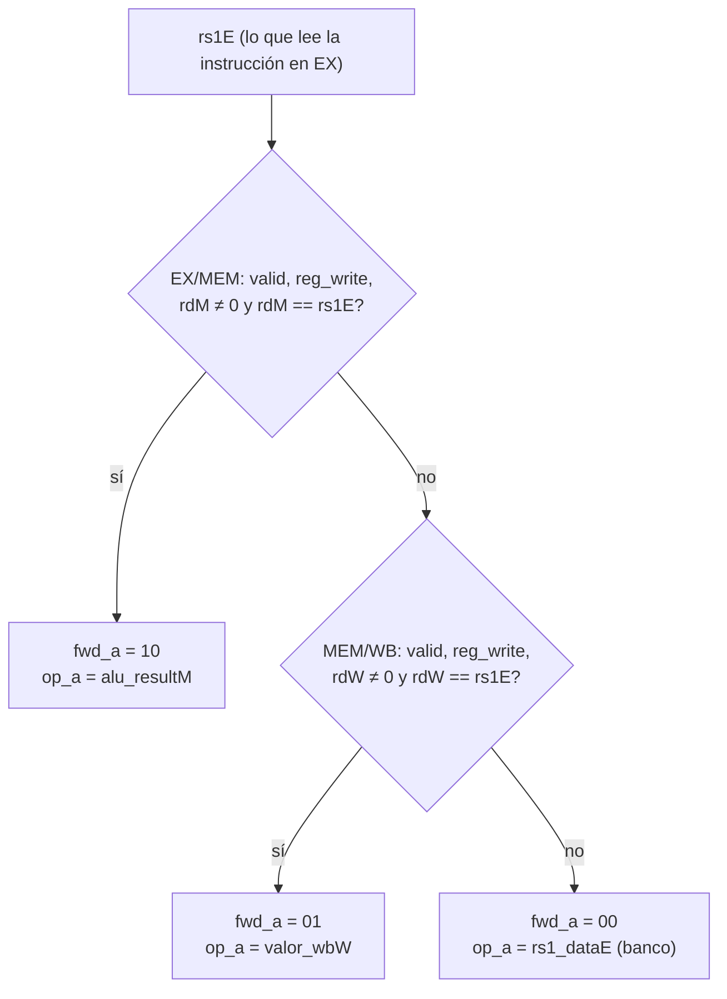
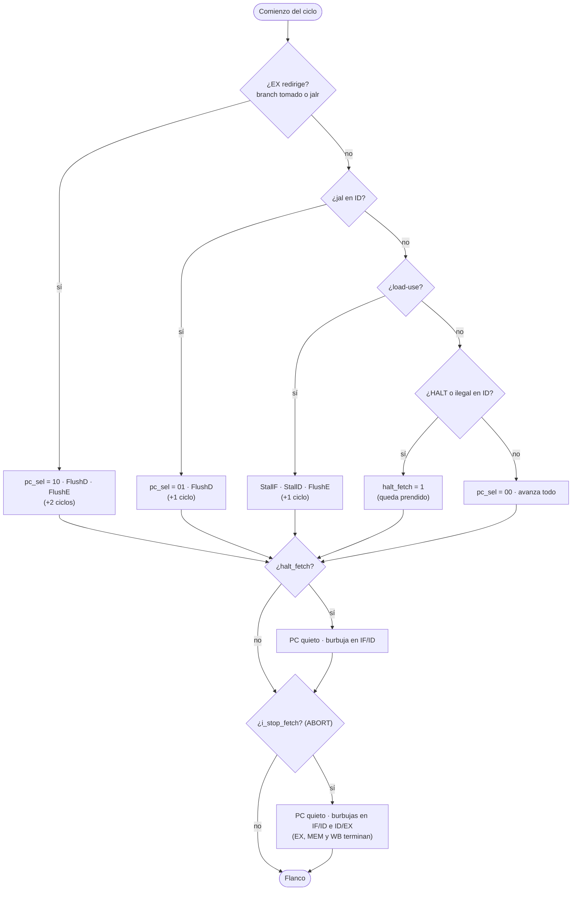

# Guía de estudio — Riesgos, Forwarding Unit y Hazard Unit (TP3)

Esta guía profundiza las secciones 4 y 5 de la [guía del datapath](guia-estudio-datapath.md): qué riesgos tiene un pipeline de 5 etapas y cómo los resuelven las dos unidades que lo coordinan. Los ejemplos salen de los programas de `TP3/asm/tests/hazards/`, y los números de ciclo son los mismos que muestran la Carta y el Historial de la GUI en modo simulado, así que se pueden comprobar paso a paso.

Referencias: Harris & Harris, _Digital Design and Computer Architecture: RISC-V Edition_, §7.5.3; [riscv_core.md](../interfaces/riscv_core.md) §3 (prioridades) y ADR-006/007. El modelo de referencia en Python es `TP3/tools/riscv_toolkit/iss/pipeline_model.py`.

---

## 0. Vocabulario

| Término                                       | Qué significa en este diseño                                                                                                                                           |
| --------------------------------------------- | ---------------------------------------------------------------------------------------------------------------------------------------------------------------------- |
| **Riesgo** (_hazard_)                         | Situación en la que la próxima instrucción no puede avanzar normalmente sin dar un resultado incorrecto                                                                |
| **RAW** (_Read After Write_)                  | Una instrucción **lee** un registro que una anterior todavía no **escribió** en el banco. Es el único riesgo de datos que existe acá                                   |
| **Productor / consumidor**                    | La instrucción que escribe el registro / la que lo lee                                                                                                                 |
| **Distancia**                                 | Cuántas instrucciones después del productor viene el consumidor (1 = la inmediata siguiente)                                                                           |
| **Latch**                                     | Registro entre dos etapas (IF/ID, ID/EX, EX/MEM, MEM/WB). Captura todo en el flanco de reloj                                                                           |
| **Forwarding** (_bypassing_, "cortocircuito") | Tomar un resultado de un latch de más adelante en vez de esperar a que llegue al banco                                                                                 |
| **Stall** (congelar)                          | Que una etapa repita el ciclo: su latch de entrada **no carga** (enable en 0)                                                                                          |
| **Burbuja** (_bubble_)                        | Un latch con `valid = 0`: viaja por el pipeline como una instrucción, pero no escribe nada                                                                             |
| **Flush** (vaciar)                            | Reemplazar por una burbuja una instrucción que ya entró, porque era del camino equivocado                                                                              |
| **Enable**                                    | Entrada de un registro: con 1 carga el valor nuevo en el flanco; con 0 conserva el que tenía                                                                           |
| **Combinacional / secuencial**                | Lógica que responde al instante (`always @(*)`) / registros que cambian solo en el flanco (`always @(posedge clk)`). Las dos unidades de esta guía son combinacionales |

Notación de señales (la misma que la guía del datapath): el sufijo dice en qué etapa está la instrucción dueña del campo. `rdE` es el `rd` de la instrucción que **está en EX** en este ciclo (está guardado en el latch ID/EX); `rdM`, el de la que está en MEM (en EX/MEM); `rdW`, el de la que está en WB (en MEM/WB); `rs1D`, el `rs1` de la que está en ID (en IF/ID).

---

## 1. El pipeline y dónde están las dos unidades

### 1.1 El dibujo

```text
                 ┌──────────────── Hazard Unit (entre ID y EX) ────────────────┐
                 │  mira: rs1D, rs2D, uses_rs1D, uses_rs2D                     │
                 │        rdE, mem_readE, validE                               │
                 │  saca: StallF, StallD, FlushE  (+ FlushD y pc_sel, §6)      │
                 └───┬──────────────┬──────────────────┬──────────────────────┘
                     │StallF        │StallD            │FlushE
                     ▼              ▼                  ▼
   ┌────┐        ┌───────┐       ┌───────┐          ┌───────┐          ┌────────┐
   │ PC │──IF──▶ │ IF/ID │──ID──▶│ ID/EX │──EX────▶ │ EX/MEM│──MEM───▶ │ MEM/WB │──WB──┐
   └────┘        └───────┘   ▲   └───────┘  ▲ ▲     └───┬───┘          └───┬────┘      │
                             │              │ │         │ alu_resultM      │ valor_wbW │
                       banco de             │ │         │ rdM              │ rdW       │
                       registros ◄──────────┼─┼─────────┼──────────────────┼───────────┘
                     (bypass WB→ID)         │ │         │                  │   escritura
                                            │ └─ mux A/B ◄── fwd_a/fwd_b ──┤
                                            │                              │
                                 ┌──────────┴───── Forwarding Unit (en EX) ┴─────┐
                                 │ mira: rs1E, rs2E                              │
                                 │       rdM, reg_writeM, validM                 │
                                 │       rdW, reg_writeW, validW                 │
                                 │ saca: fwd_a, fwd_b (2 bits cada uno)          │
                                 └───────────────────────────────────────────────┘
```

La regla para ubicarlas:

- **La Forwarding Unit mira la instrucción que ya está en EX** y se pregunta: "¿alguna de las dos que van adelante tiene el valor que necesito?". Si la respuesta es sí, mueve un mux. **No frena nada.**
- **La Hazard Unit mira la instrucción que está por entrar a EX** (la de ID) y se pregunta: "si la dejo pasar, ¿la Forwarding Unit va a tener de dónde sacar el dato?". Si la respuesta es no, **frena**.

La Hazard Unit trabaja un ciclo antes que la Forwarding Unit, porque tiene que actuar antes de que la instrucción entre a EX. Por eso compara **IF/ID contra ID/EX**, mientras que la Forwarding Unit compara **ID/EX contra EX/MEM y MEM/WB**.

> En el libro (Harris & Harris, Fig. 7.58) una sola "Hazard Unit" genera todo: forwarding, stall y flush. En este proyecto están separadas en dos bloques porque el forwarding es solo un mux de datos y la Hazard Unit decide el flujo (PC, enables, burbujas). Las ecuaciones son las mismas.

### 1.2 El pipeline sin riesgos (la referencia)

Cada columna es un ciclo; cada fila, una instrucción. Así se lee la Carta de la GUI.

```text
ciclo           0    1    2    3    4    5    6
addi x1,x0,1    IF   ID   EX   MEM  WB
addi x2,x0,2         IF   ID   EX   MEM  WB
addi x3,x0,3              IF   ID   EX   MEM  WB
```

Con N instrucciones y sin riesgos, el programa termina en **N + 4 ciclos**: 4 de llenado y después una instrucción terminada por ciclo (CPI = 1).

---

## 2. Los tres tipos de riesgos

| Tipo            | Qué pasa                                                             | ¿Aparece acá?    | Solución                                                                               |
| --------------- | -------------------------------------------------------------------- | ---------------- | -------------------------------------------------------------------------------------- |
| **Estructural** | Dos instrucciones necesitan el mismo recurso en el mismo ciclo       | **No**           | Recursos duplicados desde el diseño                                                    |
| **De datos**    | Un consumidor necesita un valor que el productor todavía no escribió | **Sí, solo RAW** | Forwarding (distancia 1 y 2), bypass del banco (3), stall (load a distancia 1)         |
| **De control**  | No se sabe qué instrucción sigue hasta resolver un salto             | **Sí**           | Predecir "no tomado" y hacer flush si se equivocó: +2 ciclos en EX, +1 con `jal` en ID |

### 2.1 Estructurales: por qué no hay

- **IMEM y DMEM separadas** (arquitectura Harvard): IF lee instrucciones y MEM lee o escribe datos en el mismo ciclo, sin pelear por una memoria.
- **Banco de registros con 2 puertos de lectura y 1 de escritura:** ID lee `rs1` y `rs2` mientras WB escribe `rd`.
- **Cada etapa usa su propio hardware:** la ALU solo se usa en EX, `branch_cmp` es un comparador aparte (ADR-019) y el sumador de `PC + 4` es propio de IF.

### 2.2 De datos: por qué solo RAW

Hay tres combinaciones posibles de lectura y escritura sobre el mismo registro:

- **RAW** (leer después de escribir): `add x1,..` y después `sub x4,x1,..`. **Existe**, porque el consumidor lee en ID (o necesita el valor en EX) antes de que el productor escriba en WB.
- **WAR** (escribir después de leer): `sub x4,x1,..` y después `add x1,..`. **No existe**: el pipeline es en orden, y la lectura (ID de la primera) siempre pasa antes que la escritura (WB de la segunda).
- **WAW** (escribir después de escribir): `add x1,..` y después `sub x1,..`. **No existe**: todos escriben en WB, en el mismo orden en que entraron.

WAR y WAW aparecen en procesadores que ejecutan **fuera de orden** (_out of order_), donde una instrucción más nueva puede terminar antes que una vieja.

### 2.3 De control

IF busca una instrucción por ciclo, pero un `beq` recién sabe si salta en EX (dos ciclos después de buscarse). Mientras tanto IF ya buscó dos instrucciones más, que pueden ser las equivocadas. El diseño **predice siempre "no tomado"**, es decir, sigue con `PC + 4`; si en EX resulta que el branch salta, descarta lo que entró detrás (§6).

---

## 3. Riesgos de datos según la distancia

El productor escribe el banco en **WB**; el consumidor lee el banco en **ID** y usa el valor en **EX**. La pregunta en cada caso es: _cuando el consumidor está en EX, ¿dónde está el valor?_

### Distancia 1: forwarding desde EX/MEM (`10`)

```text
ciclo           0    1    2    3    4    5
add x1,x2,x3    IF   ID   EX   MEM  WB
sub x4,x1,x5         IF   ID   EX   MEM  WB
                               ▲
                el resultado del add está en EX/MEM.alu_result → fwd_a = 10
```

En el ciclo 3, el `add` está en MEM y su resultado quedó en `EX/MEM.alu_result` en el flanco anterior. El `sub` lo toma de ahí, sin perder ciclos.

### Distancia 2: forwarding desde MEM/WB (`01`)

```text
ciclo           0    1    2    3    4    5    6
add x1,x2,x3    IF   ID   EX   MEM  WB
or  x6,x7,x8         IF   ID   EX   MEM  WB
sub x4,x1,x5              IF   ID   EX   MEM  WB
                                    ▲
                el add está en WB: su valor de WB → fwd_a = 01
```

### Distancia 3: bypass del banco (no lo hace la Forwarding Unit)

```text
ciclo           0    1    2    3    4    5    6    7
add x1,x2,x3    IF   ID   EX   MEM  WB
or  x6,x7,x8         IF   ID   EX   MEM  WB
and x9,x7,x8              IF   ID   EX   MEM  WB
sub x4,x1,x5                   IF   ID   EX   MEM  WB
                                    ▲
              en el ciclo 4, WB escribe x1 e ID lee x1 → el banco devuelve el valor nuevo
```

Si WB escribe un registro en el mismo ciclo en que ID lo lee, el banco devuelve el valor que se está escribiendo (ADR-007). Sin este bypass, ID leería el valor viejo y en el ciclo siguiente el productor ya no estaría en ningún latch para adelantarlo.

### Distancia 1 con un load: el único caso que necesita stall

```text
ciclo           0    1    2    3    4    5
lw  x1,0(x2)    IF   ID   EX   MEM  WB
add x3,x1,x4         IF   ID   EX ← ¿x1? el lw todavía está leyendo la memoria
```

El `lw` recién tiene el dato **al final de MEM** (ciclo 3). El `add` lo necesitaría al **principio** de su EX, en ese mismo ciclo 3. El dato no existe todavía en ningún latch, así que ningún mux puede elegirlo. Hay que demorar el `add` un ciclo, y para eso está la Hazard Unit (§5).

### Resumen

| Distancia | Productor ALU (`add`, `addi`, `lui`…) | Productor load (`lw`, `lb`…)  |
| --------- | ------------------------------------- | ----------------------------- |
| 1         | forwarding `10` (EX/MEM)              | **1 stall** + forwarding `01` |
| 2         | forwarding `01` (MEM/WB)              | forwarding `01`               |
| 3         | bypass del banco                      | bypass del banco              |
| ≥ 4       | ya está en el banco                   | ya está en el banco           |

---

## 4. Forwarding Unit

### 4.1 Concepto

Es un bloque **combinacional** en EX que, para cada operando de la ALU, elige entre tres fuentes: el valor leído del banco en ID, el resultado que está en EX/MEM o el valor que está escribiendo WB.

### 4.2 Problema que resuelve

Sin ella, cada dependencia de distancia 1 o 2 costaría dos o un stall, porque habría que esperar a que el productor llegue al banco. En un programa típico la mitad de las instrucciones dependen de la anterior: el CPI pasaría de cerca de 1 a cerca de 2.

### 4.3 Entradas y salidas

| Dirección | Señal                         | Viene de             | Para qué                                                                 |
| --------- | ----------------------------- | -------------------- | ------------------------------------------------------------------------ |
| entra     | `rs1E`, `rs2E`                | ID/EX                | Qué registros lee la instrucción que está en EX                          |
| entra     | `rdM`, `reg_writeM`, `validM` | EX/MEM               | ¿La instrucción de adelante (distancia 1) escribe uno de esos registros? |
| entra     | `rdW`, `reg_writeW`, `validW` | MEM/WB               | ¿La de dos adelante (distancia 2) escribe uno de esos registros?         |
| sale      | `fwd_a` (2 b)                 | → mux del operando A | `00` banco · `10` EX/MEM · `01` MEM/WB                                   |
| sale      | `fwd_b` (2 b)                 | → mux del operando B | ídem para `rs2`                                                          |

Los **datos** no pasan por la Forwarding Unit: ella solo compara números de registro (5 bits) y bits de control. Los valores de 32 bits van directo a los muxes:

```text
                         fwd_a
                           │
   rs1_dataE (del banco) ──┤00
   alu_resultM (EX/MEM) ───┤10   mux A ──▶ op_a ──▶ ALU, branch_cmp
   valor_wbW (MEM/WB) ─────┤01
                           │
                         fwd_b
                           │
   rs2_dataE (del banco) ──┤00
   alu_resultM (EX/MEM) ───┤10   mux B ──▶ op_b ──┬──▶ mux alu_src ──▶ ALU
   valor_wbW (MEM/WB) ─────┤01                    ├──▶ branch_cmp
                                                  └──▶ store_data (para el sw)
```

Tres consumidores del operando adelantado. Si te olvidás de alguno, tenés un bug:

- **La ALU:** el caso obvio.
- **`branch_cmp`:** un `beq x1, x2` justo después de `addi x1,..` tiene que comparar el `x1` nuevo.
- **`store_data`:** en `sw x1, 0(x2)`, el valor a guardar es `rs2`, y también puede venir adelantado. Por eso el mux B está **antes** del mux `alu_src`: con `alu_src = 1` la ALU recibe el inmediato, pero `store_data` sigue necesitando `rs2` adelantado.

### 4.4 Qué valor adelanta cada fuente

- **`10` → `alu_resultM`.** La instrucción todavía no pasó por MEM, así que lo único que hay es el resultado de la ALU. Por eso un load a distancia 1 no se puede adelantar: su `alu_resultM` es la **dirección**, no el dato.
- **`01` → `valor_wbW`**, la salida del mux de WB (`result_src`): `alu_result`, `mem_data` (si era un load) o `pc_plus4` (si era `jal`/`jalr`). Es exactamente el valor que se escribe en el banco en ese ciclo.

¿Y un `jal x1` a distancia 1 con `10`? No puede pasar. Después de un `jal` siempre hay una burbuja (flush de 1 ciclo), y después de un `jalr` dos. Cuando la instrucción del destino llega a EX, el salto ya está en WB (`01`, que da `pc_plus4`) o ya escribió el banco. Así que `alu_resultM` nunca es el valor de enlace que alguien necesita.

### 4.5 Las condiciones

Para el operando A (el B es igual, con `rs2E`):

```text
si   validM && reg_writeM && rdM != 0 && rdM == rs1E   → fwd_a = 10
sino validW && reg_writeW && rdW != 0 && rdW == rs1E   → fwd_a = 01
sino                                                   → fwd_a = 00
```

Cada término está por una razón:

| Término                 | Si falta…                                                                                                 |
| ----------------------- | --------------------------------------------------------------------------------------------------------- |
| `valid`                 | Una burbuja con un `rd` viejo (los campos no se borran, solo `valid = 0`) dispararía forwarding de basura |
| `reg_write`             | Un `sw` o un `beq` tienen bits en la posición de `rd` (son parte del inmediato) y se "adelantarían"       |
| `rd != 0`               | `jalr x0, 0(x1)` "escribe" x0: el consumidor de x0 recibiría `pc+4` en vez de 0                           |
| EX/MEM antes que MEM/WB | Con `addi x1,x0,1` / `addi x1,x0,2` / `add x3,x1,x1`, se usaría el 1 (viejo) en vez del 2                 |

`fwd_a` no usa `uses_rs1`: si la instrucción no lee `rs1`, adelantarle un valor no cambia nada, porque nadie lo usa. Esa señal es necesaria en la Hazard Unit (§5.4), no acá.



### 4.6 En Verilog

```verilog
// Forwarding Unit: combinacional pura, en EX
module forwarding_unit (
    input  wire [4:0] rs1E, rs2E,
    input  wire [4:0] rdM,  input wire reg_writeM, validM,
    input  wire [4:0] rdW,  input wire reg_writeW, validW,
    output reg  [1:0] fwd_a, fwd_b
);
    wire escribeM = validM && reg_writeM && (rdM != 5'd0);
    wire escribeW = validW && reg_writeW && (rdW != 5'd0);

    always @(*) begin
        if      (escribeM && rdM == rs1E) fwd_a = 2'b10;  // el más nuevo gana
        else if (escribeW && rdW == rs1E) fwd_a = 2'b01;
        else                              fwd_a = 2'b00;

        if      (escribeM && rdM == rs2E) fwd_b = 2'b10;
        else if (escribeW && rdW == rs2E) fwd_b = 2'b01;
        else                              fwd_b = 2'b00;
    end
endmodule

// Los muxes, en EX
always @(*) begin
    case (fwd_a)
        2'b10:   op_a = alu_resultM;
        2'b01:   op_a = valor_wbW;
        default: op_a = rs1_dataE;
    endcase
    case (fwd_b)
        2'b10:   op_b = alu_resultM;
        2'b01:   op_b = valor_wbW;
        default: op_b = rs2_dataE;
    endcase
end
assign alu_b      = alu_srcE ? immE : op_b;  // la ALU
assign store_data = op_b;                    // el sw: siempre rs2, nunca el inmediato
```

Detalle de síntesis: el `if / else if` se convierte en una cadena de prioridad, unos pocos comparadores de 5 bits y dos muxes 3:1 de 32 bits. El mux del operando queda en el camino crítico (EX/MEM → mux → ALU → EX/MEM), y es una de las razones por las que el comparador de branches es aparte de la ALU (ADR-019).

---

## 5. Hazard Unit (load-use)

### 5.1 Concepto

Es un bloque **combinacional** entre ID y EX que detecta **una** situación de datos: la instrucción de ID necesita un registro que va a cargar el load que está en EX. Cuando la detecta, demora la instrucción de ID **un ciclo**.

### 5.2 Problema que resuelve

El caso de §3 que el forwarding no puede cubrir: el valor del load aparece al final de MEM, y un consumidor a distancia 1 lo necesitaría en ese mismo ciclo. Esperando un ciclo, el consumidor llega a EX cuando el load está en WB, y entonces sí hay de dónde sacarlo (`01`).

### 5.3 Entradas y salidas

| Dirección | Señal                        | Viene de / va a                | Para qué                                                      |
| --------- | ---------------------------- | ------------------------------ | ------------------------------------------------------------- |
| entra     | `rs1D`, `rs2D`               | IF/ID (bits de la instrucción) | Qué registros va a necesitar la instrucción de ID             |
| entra     | `uses_rs1D`, `uses_rs2D`     | unidad de control, en ID       | Si de verdad los lee (en un `lui` esos bits son inmediato)    |
| entra     | `validE`, `mem_readE`, `rdE` | ID/EX                          | ¿Lo que está en EX es un load real, y qué registro carga?     |
| sale      | `StallF` (= `!pc_en`)        | → enable del PC                | El PC no avanza: IF vuelve a buscar la misma instrucción      |
| sale      | `StallD` (= `!if_id_en`)     | → enable de IF/ID              | La instrucción de ID se queda en ID                           |
| sale      | `FlushE` (burbuja)           | → mux de entrada de ID/EX      | A EX entra una burbuja (`valid = 0`), no la instrucción de ID |

Esas tres salidas son la misma condición (`stall`) repartida en tres cables, y las tres son necesarias:

- **Sin `StallF`:** IF busca la siguiente y pisa a la que estaba esperando en IF. Se pierde una instrucción.
- **Sin `StallD`:** la instrucción de ID se pierde, porque IF/ID carga la nueva.
- **Sin `FlushE`:** la instrucción de ID **también** entraría a EX (ID/EX carga lo que calcula ID), y quedaría duplicada: una copia en EX con el dato viejo y otra en ID.

### 5.4 La condición

```verilog
stall = validE && mem_readE && (rdE != 0) &&
        ((uses_rs1D && rs1D == rdE) || (uses_rs2D && rs2D == rdE));
```

| Término               | Si falta…                                                                                                |
| --------------------- | -------------------------------------------------------------------------------------------------------- |
| `validE`              | Una burbuja con un `mem_read` viejo provocaría stalls falsos                                             |
| `mem_readE`           | Habría stall también con un `add` en EX, que no lo necesita (alcanza con el forwarding `10`)             |
| `rdE != 0`            | `lw x0, ..` (carga y descarta) frenaría a cualquiera que lea x0                                          |
| `uses_rs1D/uses_rs2D` | Stalls de más: en `lui x5, 0x00010`, los bits 19:15 son parte del inmediato y pueden coincidir con `rdE` |

¿Qué instrucciones usan cada operando? Lo define la unidad de control (`isa/control.py`, `tabla_control.md`):

| Instrucción                       | `uses_rs1` | `uses_rs2` |
| --------------------------------- | ---------- | ---------- |
| tipo R, branches, stores          | 1          | 1          |
| tipo I aritméticas, loads, `jalr` | 1          | 0          |
| `lui`, `jal`, `halt`              | 0          | 0          |

Ojo con los stores: `sw x1, 0(x2)` usa `rs2 = x1` para el dato. Por eso `lw x1` seguido de `sw x1, ..` **sí** tiene stall: el dato llegaría por `01` a `store_data` en EX, pero la Hazard Unit no distingue para qué se usa el registro.

### 5.5 Ejemplo ciclo a ciclo: `load_use.asm`

Esta es la Carta que muestra la GUI (ciclos 0 a 13; el programa termina en el flanco 14):

```text
ciclo          0    1    2    3    4    5    6    7    8    9    10   11   12   13
addi x1,x0,7   IF   ID   EX   MEM  WB
sw   x1,0(x0)       IF   ID   EXb  MEM  WB                                             b: fwd_b = 10
lw   x2,0(x0)            IF   ID   EX   MEM  WB
add  x2,x2,x2                 IF   ID   ID*  EXab MEM  WB                              ab: fwd 01/01
sw   x2,4(x0)                      IF   IF*  ID   EXb  MEM  WB                         b: fwd_b = 10
(burbuja)                               EX   MEM  WB
lw   x3,4(x0)                                IF   ID   EX   MEM  WB
nop                                               IF   ID   EX   MEM  WB
add  x3,x3,x1                                          IF   ID   EXa  MEM  WB          a: fwd_a = 01
halt                                                        IF   ID   EX   MEM  WB

* = la misma etapa repetida por el stall
```

En el **ciclo 4**, la Hazard Unit ve `lw x2` en EX (`mem_readE = 1`, `rdE = 2`) y `add x2,x2,x2` en ID (`uses_rs1D`, `rs1D = 2`), así que `stall = 1`. Esto es lo que hay en cada lugar **antes** y **después** del flanco:

```text
                    PC       IF/ID              ID/EX               EX/MEM
ciclo 4 (ahora)   0x010    add x2,x2,x2       lw x2,0(x0)          sw x1,0(x0)
señales           StallF   StallD             FlushE
ciclo 5 (después) 0x010    add x2,x2,x2       burbuja (valid=0)    lw x2,0(x0)
                  ▲ igual  ▲ igual            ▲ nada entra a EX    ▲ el lw avanzó normal
```

EX/MEM y MEM/WB **no se congelan**: el `lw` tiene que seguir avanzando, porque justamente se está esperando su dato. El stall congela solo lo que está **detrás** del punto del problema.

En el **ciclo 6**, el `add` está en EX y el `lw` en WB. La Forwarding Unit ve `rdW = 2 = rs1E = rs2E` y saca `fwd_a = fwd_b = 01`, con valor `mem_dataW = 7`. La Hazard Unit ya no ve nada, porque en EX está el `add`, que no es un load.

En el **ciclo 10**, `lw x3` está dos instrucciones antes del `add x3,x3,x1` (con el `nop` en el medio), así que no hay stall: alcanza el forwarding `01`.

Cuenta de ciclos: 9 instrucciones (incluido el `halt`) + 4 de llenado + 1 stall = **14**.

### 5.6 En Verilog

```verilog
// Hazard Unit, parte de datos: combinacional, entre ID y EX
wire load_use = validE && mem_readE && (rdE != 5'd0) &&
                ((uses_rs1D && rs1D == rdE) || (uses_rs2D && rs2D == rdE));

// Cómo se usan las salidas en los registros (con la Debug Unit: todo también con i_enable)
always @(posedge clk) begin
    if (pc_en)    pc    <= pc_next;         // pc_en    = !StallF
    if (if_id_en) if_id <= if_id_next;      // if_id_en = !StallD
    id_ex <= (FlushE) ? BURBUJA : id_ex_next;   // BURBUJA: valid = 0
    ex_mem <= ex_mem_next;                  // estos nunca se congelan
    mem_wb <= mem_wb_next;
end
```

El enable **no es una compuerta en el reloj** (ADR-001): el registro recibe el reloj siempre y tiene un mux que elige entre "lo nuevo" y "lo mismo". En la FPGA eso es la entrada CE del flip-flop.

---

## 6. Riesgos de control

### 6.1 Los dos puntos de redirección

| Dónde se resuelve | Instrucciones              | Destino                            | Qué se descarta                                 | Penalidad |
| ----------------- | -------------------------- | ---------------------------------- | ----------------------------------------------- | --------- |
| ID                | `jal`                      | `pcD + immJ`                       | lo que está en IF (`FlushD`)                    | 1 ciclo   |
| EX                | `beq`/`bne` tomado, `jalr` | `pcE + immB` / `(op_a + imm) & ~1` | lo que está en IF y en ID (`FlushD` + `FlushE`) | 2 ciclos  |

¿Por qué el `jal` se resuelve en ID? Su destino depende solo del PC y del inmediato, y los dos están disponibles en ID (ADR-006). Los branches necesitan comparar registros, y `jalr` sumar uno: esos valores recién son confiables en EX, **después del forwarding**.

### 6.2 Ejemplo: branch tomado (`branch_taken.asm`)

```text
ciclo              0    1    2    3    4    5    6
addi x1,x0,1       IF   ID   EX   MEM  WB
beq  x1,x1,0x10         IF   ID   EXab MEM  WB          fwd 10/10 y tomado → 0x10
addi x2,x0,99  (0x08)        IF   ID   ✕                FlushE
addi x2,x0,98  (0x0c)             IF   ✕                FlushD
bne  ...       (0x10)                  IF   ID   EX
```

En el ciclo 3 pasan **dos cosas a la vez**, y no hay conflicto entre ellas:

1. La Forwarding Unit le da al `beq` el `x1` nuevo desde EX/MEM (`fwd_a = fwd_b = 10`), y `branch_cmp` compara valores correctos.
2. Con ese resultado, EX decide "tomado": `pc_sel = 10` (destino de EX), `FlushD = FlushE = 1`.

Las dos instrucciones de atrás se convierten en burbujas en el flanco. En el ciclo 4, IF ya está buscando `0x10`.

### 6.3 Ejemplo: `jal`

```text
ciclo              0    1    2    3    4
jal  x1, f         IF   ID   EX   MEM  WB      en ID: pc_sel = 01, FlushD
(la siguiente)          IF   ✕
f:   ...                     IF   ID   EX
```

### 6.4 Entradas y salidas de la parte de control

En este diseño la Hazard Unit también arma `FlushD`, `FlushE` y `pc_sel`:

| Entra                                                      | Sale                                                                   |
| ---------------------------------------------------------- | ---------------------------------------------------------------------- |
| `redirige_E = validE && ((branchE && tomadoE) \|\| jalrE)` | `pc_sel` (2 b): `00` PC+4 · `01` destino de `jal` · `10` destino de EX |
| `jal_D = validD && jumpD`                                  | `FlushD`: burbuja en IF/ID                                             |
| `load_use` (§5)                                            | `FlushE`: burbuja en ID/EX                                             |
| `halt_D`, `halt_fetch`, `i_stop_fetch`                     | `StallF`, `StallD`                                                     |

---

## 7. Cuando pasan varias cosas a la vez: la cadena de prioridades

Cada ciclo la Hazard Unit recorre esta lista **en orden** y aplica la primera que se cumple. Después, `halt_fetch` y `stop_fetch` se aplican encima (no excluyen a las anteriores: un flush de EX sigue actuando durante un ABORT).



Por qué este orden:

1. **EX primero:** la instrucción de EX es la más vieja de las que pueden redirigir. Si salta, todo lo de atrás (ID e IF) es especulativo: un `jal`, un stall o un HALT de esas etapas **no debían ejecutarse**.
2. **`jal` antes que el stall:** ¿Pueden darse las dos a la vez? La condición de load-use mira la instrucción de ID, y si en ID hay un `jal`, este no lee registros (`uses_rs = 0`). Así que nunca coinciden. El orden es por claridad.
3. **El HALT al final:** un HALT en ID detrás de un branch tomado es especulativo. Por eso no se activa `halt_fetch` si EX redirige (R-EJ-4).

> **Un caso que no puede pasar.** "Branch tomado en EX mientras ID pide stall de load-use" no existe en este diseño: el load-use exige **un load en EX**, y la redirección exige **un branch o `jalr` en EX**. En EX hay una sola instrucción. Por eso US-303 AC7 no tiene test. La [guía del datapath](guia-estudio-datapath.md) §5.2 lo pone como ejemplo; leelo como "si existiera, ganaría el flush".

### 7.1 La Hazard Unit completa en Verilog

```verilog
always @(*) begin
    // valores por defecto: todo avanza
    pc_sel = 2'b00;  StallF = 0;  StallD = 0;  FlushD = 0;  FlushE = 0;
    set_halt_fetch = 0;

    if (redirige_E) begin                       // 1. branch tomado / jalr en EX
        pc_sel = 2'b10;  FlushD = 1;  FlushE = 1;
    end else if (jal_D) begin                   // 2. jal en ID
        pc_sel = 2'b01;  FlushD = 1;
    end else if (load_use) begin                // 3. load-use
        StallF = 1;  StallD = 1;  FlushE = 1;
    end else if (halt_D) begin                  // 4. HALT o ilegal en ID
        set_halt_fetch = 1;
    end

    if (halt_fetch || set_halt_fetch) begin     // desde el mismo ciclo en que se detecta
        StallF = 1;  FlushD = 1;                // PC quieto (en HALT + 4), nada nuevo entra a ID
    end
    if (i_stop_fetch) begin                     // ABORT de la Debug Unit
        StallF = 1;  FlushD = 1;  FlushE = 1;  StallD = 0;
    end
end

always @(posedge clk)
    if (i_flush_all)         halt_fetch <= 0;
    else if (set_halt_fetch) halt_fetch <= 1;   // es un registro: se queda prendido
```

`halt_fetch` es la única parte **secuencial**: un flip-flop que se prende una vez y queda así hasta el próximo LOAD o RESET. Todo lo demás se recalcula en cada ciclo con lo que hay en los latches.

---

## 8. La cuenta de ciclos

Todo lo anterior se resume en una fórmula, útil para verificar a mano lo que da el hardware:

```text
ciclos = instrucciones ejecutadas (incluido el HALT)
       + 4                                    (llenado: el HALT tiene que llegar a WB)
       + stalls de load-use                   (1 por cada uno)
       + 2 · (branches tomados + jalr)        (flush de IF/ID e ID/EX)
       + 1 · jal                              (flush de IF/ID)
```

| Programa        | Instrucciones | Stalls | Saltos           | Ciclos                |
| --------------- | ------------- | ------ | ---------------- | --------------------- |
| `load_use.asm`  | 9             | 1      | —                | 9 + 4 + 1 = **14**    |
| `fibonacci.asm` | 89            | 0      | 11 `bne` tomados | 89 + 4 + 22 = **115** |

El CPI resulta `ciclos / instrucciones` (el HALT no cuenta como instrucción útil en el Resumen de la GUI). Un CPI de 1 es inalcanzable con un programa corto por los 4 ciclos de llenado.

---

## 9. Dónde verlo

### 9.1 En la GUI (modo simulado o placa)

| Mecanismo  | Pipeline → Etapas                                    | Pipeline → Latches                           | Carta                        | Historial / Resumen   |
| ---------- | ---------------------------------------------------- | -------------------------------------------- | ---------------------------- | --------------------- |
| Forwarding | `A ← EX/MEM` en EX, `→ A` en la etapa fuente         | `rs1_data`/`rs2_data` marcados "valor viejo" | `EXa`, `EXb`, `EXab`         | chip `forwarding A/B` |
| Stall      | IF e ID con "se congela"                             | IF/ID igual dos ciclos seguidos              | `ID` repetido, `IF` repetido | chip `stall`          |
| Burbuja    | Tarjeta rayada, `valid = 0`                          | todos los campos en 0                        | fila "burbuja"               | —                     |
| Flush      | IF/ID tachadas, chip `flush`; EX con `tomado → 0x..` | —                                            | ✕ y la instrucción tachada   | chip `flush`          |

El panel "Qué pasó en este ciclo" explica con palabras cada uno de estos eventos.

### 9.2 En el modelo de Python (`iss/pipeline_model.py`)

| Verilog                               | Python                                                              |
| ------------------------------------- | ------------------------------------------------------------------- |
| `forwarding_unit`                     | `ModeloPipeline._forwarding()` → `(fwd_a, fwd_b)`                   |
| muxes A/B                             | `ModeloPipeline._operando(fwd, del_banco)`                          |
| `load_use`                            | `ModeloPipeline._load_use(control, rs1, rs2)`                       |
| cadena de prioridades (`always @(*)`) | final de `_combinacional()`                                         |
| `always @(posedge clk)`               | `ciclo()`: aplica todo lo que calculó `_combinacional()` de una vez |
| `o_stall`, `o_flush_*`, `o_fwd_*`     | `RiesgosCiclo` en el snapshot                                       |

`verify_board --step` compara estas señales con las de la placa ciclo a ciclo y reporta el primer ciclo distinto. Si tu Forwarding Unit en Verilog tiene un error, el reporte dice cosas como `ciclo 3: riesgos.fwd_a = 0 (modelo: 2)`.

---

## 10. Errores típicos (y cómo se ven)

| Error                                           | Síntoma                                                                                       |
| ----------------------------------------------- | --------------------------------------------------------------------------------------------- |
| MEM/WB con prioridad sobre EX/MEM               | Con dos escrituras seguidas al mismo registro, el consumidor recibe la primera                |
| Falta `rd != 0` en el forwarding                | Después de `jalr x0, 0(x1)` (un `ret`), una instrucción que lee x0 recibe una dirección       |
| Falta `valid` en el forwarding                  | Después de un flush, un registro recibe valores de una instrucción descartada                 |
| Forwarding solo a la ALU                        | `sw` guarda valores viejos; `beq` decide mal con dependencias cercanas                        |
| Mux B después de `alu_src`                      | `sw x1, 4(x2)` con `x1` recién calculado guarda el valor viejo (o el inmediato)               |
| `alu_resultM` en lugar de `valor_wbW` para `01` | Un `lw` a distancia 2 entrega la **dirección** en vez del dato                                |
| Hazard Unit sin `uses_rs`                       | Stalls de más (CPI más alto que la cuenta a mano) en programas con `lui` o `jal`              |
| Stall que también congela EX/MEM                | Deadlock: el load que se espera nunca avanza                                                  |
| Stall sin `FlushE`                              | La instrucción de ID se ejecuta dos veces                                                     |
| Stall que gana sobre el flush de EX             | Una instrucción del camino equivocado demora el salto y puede escribir                        |
| `halt_fetch` combinacional (no registro)        | El PC vuelve a avanzar en cuanto el HALT sale de ID, y se ejecuta lo que hay después del HALT |

---

## 11. Preguntas de autoevaluación

1. ¿Por qué la Hazard Unit compara contra `rdE` (ID/EX) y la Forwarding Unit contra `rdM` y `rdW`? ¿Qué pasaría si la Hazard Unit esperara a que el load esté en MEM para decidir?
2. `lw x1, 0(x0)` / `addi x2, x0, 1` / `add x3, x1, x1`: ¿cuántos stalls hay y de qué latch sale `x1` para el `add`?
3. ¿Por qué el forwarding `10` adelanta `alu_result` y nunca `mem_data`? ¿Y por qué nunca hace falta adelantar el `pc+4` de un `jal` desde EX/MEM?
4. ¿Qué tres señales saca la Hazard Unit en un load-use, y qué se rompe si falta cada una?
5. En `branch_taken.asm`, ciclo 3, el `beq` usa forwarding y además provoca un flush. ¿En qué orden suceden esas dos cosas dentro del ciclo?
6. ¿Por qué no hay riesgos WAR ni WAW en este pipeline? ¿Qué tendría que cambiar para que aparezcan?
7. Si los branches se resolvieran en ID (como el `jal`), ¿cuánto costaría un branch tomado? ¿Qué problema nuevo aparecería con el forwarding?
8. Calculá a mano los ciclos de un programa con 20 instrucciones, 2 load-use, 3 branches tomados y 1 `jal`.
