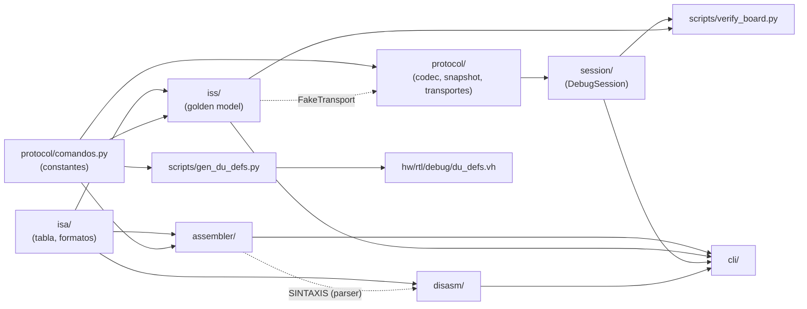

# Guía del `riscv_toolkit`: el software de PC del TP3

Mapa de todo el código Python del TP3 (`TP3/tools/`): qué hace cada paquete, cómo se conectan entre sí y con el hardware, y cómo se corre y se prueba. Es la puerta de entrada; el detalle fino de cada pieza grande está en su propia guía:

| Pieza                  | Guía de detalle                                          |
| ---------------------- | -------------------------------------------------------- |
| Ensamblador (US-106)   | [guia-ensamblador.md](guia-ensamblador.md)               |
| Golden model (US-108)  | [guia-golden-model.md](guia-golden-model.md)             |
| Expresiones regulares  | [guia-regex.md](guia-regex.md) (las usa el lexer)        |
| Protocolo con la placa | [`docs/protocolo.md`](../protocolo.md), ADR-003, ADR-017 |

> **Estado.** Cubre lo hecho hasta US-411: `isa`, `assembler`, `disasm`, `iss`, `protocol/` (constantes, codec, snapshot y transportes), `session/` (la sesión de depuración), `cli` (`asm`, `sim` y `dbg`) y `scripts` (incluido `verify_board.py`). La GUI (Hito 5) se agrega cuando exista (§15).

---

## 1. Qué es y qué problema resuelve

El procesador en la FPGA solo entiende **palabras de 32 bits** en su IMEM y solo habla con el exterior por **bytes en la UART**. Una persona, en cambio, escribe `addi x5, x0, 10` y quiere ver "x5 vale 10". El `riscv_toolkit` es todo lo que hay en el medio, del lado de la PC:

| Necesidad                                                         | Quién la resuelve                                 |
| ----------------------------------------------------------------- | ------------------------------------------------- |
| Pasar de texto assembly a palabras de máquina                     | `assembler/`                                      |
| Pasar de una palabra a texto (para mostrar qué hay en cada etapa) | `disasm/`                                         |
| Saber qué **tendría** que dar un programa, sin hardware           | `iss/` (golden model)                             |
| Que la PC y la Debug Unit usen los mismos números de protocolo    | `protocol/comandos.py` + `scripts/gen_du_defs.py` |
| Hablar con la Debug Unit por la UART (bytes ↔ objetos)            | `protocol/` (codec, snapshot, transportes)        |
| Los casos de uso (cargar, correr, paso, volcar) como API          | `session/` (`DebugSession`)                       |
| Usar todo eso desde la terminal                                   | `cli/` (`asm`, `sim`, `dbg`)                      |
| Verificar la suite en la placa contra el golden model             | `scripts/verify_board.py`                         |

### El recorrido de un programa, hoy

```text
                    ┌──────────── riscv_toolkit ─────────────┐
 prog.asm ──► ensamblar() ──► Imagen ──┬──► a_hex / a_bin / a_lst ──► .hex (tb), .bin, .lst
                                       │
                                       ├──► GoldenModel.run() ──► EstadoArquitectonico
                                       │                            ├──► pantalla (rvsim --dump)
                                       │                            └──► .expected (tb, a futuro)
                                       │
                                       └──► DebugSession.load / run / step (US-410)
                                              └──► codec ──► Transport ──► UART ──► placa
                                                      ◄── Snapshot ◄── FrameReader ◄──┘
```

Hasta US-408 el camino **terminaba en la PC**. Desde US-409 y US-410 llega a la placa: `protocol/` traduce objetos a bytes (§12), `session/` arma los casos de uso (§13) y `verify_board.py` compara la placa contra el golden model (§14).

**Analogía con un sistema real.** Es lo mismo que trae cualquier SDK de microcontrolador (por ejemplo el de un ESP32 o un STM32): un _assembler/compiler_, un _disassembler_ (`objdump`), un simulador de la ISA y un programa que habla con el _debugger_ por USB. Acá están todos hechos a mano y reducidos a las 33 instrucciones del TP.

---

## 2. Cómo está armado el proyecto y cómo se corre

### 2.1 Estructura de carpetas

```text
TP3/tools/
├── pyproject.toml          dependencias y configuración de ruff, mypy, pytest
├── uv.lock                 versiones exactas (lo maneja uv)
├── riscv_toolkit/          el código
│   ├── __main__.py         `python -m riscv_toolkit`: despacha los subcomandos
│   ├── isa/                la ISA: tabla de instrucciones, formatos, registros
│   ├── assembler/          .asm → Imagen, y la Imagen a .hex/.bin/.lst
│   ├── disasm/             palabra → texto
│   ├── iss/                golden model y formato .expected
│   ├── protocol/           protocolo con la Debug Unit: constantes, codec, snapshot, transportes
│   ├── session/            DebugSession, historial de snapshots y diff (US-410)
│   └── cli/                subcomandos asm, sim y dbg
├── scripts/                utilidades sueltas: gen_du_defs, uart_echo_test, verify_board
└── tests/                  un subdirectorio por paquete, mismo nombre
```

No hay `__init__.py`: Python 3.3+ trata a las carpetas sin él como _namespace packages_, y el proyecto no se distribuye como librería.

### 2.2 `uv`: el gestor del entorno

**`uv`** es un gestor de proyectos Python (reemplaza a `pip` + `venv`). Lee `pyproject.toml`, crea el entorno virtual en `.venv/` e instala exactamente las versiones de `uv.lock`, así todos (y el CI) corren con lo mismo.

```bash
cd TP3/tools
uv sync                                   # crea/actualiza el entorno
uv run python -m riscv_toolkit --version  # corre el toolkit dentro del entorno
uv run pytest                             # tests
```

`pyproject.toml` tiene `package = false`: el proyecto **no se instala**, se corre desde `TP3/tools/`. Por eso los tests necesitan `pythonpath = ["."]` (para encontrar `riscv_toolkit`) y por eso `__main__.py` tiene la versión duplicada (no hay metadata instalada de donde leerla).

La única dependencia de ejecución es **`pyserial`** (para el puerto serie). Todo lo demás es la biblioteca estándar.

### 2.3 Cómo se agregan subcomandos

`python -m riscv_toolkit` ejecuta `riscv_toolkit/__main__.py`, que arma un `argparse` con **subparsers** (como `git commit`, `git push`: un programa, varios subcomandos). Cada módulo de `cli/` aporta dos funciones:

```python
def agregar_subcomando(subcomandos) -> None:   # registra "asm" y sus opciones
    parser = subcomandos.add_parser("asm", ...)
    parser.set_defaults(ejecutar=ejecutar)       # ← qué función corre este subcomando

def ejecutar(args) -> int:                       # hace el trabajo y devuelve el código de salida
```

`__main__.py` solo llama a `args.ejecutar(args)`. Así se sumó `dbg` (US-410), y así se va a sumar `gui`: un módulo con esas dos funciones y una línea en `main()`.

Los programas de assembly que no son tests unitarios viven fuera de `tools/`, en `TP3/asm/` (la carpeta de la suite, US-30x): hoy tiene `demos/fibonacci.asm` y `special/infinite_loop.asm`.

---

## 3. Cómo dependen los paquetes entre sí



Tres reglas que se respetan a propósito:

1. **`isa/` es la única fuente de verdad de las instrucciones.** El ensamblador codifica, el desensamblador y el golden model decodifican, y los tres leen la misma tabla. Si una instrucción estuviera mal en la tabla, fallaría en los tres a la vez (y lo detectaría `test_vs_gnu.py`, §10).
2. **El golden model no importa nada de `assembler/`.** Recibe palabras ya ensambladas (US-108, AC4). Así se puede alimentar con cualquier programa, incluso uno ensamblado con GNU.
3. **`protocol/comandos.py` es la fuente de verdad del protocolo** para Python **y** para Verilog (§8).

---

## 4. `isa/`: la ISA en tablas

### 4.1 Concepto

Una **ISA** (_Instruction Set Architecture_) es el contrato entre el software y el procesador: qué instrucciones existen y cómo se codifica cada una en 32 bits. RV32I agrupa sus instrucciones en **formatos** (R, I, S, B, U, J): todas las de un formato ponen sus campos en los mismos bits, así el hardware los extrae siempre del mismo lugar.

### 4.2 Los tres archivos

| Archivo            | Contenido                                                                                                                                           |
| ------------------ | --------------------------------------------------------------------------------------------------------------------------------------------------- |
| `instrucciones.py` | La tabla de las 33 instrucciones (`InstructionSpec`: mnemónico, formato, opcode, funct3, funct7), `HALT_WORD = 0x0000000B` e `identificar(palabra)` |
| `formatos.py`      | Un `Campos*` (dataclass) y un par `encode_*`/`decode_*` por formato, más `sign_extend`                                                              |
| `registros.py`     | `REGISTROS = {"x0": 0, …, "x31": 31}` (sin nombres ABI como `t0`, ADR-013)                                                                          |

### 4.3 Ejemplo: codificar `addi x5, x0, 10`

`addi` es formato I: `imm[11:0] | rs1 | funct3 | rd | opcode`.

```text
 31          20 19   15 14  12 11    7 6       0
┌──────────────┬───────┬──────┬───────┬─────────┐
│ 000000001010 │ 00000 │ 000  │ 00101 │ 0010011 │   = 0x00A00293
│   imm = 10   │ rs1=0 │ addi │ rd=5  │  OP-IMM │
└──────────────┴───────┴──────┴───────┴─────────┘
```

En código:

```python
from riscv_toolkit.isa.formatos import CamposI, encode_i
encode_i(CamposI(opcode=0b0010011, rd=5, funct3=0, rs1=0, imm=10))   # 0x00A00293
```

`encode_i` primero **verifica rangos** (`imm` en −2048…2047, registros en 0…31) y lanza `ErrorCodificacion` si algo no entra. Esto importa porque un `imm = 3000` metido a la fuerza en 12 bits se convertiría en silencio en otro número.

Los formatos B y J son los "raros": el inmediato va **desordenado** (`imm[12|10:5]` … `imm[4:1|11]`) y no guardan el bit 0, porque los saltos siempre son a direcciones pares. Por eso `encode_b` rechaza offsets impares (`_verificar_par`): se perderían sin aviso.

### 4.4 `identificar`: de la palabra a la instrucción

El camino inverso: dada `0xFE029CE3`, ¿qué instrucción es? Opcode, funct3 y funct7 están en los **mismos bits en todos los formatos**, así que se extraen con `decode_r` y se buscan en un índice probando de la clave más específica a la menos:

```text
(opcode, funct3, funct7)  →  encuentra R y los shifts (slli/srli/srai)
(opcode, funct3)          →  resto de I, S, B
(opcode)                  →  U, J, HALT
```

Si ninguna coincide, devuelve `None`: la palabra es **ilegal**. Esta misma función usan el desensamblador y el golden model, así ambos coinciden en qué es ilegal (y con `tabla_control.md` del hardware).

---

## 5. `assembler/`: texto → `Imagen` → archivos

Detalle completo en [guia-ensamblador.md](guia-ensamblador.md). Resumen:

### 5.1 Las etapas

```text
texto ──lexer──► tokens ──parser──► LineaAsm ──1.ª pasada──► símbolos ──2.ª pasada──► Imagen
```

| Etapa      | Archivo        | Qué hace                                                                                                  |
| ---------- | -------------- | --------------------------------------------------------------------------------------------------------- |
| Lexer      | `lexer.py`     | Corta cada línea en `Token`s (registro, inmediato, identificador, coma, paréntesis…) con una regex        |
| Parser     | `parser.py`    | Verifica que los operandos coincidan con la sintaxis de la instrucción (`SINTAXIS`) y arma una `LineaAsm` |
| 1.ª pasada | `assembler.py` | Asigna dirección a cada línea y anota las etiquetas (`loop → 0x004`); expande pseudoinstrucciones         |
| 2.ª pasada | `assembler.py` | Calcula offsets de saltos (`destino − PC`) y codifica con `isa/formatos.py`                               |

**¿Por qué dos pasadas?** Un `bne x5, x0, fin` puede saltar a una etiqueta que aparece _más abajo_: en la primera lectura todavía no se sabe su dirección. La primera pasada solo junta direcciones; la segunda ya las conoce todas.

### 5.2 La `Imagen`

Es el resultado del ensamblador y la pieza que circula por todo el toolkit (`assembler/imagen.py`):

| Campo          | Tipo             | Para qué                                                                       |
| -------------- | ---------------- | ------------------------------------------------------------------------------ |
| `palabras`     | `list[int]`      | El programa: lo que va a la IMEM (por `$readmemh` o por `LOAD`)                |
| `simbolos`     | `dict[str, int]` | Etiqueta → dirección                                                           |
| `mapa_lineas`  | `dict[int, int]` | Dirección → línea de la fuente: la GUI resalta la línea que está en cada etapa |
| `expansiones`  | `dict[int, str]` | Dirección → instrucción real de una pseudo (`mv x6, x5` → `addi x6, x5, 0`)    |
| `advertencias` | `list[str]`      | HALT agregado, accesos desalineados…                                           |

Es `@dataclass(frozen=True)`: una vez ensamblada no se puede modificar por accidente.

### 5.3 Ejemplo real

```asm
addi x5, x0, 10
loop: addi x5, x5, -1
sw x5, 0(x0)
bne x5, x0, loop
mv x6, x5
```

`uv run python -m riscv_toolkit asm ej.asm -o - --format lst`:

```text
# dir  palabra   línea  fuente
0x000  00a00293      1  addi x5, x0, 10
                        loop:
0x004  fff28293      2  addi x5, x5, -1
0x008  00502023      3  sw x5, 0(x0)
0x00c  fe029ce3      4  bne x5, x0, loop
0x010  00028313      5  mv x6, x5               # addi x6, x5, 0
0x014  0000000b      -  halt                    # agregado por el ensamblador
```

Tres cosas para notar:

- `-1` se codifica como `0xFFF` en el campo imm (complemento a dos de 12 bits): `fff28293`.
- `bne` a `loop` desde `0x00C` es un offset de `−8`: el ensamblador lo calculó en la segunda pasada.
- El programa no terminaba en `halt`, así que el ensamblador **agregó uno** (con línea `-`) y dejó una advertencia. Sin él, el procesador seguiría ejecutando lo que haya en la IMEM.

### 5.4 Las salidas (`salidas.py`)

| Formato | Contenido                                         | Lo consume                                                                   |
| ------- | ------------------------------------------------- | ---------------------------------------------------------------------------- |
| `.hex`  | una palabra por línea, 8 dígitos (`00a00293`)     | `$readmemh` en los testbenches                                               |
| `.bin`  | las palabras en _little endian_ (`93 02 a0 00 …`) | el payload de `LOAD` (protocolo §4): es exactamente lo que viaja por la UART |
| `.lst`  | el listado de arriba                              | una persona                                                                  |

_Little endian_ = el byte menos significativo primero. `0x00A00293` se manda como `93 02 A0 00`. Es el orden de RISC-V y el del protocolo.

---

## 6. `disasm/`: palabra → texto

`desensamblar(palabra, pc=None)` hace lo inverso del ensamblador para **una** palabra:

```python
desensamblar(0xFE029CE3)          # 'bne x5, x0, .-8'   destino relativo
desensamblar(0xFE029CE3, pc=0xC)  # 'bne x5, x0, 0x4'   destino absoluto
desensamblar(0xFFFFFFFF)          # '.word 0xffffffff'  ilegal
```

Funciona en tres pasos: `identificar` (§4.4) → `decode_*` del formato → texto con la misma sintaxis que acepta el parser (por eso importa `SINTAXIS` de `assembler/parser.py`). Gracias a eso se cumple `ensamblar(desensamblar(p)) == p` para toda instrucción, salvo branches y `jal`: el ensamblador solo acepta etiquetas como destino, y el desensamblador no las conoce.

**Para qué sirve en el TP.** El snapshot de la Debug Unit trae la `instr` de cada latch (ADR-017). La GUI la pasa por `desensamblar` para mostrar "en EX está `addi x5, x5, -1`", incluso con burbujas y flushes.

---

## 7. `iss/`: el golden model

Detalle completo en [guia-golden-model.md](guia-golden-model.md). Resumen:

### 7.1 Concepto

Un **ISS** (_Instruction Set Simulator_) ejecuta un programa instrucción por instrucción según la **especificación** de la ISA, sin modelar el hardware (no hay pipeline, ni riesgos, ni ciclos). Se le dice **golden model** (modelo de referencia) porque se asume correcto: si el pipeline de la FPGA da otro estado final que el ISS, el que está mal es el pipeline.

**Problema que resuelve.** Sin él, para saber si `tb_core` anduvo habría que calcular a mano el resultado de cada programa de prueba.

### 7.2 Cómo se usa

```python
from riscv_toolkit.assembler.assembler import ensamblar
from riscv_toolkit.iss.golden_model import GoldenModel

imagen = ensamblar(texto)
modelo = GoldenModel(imagen.palabras)   # IMEM = programa + HALT de relleno; regs y DMEM en 0
motivo = modelo.run(max_instr=10_000)   # Motivo.HALTED / ILLEGAL / TIMEOUT
estado = modelo.estado_final()          # EstadoArquitectonico(regs, mem_usada, pc, motivo)
```

| Pieza                  | Qué es                                                                                                                                                                               |
| ---------------------- | ------------------------------------------------------------------------------------------------------------------------------------------------------------------------------------ |
| `step()`               | ejecuta **una** instrucción: busca en `imem[pc/4]`, `identificar`, decodifica, aplica la operación de la tabla de su grupo (`_ALU`, `_LOADS`, `_STORES`, `_BRANCHES`) y avanza el PC |
| `run(max_instr)`       | `step()` hasta que termine; si no termina, corta con `TIMEOUT` (no existe en el hardware: es una red de seguridad para loops infinitos)                                              |
| `mem_escrita`          | direcciones de las palabras que se escribieron: es la "memoria usada" del snapshot (ADR-008)                                                                                         |
| `EstadoArquitectonico` | lo **visible para el programador** al final: registros, memoria usada, PC y motivo. Es justo lo comparable con la parte de registros y memoria del snapshot del hardware             |

Detalles que se repiten en el hardware: registros guardados **sin signo** (0…2³²−1, se interpretan con signo solo en `slt`, `sra`…), `x0` siempre 0, y una instrucción ilegal **no modifica nada** (ni el PC).

Con el programa del §5.3 (`sim ej.asm --dump`):

```text
ej.asm: HALTED en 0x014, 32 instrucciones
x0  = 0x00000000   x1  = 0x00000000   ...
memoria usada (1 palabras):
  0x000: 0x00000000
```

32 = 1 `addi` inicial + 10 vueltas × 3 + el `mv`; el `halt` no cuenta como retirada. La DMEM en `0x000` vale 0 pero figura como "usada" porque se **escribió** (el último `sw` guardó el 0).

### 7.3 El formato `.expected` (`expected.py`)

`rvsim --expect prog.expected` escribe el `EstadoArquitectonico` como **una palabra hex por línea**, para que un testbench lo cargue con `$readmemh` y compare registro por registro:

```text
[0]       motivo (1 = HALTED, 2 = ILLEGAL, los valores del protocolo)
[1]       PC
[2..33]   x0 … x31
[34]      K = cantidad de palabras usadas
[35..]    K pares dirección, dato
```

`leer_expected` es la inversa (para los tests y para `verify_rtl.py`). Los consumidores en hardware (`tb_core_programs.v`, US-210) llegan con el núcleo real.

---

## 8. `protocol/comandos.py`: un solo lugar para los números del protocolo

### 8.1 Problema

La Debug Unit (Verilog) y el software (Python) tienen que coincidir en decenas de números: `'R' = 0x52` es `RUN`, `0x03` es `SNAPSHOT`, `0x05` es `ERR_RANGO`, el snapshot fijo mide 221 bytes… Si se escriben dos veces, tarde o temprano alguien cambia uno y no el otro, y el bug aparece recién en la placa ("la PC manda `0x4D` y la DU responde `ERR_DESCONOCIDO`").

### 8.2 Cómo se resolvió

```text
comandos.py ──(scripts/gen_du_defs.py)──► hw/rtl/debug/du_defs.vh ──`include──► módulos de la DU
     ▲                                              │
     └────────── tests/protocol/test_du_defs_sync.py: el .vh versionado == lo que se generaría
```

- `comandos.py` define `IntEnum`s (`Comando`, `TipoTrama`, `ErrorNack`, `EstadoDU`, `Motivo`) y constantes (`SYNC = 0xA5`, `IMEM_DEPTH`, los tamaños de cada bloque del snapshot, `SNAPSHOT_FIJO = 221`).
- `uv run python -m scripts.gen_du_defs` escribe `du_defs.vh` con `` `define DU_CMD_RUN 8'h52 `` y similares.
- `test_du_defs_sync.py` falla si alguien edita `comandos.py` y se olvida de regenerar, así el CI lo detecta antes de sintetizar.
- `test_comandos.py` verifica propiedades: sin valores repetidos, que cada comando sea su letra ASCII, que estado y motivo entren en un nibble, que el snapshot máximo entre en el campo longitud.

Un **`IntEnum`** es un enum cuyos miembros **son** enteros: `Comando.RUN == 0x52` es verdadero y se puede meter directo en un `bytes([...])`, pero en un `print` o un error se lee `Comando.RUN` en vez de `82`.

### 8.3 Dos `Motivo` distintos

Ojo con esto, confunde: hay un `Motivo` en `iss/golden_model.py` (`HALTED`, `ILLEGAL`, `TIMEOUT`) y otro en `protocol/comandos.py` (`NINGUNO`, `HALTED`, `ILLEGAL`, `ABORTED`, con valores numéricos del protocolo). El del ISS describe por qué terminó **la simulación**; el del protocolo, lo que reporta **el hardware** en el nibble alto del byte `estado`. `expected.py` traduce del primero al segundo (`_CODIGOS`).

---

## 9. `cli/` y `scripts/`

### 9.1 Subcomandos

| Comando                                       | Qué hace                            | Salida                                                                 |
| --------------------------------------------- | ----------------------------------- | ---------------------------------------------------------------------- |
| `uv run python -m riscv_toolkit asm prog.asm` | ensambla y escribe `prog.hex`       | también `-o archivo`, `-o -` (pantalla), `--format hex\|bin\|lst`      |
| `uv run python -m riscv_toolkit sim prog.asm` | ensambla y corre en el golden model | `--dump` (registros y memoria), `--expect f.expected`, `--max-instr N` |
| `uv run python -m riscv_toolkit dbg <acción>` | maneja la placa por la UART (§13)   | `--port`, `--fake`, `--json`; acciones `ping`, `load`, `run`, `step`…  |

Convenciones de ambos, como cualquier herramienta Unix:

- errores y advertencias van a **stderr** con el formato `archivo:línea: error: mensaje` (el mismo de `gcc`, así VS Code los vuelve clicables);
- código de salida **0** si todo bien, **1** si hubo error. En `sim`, `ILLEGAL` es un resultado válido (sale con 0); `TIMEOUT` no (sale con 1).

### 9.2 Scripts

| Script                      | Uso                                                                                                                                                                              |
| --------------------------- | -------------------------------------------------------------------------------------------------------------------------------------------------------------------------------- |
| `scripts/gen_du_defs.py`    | regenera `du_defs.vh` (§8)                                                                                                                                                       |
| `scripts/uart_echo_test.py` | prueba de eco de la UART en la placa (US-401): manda bytes al azar a 19200 8E1 y verifica que vuelvan. Manda de a bloques porque el TX de la placa es 0,15 % más lento que el RX |
| `scripts/verify_board.py`   | corre la suite en la placa y la compara contra el golden model (US-411, §14)                                                                                                    |

Se corren como módulos (`uv run python -m scripts.gen_du_defs`) para que encuentren `riscv_toolkit` sin instalarlo.

---

## 10. Calidad: tests y verificaciones

`make check-py` (desde `TP3/`) corre las cuatro herramientas que también corre el CI:

| Herramienta   | Qué verifica                                                                 | Configuración                          |
| ------------- | ---------------------------------------------------------------------------- | -------------------------------------- |
| **ruff**      | lint y formato: errores probables, imports, nombres, seguridad (`S`, bandit) | `line-length = 100`                    |
| **mypy**      | tipos, en modo `strict`: toda función anotada, sin `Any` implícitos          | `strict = true`                        |
| **pytest**    | los tests, con cobertura                                                     | falla si la cobertura baja de **80 %** |
| **pip-audit** | vulnerabilidades conocidas en las dependencias                               | —                                      |

`tests/` replica la estructura del código: `tests/assembler/`, `tests/iss/`, etc. Algunos tests que vale la pena conocer:

| Test                            | Qué garantiza                                                                                                                                                                                                                                             |
| ------------------------------- | --------------------------------------------------------------------------------------------------------------------------------------------------------------------------------------------------------------------------------------------------------- |
| `assembler/test_vs_gnu.py`      | el ensamblador produce **las mismas palabras** que el `as` de GNU para las 32 instrucciones estándar de `todas_las_instrucciones.asm`. La referencia `.hex` se generó una vez con `make gnu-ref` y está versionada, así el test no necesita GNU instalado |
| `disasm/test_disassembler.py`   | ida y vuelta `ensamblar(desensamblar(p)) == p`                                                                                                                                                                                                            |
| `iss/test_golden_model.py`      | programas de `iss/fixtures/` (aritmética, branches, loads/stores, loop) con resultado conocido                                                                                                                                                            |
| `isa/test_solo_stdlib.py`       | `isa/` no importa nada fuera de la biblioteca estándar                                                                                                                                                                                                    |
| `protocol/test_du_defs_sync.py` | el `.vh` del hardware está al día con `comandos.py`                                                                                                                                                                                                       |

---

## 11. Errores comunes

- **Correr desde la carpeta equivocada.** `python -m riscv_toolkit` solo funciona desde `TP3/tools/` (el proyecto no se instala). Desde otra carpeta: `ModuleNotFoundError: riscv_toolkit`.
- **Usar `python` en vez de `uv run python`.** Se usa el Python del sistema, sin `pyserial` ni las versiones fijadas.
- **Cambiar `comandos.py` sin regenerar `du_defs.vh`.** `test_du_defs_sync.py` falla; la solución es correr `gen_du_defs`, no editar el `.vh` a mano.
- **Confundir dirección en bytes con índice de palabra.** La `Imagen` y el PC usan bytes (`0x00C`); la IMEM y `imem[]` usan índices (`3`). `pc // 4` pasa de uno a otro.
- **Olvidar el signo.** Los registros se guardan sin signo: `0xFFFFFFFF` es −1 solo si se interpreta con `sign_extend(v, 32)`.
- **Confundir los dos `Motivo`** (§8.3).
- **Leer `.bin` como si fuera big endian.** `00a00293` aparece como `93 02 a0 00` en un volcado hex del archivo.

---

## 12. `protocol/`: hablar con la placa (US-409)

Hasta acá el toolkit terminaba en la PC. Este paquete es la capa que convierte objetos de Python en los bytes del protocolo y al revés, y que separa el _qué_ se manda del _por dónde_.

```text
            ┌───────────────────────────── protocol/ ─────────────────────────────┐
Imagen ──► encode_load / encode_cmd / encode_dump_mem ──► bytes ──► Transport.write ──► placa
                                                                                         │
Snapshot / MemRange ◄── from_bytes ◄── Trama ◄── FrameReader ◄── Transport.read ◄────────┘
```

### 12.1 Los archivos

| Archivo               | Qué tiene                                                                                                | Lo usa                           |
| --------------------- | -------------------------------------------------------------------------------------------------------- | -------------------------------- |
| `comandos.py`         | constantes (§8)                                                                                          | todos                            |
| `codec.py`            | `encode_*` (PC → FPGA), `encode_trama` y `FrameReader` (FPGA → PC), `checksum`, las excepciones `Error*` | la sesión (US-410), el fake      |
| `snapshot.py`         | `Snapshot`, los 4 `Latch*`, `RiesgosCiclo`, `MemRange`, con `from_bytes` y `to_bytes`                    | la sesión, la GUI, el fake       |
| `transport.py`        | la interfaz `Transport`: `write`, `read(n, timeout)`, `close`, `simulado`                                | todo lo que habla con "la placa" |
| `serial_transport.py` | `SerialTransport` (pyserial, 19200 8E1) y `detectar_puerto` (VID/PID `0403:6010`)                        | la placa real                    |
| `fake_transport.py`   | `FakeTransport`: la Debug Unit respondida por el golden model                                            | tests, CI, GUI sin placa         |

### 12.2 Codificar (PC → FPGA)

`encode_load(imagen.palabras)` arma `4C | N | palabras LE | XOR`. El criterio de qué se valida en la PC:

- **Se rechaza** lo que no entra en los campos (una palabra de 33 bits, una dirección mayor que `0xFFFF`) y lo que, mandado, **destruye estado**: un `LOAD` con N inválido hace que la DU responda `ERR_TAMANO` y deje la IMEM llena de HALT.
- **No se rechaza** un `DUMP_MEM` fuera de rango: la DU responde `NACK(ERR_RANGO)` sin cambiar nada, y duplicar la regla en Python abriría la puerta a que las dos versiones no coincidan.

### 12.3 Decodificar (FPGA → PC): _framing_

La UART entrega un **flujo** de bytes sin separaciones. `FrameReader` guarda lo que llega en un buffer y corta una trama cuando la tiene completa:

1. descarta todo lo anterior al primer `A5`;
2. con la cabecera (4 bytes) valida el **tipo** y que la **longitud sea posible para ese tipo** (ACK = 0, NACK = 1, SNAPSHOT = 221 + 6K con K ≤ 256, MEM*DATA = 4 + 4n). Esto se hace \_antes* de esperar el payload: un `A5 03 FF FF` corrupto no deja al lector esperando 65 535 bytes;
3. con la trama completa, verifica el **checksum**: tipo ⊕ longitud ⊕ payload ⊕ XOR tiene que dar 0.

Cada error tiene su excepción (`ErrorTipo`, `ErrorLongitud`, `ErrorChecksum`, `ErrorTramaTruncada`, `ErrorPayload`, todas hijas de `ErrorTrama`). Siempre se lanza **después** de descartar la trama mala, así la siguiente llamada sigue con la próxima (resincronización):

| Error                                    | Qué se descarta | Por qué                                                                                  |
| ---------------------------------------- | --------------- | ---------------------------------------------------------------------------------------- |
| tipo o longitud imposibles               | solo el `A5`    | la longitud no es confiable: saltear esa cantidad podría comerse la trama siguiente      |
| checksum                                 | la trama entera | la cabecera era plausible, y un `0xA5` dentro del payload haría arrancar una trama falsa |
| truncada (timeout con la trama a medias) | lo acumulado    | la DU manda cada trama sin pausas: si se cortó, no va a seguir                           |

`leer(transport, timeout)` es el bucle completo: pide al transporte exactamente los bytes que faltan, lanza `TimeoutError` si no llegó nada y `ErrorTramaTruncada` si llegó a medias.

### 12.4 El snapshot como objetos

`Snapshot.from_bytes(payload)` recorre el payload en el mismo orden en que lo arma el `du_dumper` (ADR-017), con `struct`: `"<IIIB"` es "little-endian, tres enteros de 4 bytes y uno de 1 byte", que es exactamente el IF/ID. Los flags se separan bit a bit (`valid` es el bit 0, `jalr` el 7 del flags 1 de ID/EX…). El resultado:

```python
snap.estado          # EstadoDU.HALTED
snap.motivo          # Motivo.ILLEGAL, o None si la ejecución no terminó
snap.regs[1]         # x1, sin signo
snap.id_ex.instr     # la instrucción que está en ID/EX → desensamblar(...)
snap.riesgos.fwd_a   # 0 banco, 1 MEM/WB, 2 EX/MEM
snap.mem_usada       # {dirección en bytes: palabra}
```

`to_bytes()` es la inversa: la usa el fake para responder igual que la placa, y los tests verifican que `from_bytes(x).to_bytes() == x` con los ejemplos del protocolo y con la **captura real** `tests/protocol/fixtures/snapshot_sim.bin`, que guarda `tb_du_cmd_fsm.v` (con el `core_stub`, K = 256).

### 12.5 Transportes

`Transport` es un `typing.Protocol`: una clase lo cumple si tiene los métodos, sin heredar (_duck typing_ que mypy verifica). La sesión recibe "algo que es un `Transport`" y no sabe si es la placa o el fake.

- **`SerialTransport`** es el único módulo que importa `serial` (lo verifica un test). Abre a 19200 bps, paridad par, 1 stop. `write` espera a que los bytes salgan (`flush`), así el timeout de la respuesta no empieza a contar mientras todavía se manda un `LOAD` largo.
- **`FakeTransport`** procesa los comandos dentro de `write` con las mismas reglas de estado que la DU (R-DU-1) y deja las respuestas para `read`. Diferencias con la placa: un `STEP` es una instrucción (no un ciclo), no hay riesgos, los latches son una aproximación (IF/ID = la próxima, ID/EX…MEM/WB = las tres anteriores) y un `RUN` que no termina en `max_instr` queda en `RUN` hasta un `ABORT`. Si no hay nada para leer, `read` duerme el `timeout` pedido, como una placa que no contesta: así quien espera en un bucle (el `RUN` de la sesión) no gira en vacío. Por eso su `simulado = True`, que pasa al `Snapshot` (`from_bytes(payload, simulado=transport.simulado)`).

### 12.6 Errores comunes

- **Leer la trama con `transport.read(5 + 221)` "porque el snapshot mide 226".** Mide 226 solo con K = 0. La longitud se lee de la cabecera.
- **Tomar un `ErrorTrama` como fatal.** Ya se descartó la trama: se puede reintentar el comando o seguir leyendo.
- **Comparar `snap.regs[x]` con un número negativo.** Están sin signo: `sign_extend(v, 32)`.
- **Olvidar `simulado`** al mostrar un snapshot del fake: los latches y los ciclos no son los del pipeline real.

---

## 13. `session/` y `dbg`: los casos de uso (US-410)

### 13.1 Problema

Con `protocol/` ya se puede hablar con la placa, pero cada uso repetiría lo mismo: codificar el comando, mandarlo, leer una trama, ver si es un `NACK`, si es del tipo que corresponde, decodificarla… La GUI, la CLI y `verify_board.py` tendrían tres copias, cada una con sus bugs. `DebugSession` lo escribe **una vez**:

```python
with DebugSession(SerialTransport()) as sesion:   # o FakeTransport()
    sesion.conectar()                 # PING con reintentos + chequeo de versión
    sesion.load(imagen.palabras)
    snap = sesion.step()              # Snapshot, o una excepción con mensaje legible
```

Es una **fachada** (_facade_): una clase con métodos simples que esconde varias piezas (codec, `FrameReader`, transporte, timeouts).

### 13.2 Cada método es una transacción

| Método                  | Manda       | Espera                              | Devuelve   |
| ----------------------- | ----------- | ----------------------------------- | ---------- |
| `conectar()` / `ping()` | `?`         | `PING_INFO`                         | la versión |
| `load(palabras)`        | `L N … XOR` | `ACK`                               | —          |
| `reset()`               | `X`         | `ACK`                               | —          |
| `step()` / `dump()`     | `S` / `D`   | `SNAPSHOT`                          | `Snapshot` |
| `run()`                 | `R`         | `ACK` y después el `SNAPSHOT` final | `Snapshot` |
| `abort()`               | `A`         | `SNAPSHOT` (motivo `ABORTED`)       | `Snapshot` |
| `dump_mem(addr, n)`     | `M addr n`  | `MEM_DATA`                          | `MemRange` |

Si llega otra cosa, el método **no devuelve**: lanza una excepción.

| Excepción        | Cuándo                                                                        |
| ---------------- | ----------------------------------------------------------------------------- |
| `ErrorNackDU`    | la DU respondió `NACK`; trae `.comando`, `.codigo` y `.estado`                |
| `ErrorRespuesta` | llegó una trama válida pero de otro tipo (la sesión quedó desincronizada)     |
| `ErrorVersion`   | la placa habla otra `PROTO_VERSION`: bitstream y toolkit de commits distintos |
| `TimeoutError`   | la placa no respondió a tiempo (AC3)                                          |
| `ErrorTrama`     | llegó basura (del codec, §12.3); ya se descartó                               |

**Por qué excepciones y no un código de retorno:** quien llama no puede "olvidarse" de revisar el `NACK`. Si no lo atrapa, el programa se corta con el mensaje.

### 13.3 Mensajes legibles (AC2)

Un `NACK(ERR_ESTADO)` solo trae el código, no el estado. Para decir "_No se puede ejecutar STEP: el procesador está detenido (HALTED). Cargá o reseteá el programa._", la sesión averigua el estado:

- si el rechazado es `LOAD`, `RESET`, `DUMP` o `DUMP_MEM`, el estado es **`RUN`**: es el único que los rechaza (tabla §4.1 del protocolo);
- si es `STEP`, `RUN` o `ABORT` hay varios posibles, y entonces **pregunta con un `DUMP`**, que no ejecuta nada y no se guarda en el historial.

`mensaje_nack(comando, codigo, estado)` arma el texto; los otros códigos (`CHECKSUM`, `RANGO`…) tienen una frase fija que dice qué pasó y qué hacer.

### 13.4 Timeouts y la espera de `RUN`

`Timeouts` agrupa los tiempos del protocolo §7.4: `respuesta = 1 s` (ACK/NACK, PING, MEM_DATA), `snapshot = 2 s` (STEP, DUMP, ABORT), `run = None` (sin límite, ADR-010) y `sondeo = 0,2 s`.

El `RUN` no tiene un timeout corto, porque un programa puede tardar lo que quiera. Pero un `read` bloqueado sin límite puede no dejar pasar el **Ctrl+C** (`KeyboardInterrupt`): en Windows, pyserial bloqueado a veces lo ignora. Por eso `run()` espera en un bucle de lecturas cortas (`sondeo`). Entre una y otra, Python revisa las señales y el Ctrl+C corta la espera. La DU sigue en `RUN`, y quien llamó decide mandar `abort()`; la CLI lo hace sola (AC5).

Dos detalles del protocolo que `run()` y `abort()` resuelven:

- **`NACK(ERR_PARIDAD)` durante `RUN`.** Un byte con ruido no corta la ejecución (§7.2): `run()` lo ignora y sigue esperando el snapshot.
- **Carrera de `ABORT`.** Si el programa terminó solo justo antes del `ABORT`, llegan el snapshot final (HALTED) y después un `NACK(ESTADO)` por el `ABORT`. `abort()` devuelve el snapshot y **consume** el `NACK`, para que no quede como respuesta del próximo comando.

### 13.5 Qué se reintenta y qué no

Solo el `PING` de `conectar()`, hasta 3 veces: recién abierto el puerto puede haber basura en la línea. Los demás comandos **no son idempotentes**: repetir un `STEP` avanza dos ciclos, y repetir un `LOAD` borra lo que corría. Ante un error se informa y decide quien llama.

### 13.6 Una guarda: no mandar argumentos a una DU que corre

En `RUN`, la DU rechaza el byte `L` sin leer los argumentos (§4.1) y toma los que siguen (N, palabras, checksum) como **comandos sueltos**. Un `0x41` dentro de una palabra sería un `ABORT`. Por eso `load()` y `dump_mem()` primero se fijan en el estado: si es `RUN` lanzan `ErrorNackDU` sin mandar nada, y si es desconocido lo preguntan antes.

### 13.7 `SnapshotHistory` y `diff`

- **`sesion.historial`** guarda cada snapshot recibido desde el último `LOAD`/`RESET`, con un **cursor**, como el atrás y adelante de un navegador: `agregar` (el cursor salta al último), `anterior`, `siguiente`, `ir_a(i)`, `actual`. La GUI lo usa para volver a ver un ciclo sin pedírselo a la placa.
- **`diff(a, b) -> CambiosEstado`** dice qué cambió entre dos snapshots: `pc`, `regs` y `memoria`, como `{posición: (antes, después)}`. Una palabra que no está en `mem_usada` vale 0, porque la DMEM arranca en 0. Los latches no se comparan: cambian en todos los ciclos. `bool(cambios)` es `False` si no cambió nada.

### 13.8 La CLI `dbg` (rvdbg)

```bash
cd TP3/tools
uv run python -m riscv_toolkit dbg ping
uv run python -m riscv_toolkit dbg load ../asm/demos/fibonacci.asm
uv run python -m riscv_toolkit dbg run                      # Ctrl+C → ABORT
uv run python -m riscv_toolkit dbg step 5
uv run python -m riscv_toolkit dbg dump-mem 0x0 12
uv run python -m riscv_toolkit dbg --json dump              # para scripts
uv run python -m riscv_toolkit dbg --fake run --load ../asm/demos/fibonacci.asm
uv run python -m riscv_toolkit dbg --fake shell             # modo interactivo
```

- **Opciones antes de la acción:** `--port COM5`, `--fake`, `--json`.
- **`--fake` y los procesos.** Con la placa, el estado vive en el hardware entre una invocación y otra. El `FakeTransport` vive en memoria y muere con el proceso: `dbg --fake load x && dbg --fake run` no anda (el segundo arranca en IDLE). Por eso `run` y `step` aceptan **`--load ARCHIVO`**, y existe `shell`.
- **`shell`** reusa los **mismos** subparsers de argparse: lee un renglón, lo parte con `shlex` y lo despacha a la misma función que usa la línea de comandos. Hay una sola implementación de cada acción.
- **`--json`** imprime un objeto por acción: `{"ok": true, ...datos}` o `{"ok": false, "error": "..."}`. Un snapshot sale con `dataclasses.asdict`, con `estado` y `motivo` por nombre y `mem_usada` como lista de `{"addr", "dato"}` (JSON no admite claves enteras).
- **Salida de texto:** resumen (estado, motivo, ciclos, PC), registros y memoria (la misma función `volcado` que `rvsim --dump`), los cuatro latches con su instrucción desensamblada o `(burbuja)`, y los riesgos del ciclo si hay.
- **Códigos de salida:** 0 si la acción anduvo, 1 ante cualquier error (NACK, timeout, archivo, puerto). Los errores van a stderr como `error: ...`.

---

## 14. `scripts/verify_board.py`: la suite en la placa (US-411)

```bash
cd TP3/tools
uv run python -m scripts.verify_board                                # toda TP3/asm/
uv run python -m scripts.verify_board ../asm/demos --step            # también ciclo a ciclo
uv run python -m scripts.verify_board --bitstream ../build/top.bit \
    --reporte ../../docs/informe/datos/resultados_placa.md
uv run python -m scripts.verify_board --fake tests/iss/fixtures ../asm   # sin placa
```

Para cada `.asm`:

1. ensambla y lo corre en el **golden model**. Si ahí no termina (`infinite_loop.asm`) queda **OMITIDO**;
2. **`LOAD` → `RUN`** en la placa y compara el snapshot final contra el golden model: registros, memoria usada (con claves: una palabra escrita de más es un bug aunque valga 0) y motivo;
3. con `--step`: **`LOAD` → `STEP`…** hasta `HALTED`, y compara contra el resultado de `RUN` con `diff` (AC2). Corta a los `4·instrucciones + 10` pasos: el pipeline necesita más ciclos que instrucciones (llenado, stalls, flushes), pero no tantos.

**No compara el PC**: en la placa queda congelado unos ciclos después del HALT, y en el golden model queda en el HALT.

| AC  | Cómo lo cubre                                                                                                       |
| --- | ------------------------------------------------------------------------------------------------------------------- |
| AC1 | la fila "Pasan en RUN (North Star)" del reporte                                                                     |
| AC2 | `--step`                                                                                                            |
| AC3 | los programas se cargan uno tras otro **sin `RESET`**: con 5 o más, la corrida misma es la prueba de reprogramación |
| AC4 | el reporte guarda el commit (`git describe --dirty`) y, con `--bitstream`, el SHA-256 del `.bit`                    |

Un programa que falla, o que se cuelga (`--timeout-run`, 10 s por defecto; manda `ABORT` para dejar la placa lista), no corta la suite: se anota **FALLA** con el detalle y se sigue con el siguiente. Sale con 0 solo si no hubo fallas.

Con `--fake` todo el script se prueba sin placa: es lo que hace `tests/scripts/test_verify_board.py`.

---

## 15. Lo que viene

| US     | Qué falta                                                                                                                                |
| ------ | ---------------------------------------------------------------------------------------------------------------------------------------- |
| US-411 | la parte de hardware: integrar `riscv_core` (Hito 3) en `top.v`, repetir los testbenches de US-404…407 y correr `verify_board` en placa |
| Hito 5 | `gui/`: la GUI en Flet, sobre `DebugSession`, `historial` y `diff`                                                                        |

---

## 16. Preguntas de autoevaluación

1. ¿Por qué el golden model recibe `imagen.palabras` y no el texto `.asm` ni la `Imagen` entera? ¿Qué se gana con esa separación?
2. Si cambiás el valor de `Comando.DUMP_MEM` en `comandos.py` y no hacés nada más, ¿qué falla primero y por qué es mejor que falle ahí y no en la placa?
3. `bne x5, x0, loop` en `0x00C` con `loop` en `0x004` se codifica como `0xFE029CE3`. ¿Qué offset quedó codificado, por qué es negativo y por qué el formato B no guarda el bit 0?
4. ¿Por qué `identificar` prueba primero la clave `(opcode, funct3, funct7)` y después las más cortas? ¿Qué pasaría con `srai` si fuera al revés?
5. ¿Qué diferencia hay entre el `.hex` y el `.bin` de la misma `Imagen`, y quién consume cada uno?
6. ¿Por qué `FrameReader` valida la longitud apenas tiene la cabecera, antes de esperar el payload? ¿Qué pasaría si no lo hiciera y llegara `A5 03 FF FF`?
7. ¿Por qué `encode_load` rechaza N = 0 en la PC, pero `encode_dump_mem` deja pasar un rango que se sale de la DMEM?
8. ¿Por qué `DebugSession.run()` espera el snapshot en lecturas de 0,2 s en vez de un solo `read` sin timeout, si igual no tiene límite?
9. `conectar()` reintenta el `PING` pero `step()` no se reintenta nunca. ¿Qué propiedad tiene uno y no el otro, y qué pasaría si se reintentara un `STEP` que en realidad sí llegó?
10. ¿Por qué `load()` se niega a mandar la trama si la DU está en `RUN`, si la DU igual la rechazaría con un `NACK`?
11. `rvdbg --fake load x.asm && rvdbg --fake run` falla, pero con la placa real funciona. ¿Por qué?
