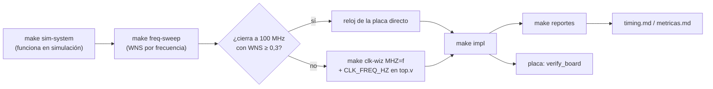

# Guía: síntesis, timing y métricas del sistema completo (Hito 6)

Cómo se sintetiza el sistema entero (`top`: UART + Debug Unit + núcleo), se mide el timing, se busca la frecuencia óptima y se sacan las métricas del informe, todo con scripts y sin abrir la GUI de Vivado. Para leer un reporte de timing, ver la [mini guía del reporte](guia-reporte-timing.md); para un caso resuelto paso a paso, el [de la Debug Unit](guia-caso-timing-debug-unit.md).

## 0. Vocabulario

| Término                     | Qué es                                                                                                                                              |
| --------------------------- | --------------------------------------------------------------------------------------------------------------------------------------------------- |
| **Síntesis**                | Traduce el Verilog a celdas de la FPGA (LUT, FF, CARRY4, LUTRAM). Todavía no sabe dónde va cada una: los retardos de los cables son estimados       |
| **Implementación**          | `opt_design` → `place_design` (ubica cada celda) → `route_design` (une con cables reales). Recién acá el timing es el de verdad                     |
| **Fuera de contexto (OOC)** | Sintetizar un módulo suelto, sin pines. Sirve para medir sus caminos internos; no ve los que cruzan a otros módulos                                 |
| **En contexto**             | El `top` con los pines y el reloj de la placa: el análisis del sistema real                                                                         |
| **Modo batch**              | Vivado sin ventana, siguiendo un script Tcl: `vivado -mode batch -source x.tcl`                                                                     |
| **Checkpoint (`.dcp`)**     | Foto del diseño en una etapa; se abre en la GUI con `open_checkpoint` para mirar el camino crítico dibujado                                         |
| **MMCM / Clock Wizard**     | Bloque de la FPGA que genera otra frecuencia a partir del reloj de entrada, por la red dedicada de reloj. El Clock Wizard es el IP que lo configura |
| **`locked`**                | Salida del MMCM: 1 cuando el reloj generado ya es estable                                                                                           |

## 1. Qué hay y para qué sirve cada cosa

| Comando (desde `TP3/`) | Script                              | Qué hace                                                                             | Deja                                                                     |
| ---------------------- | ----------------------------------- | ------------------------------------------------------------------------------------ | ------------------------------------------------------------------------ |
| `make synth-ooc`       | `hw/scripts/synth_ooc.tcl`          | Síntesis OOC de cada módulo del núcleo: recursos y latches (sin timing)              | `build/synth/`                                                           |
| `make timing-core`     | `hw/scripts/timing_core_ooc.tcl`    | `riscv_core` OOC a 100 MHz (US-210 AC5)                                              | `hw/reports/timing_core_ooc.rpt`, `util_core_ooc.rpt`                    |
| (a mano)               | `hw/scripts/synth_du_ooc.tcl`       | La Debug Unit OOC a 100 MHz                                                          | `hw/reports/du_ooc_*.rpt`                                                |
| `make impl`            | `hw/scripts/impl_top.tcl`           | **El sistema en contexto**: síntesis, implementación, bitstream y todos los reportes | `hw/reports/top_*.rpt`, `build/vivado_top/top.bit`, `commit.txt`, `.dcp` |
| `make freq-sweep`      | `hw/scripts/freq_sweep.tcl`         | El sistema sin MMCM, implementado a varias frecuencias (US-602)                      | `hw/reports/freq_sweep.csv`                                              |
| `make clk-wiz MHZ=85`  | `hw/scripts/gen_clk_wiz.tcl`        | Regenera el Clock Wizard para esa frecuencia                                         | `hw/ip/clk_wiz_0/clk_wiz_0.xci`                                          |
| `make reportes`        | `tools/scripts/resumen_reportes.py` | **Sin Vivado**: lee los `.rpt` y el `.csv` y arma las tablas del informe             | `docs/informe/datos/reportes_vivado.md`                                  |

Los `.tcl` comparten `hw/scripts/comun.tcl`: la parte, qué fuentes leer, dónde están los `.vh` y cómo limpiar los reportes. Los reportes se versionan sin el nombre de la máquina, la fecha ni la ruta, así que un reporte nuevo solo aparece en `git diff` si cambió el diseño.

## 2. Cómo correrlos

Vivado está en Windows. Hay dos formas:

**Desde WSL con `make`:** se le pasa el ejecutable de Windows en `VIVADO`:

```bash
cd TP3
make impl VIVADO="cmd.exe /c C:/AMDDesignTools/2025.2/Vivado/bin/vivado.bat"
```

**Desde PowerShell, sin `make`:** parado en la carpeta de salida, para que los archivos sueltos de Vivado (`clockInfo.txt`, `vivado_*.jou`…) queden ahí y no en `TP3/`:

```powershell
cd TP3\build\vivado_top
C:\AMDDesignTools\2025.2\Vivado\bin\vivado.bat -mode batch -nojournal -nolog -source ..\..\hw\scripts\impl_top.tcl
```

`make reportes` es Python puro y anda en cualquier sistema. Los tiempos aproximados son unos 10 minutos para `impl` y unos 5 minutos por frecuencia del barrido.

## 3. El flujo del Hito 6



1. **¿Funciona?** `make sim-system` pasa cada programa de `asm/` por la UART simulada al `top` y compara el snapshot con el golden model. Si esto falla, no tiene sentido mirar el timing.
2. **¿A qué frecuencia cierra?** `make freq-sweep`. La óptima es la mayor con WNS ≥ 0,3 ns y WHS ≥ 0 (ADR-016). El barrido sintetiza una vez **sin MMCM** (macro `SIN_MMCM`) y para cada frecuencia vuelve a implementar con otro período de reloj.
3. **Aplicarla.** Si no es 100 MHz: `make clk-wiz MHZ=<f>`, y en `hw/rtl/top.v` el parámetro `CLK_FREQ_HZ` a la misma frecuencia (la UART y el timeout de la Debug Unit se calculan desde ahí).
4. **El diseño final.** `make impl` implementa con el MMCM, escribe el bitstream y todos los reportes. Termina con código 1 si no cumple el reloj.
5. **Las tablas.** `make reportes`.
6. **En la placa** (fuera de esta guía): programar `top.bit` y correr `verify_board` con toda la suite.

## 4. Cómo está armado el reloj en `top.v`

```text
 clock (W5, 100 MHz) ──► clk_wiz_0 (MMCM) ──► w_clk (85 MHz) ──► UART, Debug Unit, núcleo
                               │
                               └── locked ──► (i_reset || !locked) ──► 2 FF ──► w_reset
```

- El MMCM se instancia solo al sintetizar: Vivado define la macro `SYNTHESIS`. En Icarus y Verilator el reloj del testbench entra directo, así que `tb_top_system` sigue simulando el `top` sin el modelo del IP.
- Mientras `locked = 0` el sistema queda en reset (ADR-016). El botón también pasa por dos flip-flops antes de llegar a los ~2000 registros que resetea.
- No es "intervenir el clock" (PRD §14, C2): el MMCM genera el reloj por la red dedicada. Lo prohibido es poner lógica en el camino del reloj.
- No hace falta escribir restricciones para el reloj de 85 MHz. El `.xdc` define el de 100 MHz en el pin y Vivado **deriva** solo el que sale del MMCM (`clk_out1_clk_wiz_0`).

## 5. Qué mirar en cada reporte

| Reporte                     | Para                                                                                |
| --------------------------- | ----------------------------------------------------------------------------------- |
| `top_timing_summary.rpt`    | WNS/TNS/WHS; "Check Timing" (relojes o entradas sin restricción)                    |
| `top_timing_setup.rpt`      | Los 10 peores de setup, con lógica/ruteo y **Clock Path Skew** de cada uno (US-601) |
| `top_timing_hold.rpt`       | Los 10 peores de hold                                                               |
| `top_clock_networks.rpt`    | Qué relojes hay y de dónde salen                                                    |
| `top_clock_utilization.rpt` | BUFG y MMCM usados, carga de cada reloj                                             |
| `top_util.rpt`              | Recursos totales (LUT, LUTRAM, FF, BRAM, IO)                                        |
| `top_util_hier.rpt`         | Recursos por módulo, tres niveles de jerarquía (US-603)                             |
| `top_power.rpt`             | Potencia estimada (vectorless): total, dinámica, estática y por tipo de recurso     |
| `top_drc.rpt`               | Reglas de diseño (lo que impediría generar el bitstream)                            |

Para **ver** un camino en la GUI: `open_checkpoint build/vivado_top/top_routed.dcp`, después `report_timing -max_paths 1` y, en el camino, *Schematic* o *Device*.

## 6. Errores comunes

| Síntoma                                                 | Causa                                                                                                               |
| ------------------------------------------------------- | ------------------------------------------------------------------------------------------------------------------- |
| `make impl` dice "vivado: command not found"            | Falta `VIVADO=…` (sección 2)                                                                                        |
| Aparecen `clockInfo.txt` y otros archivos en `TP3/`     | Vivado se corrió parado en `TP3/`. `make` lo corre en `build/`; a mano, hacer `cd` primero                          |
| `module clk_wiz_0 not found` al sintetizar              | Falta `hw/ip/clk_wiz_0/clk_wiz_0.xci`: `make clk-wiz MHZ=85`                                                        |
| El IP aparece *locked* al abrirlo                       | Se generó con otra versión de Vivado (ADR-020): regenerarlo con `make clk-wiz`                                      |
| La UART recibe basura después de cambiar la frecuencia  | `CLK_FREQ_HZ` en `top.v` no coincide con la salida del MMCM: el baud rate se calcula mal                            |
| En el barrido, una frecuencia baja da un WNS muy grande | Normal: a 50 MHz el placer no se esfuerza. El WNS de una frecuencia no permite calcular la máxima; por eso se barre |
| `make reportes` dice "Falta …"                          | Todavía no se corrió `make impl` o `make freq-sweep`                                                                |
