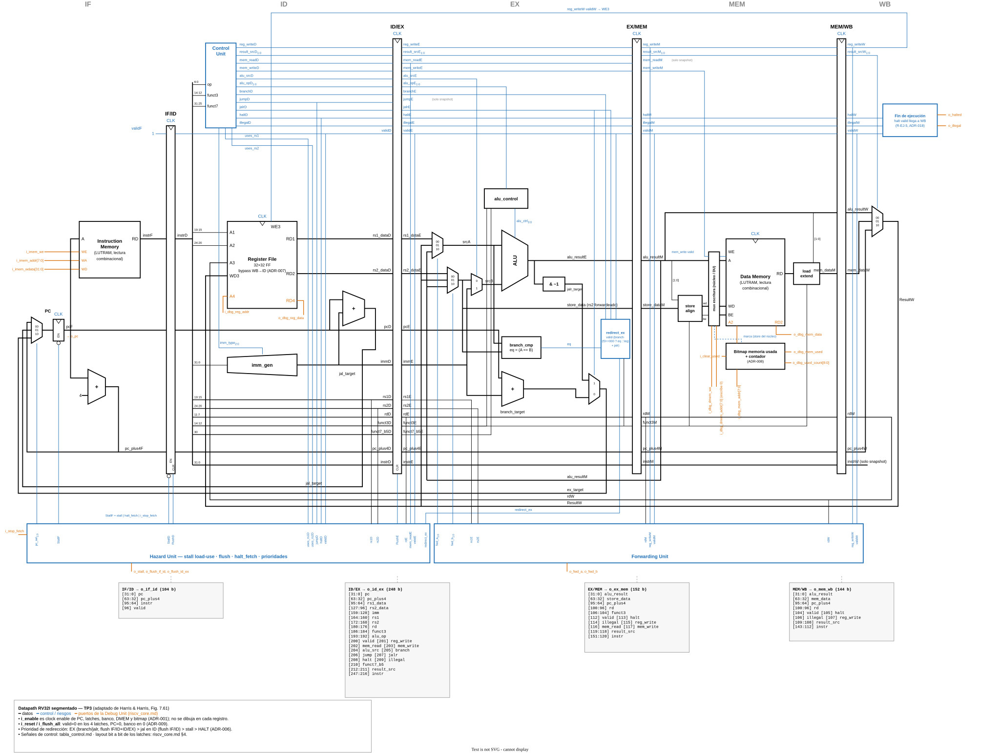
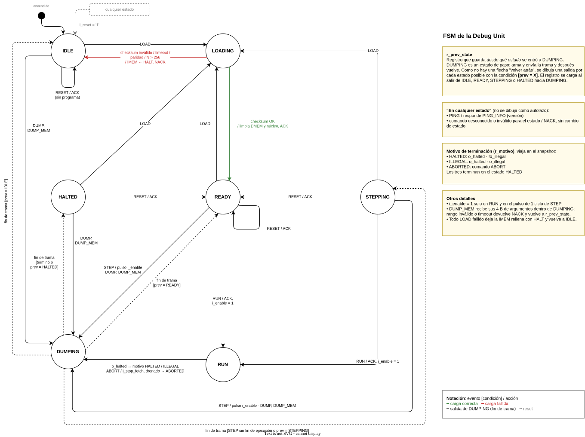

# Informe final — Procesador RISC-V segmentado (TP3)

**Arquitectura de Computadoras · Krede, Julián · Piñera, Nicolás**

Procesador RV32I de 5 etapas con control de riesgos, una Debug Unit que lo controla por UART y software de PC (ensamblador, golden model, CLI e interfaz gráfica), implementado en una Basys 3 (Artix-7 `xc7a35tcpg236-1`).

Los números de este informe salen de reportes y scripts versionados (`make impl`, `make freq-sweep`, `make reportes`, `make verify`); el detalle está en [timing.md](timing.md) y [metricas.md](metricas.md).

## Índice

1. [Introducción y marco teórico](#1-introducción-y-marco-teórico)
2. [Especificación](#2-especificación)
3. [Diseño del núcleo](#3-diseño-del-núcleo)
4. [Debug Unit](#4-debug-unit)
5. [Software de PC](#5-software-de-pc)
6. [Verificación](#6-verificación)
7. [Respuestas a las preguntas del enunciado](#7-respuestas-a-las-preguntas-del-enunciado)
8. [Síntesis e implementación](#8-síntesis-e-implementación)
9. [Decisiones de diseño (ADR)](#9-decisiones-de-diseño-adr)
10. [Manual de usuario](#10-manual-de-usuario)

## 1. Introducción y marco teórico

Un procesador **segmentado** (_pipeline_) divide la ejecución de cada instrucción en etapas —IF (búsqueda), ID (decodificación y lectura del banco), EX (ALU y saltos), MEM (memoria de datos) y WB (escritura del banco)— separadas por registros (_latches_ IF/ID, ID/EX, EX/MEM, MEM/WB). En cada ciclo hay hasta cinco instrucciones en vuelo, así que en régimen se termina una por ciclo (CPI ideal = 1), aunque cada una tarde 5 ciclos.

El precio son los **riesgos** (_hazards_): situaciones en las que la instrucción siguiente no puede avanzar con el dato o el PC correctos.

| Riesgo                         | Ejemplo                                           | Solución en este diseño                                                                     |
| ------------------------------ | ------------------------------------------------- | ------------------------------------------------------------------------------------------- |
| Estructural                    | Dos etapas usan el mismo recurso                  | No hay: IMEM y DMEM separadas; el banco escribe en la primera mitad lógica (bypass interno) |
| De datos (RAW)                 | `add x1,…` seguido de `sub x2, x1, …`             | **Forwarding** desde EX/MEM y MEM/WB hacia EX (ADR-007)                                     |
| De datos con load (_load-use_) | `lw x1,…` seguido de una instrucción que lee `x1` | **Stall** de 1 ciclo + forwarding (Hazard Unit)                                             |
| De control                     | Branch tomado, `jal`, `jalr`                      | **Predict not-taken** y flush; `jal` se resuelve en ID, branches y `jalr` en EX (ADR-006)   |

Guía de estudio completa: [guia-riesgos-forwarding-hazard.md](../guias/guia-riesgos-forwarding-hazard.md).

## 2. Especificación

- **ISA:** RV32I, las 32 instrucciones que pide el enunciado más `HALT` (opcode _custom-0_, palabra `0x0000000B`, ADR-004). Tabla de control: [tabla_control.md](../interfaces/tabla_control.md).
- **Memorias:** IMEM y DMEM de 256 palabras cada una (ADR-008), little-endian.
- **Instrucciones ilegales:** detienen el procesador con motivo `ILLEGAL` cuando llegan a WB; si quedaron en un camino descartado por un salto, no hacen nada (ADR-018).
- **Accesos desalineados:** se ignoran los bits bajos de la dirección (ADR-018).
- **Fin de ejecución:** el HALT llegó a WB, con el pipeline vacío, en cualquier modo (`RUN` o `STEP`).

### Errores e interpretaciones del enunciado

Se revisó la presentación contra la especificación de RISC-V ([PRD §14](../PRD-pipeline-riscv.md#14-incoherencias-y-errores-de-la-presentación-del-tp)). Lo principal:

| Tema                   | Qué dice la presentación                                          | Qué se hizo                                                                                   |
| ---------------------- | ----------------------------------------------------------------- | --------------------------------------------------------------------------------------------- |
| `jal`                  | "Se salta a la dirección almacenada en rd"                        | Según la especificación: `rd ← PC + 4` y se salta a `PC + imm`. El salto a registro es `jalr` |
| Codificación de `beq`  | Rotula `rs1` en los bits [24:20] y [19:15]                        | [24:20] es `rs2`                                                                              |
| `ld`                   | Aparece en la tabla de tipo I                                     | Es de RV64I: no se implementa                                                                 |
| Skew                   | "¿El camino crítico genera skew?"                                 | Se responde aclarando que el skew lo genera la red del reloj, no un camino de datos (§7.7)    |
| Paso a paso vs. reloj  | "Un comando ejecuta un ciclo de clock" y "no intervenir el clock" | _Clock enable_: el reloj corre siempre y lo que se habilita es el avance (ADR-001)            |
| Clock Wizard vs. reloj | "Investiguen Clock Wizard" y "no intervenir el clock"             | El MMCM genera el reloj por la red dedicada: no es intervenirlo (ADR-016)                     |

## 3. Diseño del núcleo

- **Etapas** (`hw/rtl/core/`): `if_stage` (PC e IMEM), `id_stage` (banco, `control_unit`, `imm_gen`, `jal`), `ex_stage` (forwarding, ALU, `branch_cmp`), `mem_stage` (`store_align`, `data_mem`, `load_extend`, bitmap de memoria usada) y `wb_stage`.
- **Latches** con `valid`, reset, enable, flush y stall; con `DEBUG_TRACE` también guardan la instrucción para el volcado (ADR-017). Layout: [riscv_core.md](../interfaces/riscv_core.md).
- **Control de ejecución:** todo el núcleo avanza con un único `i_enable` (_clock enable_, ADR-001). La Debug Unit lo levanta un ciclo para `STEP` o de forma continua para `RUN`.
- **Forwarding Unit:** elige para cada operando de EX el dato más nuevo (EX/MEM > MEM/WB > banco); nunca reenvía `x0`, burbujas ni instrucciones que no escriben.
- **Hazard Unit:** detecta load-use (stall de PC e IF/ID y burbuja en ID/EX), elige el próximo PC (redirección de EX > `jal` en ID > PC + 4) y genera los flush.
- **Penalidades:** load-use 1 ciclo; branch tomado y `jalr` 2 ciclos; `jal` 1 ciclo; branch no tomado 0.

Carta de pipeline de un load-use y un branch tomado, tal como la muestra la GUI: [carta_pipeline_us103.md](../carta_pipeline_us103.md). Programas cortos de cada caso: `TP3/asm/riesgos/`.

## 4. Debug Unit

- **Protocolo** ([protocolo.md](../protocolo.md), ADR-003): comando ASCII de 1 byte más argumentos; respuestas en tramas `[A5][tipo][len][payload][XOR]`; UART 19200 bps 8E1 (ADR-002).
- **Módulos** (`hw/rtl/debug/`): `du_cmd_fsm` (intérprete y estados), `du_loader` (carga y relleno con HALT), `du_exec_ctrl` (`RUN`, `STEP`, `ABORT`), `du_dumper` (snapshot y `DUMP_MEM`), `du_resp_tx` y `du_tx_mux` (respuestas).
- **Snapshot:** PC, los 32 registros, los 4 latches campo a campo, señales de riesgo del ciclo, ciclos y la memoria usada (pares dirección/dato).
- **Modos:** `RUN` corre hasta HALT, ilegal o `ABORT`; `STEP` avanza un ciclo y devuelve el snapshot.

Guía: [guia-estudio-debug-unit.md](../guias/guia-estudio-debug-unit.md).

## 5. Software de PC

Paquete Python `riscv_toolkit` (`TP3/tools/`, ADR-011):

| Componente          | Qué hace                                                                                               |
| ------------------- | ------------------------------------------------------------------------------------------------------ |
| Ensamblador         | Dos pasadas, etiquetas, pseudoinstrucciones `nop`/`mv`/`j`/`ret`, errores con línea (ADR-013)          |
| Golden model        | Simulador de instrucciones de referencia; genera el `.expected` de cada programa (ADR-014)             |
| Modelo del pipeline | Calcula ciclo a ciclo lo mismo que el hardware, para la vista Datapath y para comparar en lockstep     |
| Protocolo y sesión  | Tramas, snapshot, transporte serie o simulado (`FakeTransport`), historial de snapshots                |
| CLI                 | `asm`, `sim`, `dbg` (`python -m riscv_toolkit …`)                                                      |
| GUI (Flet)          | Editor, registros, memoria, pipeline, carta, Datapath, historial y verificación contra el golden model |

Guía: [guia-riscv-toolkit.md](../guias/guia-riscv-toolkit.md). Capturas: [manual de usuario](../manual/usuario.md).

## 6. Verificación

Estrategia en capas: cada módulo tiene su testbench autoverificable; el núcleo y el sistema completo se comparan contra el golden model con los mismos programas.

| Nivel                  | Comando             | Qué compara                                                                            | Resultado   |
| ---------------------- | ------------------- | -------------------------------------------------------------------------------------- | ----------- |
| Testbenches de módulos | `make sim-all`      | Cada módulo contra vectores o modelos de referencia                                    | 30/30       |
| Programas en el núcleo | `make sim-programs` | Motivo, PC, registros y memoria contra el `.expected`, con enable fijo y aleatorio     | 74/74       |
| Verificación cruzada   | `make verify`       | Todo `asm/` en el núcleo contra el golden model, más instrucciones retiradas y CPI     | 59/59       |
| Sistema completo       | `make sim-system`   | Cada programa por la UART simulada al `top` (UART + Debug Unit + núcleo)               | 59/59       |
| Software               | `make check-py`     | pytest (cobertura 99 %), ruff, mypy, pip-audit                                         | 1162 tests  |
| Placa                  | `verify_board`      | Toda la suite en la Basys 3; con `--step`, ciclo a ciclo contra el modelo del pipeline | _pendiente_ |

El CI de GitHub Actions corre lint, testbenches, `sim-programs`, `verify` y `check-py` en cada push.

## 7. Respuestas a las preguntas del enunciado

Al reprogramar (`LOAD`), la Debug Unit hace un reset completo y carga la IMEM nueva (ADR-009). Las cuatro primeras preguntas son qué parte de ese reset hace falta y por qué.

### 7.1 ¿Hace falta vaciar la memoria de datos?

**Para que el programa nuevo sea correcto, no**: un programa bien escrito no lee una posición que no escribió antes. **Para observarlo, sí**: el snapshot muestra la "memoria usada", y con restos del programa anterior el volcado dependería de la historia de la placa. Por eso `LOAD` escribe ceros en toda la DMEM (256 ciclos, unos 3 µs a 85 MHz) y limpia el bitmap de palabras escritas (ADR-008).

### 7.2 ¿Hace falta vaciar los registros?

**Tampoco para la corrección**, por el mismo motivo. Se vuelven a 0 para que cada corrida sea **reproducible** y comparable con el golden model, que arranca con los registros en cero.

### 7.3 ¿Hace falta vaciar el pipeline?

**Sí, es obligatorio.** Si quedaran instrucciones del programa anterior en los latches, se completarían durante los primeros ciclos del nuevo: escribirían registros o memoria y podrían redirigir el PC. El reset pone `valid = 0` en los 4 latches y el PC en 0.

### 7.4 ¿Hace falta vaciar la memoria de programa?

**Depende de qué pase sin HALT** (7.5). Si el programa nuevo es más corto que el anterior, las instrucciones viejas siguen en la IMEM después de su final. Por eso la Debug Unit **rellena con HALT** todas las posiciones que el programa nuevo no ocupa (ADR-009). Así un programa sin HALT termina en la primera posición libre.

### 7.5 ¿Qué sucede si en la memoria no hay una instrucción de parada?

El PC sigue de largo. Se probó en simulación con el núcleo real desactivando el relleno con HALT (`tb_top_sin_halt`, parámetro `RELLENO_HALT = 0` del `du_loader`); el log está en [experimento_sin_halt.txt](datos/experimento_sin_halt.txt):

| Caso                                   | Qué pasa                                                                                                 | Resultado                                              |
| -------------------------------------- | -------------------------------------------------------------------------------------------------------- | ------------------------------------------------------ |
| A. IMEM en cero después del programa   | Busca `0x00000000`, que no es una instrucción válida de RV32I                                            | Termina con motivo `ILLEGAL` en PC `0x0C`              |
| B. Programa corto después de uno largo | **Ejecuta el final del programa anterior**: escribe `x3..x5 = 3, 4, 5`, que el programa nuevo nunca tocó | Termina en el HALT viejo (PC `0x18`)                   |
| C. Lazo infinito                       | Nunca termina                                                                                            | Solo lo para `ABORT`: motivo `ABORTED`, latches vacíos |

Con el diseño final no puede pasar ninguno: el ensamblador agrega un HALT al final si falta (con advertencia), la Debug Unit rellena con HALT y `ABORT` corta los lazos infinitos (ADR-010).

### 7.6 ¿Cuál es el camino crítico del sistema?

A 100 MHz el sistema **no cierra timing** (WNS = −1,316 ns). El peor camino no está en el núcleo sino en la **Debug Unit**: sale del contador de posición del snapshot (`u_dumper/r_pos`), calcula la dirección de la DMEM con dos sumas (CARRY4), lee la LUTRAM de la DMEM por su puerto de depuración (red de fanout 50), elige el byte, actualiza el checksum (`r_xor`) y entra al registro de la UART. Son 14 niveles de lógica y el 64 % del retardo es ruteo, porque el camino cruza el chip de la Debug Unit a la memoria del núcleo y vuelve.

El peor camino **del núcleo** aparece noveno (−0,443 ns): `MEM/WB.rd` → Forwarding Unit → `branch_cmp` → selección del próximo PC → `r_pc`, como anticipaba ADR-006.

En el diseño final, a 85 MHz, cumple con margen (WNS = +0,345 ns). Tabla etapa por etapa y los 10 peores caminos de setup y de hold: [timing.md](timing.md).

### 7.7 ¿Este camino crítico genera skew?

**No.** El camino crítico es un retardo de **datos** entre dos flip-flops. El **skew** es la diferencia de llegada del **reloj** a esos dos flip-flops, y lo produce la red que distribuye el reloj, no la lógica entre ellos. Lo que sí hace el skew es sumarle o restarle margen al camino.

En este diseño el skew es chico porque todo el sistema usa **un único reloj por una única red global (BUFG)**, sin compuertas ni divisores en el camino (ADR-001): en el peor camino de setup es de −0,111 ns, contra un período de 11,765 ns. Los valores de cada camino están en [timing.md](timing.md#3-skew).

### 7.8 ¿Qué consecuencias tiene?

- **En setup:** un skew negativo le resta ese tiempo al camino (el reloj llega antes al destino). Con −0,11 ns es menos del 1 % del período.
- **En hold:** el skew positivo es el que preocupa, porque el dato nuevo puede llegar al destino antes de que el reloj termine de capturar el viejo. Los peores caminos de hold, entre registros cercanos, tienen skew de unos 0,27 ns y aun así cumplen (WHS ≥ 0) gracias al retardo del propio camino.
- **Si se hubiera usado _clock gating_** (una compuerta AND en el reloj para el paso a paso), la compuerta agregaría retardo solo en una rama del reloj: skew de nanosegundos entre el núcleo y la Debug Unit, violaciones de hold y riesgo de glitches. Por eso el enunciado prohíbe intervenir el reloj y el diseño usa _clock enable_.

**Frecuencia óptima** (ADR-016): la mayor del barrido con WNS ≥ 0,3 ns y WHS ≥ 0 es **85 MHz**. Como es menor que 100 MHz, el reloj sale de un **Clock Wizard (MMCM)**: 100 MHz → 85 MHz por la red dedicada, con el reset del sistema retenido hasta `locked`. La UART recalcula su divisor desde `CLK_FREQ_HZ` (19 179 bps, error 0,11 %).

## 8. Síntesis e implementación

Detalle en [metricas.md](metricas.md) y [timing.md](timing.md). En resumen:

- El sistema ocupa 3945 LUT (19 % del Artix-7 35T), de los cuales 688 son LUTRAM de IMEM y DMEM, y 2975 flip-flops. El núcleo es el 78 % y, dentro de él, el banco de registros (en flip-flops) es el bloque más grande.
- La potencia estimada es de 0,210 W: 0,072 W estática y 0,138 W dinámica, de la cual 0,122 W es del MMCM.
- CPI agregado de la suite: 1,345 (15 % de los ciclos se pierde en saltos y 3 % en load-use); tiempo de ejecución a 85 MHz en [metricas.md](metricas.md#4-rendimiento).
- Flujo y scripts: [guia-sintesis-sistema.md](../guias/guia-sintesis-sistema.md).

## 9. Decisiones de diseño (ADR)

Cada decisión no trivial tiene su ADR en [docs/adr/](../adr/README.md) con contexto, alternativas y consecuencias.

| ADR | Decisión                                                                   | Por qué                                                                                                  |
| --- | -------------------------------------------------------------------------- | -------------------------------------------------------------------------------------------------------- |
| 001 | `i_enable` como _clock enable_ de todo el núcleo                           | Paso a paso sin tocar el reloj; un solo dominio de reloj, skew mínimo                                    |
| 002 | UART 19200 bps 8E1, `COUNT_MAX` calculado desde `CLK_FREQ_HZ`              | Reutiliza el TP2; se adapta sola al cambiar la frecuencia                                                |
| 003 | Comando de 1 byte + tramas con XOR; `RUN` = ACK + snapshot                 | Simple de decodificar en hardware y robusto ante bytes perdidos                                          |
| 004 | HALT = opcode _custom-0_ (`0x0000000B`)                                    | Espacio reservado por RISC-V para extensiones; no choca con ninguna instrucción estándar                 |
| 005 | Memorias distribuidas (LUTRAM) con lectura combinacional                   | Lectura en el mismo ciclo, sin reacomodar el pipeline; a cambio ocupan LUTs y están en el camino crítico |
| 006 | `jal` en ID; branches y `jalr` en EX; predict not-taken                    | `jal` no necesita registros; resolver branches en ID obligaría a forwarding y stalls extra               |
| 007 | Forwarding completo + stall load-use; bypass interno en el banco           | CPI cercano a 1 sin pedirle `nop` al programador                                                         |
| 008 | IMEM y DMEM de 256 palabras; bitmap de palabras escritas + `DUMP_MEM`      | Alcanza para los programas de prueba; "memoria usada" = lo que el programa escribió                      |
| 009 | `LOAD` resetea todo y rellena la IMEM con HALT                             | Reproducibilidad y respuestas 7.1 a 7.4                                                                  |
| 010 | Relleno con HALT + HALT automático del ensamblador + `ABORT`               | Ningún programa deja la placa fuera de control (7.5)                                                     |
| 011 | Software en Python 3.13                                                    | El equipo lo conoce; buen soporte de serie y de testing                                                  |
| 012 | GUI con Flet + CLI                                                         | Interfaz de escritorio en Python sin otro lenguaje                                                       |
| 013 | Ensamblador propio de dos pasadas                                          | Errores claros y control total del formato; GNU `as` solo para validarlo                                 |
| 014 | Golden model propio + firma en memoria                                     | Referencia independiente del hardware para cada programa                                                 |
| 015 | Icarus para simular, Verilator para lint, en local y en CI                 | Libres y rápidos; Vivado solo para síntesis                                                              |
| 016 | 85 MHz con Clock Wizard                                                    | Mayor frecuencia del barrido con WNS ≥ 0,3 ns; no cierra a 100 MHz (7.6)                                 |
| 017 | Volcado de latches campo a campo, alineado a byte                          | La PC lo decodifica sin conocer el layout de bits del hardware                                           |
| 018 | Little-endian; desalineado ignora bits bajos; ilegal detiene con `ILLEGAL` | Lo define la especificación o el comportamiento más simple que sigue siendo observable                   |
| 019 | ALU nueva de 32 bits; comparador de branches aparte                        | La del TP1 era de 8 bits; el comparador en paralelo acorta el camino del branch                          |
| 020 | Vivado 2025.2                                                              | Una sola versión para que los IP y los reportes sean reproducibles                                       |

## 10. Manual de usuario

Instalación, programación de la placa, uso de la GUI y la CLI, y cómo escribir programas: [manual de usuario](../manual/usuario.md).
